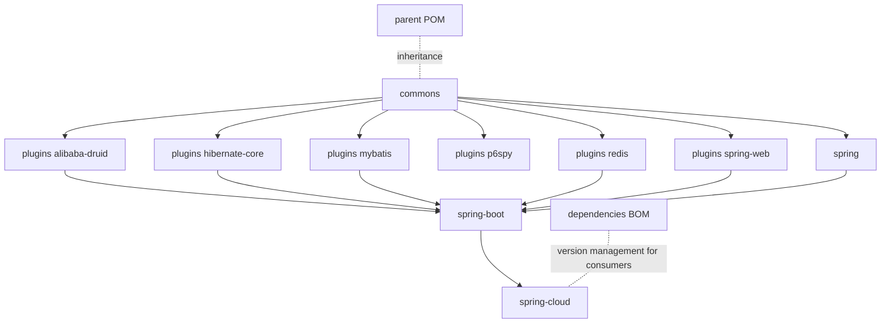

# Microsphere Alibaba Sentinel — Documentation

[中文版](zh/README.md)

This directory contains the complete documentation set for
[Microsphere Alibaba Sentinel](https://github.com/microsphere-projects/microsphere-alibaba-sentinel), an integration
layer between [Alibaba Sentinel](https://github.com/alibaba/Sentinel) and common Java infrastructure components
(Spring Web, Druid, Hibernate, MyBatis, P6Spy, Spring Data Redis).

Documentation is written exclusively against the two maintained release branches:

| Docs directory | Source branch | Artifact line | Target platform                              |
|----------------|---------------|---------------|----------------------------------------------|
| `current/`     | `release`     | `0.2.x`       | Java 17, Spring Boot 3.x, Spring Cloud 2022.0.x – 2025.0.x |
| `1.x/`         | `release-1.x` | `0.1.x`       | Java 8, Spring Boot 2.x, Spring Cloud Hoxton – 2021.0.x    |

## Documentation sets

| Set                                                | Audience       | Contents                                                                     |
|----------------------------------------------------|----------------|------------------------------------------------------------------------------|
| [User Guide](user-guide/README.md)                 | App developers | Per-module API reference, installation, configuration properties, code examples adapted from the project's own tests, version and compatibility information |
| [Developer Guide](developer-guide/README.md)       | Contributors / extension authors | Per-module architecture design, source analysis, design patterns, and Mermaid flow/sequence diagrams of the complex flows |

Each set contains one directory per release branch (`current` and `1.x`), and within each branch directory one
Markdown document per Maven module. Chinese translations live in parallel `zh/` directories with identical file names;
every page links to its counterpart.

## Module map

Every document exists in both guides, for both branches, in both languages.

| Maven module (`io.github.microsphere-projects`)      | Role                                                          |
|------------------------------------------------------|---------------------------------------------------------------|
| `microsphere-alibaba-sentinel-parent`                | Parent POM: version properties and third-party BOM imports    |
| `microsphere-alibaba-sentinel-dependencies`          | BOM managing all published project artifacts                  |
| `microsphere-alibaba-sentinel-commons`               | Core API: `SentinelPlugin`, `SentinelOperations`, `SentinelContext`, `SentinelTemplate`, plugin registry, SPI, JMX, events |
| `microsphere-alibaba-sentinel-plugins`               | Aggregator POM for the six Sentinel plugins                   |
| `microsphere-alibaba-sentinel-alibaba-druid`         | Druid filter plugin (JDBC statement protection)               |
| `microsphere-alibaba-sentinel-hibernate-core`        | Hibernate entity callback plugin                              |
| `microsphere-alibaba-sentinel-mybatis`               | MyBatis executor filter plugin                                |
| `microsphere-alibaba-sentinel-p6spy`                 | P6Spy JDBC event listener plugin                              |
| `microsphere-alibaba-sentinel-redis`                 | Spring Data Redis command interceptor plugin                  |
| `microsphere-alibaba-sentinel-spring-web`            | Spring Web MVC handler-method interceptor plugin              |
| `microsphere-alibaba-sentinel-spring`                | Dependency-aggregation module for plain Spring usage          |
| `microsphere-alibaba-sentinel-spring-boot`           | Spring Boot auto-configuration for the plugins and conditions |
| `microsphere-alibaba-sentinel-spring-cloud`          | Spring Cloud feature reporting on top of the Boot module      |

## Module dependencies

## Source diff comparisons

Module-by-module comparisons of the `src/main` and `src/test` content between tagged releases live in
[`diff/source/`](diff/source/). Java 8 ↔ Java 17 syntax/API differences and Java EE ↔ Jakarta EE API differences are
excluded, so each table lists only genuine implementation changes with their reasons.

| Release pair | `src/main` diff | `src/test` diff |
|---|---|---|
| `0.1.5` vs `0.2.5` (latest tags, Java 8 line vs Java 17 line) | [main-diff-0.1.5-vs-0.2.5.md](diff/source/main-diff-0.1.5-vs-0.2.5.md) · [中文](diff/source/main-diff-0.1.5-vs-0.2.5.zh.md) | [test-diff-0.1.5-vs-0.2.5.md](diff/source/test-diff-0.1.5-vs-0.2.5.md) · [中文](diff/source/test-diff-0.1.5-vs-0.2.5.zh.md) |

## Quick start by role

- New to the library → [User Guide, current branch](user-guide/current/README.md), starting with
  [commons](user-guide/current/microsphere-alibaba-sentinel-commons.md).
- Maintaining a legacy Java 8 / Spring Boot 2.x application → [User Guide, 1.x branch](user-guide/1.x/README.md).
- Reading or extending the source → [Developer Guide, current branch](developer-guide/current/README.md).
- Understanding the 0.1.x line internals → [Developer Guide, 1.x branch](developer-guide/1.x/README.md).

---

## 中文

[文档总目录（中文版）](zh/README.md) · [返回仓库根目录 README](../README.md)
