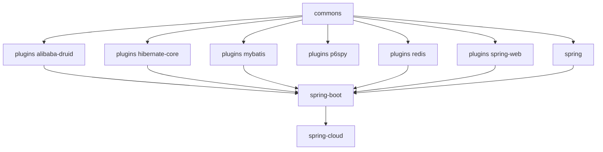

# Developer Guide — 1.x (release-1.x branch, 0.1.x)

[中文版](zh/README.md) · [Developer Guide home](../README.md)

These documents analyse the implementation of the `release-1.x` branch (`0.1.x` line), maintained for legacy
Java 8 / Spring Boot 2.x applications.

## Implementation baseline

| Item                  | Value                                                          |
|-----------------------|----------------------------------------------------------------|
| Source branch         | `release-1.x` (revision `0.1.6-SNAPSHOT`, releases `0.1.0` – `0.1.5`) |
| Language level        | Java 8                                                         |
| Framework generation  | Spring Boot 2.x / Spring Cloud Hoxton – 2021.0.x               |
| Sentinel              | `sentinel-core` 1.8.10                                         |
| Auto-config mechanism | `META-INF/spring.factories` (`EnableAutoConfiguration` key)    |
| Servlet namespace     | `javax.servlet`                                                |

## Reading order

1. [commons](microsphere-alibaba-sentinel-commons.md) — architectural core: plugin lifecycle, `SentinelOperations`
   begin/end protocol, `ThreadLocal` `SentinelContext`, SPI loading, slot-callback instrumentation, JMX and node events.
2. [plugins](microsphere-alibaba-sentinel-plugins.md) — how a plugin attaches to a host framework.
3. One plugin document per integration:
   [alibaba-druid](microsphere-alibaba-sentinel-alibaba-druid.md) ·
   [hibernate-core](microsphere-alibaba-sentinel-hibernate-core.md) ·
   [mybatis](microsphere-alibaba-sentinel-mybatis.md) ·
   [p6spy](microsphere-alibaba-sentinel-p6spy.md) ·
   [redis](microsphere-alibaba-sentinel-redis.md) ·
   [spring-web](microsphere-alibaba-sentinel-spring-web.md)
4. Spring layer: [spring](microsphere-alibaba-sentinel-spring.md) ·
   [spring-boot](microsphere-alibaba-sentinel-spring-boot.md) ·
   [spring-cloud](microsphere-alibaba-sentinel-spring-cloud.md)
5. Build layer: [parent](microsphere-alibaba-sentinel-parent.md) ·
   [dependencies](microsphere-alibaba-sentinel-dependencies.md)

## Module dependencies

## Differences from the `0.2.x` implementation

The production sources are, with minor exceptions, the same files as on the `release` branch. The implementation
differences are all in the build/registration layer:

- Auto-configuration registration uses `spring.factories` instead of Boot 3 `AutoConfiguration.imports` (the Boot 3
  file is present only in the `spring-cloud` module).
- POM baselines pin the javax Servlet API and the legacy `org.hibernate` coordinates.
- Companion microsphere BOMs and fastjson versions are one minor line lower; some tests differ (e.g.
  `SimpleSentinelPluginTest`, web/hibernate assertions).

## Diagrammed flows you will find

- Plugin install / uninstall lifecycle including the JVM shutdown-hook uninstall
- `begin` → `ContextUtil.enter` → `SphU.entry` → callback → `Tracer.traceEntry` → `end` → `exit`, with the
  `BlockException` branch
- SPI discovery: `SentinelPluginRepository` ServiceLoader and the Sentinel `InitFunc`
- Spring Boot 2.x auto-configuration condition evaluation (`@ConditionalOnSentinelAvailable`, `@ConditionalOnSentinelEnabled`)
- Per-plugin interception flows

## Companion set

Usage-oriented documentation for the same branch lives in the
[User Guide for the 1.x branch](../../user-guide/1.x/README.md). Current-line developers should read the
[0.2.x Developer Guide](../current/README.md) instead.

---

## 中文

[1.x 版本开发者指南（中文版）](zh/README.md)
