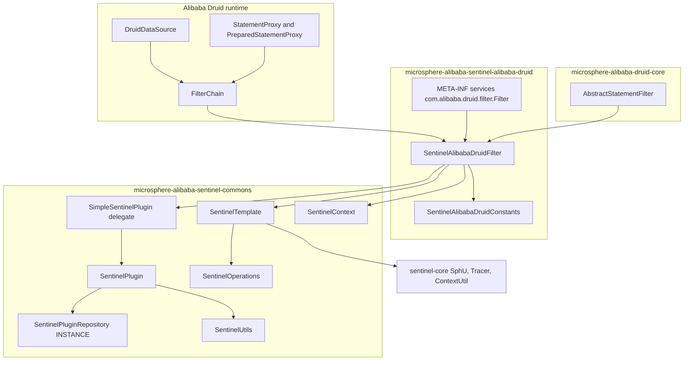
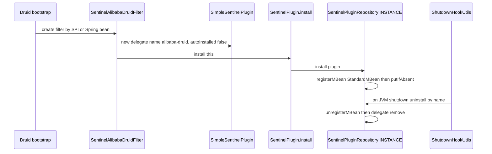
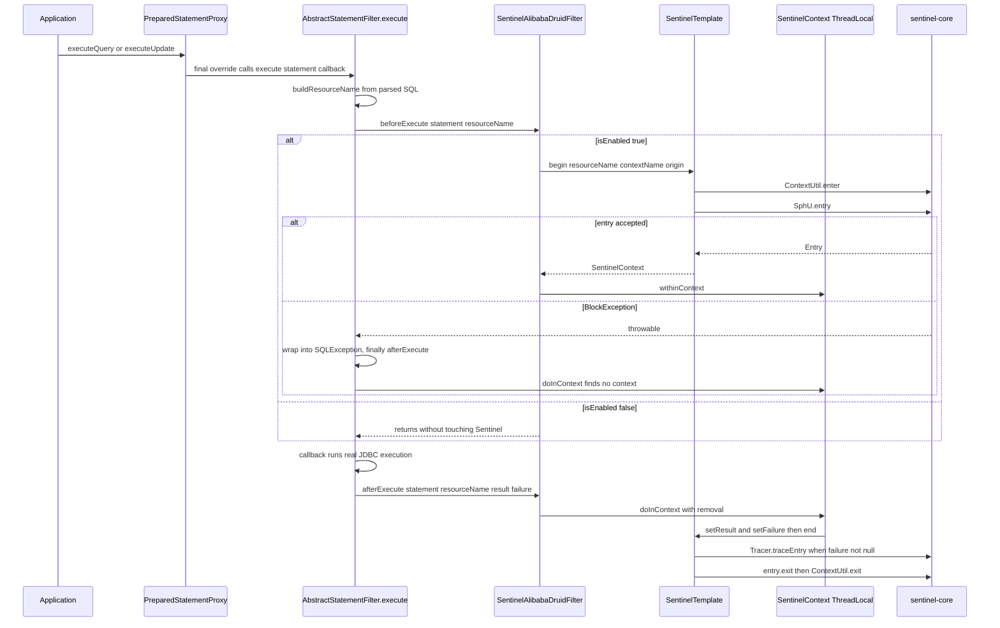
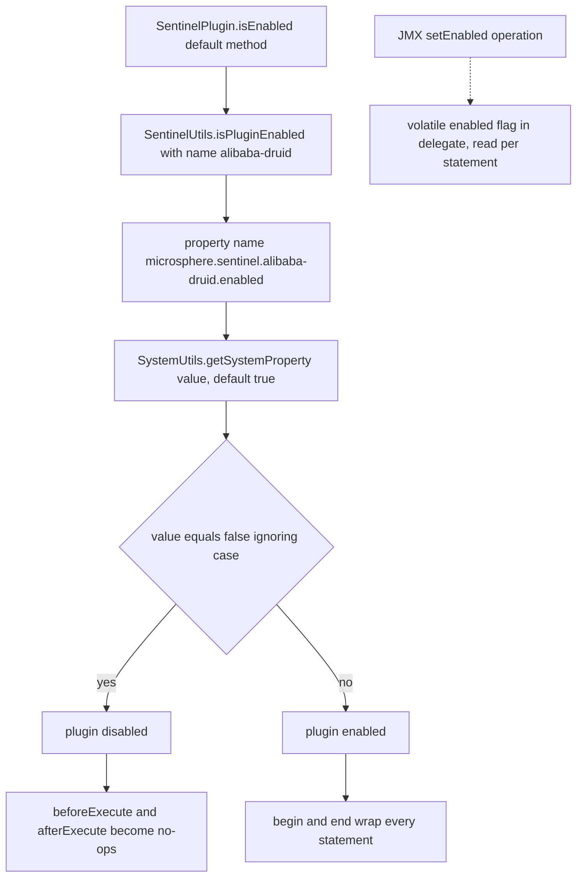
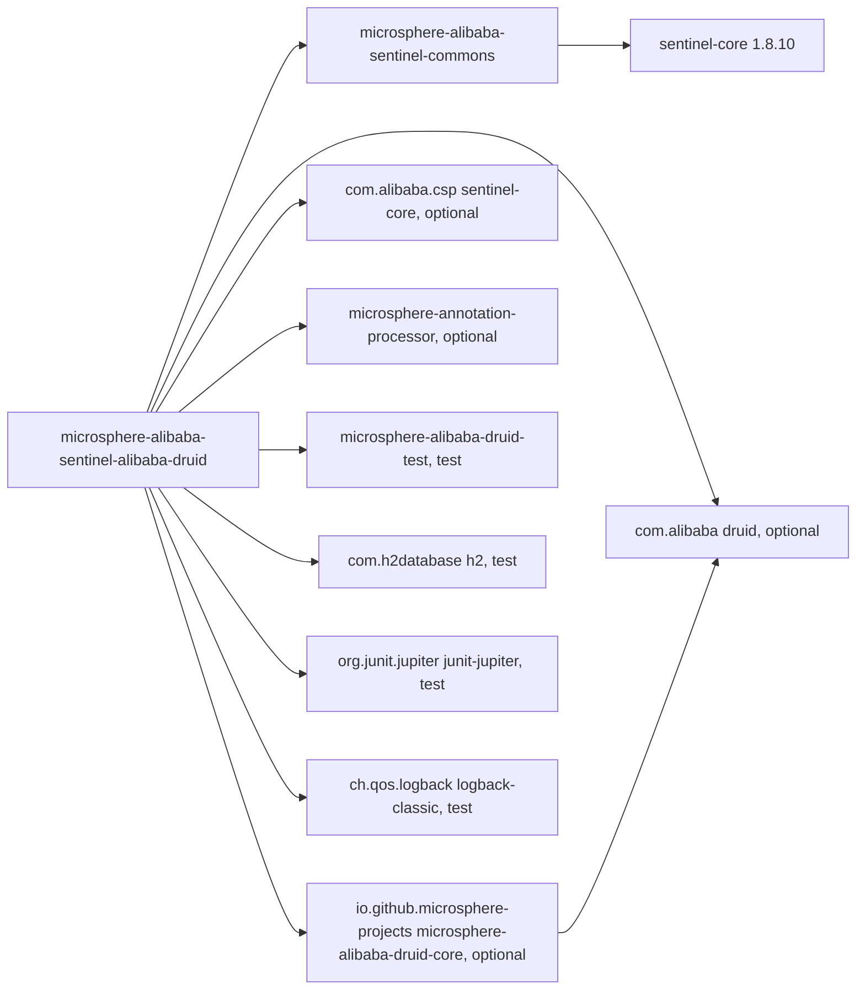

# microsphere-alibaba-sentinel-alibaba-druid — Developer Guide

[中文版](zh/microsphere-alibaba-sentinel-alibaba-druid.md)

> **Archived `1.x` line.** This page documents the internal design of the `0.1.x` artifacts (branch `release-1.x`, Java 8, Spring Boot 2.x, Spring Cloud Hoxton - 2021.0.x). The source tree is identical to the current line; only the POM baselines differ (javax Servlet API, `org.hibernate:hibernate-core`, `META-INF/spring.factories` auto-configuration registration). The current-line equivalent of this page is [../current/microsphere-alibaba-sentinel-alibaba-druid.md](../current/microsphere-alibaba-sentinel-alibaba-druid.md).

## Purpose and Scope

`microsphere-alibaba-sentinel-alibaba-druid` (directory
`microsphere-alibaba-sentinel-plugins/microsphere-alibaba-sentinel-alibaba-druid`) guards JDBC
statement execution on Alibaba Druid with Alibaba Sentinel. It contributes a single production class,
`SentinelAlibabaDruidFilter`, plus a constants interface, and it registers the filter through the
Druid SPI file `src/main/resources/META-INF/services/com.alibaba.druid.filter.Filter`.

Two source layers are involved. The intercepting skeleton — Druid `FilterAdapter` callbacks, SQL
parsing, resource naming — comes from `microsphere-alibaba-druid-core` 0.1.20 via
`io.microsphere.alibaba.druid.filter.AbstractStatementFilter`. The Sentinel semantics — `begin` /
`end`, entry bookkeeping, failure tracing, plugin registration — come from
`microsphere-alibaba-sentinel-commons`. This document explains where those two meet, which is the
part that matters when you change the module.

Version context: `0.1.x` line (`0.1.0`–`0.1.5` released, `revision` = `0.1.6-SNAPSHOT`), Java 8,
`sentinel-core` 1.8.10, Spring Boot 2.x / Spring Cloud Hoxton-2021 for the auto-configuration path.
User-facing setup lives in
[the user guide](../../user-guide/1.x/microsphere-alibaba-sentinel-alibaba-druid.md).

## Architecture



## Source Analysis

### SentinelAlibabaDruidConstants

Four constants, all pinned by `SentinelAlibabaDruidConstantsTest`:

```java
String PLUGIN_NAME = "alibaba-druid";
String DEFAULT_CONTEXT_NAME = "microsphere_sentinel_alibaba_druid_context";
String DEFAULT_ORIGIN = "Filter";
String ENABLED_PROPERTY_NAME = PROPERTY_NAME_PREFIX + PLUGIN_NAME + DOT + PropertyConstants.ENABLED_PROPERTY_NAME;
```

`ENABLED_PROPERTY_NAME` therefore equals `microsphere.sentinel.alibaba-druid.enabled` and is
asserted to be identical to `SentinelUtils.getPluginEnabledPropertyName(PLUGIN_NAME)`; it is
annotated `@ConfigurationProperty(type = boolean.class, defaultValue = "true", source =
SYSTEM_PROPERTIES_SOURCE)`, matching the fact that `SentinelUtils.isPluginEnabled` resolves the flag
from JVM system properties only. Note that `DEFAULT_CONTEXT_NAME` is written with underscores while
`SentinelUtils.getDefaultContextName(PLUGIN_NAME)` would produce
`microsphere_sentinel_alibaba-druid_context` from the hyphenated plugin name; the filter always uses
the explicit constant, so the context name is the underscore form.

### SentinelAlibabaDruidFilter

```java
public class SentinelAlibabaDruidFilter extends AbstractStatementFilter implements SentinelPlugin
```

It cannot extend `AbstractSentinelPlugin` because `AbstractStatementFilter` already occupies the
superclass slot, so identity lives in a delegate:

```java
public SentinelAlibabaDruidFilter(String contextName, String origin) {
    this.delegate = new SimpleSentinelPlugin(PLUGIN_NAME, contextName, origin, COMMON_DB_SQL, IN, false);
    this.sentinelOperations = new SentinelTemplate(getResourceType(), getTrafficType());
    install(this);
}
```

Three details are load-bearing:

1. `autoInstalled = false` on the delegate prevents `SimpleSentinelPlugin` from registering itself;
   `SentinelPlugin.install(this)` registers the *filter*, which is what JMX clients and
   `SentinelPluginRepository.get("alibaba-druid")` see, and which also adds the shutdown-hook
   callback that uninstalls it.
2. `SentinelTemplate` is built from `getResourceType()`/`getTrafficType()` — the values come from the
   delegate: `ResourceTypeConstants.COMMON_DB_SQL` and `EntryType.IN`. One filter instance therefore
   reports all SQL traffic under a single Sentinel resource type.
3. `install` is the static `SentinelPlugin.install`, imported on purpose; the no-arg constructor
   `SentinelAlibabaDruidFilter()` chains to `(DEFAULT_CONTEXT_NAME, DEFAULT_ORIGIN)`.

All eight `SentinelPlugin` members are one-line delegations: `isAutoInstalled`, `isEnabled`,
`setEnabled`, `getName`, `getContextName`, `getOrigin`, `getResourceType`, `getTrafficType`. The
class holds no mutable state of its own beyond the delegate's `volatile enabled` flag.

The two hook implementations are the Template Method contract:

```java
@Override
protected void beforeExecute(StatementProxy statement, String resourceName) throws Throwable {
    if (isEnabled()) {
        SentinelContext context = this.sentinelOperations.begin(resourceName, getContextName(), getOrigin());
        context.withinContext();
    }
}

@Override
protected void afterExecute(StatementProxy statement, String resourceName, Object result, Throwable failure) {
    if (isEnabled()) {
        doInContext(context -> {
            context.setResult(result);
            context.setFailure(failure);
            this.sentinelOperations.end(context);
        }, true);
    }
}
```

`beforeExecute` declares `throws Throwable`, which lets `begin` propagate `BlockException` upward.
`afterExecute` is the unconditionally-called `finally` phase, so it must tolerate "no context bound".
`SentinelContext.doInContext(consumer, true)` removes the ThreadLocal binding *before* running the
consumer, which both releases the slot for the next statement on the same pooled thread and prevents
re-entrant consumption.

### Inherited behaviour from AbstractStatementFilter (microsphere-alibaba-druid-core 0.1.20)

`AbstractStatementFilter extends FilterAdapter` and is where the actual Druid integration lives;
the Sentinel module only fills in the two abstract hooks.

- `public final void init(DataSourceProxy dataSource)` caches the proxy and, when it is a
  `DruidDataSource`, its `validationSQL`. It is `final`, so a Sentinel filter cannot override
  initialisation.
- Every statement entry point is overridden `final`:
  `preparedStatement_execute`, `preparedStatement_executeQuery`, `preparedStatement_executeUpdate`,
  `statement_executeQuery`, the four `statement_execute` overloads, `statement_executeBatch` and the
  four `statement_executeUpdate` overloads. Each funnels into
  `protected <T> T execute(StatementProxy statement, ThrowableSupplier<T> callback) throws SQLException`.
- That template method resolves the resource name, calls `beforeExecute`, runs the callback,
  captures any `Throwable` into `failure`, rethrows it as
  `wrap(e, SQLException.class)`, and always calls
  `afterExecute(statement, resourceName, result, failure)` in the `finally`.
- Consequence worth remembering when debugging: because `beforeExecute` runs inside that `try`, a
  Sentinel `BlockException` is wrapped into a `java.sql.SQLException` before it reaches application
  code. Applications see a SQL failure, not a FlowException type.
- `protected String buildResourceName(StatementProxy statement)` takes
  `statement.getLastExecuteSql()`; if it equals the data source validation query the raw SQL is used
  as the resource name, otherwise the SQL is parsed with `SQLUtils.parseStatements(sql, dataSource.getDbType())`
  and the first `SQLStatement` is dispatched to type-specific builders producing table-level names
  `SELECT <table>`, `UPDATE <table>`, `INSERT <table>`, `DELETE <table>` (via `computeAlias()`), with
  the literal `"UNRECOGNIZED"` fallback when parsing fails or the statement type is unsupported.
  Resource granularity is therefore per verb and per table, not per statement text.

Because all `execute` paths run on the calling JDBC thread, and both hooks exchange state through
`SentinelContext`'s `ThreadLocal`, a single filter instance shared by a pool of connections remains
correct. The one asymmetry to keep in mind: if `setEnabled(false)` happens between `beforeExecute`
and `afterExecute`, the `afterExecute` guard skips `end`, so the entry is not exited and the
ThreadLocal binding survives until the next `doInContext(..., true)` on that thread. Toggling the
flag at runtime is intended for quiescent moments.

## Design Patterns

| Pattern | Implementing classes | Note |
| --- | --- | --- |
| Template Method | `AbstractStatementFilter.execute` with `beforeExecute`/`afterExecute` implemented by `SentinelAlibabaDruidFilter` | fixed skeleton in the external core module |
| Adapter | `SentinelAlibabaDruidFilter` over `com.alibaba.druid.filter.FilterAdapter` | JDBC callback surface → Sentinel entries |
| Delegation | `SentinelAlibabaDruidFilter` holds `private final SentinelPlugin delegate` (`SimpleSentinelPlugin`) | identity and enabled flag owned by the delegate |
| Facade | `SentinelTemplate` implementing `SentinelOperations` | hides `SphU.entry`, `Tracer.traceEntry`, `ContextUtil.enter`/`exit` |
| Registry / Singleton | `SentinelPlugin.install(this)` → `SentinelPluginRepository.INSTANCE` | JMX-visible `io.microsphere.sentinel:type=SentinelPlugin,name=alibaba-druid` |
| SPI | `META-INF/services/com.alibaba.druid.filter.Filter` | provider line is the fully qualified filter class |
| Command | `ThrowableSupplier<T>` wrapping `super.preparedStatement_execute(...)` | the deferred business call |
| Marker | `SentinelAlibabaDruidConstants` as an interface of constants | no instances |

## Core Flows

### Plugin install lifecycle for the Druid filter



### Druid filter chain and Sentinel entry per statement



### Enabled resolution



The constructor snapshots the property once; after that the `volatile` field is the single source of
truth, mutated only by `setEnabled`.

## Dependencies



| Dependency | Scope | Role |
| --- | --- | --- |
| `io.github.microsphere-projects:microsphere-alibaba-sentinel-commons` | compile | `SentinelPlugin`, `SimpleSentinelPlugin`, `SentinelTemplate`, `SentinelContext`, `SentinelUtils` |
| `io.github.microsphere-projects:microsphere-alibaba-druid-core` | compile, `optional` | `AbstractStatementFilter` with Druid `FilterAdapter`, SQL parsing and resource naming |
| `com.alibaba.csp:sentinel-core` (1.8.10) | compile, `optional` | `ResourceTypeConstants.COMMON_DB_SQL`, `EntryType.IN`, `Entry` |
| `com.alibaba:druid` | compile, `optional` | `Filter`, `FilterChain`, `StatementProxy`, `PreparedStatementProxy` |
| `io.github.microsphere-projects:microsphere-annotation-processor` | compile, `optional` | metadata generation for `@ConfigurationProperty` |
| `org.junit.jupiter:junit-jupiter` | test | test engine |
| `io.github.microsphere-projects:microsphere-alibaba-druid-test` | test | `AbstractAlibabaDruidTest` harness with a real `DruidDataSource` |
| `com.h2database:h2` | test | in-memory database used by the filter tests |
| `ch.qos.logback:logback-classic` | test | logging backend for `io.microsphere.logging` |

`druid`, `microsphere-alibaba-druid-core` and `sentinel-core` are `optional` on purpose: the module
must not pin a Druid or Sentinel version for consumers, and Spring Boot users bring them via the
`sentinel-core`/Druid starters. Versions are managed by `microsphere-alibaba-sentinel-parent`
(`microsphere-alibaba-druid.version` 0.1.20, `sentinel.version` 1.8.10).

Tests: `SentinelAlibabaDruidFilterTest` extends `AbstractAlibabaDruidTest`, registers the filter with
`dataSource.getProxyFilters().add(filter)` in `customize(DruidDataSource)`, calls
`SentinelUtils.resetContextMap()` before each test, and drives both `testEnable` and `testDisable`
after flipping `setEnabled`, asserting afterwards that `ContextUtil.enter(filter.getContextName(),
filter.getOrigin())` yields the context named `microsphere_sentinel_alibaba_druid_context`.

## Extension Points

- **Custom resource naming.** `SentinelAlibabaDruidFilter` inherits `buildResourceName(...)` from
  `AbstractStatementFilter`. Subclass the filter and override
  `protected String buildResourceName(StatementProxy statement)` to key rules by full SQL text, by
  schema, or by caller trace instead of the default `VERB table` granularity. Keep names stable —
  they are the keys of Sentinel flow rules and metrics.
- **Custom context or origin.** Use the two-argument constructor
  `SentinelAlibabaDruidFilter(String contextName, String origin)`; the Spring Boot auto-configuration
  declares the no-arg bean behind `@ConditionalOnMissingBean`, so declaring your own bean replaces it.
- **Different traffic type or resource type.** The delegate is built with `COMMON_DB_SQL` and `IN`;
  to change either, construct your own `SimpleSentinelPlugin` (or extend the filter and expose
  overridable identity) and build the `SentinelTemplate` from it.
- **Programmatic installation of several filters.** Each instance registers under the same plugin
  name `alibaba-druid`, so a second `install` returns `false` from
  `SentinelPluginRepository.install` and logs a duplicate warning; give multi-datasource setups a
  shared filter instance instead of duplicates.
- **Runtime toggling.** `setEnabled` is an MBean operation on
  `io.microsphere.sentinel:type=SentinelPlugin,name=alibaba-druid`; `isInstalled`/`get`/`uninstall`
  are available through the same `JMXSentinelPluginRepository`.
- **Disabling without code.** `-Dmicrosphere.sentinel.alibaba-druid.enabled=false` before Sentinel or
  Druid classes are initialised, plus the module-level
  `microsphere.sentinel.enabled` gate handled by `@ConditionalOnSentinelEnabled` in
  `microsphere-alibaba-sentinel-spring-boot`.

## Related Modules

- Index: [developer guide README](./README.md)
- Core abstractions: [microsphere-alibaba-sentinel-commons](./microsphere-alibaba-sentinel-commons.md)
- Sibling plugins: [microsphere-alibaba-sentinel-mybatis](./microsphere-alibaba-sentinel-mybatis.md),
  [plugins overview](./microsphere-alibaba-sentinel-plugins.md)
- Auto-configuration: `microsphere-alibaba-sentinel-spring-boot` —
  `SentinelAlibabaDruidAutoConfiguration` is conditional on
  `io.microsphere.alibaba.druid.spring.boot.condition.ConditionalOnAlibabaDruidAvailable` and on
  `io.microsphere.alibaba.sentinel.alibaba.druid.SentinelAlibabaDruidFilter` being present, runs after
  `com.alibaba.cloud.sentinel.custom.SentinelAutoConfiguration` and
  `io.microsphere.alibaba.druid.spring.boot.autoconfigure.AlibabaDruidAutoConfiguration`, and defines
  the filter bean with `@ConditionalOnMissingBean`
- User guide counterpart: [user guide](../../user-guide/1.x/microsphere-alibaba-sentinel-alibaba-druid.md)
- Source: `microsphere-alibaba-sentinel-plugins/microsphere-alibaba-sentinel-alibaba-druid/src/{main,test}/java`
  and `src/main/resources/META-INF/services/com.alibaba.druid.filter.Filter`

---

## 中文

[中文版](zh/microsphere-alibaba-sentinel-alibaba-druid.md)
