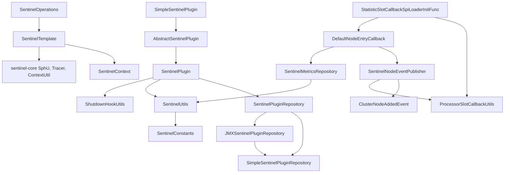
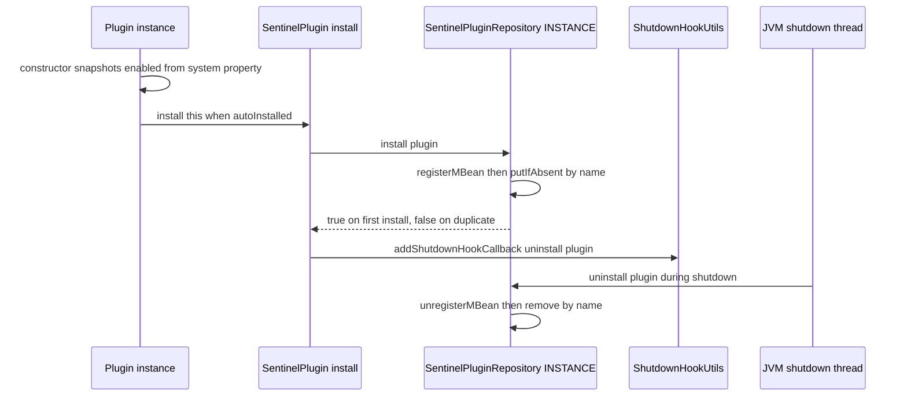
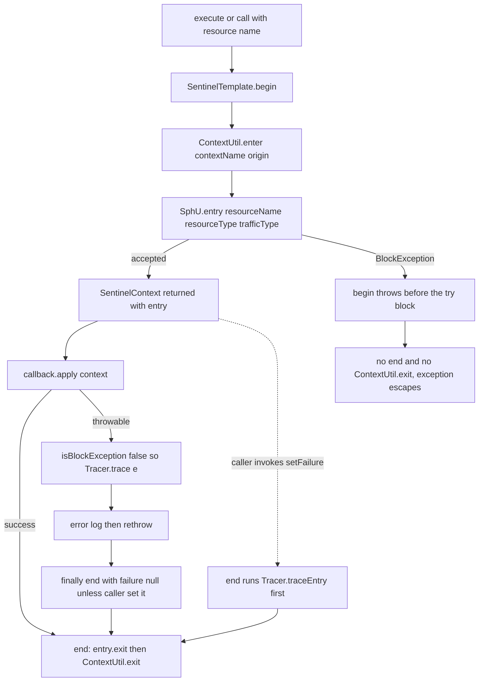
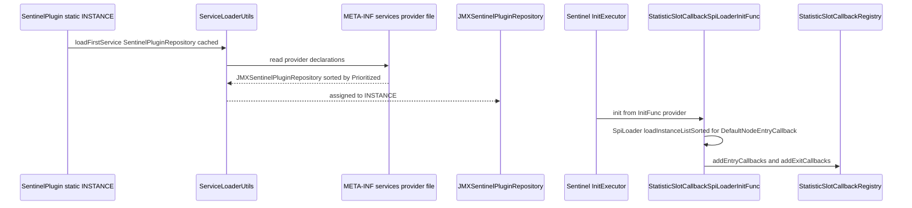
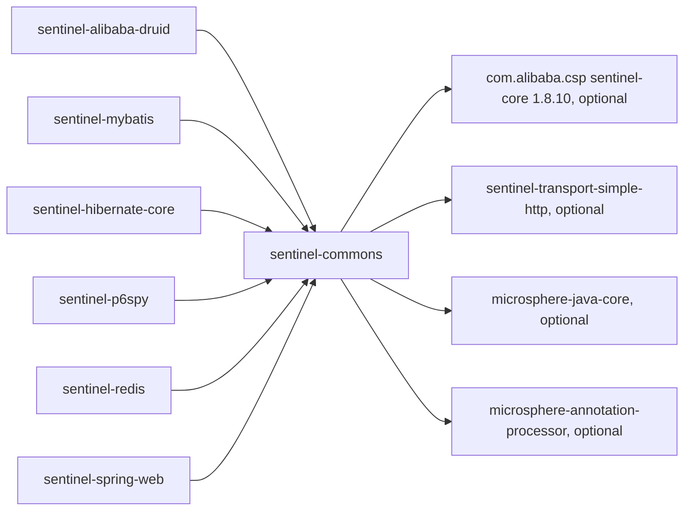

# microsphere-alibaba-sentinel-commons — Developer Guide

[中文版](zh/microsphere-alibaba-sentinel-commons.md)

> **Archived `1.x` line.** This page documents the internal design of the `0.1.x` artifacts (branch `release-1.x`, Java 8, Spring Boot 2.x, Spring Cloud Hoxton - 2021.0.x). The source tree is identical to the current line; only the POM baselines differ (javax Servlet API, `org.hibernate:hibernate-core`, `META-INF/spring.factories` auto-configuration registration). The current-line equivalent of this page is [../current/microsphere-alibaba-sentinel-commons.md](../current/microsphere-alibaba-sentinel-commons.md).

## Purpose and Scope

`microsphere-alibaba-sentinel-commons` is the architectural core of the library: the plugin abstraction
`SentinelPlugin` and its registry `SentinelPluginRepository`, the guarding API (`SentinelOperations`,
`SentinelTemplate`, `SentinelContext`), the Sentinel slot-chain hooks (`DefaultNodeEntryCallback`,
`ProcessorSlotCallbackUtils`, `StatisticSlotCallbackSpiLoaderInitFunc`), the node/metric read models
(`SentinelNodeEventPublisher`, `SentinelMetricsRepository`) and shared support (`SentinelUtils`,
`SentinelConstants`). Every integration module — Druid, MyBatis, Hibernate, P6Spy, Redis, Spring Web —
is a thin plugin on top of it. This guide targets developers changing internals, not end users.

Version context: the `release-1.x` branch is the `0.1.x` line (`0.1.0`–`0.1.5` released; root `pom.xml`
`revision` = `0.1.6-SNAPSHOT`), Java 8, `sentinel-core` 1.8.10, Spring Boot 2.x with Spring Cloud
Hoxton-2021 for consumers. Extended version tables live in
[the user guide](../../user-guide/1.x/microsphere-alibaba-sentinel-commons.md). Paths are relative to
`microsphere-alibaba-sentinel-commons/src/{main,test}`.

## Architecture

## Source Analysis

### SentinelPlugin (`common/SentinelPlugin.java`)

Abstract members: `boolean isAutoInstalled()`, `void setEnabled(boolean)`, `@Nonnull String getName()`, `@Nonnull String getOrigin()`,
`int getResourceType()` (a `ResourceTypeConstants` value), `@Nonnull EntryType getTrafficType()`. Default members: `isEnabled()` →
`isPluginEnabled(getName())` and `getContextName()` → `getDefaultContextName(getName())`. The lifecycle entry point is
`static void install(SentinelPlugin plugin) throws NullPointerException`, whose body is `SentinelPluginRepository repository = INSTANCE; repository.install(plugin);`
then `addShutdownHookCallback(() -> repository.uninstall(plugin))`. That helper is `io.microsphere.util.ShutdownHookUtils.addShutdownHookCallback(Runnable)`,
which queues the lambda into a `PriorityBlockingQueue<Runnable>` drained by one registered JVM shutdown-hook thread, so uninstall always runs.
Installing the same plugin twice registers two hook callbacks while the second `repository.install` returns `false`.

### SentinelPluginRepository (`common/SentinelPluginRepository.java`)

SPI interface with a ServiceLoader-resolved singleton: `SentinelPluginRepository INSTANCE = loadFirstService(SentinelPluginRepository.class, true)`.
`ServiceLoaderUtils.loadFirstService(Class, boolean cached)` wraps `java.util.ServiceLoader`, sorts providers implementing `io.microsphere.lang.Prioritized`,
and throws `IllegalArgumentException` when none is declared. `src/main/resources/META-INF/services/io.microsphere.alibaba.sentinel.common.SentinelPluginRepository`
names `io.microsphere.alibaba.sentinel.jmx.JMXSentinelPluginRepository`, so `INSTANCE` is JMX-backed by default and overridable by a downstream provider.
Contract: `boolean install(SentinelPlugin) throws NullPointerException` (`true` only on first registration), `boolean isInstalled(String)`,
`@Nullable SentinelPlugin get(String)`, `@Nonnull Collection<SentinelPlugin> getAll()`, `default boolean uninstall(SentinelPlugin)` → `uninstall(plugin.getName())`,
`boolean uninstall(String) throws NullPointerException`, `void clear()`. Keying is by plugin name only; the resource-to-context and resource-to-node maps
live in `SentinelMetricsRepository` and `SentinelNodeEventPublisher`.

### Registries: Simple and JMX

`SimpleSentinelPluginRepository` holds a `ConcurrentHashMap<String, SentinelPlugin>` created with capacity 8: `install` is `putIfAbsent(name, plugin) == null`,
duplicates log `logger.warn("{} with name ['{}'] already exists", plugin)` (two placeholders, one argument, so the second prints literally), `uninstall` is
`remove(name) != null`, `getAll()` returns the live `values()` view, and a `null` plugin or name surfaces as `NullPointerException` from `plugin.getName()` or
`ConcurrentHashMap.remove`. `JMXSentinelPluginRepository` decorates a private `SimpleSentinelPluginRepository delegate`, `implements SentinelPluginRepository, Prioritized`
with `getPriority() == DEFAULT_PRIORITY` (9), and declares `JMX_DOMAIN = "io.microsphere.sentinel"` plus `OBJECT_NAME_PATTERN = JMX_DOMAIN + ":type=SentinelPlugin,name={}"`.
`install` registers `new StandardMBean(plugin, SentinelPlugin.class)` under the formatted `ObjectName` before delegating — using `SentinelPlugin` as the management
interface turns its getters into MBean attributes and `setEnabled(boolean)` into an operation. All calls go through
`doInMBeanServer(String, ThrowableBiFunction<MBeanServer, ObjectName, R>)`, which resolves `getPlatformMBeanServer()` and runs the body inside `synchronized (delegate)`
within `ThrowableSupplier.execute(...)`, so a failed registration never mutates the delegate. `get(name)` self-heals (calls `delegate.uninstall(name)` and returns `null`
once the MBean vanished), `uninstall(String)` rejects `null` explicitly, and `clear()` calls `getAll(true)`, which queries `name=*` and uninstalls each hit.
`SentinelPluginRepositoryTest` is the shared contract test; the `Simple…` and `JMX…` tests only override `createSentinelPluginRepository()`.

### SentinelOperations (`common/SentinelOperations.java`)

The six `execute(...)` overloads (`Runnable`, `Consumer<SentinelContext>`, `Function<SentinelContext,R>`, each with and without `contextName`/`origin`) and the
`call(...)` overloads over `ThrowableAction`, `ThrowableConsumer<SentinelContext>` and `ThrowableFunction<SentinelContext,R>` all funnel into
`<R> R call(String, String, String, ThrowableFunction<SentinelContext,R>) throws Throwable`: `begin(...)` runs **outside** the `try`, `callback.apply(context)`
inside, the `catch (Throwable e)` calls `Tracer.trace(e)` only when `!isBlockException(e)`, logs at error level and rethrows, and `finally { end(context); }`
always runs. Only
`@Nonnull SentinelContext begin(@Nonnull String resourceName, @Nullable String contextName, @Nullable String origin) throws Exception` and
`void end(SentinelContext context)` are abstract. The `execute` family delegates to `call(..., RuntimeException.class)`, converting checked exceptions with
`ExceptionUtils.throwTarget`. Because the `catch` reports through `Tracer.trace` and never calls `context.setFailure`, two-phase callers must set the failure
themselves for `Tracer.traceEntry` to fire — and must not add their own `Tracer.trace`, or errors are counted twice.

### SentinelTemplate (`common/SentinelTemplate.java`)

The only implementation, a facade over `SphU`, `Tracer`, `ContextUtil` with immutable `resourceType` and `trafficType` from `SentinelTemplate()`,
`SentinelTemplate(int)`, `SentinelTemplate(int, EntryType)` (defaults `COMMON`, `IN`). `begin` substitutes `SentinelConstants.DEFAULT_CONTEXT_NAME`/`DEFAULT_ORIGIN`
when an argument `isBlank`, then `ContextUtil.enter(context, origin)`, then `SphU.entry(resourceName, resourceType, trafficType)`, and returns
`new SentinelContext(resourceName, actualContextName, actualOrigin, entry)`. `end` reads `context.getEntry()` and `context.getFailure()`, calls
`Tracer.traceEntry(failure, entry)` when the failure is non-null, then `entry.exit()` and `ContextUtil.exit()` — the order matters because `traceEntry` needs a
live entry. Logging uses `io.microsphere.logging.Logger` guarded by `isTraceEnabled()`.

### SentinelContext (`common/SentinelContext.java`)

Per-invocation holder with `private static final ThreadLocal<SentinelContext> contextHolder`, `final` `resourceName`, `contextName`, `origin`, `entry`, plus
mutable `result`, `failure` and a lazily created `Map<String,Object> attributes`. The `protected` constructor validates with `assertNotEmpty`/`assertNotNull`, so
blank names or a `null` entry throw `IllegalArgumentException` (`SentinelContextTest`). Fluent members `setResult`, `setFailure`, `setAttribute`,
`removeAttributes` and `withinContext()` return `this`; readers are `getResult`, `getFailure`, `getAttribute(name)`, `getAttribute(name, default)`, `hasAttribute`,
`removeAttribute` and `getAttributes()` (which returns `emptyMap()` or `unmodifiableMap(...)`). Statics: `getContext()`, `setContext(@Nullable)` (`null` clears),
`removeContext()`, `doInContext(Consumer)` and `doInContext(Consumer, boolean forRemoval)` — with `forRemoval = true` the binding is released *before* the consumer
runs, which is how two-phase plugins avoid self-consumption. Thread-safety: attributes use a plain `HashMap`, so a context is single-thread-owned; only
`contextHolder` separates threads, and nothing unbinds for you, so `withinContext()` must be paired with `doInContext(..., true)`.

### AbstractSentinelPlugin and SimpleSentinelPlugin

`AbstractSentinelPlugin` telescopes four constructors into `(String name, String contextName, String origin, int resourceType, EntryType trafficType, boolean autoInstalled)`
with progressive defaults `COMMON`, `IN`, `autoInstalled = true`. The terminal constructor assigns the `final` fields, snapshots
`this.enabled = SentinelPlugin.super.isEnabled()` (the system property is read once; later changes require `setEnabled`) and calls `install(this)` when
`autoInstalled`, so construction alone registers the plugin and schedules its uninstall. `enabled` is `volatile` because JMX threads write it while request threads
read it; `enable()`/`disable()` wrap `setEnabled`; `toString()` labels the flag `autoRegisterMBean=` although the field is `autoInstalled` (legacy output).
`SimpleSentinelPlugin` exposes all constructor shapes and adds no behaviour: it serves tests and plugins whose superclass is already occupied.

### SentinelConstants (`common/constants/SentinelConstants.java`)

`FLOW_DATA_ID_PATTERN = "{}-flow-rules"`, `DEFAULT_CONTEXT_NAME_PATTERN = "microsphere_sentinel_{}_context"`,
`DEFAULT_CONTEXT_NAME = "microsphere_sentinel_default_context"`, `DEFAULT_ORIGIN = ""`, `PROPERTY_NAME_PREFIX = "microsphere.sentinel."`,
`ENABLED_PROPERTY_VALUE = "true"`, `ENABLED_PROPERTY_NAME = PROPERTY_NAME_PREFIX + PropertyConstants.ENABLED_PROPERTY_NAME`,
`SENTINEL_CONTEXT_ATTRIBUTE_NAME = "sentinel-context"`, `DEFAULT_PRIORITY = 9` — all pinned by `SentinelConstantsTest`. `microsphere.sentinel.enabled` is *not*
consulted inside commons, only the per-plugin key; the global property is consumed by `@ConditionalOnSentinelEnabled` (`matchIfMissing = true`) in
`microsphere-alibaba-sentinel-spring-boot`.

### SentinelUtils (`common/util/SentinelUtils.java`)

Abstract utility with a private constructor. `resourceTypeToLabelMapping` is built at class load by reflecting over the `ResourceTypeConstants` static fields, and
`getResourceTypeAsString(int)` falls back to `"UNKNOWN"`. `getDefaultContextName(pluginName)` formats the context pattern;
`getPluginEnabledPropertyName(pluginName)` yields `microsphere.sentinel.<plugin>.enabled`; `isPluginEnabled(pluginName)` reads it through
`SystemUtils.getSystemProperty(name, "true")` and treats only a case-insensitive `"false"` as disabled — resolution is JVM system properties, not a Spring
`Environment`. `buildResourceName(Method)` yields `SimpleClass.method(ParamA,ParamB)`, pinned by `SentinelUtilsTest` as `SentinelUtils.buildResourceName(Method)`.
`resetContextMap()` invokes `findStatic(ContextUtil.class, "resetContextMap")` with `invokeExact()` and is registered as a shutdown-hook callback in the static
block, which also calls `shutdownOnExit(sentinelMetricsTaskExecutor)` while that `volatile` field is still `null`.
`findSentinelMetricsTaskExecutor()` reads `FlowRuleManager.SCHEDULER` reflectively; `getSentinelMetricsTaskExecutor()` caches into a `volatile` field with a
non-atomic check-then-act (benign: both writers resolve the same value), else creates a daemon scheduler named `sentinel-metrics-task`. `getMetricSearcher()` uses
correct double-checked locking under `synchronized (SentinelUtils.class)`, and `newMetricSearcher()` combines `SentinelConfig.getAppName()`, `PidUtil.getPid()`,
`MetricWriter.METRIC_BASE_DIR` and `formMetricFileName`.

### Callback plumbing: DefaultNodeEntryCallback, ProcessorSlotCallbackUtils, InitFunc

`common/callback/DefaultNodeEntryCallback.java` is a marker `interface DefaultNodeEntryCallback extends ProcessorSlotEntryCallback<DefaultNode>`.
`common/util/ProcessorSlotCallbackUtils.java` (abstract, private constructor, `implements Utils`) wraps `StatisticSlotCallbackRegistry`: varargs and `Iterable`
`addEntryCallbacks`/`addExitCallbacks`, singular `addEntryCallback`/`addExitCallback`, `getEntryCallback(Class)`/`getExitCallback(Class)` (linear scan with
`isInstance`, `null` when absent) and `removeEntryCallback(Class)`/`removeExitCallback(Class)`. Registry keys come from `key(Object)`/`key(Class)` →
`ClassUtils.getTypeName`, so a lambda must be looked up by its generated class, as `ProcessorSlotCallbackUtilsTest` shows.
`common/init/StatisticSlotCallbackSpiLoaderInitFunc.java` `implements com.alibaba.csp.sentinel.init.InitFunc` and is declared in
`src/main/resources/META-INF/services/com.alibaba.csp.sentinel.init.InitFunc`, so Sentinel's `InitExecutor` runs it at first-time start-up; `init()` calls
`SpiLoader.of(DefaultNodeEntryCallback.class).loadInstanceListSorted()` and `SpiLoader.of(ProcessorSlotExitCallback.class).loadInstanceListSorted()`, feeding both
lists into `ProcessorSlotCallbackUtils`. That is the seam by which other jars contribute callbacks without Spring. `StatisticSlotCallbackSpiLoaderInitFuncTest`
exercises it through `AbstractSentinelTemplateTest`, which loads one `FLOW_GRADE_THREAD` rule per resource with `count = 1`.

### SentinelNodeEventPublisher and SentinelMetricsRepository

`event/SentinelNodeEventPublisher.java` is `@Spi` and `implements DefaultNodeEntryCallback`. `onPass` and `onBlocked` both call `addNodeIfAbsent`, which uses
`ConcurrentMap<String, ClusterNode> processedResourceClusterNodes` with `computeIfAbsent(resourceName, k -> { onClusterNodeAdded(...); return clusterNode; })` —
at most one `ClusterNodeAddedEvent` per resource name (the key ignores the context name, and the lambda runs inside the map's bin lock). Dispatch goes to
`io.microsphere.event.EventDispatcher` built by `of(@Nullable Executor)`, synchronous on the calling thread when no executor is supplied.
`addEventListener`/`removeEventListener` return `this`, and `getSentinelNodeEventPublisher()` resolves the singleton through
`ProcessorSlotCallbackUtils.getEntryCallback(...)`, making the Sentinel registry the source of truth instead of a static field. `event/ClusterNodeAddedEvent.java`
extends `io.microsphere.event.Event` with the `ClusterNode` as source plus `contextName`/`resourceName`; `event/ClusterNodeAddedEventListener.java` is a
`@FunctionalInterface extends EventListener<ClusterNodeAddedEvent>`. `SentinelNodeEventPublisherTest` verifies once-per-resource dispatch across two parallel threads.

`common/reposistory/SentinelMetricsRepository.java` (the published package name really is `reposistory`) is `@Spi` and `implements DefaultNodeEntryCallback`:
`onPass`/`onBlocked` → `resourceToContextMapping.putIfAbsent(resource, context)` (first context wins, `ConcurrentHashMap` sized 256), `getContext(String)` defaults
to `Constants.CONTEXT_DEFAULT_NAME`, and the constructor captures `SentinelUtils.getMetricSearcher()`. `findMetricNodes(long, int)`, `findMetricNodes(long, long)`
and `findMetricNodes(long, long, String)` route through the protected
`findMetricNodes(ThrowableFunction<MetricSearcher, List<MetricNode>>, Supplier<List<MetricNode>>)`, which logs, yields `null` on failure and applies
`defaultIfNull`, so unreadable metric files never propagate; `findContextMetricNodesMap(long, long)` groups into a `TreeMap` by context and returns an unmodifiable
map. `getSentinelMetricsRepository()` mirrors the publisher's registry lookup.

## Design Patterns

| Pattern | Implementing types | Evidence |
| --- | --- | --- |
| Template Method | `SentinelOperations`, `SentinelTemplate` | one-time `execute`/`call` are the canned skeleton over `begin`/`end` |
| Facade | `SentinelTemplate` | hides `SphU.entry`, `Tracer.traceEntry`, `ContextUtil.enter`/`exit` |
| Registry, Singleton | `SentinelPluginRepository.INSTANCE`, `SimpleSentinelPluginRepository`, `JMXSentinelPluginRepository` | keyed by plugin name; `getSentinelNodeEventPublisher()` and `getSentinelMetricsRepository()` are registry-backed singletons |
| SPI with ServiceLoader | `SentinelPluginRepository`, `com.alibaba.csp.sentinel.init.InitFunc` provider files, Sentinel `SpiLoader` | two files under `src/main/resources/META-INF/services` |
| Decorator | `JMXSentinelPluginRepository` over `SimpleSentinelPluginRepository`; `StandardMBean` over `SentinelPlugin` | management view without changing the contract |
| Observer | `SentinelNodeEventPublisher`, `EventDispatcher`, `ClusterNodeAddedEvent`, `ClusterNodeAddedEventListener` | once-per-resource notification |
| Strategy | `resourceType` and `EntryType` on plugins and `SentinelTemplate` | `COMMON`, `COMMON_DB_SQL`, `COMMON_WEB` |
| Lifecycle hook | `ShutdownHookUtils.addShutdownHookCallback` in `SentinelPlugin.install` and `SentinelUtils` | symmetric uninstall and `resetContextMap` |

## Core Flows

### Plugin install and uninstall lifecycle

### Guarded invocation and the block path

### SPI loading of the repository and of the InitFunc

## Dependencies

| Dependency | Scope | Role |
| --- | --- | --- |
| `io.github.microsphere-projects:microsphere-java-core` | compile, `optional` | `ServiceLoaderUtils`, `ShutdownHookUtils`, `Prioritized`, `Throwable*` functionals, `io.microsphere.logging`, reflection/text/collection helpers |
| `com.alibaba.csp:sentinel-core` 1.8.10 | compile, `optional` | `SphU`, `Entry`, `Tracer`, `ContextUtil`, `StatisticSlotCallbackRegistry`, `SpiLoader`, `InitFunc`, `MetricSearcher`, `ResourceTypeConstants` |
| `com.alibaba.csp:sentinel-transport-simple-http` 1.8.10 | compile, `optional` | transport exercised by heartbeat and metric paths |
| `io.github.microsphere-projects:microsphere-annotation-processor` | compile, `optional` | metadata generation for `@ConfigurationProperty` |
| `junit-jupiter`, `mockito-core`, `mockito-junit-jupiter` | test | unit tests; `SentinelContextTest` mocks `Entry` |
| `microsphere-java-test`, `microsphere-logging-test`, `microsphere-logback`, `logback-classic` | test | helpers and `@LoggingLevelsClass` log-level control |

Versions come from `microsphere-alibaba-sentinel-parent`, which imports `microsphere-spring-cloud-dependencies`
0.1.26; this module declares none. All compile dependencies are `optional`, so the commons jar never forces a
Sentinel or microsphere version onto an application.

## Extension Points

1. Declare `Sentinel<Framework>Constants` with `PLUGIN_NAME`, `DEFAULT_CONTEXT_NAME` in the
   `microsphere_sentinel_<plugin>_context` shape, `DEFAULT_ORIGIN`, and
   `ENABLED_PROPERTY_NAME = PROPERTY_NAME_PREFIX + PLUGIN_NAME + DOT + "enabled"`.
2. Choose identity: a `ResourceTypeConstants` value plus an `EntryType` (`IN` by default).
3. Implement the host extension interface, then either extend `AbstractSentinelPlugin` (auto-install in the
   constructor) or implement `SentinelPlugin` over a `SimpleSentinelPlugin` delegate built with
   `autoInstalled = false` and call `SentinelPlugin.install(this)` last in the constructor — the latter is
   mandatory when a framework adapter already owns the superclass.
4. Build `new SentinelTemplate(getResourceType(), getTrafficType())`; use `begin`/`end` with `withinContext()`
   plus `doInContext(consumer, true)` for pre/post hooks, or the one-time
   `call(resourceName, contextName, origin, callback, DeclaredException.class)` for single wrap-points, and
   always `setFailure` in the two-phase form.
5. Guard both phases with `isEnabled()`; use `DEFAULT_PRIORITY` (9) where the host orders plugins.
6. Replace the registry by contributing your own `SentinelPluginRepository` provider file; contribute statistics
   hooks by implementing `DefaultNodeEntryCallback` or `ProcessorSlotExitCallback` for Sentinel `SpiLoader`,
   harvested by `StatisticSlotCallbackSpiLoaderInitFunc`.

## Related Modules

- Index: [developer guide README](./README.md)
- Plugins overview: [microsphere-alibaba-sentinel-plugins](./microsphere-alibaba-sentinel-plugins.md)
- Consumers: [microsphere-alibaba-sentinel-alibaba-druid](./microsphere-alibaba-sentinel-alibaba-druid.md),
  [microsphere-alibaba-sentinel-mybatis](./microsphere-alibaba-sentinel-mybatis.md)
- Spring layer reading these properties: `microsphere-alibaba-sentinel-spring-boot`
  (`@ConditionalOnSentinelEnabled`, `@ConditionalOnSentinelAvailable`)
- User guide counterpart: [user guide](../../user-guide/1.x/microsphere-alibaba-sentinel-commons.md)

---

## 中文

[中文版](zh/microsphere-alibaba-sentinel-commons.md)
