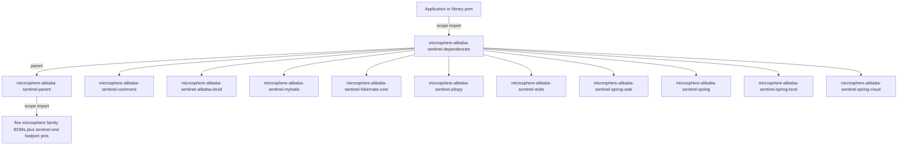
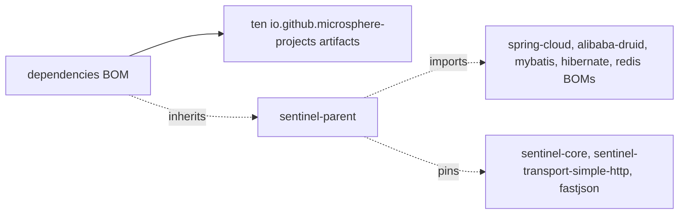

# microsphere-alibaba-sentinel-dependencies — Developer Guide

[中文版](zh/microsphere-alibaba-sentinel-dependencies.md)

> **Archived `1.x` line.** This page documents the internal design of the `0.1.x` artifacts (branch `release-1.x`, Java 8, Spring Boot 2.x, Spring Cloud Hoxton - 2021.0.x). The source tree is identical to the current line; only the POM baselines differ (javax Servlet API, `org.hibernate:hibernate-core`, `META-INF/spring.factories` auto-configuration registration). The current-line equivalent of this page is [../current/microsphere-alibaba-sentinel-dependencies.md](../current/microsphere-alibaba-sentinel-dependencies.md).

## Purpose and Scope

`microsphere-alibaba-sentinel-dependencies` is the published Bill of Materials of the project. It
is a POM-only module: `<packaging>pom</packaging>`, no sources, no `<properties>`, no
`<dependencies>`, no `<build>` and no `<modules>`. Its entire content is one
`<dependencyManagement>` block listing the **ten consumable artifacts** of the repository, each with
`<version>${revision}</version>`.

| Kind of POM | Managed here |
|---|---|
| Library artifacts consumers depend on | yes — commons, six plugins, spring, spring-boot, spring-cloud |
| Reactor root `microsphere-alibaba-sentinel` | no — build-time aggregator, not a dependency |
| `microsphere-alibaba-sentinel-plugins` | no — intermediate `pom` aggregate with no artifact of its own |
| `microsphere-alibaba-sentinel-parent` | no — it is the parent of this BOM |
| Third-party libraries | no — those are pinned in the parent POM |

## Architecture

Because the published POM keeps its `<parent>` reference, a consumer that imports this BOM also
resolves the parent chain, and with it the third-party versions declared in
[microsphere-alibaba-sentinel-parent](./microsphere-alibaba-sentinel-parent.md). That is why the
entries below need no versions of their own beyond `${revision}`.

## Source Analysis

### Anatomy

- `parent`: `microsphere-alibaba-sentinel-parent`, `${revision}`, explicit
  `relativePath ../microsphere-alibaba-sentinel-parent/pom.xml`.
- `artifactId` / `version`: `microsphere-alibaba-sentinel-dependencies` / `${revision}`.
  `revision` is declared in the reactor root, two levels above, and is inherited.
- `dependencyManagement`: ten entries, all `io.github.microsphere-projects`, all `${revision}`, none
  with `<type>pom</type>` and none with `<scope>import</scope>` — this BOM manages jars, not BOMs.

The declared order matches the dependency graph rather than the alphabet: commons first, then the six
plugins in the order of the plugins aggregator, then the three Spring layers. Ordering inside a BOM is
cosmetic because no coordinate is declared twice; only imported-BOM ordering carries meaning.

### Coverage check against the reactor

The root POM lists seven modules: parent, commons, plugins, spring, spring-boot, spring-cloud and
dependencies. Expanding the plugins aggregator adds six more. Removing the three non-artifact POMs —
root, plugins aggregate, parent — and this BOM itself leaves exactly the ten entries managed here, so
every deployable artifact of the project is covered.

## Design Patterns

| Pattern | Implementation |
|---|---|
| Bill of Materials | A POM whose only payload is `<dependencyManagement>` for project artifacts |
| Version alignment | One `${revision}` value binds all ten artifacts, so a partial upgrade is impossible by construction |
| Layered management | Third-party versions live in the parent POM, project versions live here, and the two meet when a consumer imports this BOM |
| Inheritance-based publishing | This POM inherits from the parent, so consumers resolve the parent chain and receive the imported family BOMs implicitly |

## Core Flows

### Build and release flow

```mermaid
flowchart LR
    A["Reactor root declares revision 0.1.6-SNAPSHOT"] --> B["This BOM references the ten artifacts with revision"]
    B --> C["CI runs deploy with -Drevision set to the release version"]
    C --> D["Published POMs resolve the project version to a literal value"]
    D --> E["Parent POM and imported family BOMs are deployed together"]
    E --> F["Consumer imports this BOM with scope import and type pom"]
    F --> G["Consumer declares any of the ten coordinates without a version"]
    G --> H["Maven resolves the parent chain for the third-party versions"]
```

Two properties are retained as placeholders in published POMs — the `${microsphere-*.version}`,
`${sentinel.version}` and `${fastjson.version}` references inside the parent's
`<dependencyManagement>` — while `${revision}` is resolved. Consumers can therefore read the exact
family versions from the deployed parent POM.

## Dependencies

| Managed coordinate | Version | What it is |
|---|---|---|
| `microsphere-alibaba-sentinel-commons` | `${revision}` | Plugin model, repository, template and utilities |
| `microsphere-alibaba-sentinel-alibaba-druid` | `${revision}` | Druid `Filter` plugin |
| `microsphere-alibaba-sentinel-mybatis` | `${revision}` | MyBatis `ExecutorFilter` plugin |
| `microsphere-alibaba-sentinel-hibernate-core` | `${revision}` | Hibernate `EntityCallback` plugin, SPI registered |
| `microsphere-alibaba-sentinel-p6spy` | `${revision}` | P6Spy `JdbcEventListener` plugin, SPI registered |
| `microsphere-alibaba-sentinel-redis` | `${revision}` | Redis command interceptor plugin |
| `microsphere-alibaba-sentinel-spring-web` | `${revision}` | `HandlerMethodInterceptor` plugin |
| `microsphere-alibaba-sentinel-spring` | `${revision}` | Spring dependency aggregate, no sources |
| `microsphere-alibaba-sentinel-spring-boot` | `${revision}` | Four auto-configuration classes |
| `microsphere-alibaba-sentinel-spring-cloud` | `${revision}` | Feature reporting for the Spring Cloud actuator |

There are no direct `<dependencies>` in this POM, hence no scopes to list; the `<type>pom</type>`
and `<scope>import</scope>` pair belongs to the consumer POM that imports this artifact.

## Extension Points

| Change | How |
|---|---|
| Publish a new module | Add an entry with `io.github.microsphere-projects` coordinates and `<version>${revision}</version>`; forgetting it leaves consumers with a mandatory version on every declaration |
| Retire a module | Remove the entry and keep the root `<modules>` in sync, otherwise the artifact is still built but unmanaged |
| Align a plugin with a different Sentinel release | Change `sentinel.version` in the parent POM, not here |
| Consumer needs a different project version | Declare that coordinate explicitly in your own `<dependencyManagement>` **before** importing this BOM — the first managed version wins |
| Consumer needs a different third-party version | Declare the third-party coordinate in your own `<dependencyManagement>` before the import, since properties of an imported POM cannot be overridden from outside |
| Release a new line | The publish workflow bumps `revision` in the reactor root; this BOM needs no edit because every entry uses the property |

## Related Modules

- Developer guide index: [./README.md](./README.md)
- Third-party version owner: [./microsphere-alibaba-sentinel-parent.md](./microsphere-alibaba-sentinel-parent.md)
- Managed artifacts: [./microsphere-alibaba-sentinel-commons.md](./microsphere-alibaba-sentinel-commons.md), [./microsphere-alibaba-sentinel-plugins.md](./microsphere-alibaba-sentinel-plugins.md), [./microsphere-alibaba-sentinel-spring.md](./microsphere-alibaba-sentinel-spring.md), [./microsphere-alibaba-sentinel-spring-boot.md](./microsphere-alibaba-sentinel-spring-boot.md), [./microsphere-alibaba-sentinel-spring-cloud.md](./microsphere-alibaba-sentinel-spring-cloud.md)
- User-facing documentation: [../../user-guide/1.x/microsphere-alibaba-sentinel-dependencies.md](../../user-guide/1.x/microsphere-alibaba-sentinel-dependencies.md)

---

## 中文

[中文版](zh/microsphere-alibaba-sentinel-dependencies.md)
