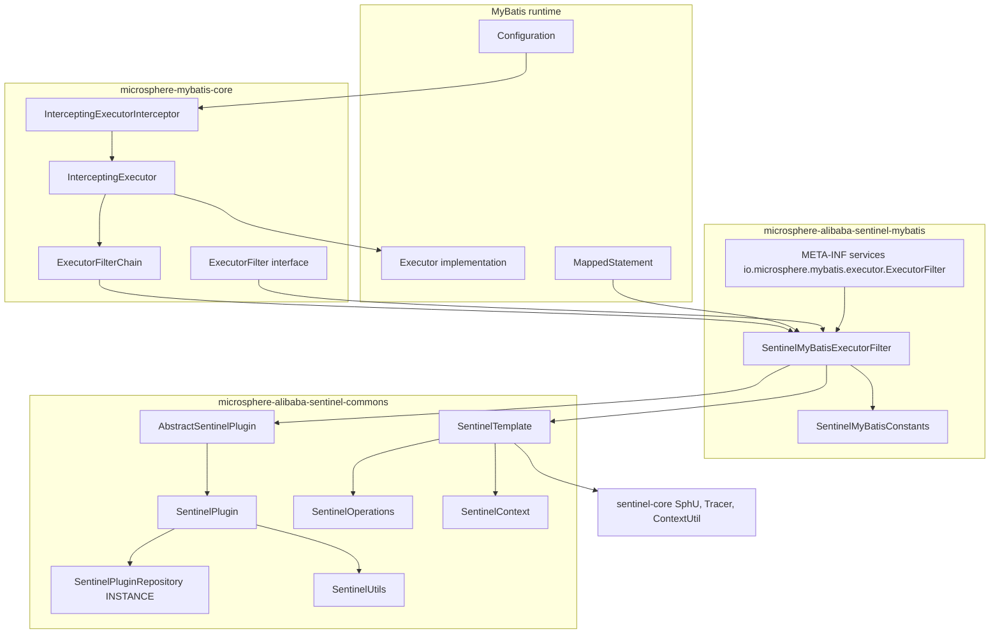
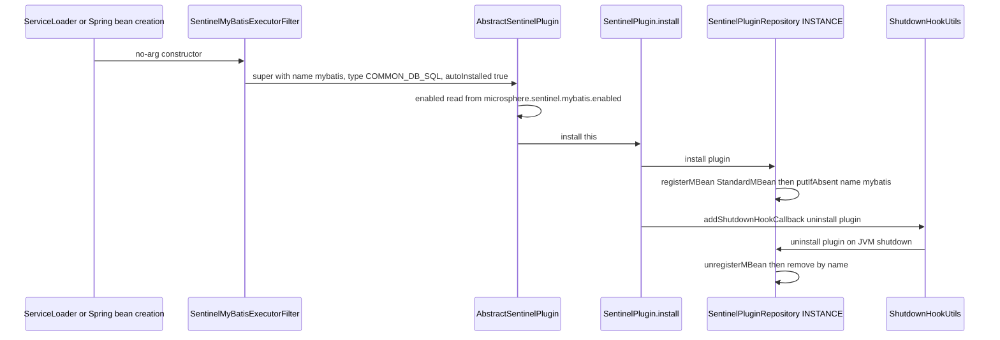
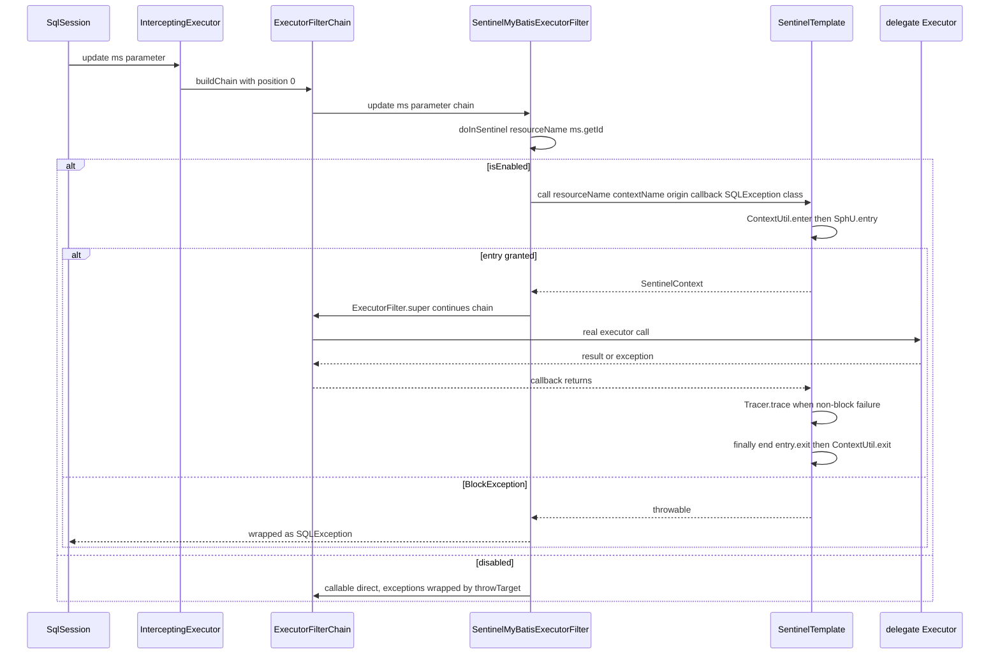
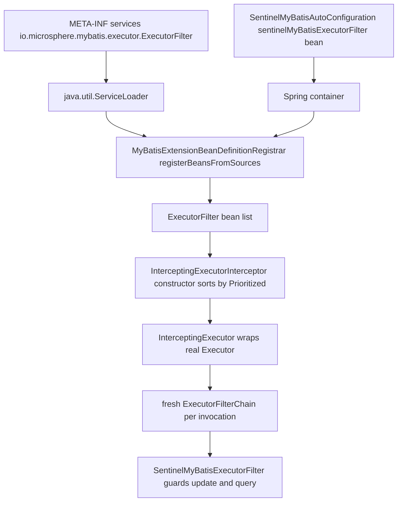
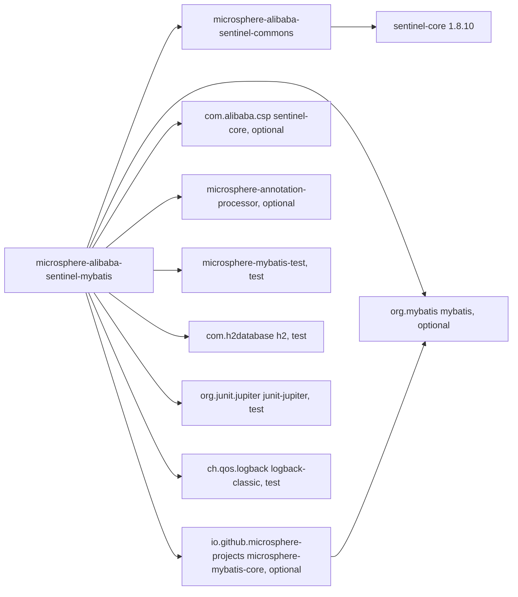

# microsphere-alibaba-sentinel-mybatis — Developer Guide

[中文版](zh/microsphere-alibaba-sentinel-mybatis.md)

> **Archived `1.x` line.** This page documents the internal design of the `0.1.x` artifacts (branch `release-1.x`, Java 8, Spring Boot 2.x, Spring Cloud Hoxton - 2021.0.x). The source tree is identical to the current line; only the POM baselines differ (javax Servlet API, `org.hibernate:hibernate-core`, `META-INF/spring.factories` auto-configuration registration). The current-line equivalent of this page is [../current/microsphere-alibaba-sentinel-mybatis.md](../current/microsphere-alibaba-sentinel-mybatis.md).

## Purpose and Scope

`microsphere-alibaba-sentinel-mybatis` (directory
`microsphere-alibaba-sentinel-plugins/microsphere-alibaba-sentinel-mybatis`) guards MyBatis
`Executor` traffic with Alibaba Sentinel. It ships one plugin class,
`SentinelMyBatisExecutorFilter`, one constants interface, and the SPI declaration
`src/main/resources/META-INF/services/io.microsphere.mybatis.executor.ExecutorFilter`. Unlike the
Druid plugin it extends `AbstractSentinelPlugin` directly and uses the one-time
`SentinelOperations.call(...)` form rather than the two-phase `begin`/`end` pair.

Resource granularity is one Sentinel resource per mapped statement: `getSentinelResourceName(ms)`
returns `ms.getId()`, for example
`io.microsphere.mybatis.test.mapper.UserMapper.selectById`. The resource type is
`ResourceTypeConstants.COMMON_DB_SQL` and the traffic type `EntryType.IN`.

Version context: `0.1.x` line (`0.1.0`–`0.1.5` released, `revision` = `0.1.6-SNAPSHOT`), Java 8,
`sentinel-core` 1.8.10, `microsphere-mybatis` 0.1.15, Spring Boot 2.x / Spring Cloud Hoxton-2021.
End-user configuration is covered by
[the user guide](../../user-guide/1.x/microsphere-alibaba-sentinel-mybatis.md).

## Architecture



## Source Analysis

### SentinelMyBatisConstants

```java
String PLUGIN_NAME = "mybatis";
String DEFAULT_CONTEXT_NAME = "microsphere_sentinel_mybatis_context";
String DEFAULT_ORIGIN = "Executor";
String ENABLED_PROPERTY_NAME = PROPERTY_NAME_PREFIX + PLUGIN_NAME + DOT + PropertyConstants.ENABLED_PROPERTY_NAME;
```

`SentinelMyBatisConstantsTest` pins all four values, asserts
`ENABLED_PROPERTY_NAME == "microsphere.sentinel.mybatis.enabled"` and that it equals
`SentinelUtils.getPluginEnabledPropertyName(PLUGIN_NAME)`. Here the constant and the derived
`SentinelUtils.getDefaultContextName(PLUGIN_NAME)` agree, because the plugin name has no hyphen.
The `@ConfigurationProperty(source = SYSTEM_PROPERTIES_SOURCE)` annotation matches the runtime
resolution, which reads only JVM system properties.

### SentinelMyBatisExecutorFilter

```java
public class SentinelMyBatisExecutorFilter extends AbstractSentinelPlugin implements ExecutorFilter {

    public SentinelMyBatisExecutorFilter() { this(DEFAULT_CONTEXT_NAME, DEFAULT_ORIGIN); }

    public SentinelMyBatisExecutorFilter(String contextName, String origin) {
        super(PLUGIN_NAME, contextName, origin, COMMON_DB_SQL);
        this.sentinelOperations = new SentinelTemplate(getResourceType(), getTrafficType());
    }
```

The four-argument `AbstractSentinelPlugin` constructor applies the defaults `EntryType.IN` and
`autoInstalled = true`; auto-install means the constructor itself calls
`SentinelPlugin.install(this)`, which registers the plugin in
`SentinelPluginRepository.INSTANCE` and adds the JVM shutdown-hook callback that uninstalls it. The
same constructor snapshots `enabled` from `microsphere.sentinel.mybatis.enabled` (default `true`),
stored in the `volatile` field of the base class. The no-arg constructor is required by
`java.util.ServiceLoader` and by the Spring bean definition.

Three `ExecutorFilter` methods are overridden; every other method of the interface keeps its
default pass-through:

```java
@Override
public int update(MappedStatement ms, Object parameter, ExecutorFilterChain chain) throws SQLException {
    return doInSentinel(ms, () -> ExecutorFilter.super.update(ms, parameter, chain));
}

@Override
public <E> List<E> query(MappedStatement ms, Object parameter, RowBounds rowBounds, ResultHandler resultHandler,
                         CacheKey cacheKey, BoundSql boundSql, ExecutorFilterChain chain) throws SQLException {
    return doInSentinel(ms, () -> ExecutorFilter.super.query(ms, parameter, rowBounds, resultHandler, cacheKey, boundSql, chain));
}

@Override
public <E> List<E> query(MappedStatement ms, Object parameter, RowBounds rowBounds, ResultHandler resultHandler,
                         ExecutorFilterChain chain) throws SQLException {
    return doInSentinel(ms, () -> ExecutorFilter.super.query(ms, parameter, rowBounds, resultHandler, chain));
}
```

`ExecutorFilter.super.<method>` is the chain-continuation call; omitting `chain` would stop the
chain and skip downstream filters. `queryCursor`, `commit`, `rollback`, `createCacheKey`,
`deferLoad`, `getTransaction` and `close` are intentionally not guarded, so cursor fetches and
transaction boundaries do not consume Sentinel entries.

The core of the class:

```java
protected <T> T doInSentinel(MappedStatement ms, Callable<T> callable) throws SQLException {
    if (isEnabled()) {
        String resourceName = getSentinelResourceName(ms);
        return sentinelOperations.call(resourceName, getContextName(), getOrigin(),
                context -> callable.call(), SQLException.class);
    } else {
        try {
            return callable.call();
        } catch (Exception e) {
            throw throwTarget(e, SQLException.class);
        }
    }
}

protected String getSentinelResourceName(MappedStatement ms) {
    return ms.getId();
}
```

Both branches guarantee a `SQLException` signature: the enabled branch uses
`SentinelOperations.call(String, String, String, ThrowableFunction, Class<TR>)`, whose
`try { return call(...); } catch (Throwable t) { throw throwTarget(t, throwableClass); }` wrapper
converts anything else — including `BlockException` thrown by `SphU.entry` and checked exceptions from
the callable — into `SQLException`; the disabled branch converts explicitly with
`ExceptionUtils.throwTarget`. Inside the unqualified `call`, `SentinelOperations` performs
`begin(...)` before the `try`, runs the callback, calls `Tracer.trace(e)` for any non-block throwable,
logs an error line, rethrows, and always runs `end(context)` in the `finally`.

Tracing semantics differ from the Druid plugin and are easy to get wrong when refactoring: the
one-time form reports failures with `Tracer.trace`, and `end` sees
`context.getFailure() == null` because nothing calls `setFailure`. Adding explicit
`setFailure` here would double-count errors. Both `Tracer.trace` and `Tracer.traceEntry` feed the
same exception statistics, so keeping exactly one of them per call path is the invariant.

Thread-safety: the instance holds `final` identity fields from `AbstractSentinelPlugin`, a `final
SentinelOperations` and the `volatile enabled` flag, so one filter shared across all `SqlSession`
instances is safe. Guarding does not use `SentinelContext.withinContext()` or any plugin-level
ThreadLocal; the context object is confined to the `doInSentinel` stack frame, which also makes the
plugin correct for nested or asynchronous executor invocations. `AbstractSentinelPlugin` itself is
not `Prioritized` and the filter does not override `getPriority()`, so `ExecutorFilter`'s default
`NORMAL_PRIORITY = 0` orders it inside `InterceptingExecutorInterceptor`'s sorted array.

### Collaboration with microsphere-mybatis-core

The plugin is passive until something installs it into the executor chain:

- `InterceptingExecutorInterceptor` (from `microsphere-mybatis-core`) takes an
  `ExecutorFilter[]`, sorts it with the `Prioritized` comparator, and in `plugin(Object target)`
  wraps the real `Executor` in `InterceptingExecutor`.
- `InterceptingExecutor` builds a *fresh* `ExecutorFilterChain(delegate, properties, filters)` per
  invocation; the chain is a position cursor (`position < size` invokes `filters[position++]`,
  otherwise the delegate `Executor` is called), so chain state is stack-confined and thread-safe.
- `ExecutorFilterChain.applySQL(...)` wraps failures as `SQLException`, matching the plugin contract.
- In a Spring context, `@EnableMyBatisExtension` triggers
  `MyBatisExtensionBeanDefinitionRegistrar.registerExecutorFilters(...)`, whose
  `registerBeansFromSources(ExecutorFilter.class, sources)` collects implementations from Spring
  Factories or SPI sources — this is the consumer that makes the module's
  `META-INF/services/io.microsphere.mybatis.executor.ExecutorFilter` entry effective.

## Design Patterns

| Pattern | Implementing classes | Note |
| --- | --- | --- |
| Chain of Responsibility | `ExecutorFilterChain` and `InterceptingExecutor` with `SentinelMyBatisExecutorFilter` as one link | `ExecutorFilter.super` continues the chain |
| Decorator | `InterceptingExecutor` wraps the delegate `Executor` | MyBatis plugin mechanism |
| Adapter | `SentinelMyBatisExecutorFilter implements ExecutorFilter` | executor callbacks to Sentinel entries |
| Template Method | `doInSentinel(ms, callable)` as the fixed skeleton, three call sites | also `AbstractSentinelPlugin` constructor defaults |
| Facade | `SentinelTemplate` behind `SentinelOperations` | hides `SphU.entry`, `Tracer.trace`, `ContextUtil.enter`/`exit` |
| Registry / Singleton | `SentinelPlugin.install` via `SentinelPluginRepository.INSTANCE` | JMX object name `io.microsphere.sentinel:type=SentinelPlugin,name=mybatis` |
| SPI | `META-INF/services/io.microsphere.mybatis.executor.ExecutorFilter` | single provider line |
| Strategy | `resourceType` / `trafficType` chosen at construction | `COMMON_DB_SQL`, `IN` |

## Core Flows

### Plugin install lifecycle, including the shutdown hook



### Executor filter chain flow for a guarded statement



### SPI and interceptor wiring



## Dependencies



| Dependency | Scope | Role |
| --- | --- | --- |
| `io.github.microsphere-projects:microsphere-alibaba-sentinel-commons` | compile | `AbstractSentinelPlugin`, `SentinelOperations`, `SentinelTemplate`, `SentinelContext`, `SentinelUtils` |
| `io.github.microsphere-projects:microsphere-mybatis-core` | compile, `optional` | `ExecutorFilter`, `ExecutorFilterChain`, `InterceptingExecutor`, `InterceptingExecutorInterceptor` |
| `com.alibaba.csp:sentinel-core` (1.8.10) | compile, `optional` | `ResourceTypeConstants.COMMON_DB_SQL`, `EntryType.IN`, `Entry`, `Tracer` |
| `org.mybatis:mybatis` | compile, `optional` | `MappedStatement`, `CacheKey`, `BoundSql`, `RowBounds`, `ResultHandler`, `Executor` |
| `io.github.microsphere-projects:microsphere-annotation-processor` | compile, `optional` | `@ConfigurationProperty` metadata generation |
| `org.junit.jupiter:junit-jupiter` | test | test engine |
| `io.github.microsphere-projects:microsphere-mybatis-test` | test | `AbstractMapperTest` and `InterceptingExecutorInterceptor` test harness |
| `com.h2database:h2` | test | in-memory database |
| `ch.qos.logback:logback-classic` | test | logging backend for `io.microsphere.logging` |

`optional` keeps MyBatis and Sentinel out of the transitive graph of consumers. Versions resolve from
`microsphere-alibaba-sentinel-parent` (`microsphere-mybatis.version` 0.1.15, `sentinel.version` 1.8.10).

### Tests

`SentinelMyBatisExecutorFilterTest` extends `AbstractMapperTest`, overrides
`customize(Configuration)` to build the filter and register
`new InterceptingExecutorInterceptor(ofArray(this.filter))` through
`configuration.addInterceptor(interceptor)`, runs the mapper suite both enabled and disabled
(`testDisabled` flips `setEnabled(false)`), and in `postTest()` enters
`microsphere_sentinel_mybatis_context` with origin `Executor` to assert the entrance node has a
non-empty `childList` — proof that entries were recorded under that context.
`SentinelMyBatisConstantsTest` guards the constant contract.

## Extension Points

- **Resource naming.** Override `protected String getSentinelResourceName(MappedStatement ms)` to
  key rules by SQL fragment, by namespace, or by namespace plus database id instead of
  `ms.getId()`. Names are the join key between flow rules and metrics, so they must stay stable
  across restarts.
- **Guarding more executor methods.** Add overrides for `queryCursor`, `commit`, `rollback` or
  `close` and route them through `doInSentinel(ms, () -> ExecutorFilter.super.<method>(...))`; the
  existing helper already guarantees the `SQLException` signature.
- **Context and origin per environment.** Use the two-argument constructor; in Spring Boot, declare
  your own `SentinelMyBatisExecutorFilter` bean to displace the auto-configured one
  (`@ConditionalOnMissingBean`).
- **Switching to two-phase guarding.** If a filter needs the result and failure visible on the
  context, call `sentinelOperations.begin(...)`/`end(...)` around `chain` continuation and set
  `context.setResult(...)` / `context.setFailure(...)`; then keep `Tracer.trace` out of the path so
  errors are counted once.
- **Ordering against other filters.** `ExecutorFilter extends Prioritized`; override `getPriority()`
  to move the Sentinel filter earlier or later in the sorted array used by
  `InterceptingExecutorInterceptor`.
- **Runtime control.** `-Dmicrosphere.sentinel.mybatis.enabled=false` (read at construction) or the
  `setEnabled` operation on the JMX MBean `io.microsphere.sentinel:type=SentinelPlugin,name=mybatis`;
  `SentinelPluginRepository.INSTANCE` exposes `isInstalled`, `get`, `uninstall` and `clear`.

## Related Modules

- Index: [developer guide README](./README.md)
- Core abstractions: [microsphere-alibaba-sentinel-commons](./microsphere-alibaba-sentinel-commons.md)
- Sibling plugins: [microsphere-alibaba-sentinel-alibaba-druid](./microsphere-alibaba-sentinel-alibaba-druid.md),
  [plugins overview](./microsphere-alibaba-sentinel-plugins.md)
- Auto-configuration: `microsphere-alibaba-sentinel-spring-boot` —
  `SentinelMyBatisAutoConfiguration` requires `io.microsphere.mybatis.spring.annotation.EnableMyBatisExtension`
  and this module's filter class on the classpath, runs after `MybatisAutoConfiguration`,
  `MybatisPlusAutoConfiguration` and `com.alibaba.cloud.sentinel.custom.SentinelAutoConfiguration`,
  imports a `Config` class annotated `@EnableMyBatisExtension`, and declares the filter bean with
  `@ConditionalOnMissingBean`; everything is gated by `@ConditionalOnSentinelEnabled`
  (`microsphere.sentinel.enabled`, `matchIfMissing = true`)
- User guide counterpart: [user guide](../../user-guide/1.x/microsphere-alibaba-sentinel-mybatis.md)
- Source: `microsphere-alibaba-sentinel-plugins/microsphere-alibaba-sentinel-mybatis/src/{main,test}/java`
  and `src/main/resources/META-INF/services/io.microsphere.mybatis.executor.ExecutorFilter`

---

## 中文

[中文版](zh/microsphere-alibaba-sentinel-mybatis.md)
