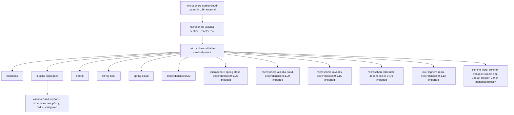
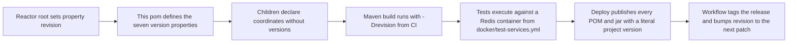
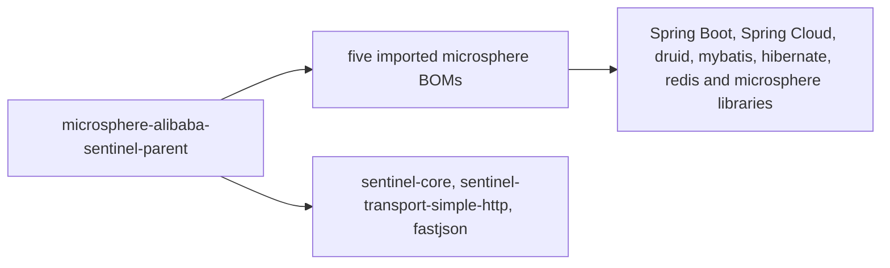

# microsphere-alibaba-sentinel-parent — Developer Guide

[中文版](zh/microsphere-alibaba-sentinel-parent.md)

> **Archived `1.x` line.** This page documents the internal design of the `0.1.x` artifacts (branch `release-1.x`, Java 8, Spring Boot 2.x, Spring Cloud Hoxton - 2021.0.x). The source tree is identical to the current line; only the POM baselines differ (javax Servlet API, `org.hibernate:hibernate-core`, `META-INF/spring.factories` auto-configuration registration). The current-line equivalent of this page is [../current/microsphere-alibaba-sentinel-parent.md](../current/microsphere-alibaba-sentinel-parent.md).

## Purpose and Scope

`microsphere-alibaba-sentinel-parent` is a POM-only module: `<packaging>pom</packaging>`, no `src`
directory, no `<build>`, no `<modules>` and no `<dependencies>` element. It holds properties and a
`<dependencyManagement>` block only, and it is the Maven parent of the twelve other POMs — commons,
the plugins aggregate, the six plugin modules, spring, spring-boot, spring-cloud and the BOM. Its job
is version arbitration: children declare coordinates, the version always comes from here or from a
BOM imported here.

## Architecture

Two roles are split: the reactor root `microsphere-alibaba-sentinel` aggregates the seven modules and
is simultaneously the parent of this POM, while this POM is the inherited parent of every artifact
module. The six plugin leaves skip the plugins aggregate and inherit from here directly.

## Source Analysis

### Properties

| Property | Value | Consumed by |
|---|---|---|
| `microsphere-spring-cloud.version` | 0.1.26 | BOM import of `microsphere-spring-cloud-dependencies` |
| `microsphere-alibaba-druid.version` | 0.1.20 | BOM import of `microsphere-alibaba-druid-dependencies` |
| `microsphere-mybatis.version` | 0.1.15 | BOM import of `microsphere-mybatis-dependencies` |
| `microsphere-hibernate.version` | 0.1.9 | BOM import of `microsphere-hibernate-dependencies` |
| `microsphere-redis.version` | 0.1.13 | BOM import of `microsphere-redis-dependencies` |
| `sentinel.version` | 1.8.10 | `sentinel-core` and `sentinel-transport-simple-http` |
| `fastjson.version` | 2.0.64 | `com.alibaba:fastjson` |

`revision` and `java.version` are **not** declared here: the reactor root sets `revision` to
`0.1.6-SNAPSHOT` and `java.version` to 8, while the branch README lists 0.1.5 as the latest
published release of this line. Every module states `<version>${revision}</version>`.

### dependencyManagement anatomy

Five imports with `<type>pom</type>` and `<scope>import</scope>`, in declaration order: spring-cloud,
alibaba-druid, mybatis, hibernate, redis. Import order is significant — Maven keeps the first
version it manages for a coordinate, so `microsphere-spring-cloud-dependencies` listed first has the
final say for any coordinate it also manages, such as Spring Boot and Spring Framework artifacts.

Then three direct managed entries: `sentinel-core`, `sentinel-transport-simple-http` and `fastjson`.
`sentinel-core` is declared by commons and marked optional by nearly every module,
`sentinel-transport-simple-http` is declared only by commons, and `fastjson` is declared by no module
in the snapshot — its entry exists purely to pin the version Sentinel's own transport brings in.
There is no `<repositories>`, `<distributionManagement>` or `<pluginManagement>` here; those, plus the
`test`, `coverage`, `publish`, `ci` and `spring-cloud-hoxton`, `spring-cloud-2020` and `spring-cloud-2021` profiles the
workflows activate, come from the external `microsphere-spring-cloud-parent`.

### Child inheritance contract

All twelve children repeat the same `<parent>` block: `microsphere-alibaba-sentinel-parent`,
`<version>${revision}</version>` and an explicit `<relativePath>` back to this directory, which is
what lets the reactor build without installing the parent first.

## Design Patterns

| Pattern | Implementation |
|---|---|
| Bill of Materials | `<dependencyManagement>` with five `scope import` entries and three direct pins |
| Parent / template POM | Coordinates-only dependency declarations in children |
| Property indirection | Seven `*.version` properties separate the "which version" decision from the "which BOM" decision |
| Separation of aggregation and inheritance | Reactor root aggregates; this POM inherits into children; the plugins aggregate adds no versions of its own |

## Core Flows

### Build and release flow

The publish workflow passes `-Drevision=<major.minor.patch>` to `deploy` with the `publish` and `ci`
profiles; the build workflow uses the throwaway `0.0.1-SNAPSHOT`. `${revision}` is resolved for the
project version but the seven properties above stay as placeholders in the deployed POMs, so the whole
parent chain must be published for a consumer to resolve the imported BOMs.

## Dependencies

This POM declares no dependencies; it only manages them.

| Managed coordinate | Declared version | Kind |
|---|---|---|
| `io.github.microsphere-projects:microsphere-spring-cloud-dependencies` | `${microsphere-spring-cloud.version}` = 0.1.26 | BOM import |
| `io.github.microsphere-projects:microsphere-alibaba-druid-dependencies` | `${microsphere-alibaba-druid.version}` = 0.1.20 | BOM import |
| `io.github.microsphere-projects:microsphere-mybatis-dependencies` | `${microsphere-mybatis.version}` = 0.1.15 | BOM import |
| `io.github.microsphere-projects:microsphere-hibernate-dependencies` | `${microsphere-hibernate.version}` = 0.1.9 | BOM import |
| `io.github.microsphere-projects:microsphere-redis-dependencies` | `${microsphere-redis.version}` = 0.1.13 | BOM import |
| `com.alibaba.csp:sentinel-core` | `${sentinel.version}` = 1.8.10 | direct pin |
| `com.alibaba.csp:sentinel-transport-simple-http` | `${sentinel.version}` = 1.8.10 | direct pin |
| `com.alibaba:fastjson` | `${fastjson.version}` = 2.0.64 | direct pin |

## Extension Points

| Change | Where to make it |
|---|---|
| Bump Sentinel itself | `sentinel.version` here; both Sentinel artifacts move together because they share the property |
| Bump a Microsphere family | The matching `microsphere-*.version` property here; never add a `<version>` in a child pom |
| Add a new third-party pin | Append a `<dependency>` inside `<dependencyManagement>` with a new `*.version` property |
| Expose a new project artifact | Add it to [./microsphere-alibaba-sentinel-dependencies.md](./microsphere-alibaba-sentinel-dependencies.md), which inherits from this POM |
| Change the Java baseline | `java.version` in the reactor root, mirrored by the CI matrix in `.github/workflows/maven-build.yml` |
| Override a version | Inside the repository, edit the property here, since children never pin versions. From a consumer build, properties do not cross artifact boundaries: declare your own `<dependencyManagement>` entries with explicit versions **before** importing this project's BOM, because the first managed declaration wins |

## Related Modules

- Developer guide index: [./README.md](./README.md)
- Project artifact BOM: [./microsphere-alibaba-sentinel-dependencies.md](./microsphere-alibaba-sentinel-dependencies.md)
- Inheriting modules: [./microsphere-alibaba-sentinel-commons.md](./microsphere-alibaba-sentinel-commons.md), [./microsphere-alibaba-sentinel-plugins.md](./microsphere-alibaba-sentinel-plugins.md), [./microsphere-alibaba-sentinel-spring.md](./microsphere-alibaba-sentinel-spring.md), [./microsphere-alibaba-sentinel-spring-boot.md](./microsphere-alibaba-sentinel-spring-boot.md), [./microsphere-alibaba-sentinel-spring-cloud.md](./microsphere-alibaba-sentinel-spring-cloud.md)
- User-facing documentation: [../../user-guide/1.x/microsphere-alibaba-sentinel-parent.md](../../user-guide/1.x/microsphere-alibaba-sentinel-parent.md)

---

## 中文

[中文版](zh/microsphere-alibaba-sentinel-parent.md)
