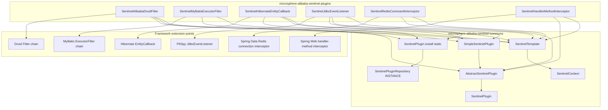
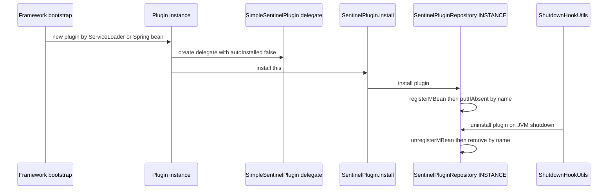
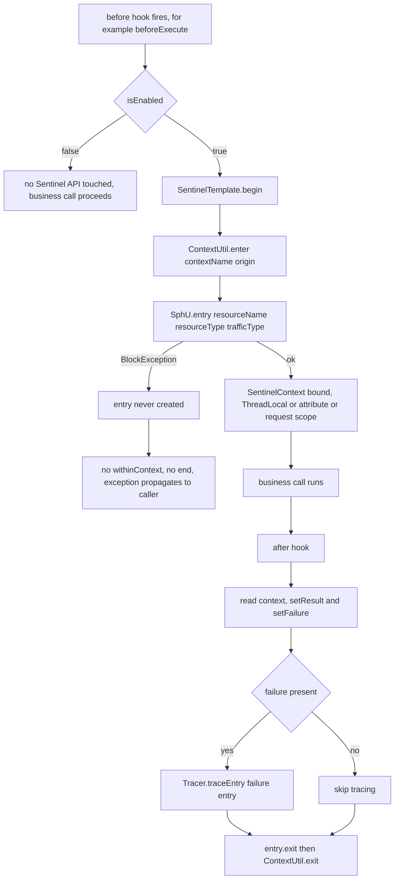
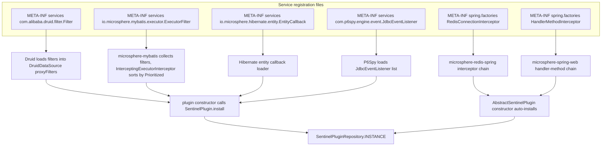
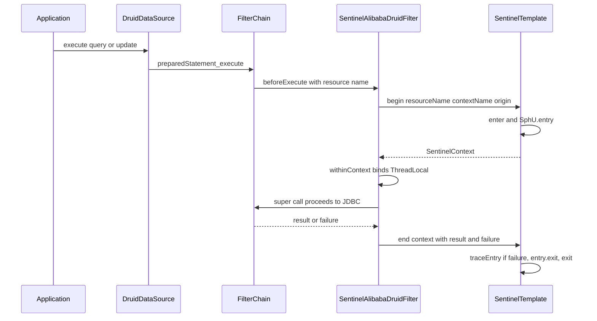
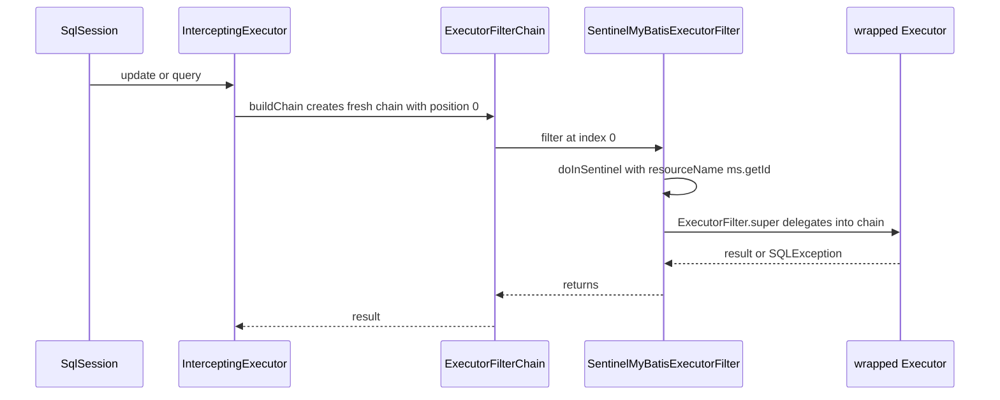
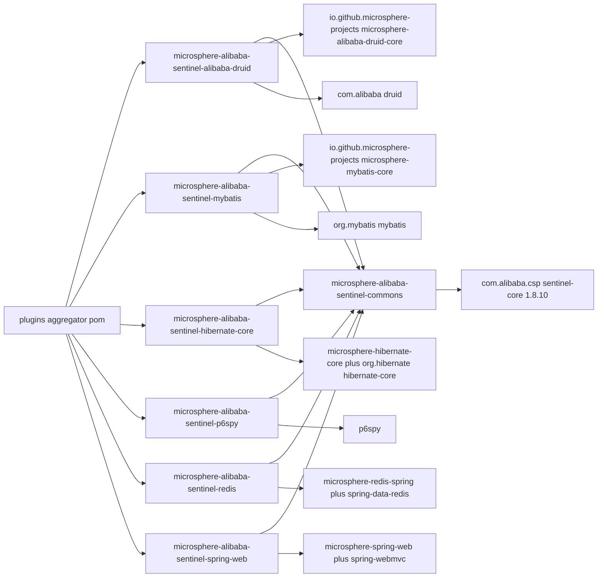

# microsphere-alibaba-sentinel-plugins — Developer Guide

[中文版](zh/microsphere-alibaba-sentinel-plugins.md)

> **Archived `1.x` line.** This page documents the internal design of the `0.1.x` artifacts (branch `release-1.x`, Java 8, Spring Boot 2.x, Spring Cloud Hoxton - 2021.0.x). The source tree is identical to the current line; only the POM baselines differ (javax Servlet API, `org.hibernate:hibernate-core`, `META-INF/spring.factories` auto-configuration registration). The current-line equivalent of this page is [../current/microsphere-alibaba-sentinel-plugins.md](../current/microsphere-alibaba-sentinel-plugins.md).

## Purpose and Scope

`microsphere-alibaba-sentinel-plugins` is a `pom` aggregator
(`microsphere-alibaba-sentinel-plugins/pom.xml`) that builds the six integration modules which turn
framework extension points into guarded Sentinel resources:

| Child artifactId | Extension interface implemented | Plugin name | `resourceType` | Origin |
| --- | --- | --- | --- | --- |
| `microsphere-alibaba-sentinel-alibaba-druid` | `io.microsphere.alibaba.druid.filter.AbstractStatementFilter` + `SentinelPlugin` | `alibaba-druid` | `COMMON_DB_SQL` | `Filter` |
| `microsphere-alibaba-sentinel-mybatis` | `io.microsphere.mybatis.executor.ExecutorFilter` | `mybatis` | `COMMON_DB_SQL` | `Executor` |
| `microsphere-alibaba-sentinel-hibernate-core` | `io.microsphere.hibernate.entity.EntityCallback` + `SentinelPlugin` | `hibernate` | `COMMON_DB_SQL` | `SessionFactory` |
| `microsphere-alibaba-sentinel-p6spy` | `com.p6spy.engine.event.SimpleJdbcEventListener` + `SentinelPlugin` | `p6spy` | `COMMON_DB_SQL` | `Statement` |
| `microsphere-alibaba-sentinel-redis` | `io.microsphere.redis.spring.interceptor.RedisConnectionInterceptor` | `redis` | `COMMON` (default) | `RedisConnection` |
| `microsphere-alibaba-sentinel-spring-web` | `io.microsphere.spring.web.method.support.HandlerMethodInterceptor` | `spring-web` | `COMMON_WEB` | `HandlerMethod` |

Every child depends on `microsphere-alibaba-sentinel-commons` (non-optional) and on
`sentinel-core` 1.8.10 plus its own framework jar as `optional`. Version facts: `0.1.x` line
(`0.1.0`–`0.1.5` released, `revision` = `0.1.6-SNAPSHOT`), Java 8, Spring Boot 2.x and
Spring Cloud Hoxton-2021 consumers. Version tables live in the user guide
(`../../user-guide/1.x/microsphere-alibaba-sentinel-plugins.md`).

Read this guide to add or change a plugin; read
[microsphere-alibaba-sentinel-commons.md](./microsphere-alibaba-sentinel-commons.md) for the
abstractions the plugins compile against.

## Architecture



The structural split is deliberate: adapters that must extend a framework base class
(`FilterAdapter`, `SimpleJdbcEventListener`, `EntityCallback` host type) cannot also extend
`AbstractSentinelPlugin`, so they implement `SentinelPlugin` and delegate identity to a
`SimpleSentinelPlugin` constructed with `autoInstalled = false`, then call
`SentinelPlugin.install(this)` explicitly at the end of their constructor. Plugins with a free
superclass (`SentinelMyBatisExecutorFilter`, `SentinelRedisCommandInterceptor`,
`SentinelHandlerMethodInterceptor`) extend `AbstractSentinelPlugin` and inherit the
auto-install-on-construction behaviour.

## Source Analysis

### SentinelAlibabaDruidFilter (`.../alibaba/druid/SentinelAlibabaDruidFilter.java`)

Extends `AbstractStatementFilter` (microsphere-alibaba-druid-core, itself a Druid `FilterAdapter`)
and implements `SentinelPlugin` by delegation. Constructor
`SentinelAlibabaDruidFilter(String contextName, String origin)` builds
`new SimpleSentinelPlugin(PLUGIN_NAME, contextName, origin, COMMON_DB_SQL, IN, false)`, a
`SentinelTemplate(getResourceType(), getTrafficType())`, then `install(this)` — the registry key is
the filter instance, not the delegate, so JMX exposes `setEnabled` on the live Druid filter.
`beforeExecute(StatementProxy, String resourceName)` calls `sentinelOperations.begin(...)` and
`context.withinContext()`; `afterExecute(StatementProxy, String, Object result, Throwable failure)`
runs `doInContext(context -> { setResult; setFailure; end; }, true)`. All eight getters
(`getName`, `getContextName`, `getOrigin`, `getResourceType`, `getTrafficType`, `isAutoInstalled`,
`isEnabled`, `setEnabled`) forward to the delegate. See
[microsphere-alibaba-sentinel-alibaba-druid.md](./microsphere-alibaba-sentinel-alibaba-druid.md)
for the SQL resource-naming rules inherited from `AbstractStatementFilter`.

### SentinelMyBatisExecutorFilter (`.../mybatis/executor/SentinelMyBatisExecutorFilter.java`)

Extends `AbstractSentinelPlugin` with `super(PLUGIN_NAME, contextName, origin, COMMON_DB_SQL)`, so
`EntryType.IN` and `autoInstalled = true` — construction alone registers and hooks the uninstall.
It overrides three `ExecutorFilter` methods only:

```java
public int update(MappedStatement ms, Object parameter, ExecutorFilterChain chain) throws SQLException
public <E> List<E> query(MappedStatement ms, Object parameter, RowBounds rowBounds,
                         ResultHandler resultHandler, CacheKey cacheKey, BoundSql boundSql,
                         ExecutorFilterChain chain) throws SQLException
public <E> List<E> query(MappedStatement ms, Object parameter, RowBounds rowBounds,
                         ResultHandler resultHandler, ExecutorFilterChain chain) throws SQLException
```

Each delegates to `doInSentinel(ms, () -> ExecutorFilter.super.<method>(...))`, the one-time form —
`sentinelOperations.call(resourceName, getContextName(), getOrigin(), context -> callable.call(), SQLException.class)`
— so `Tracer.trace` covers MyBatis exceptions and `end(...)` runs in the `finally`.
`getSentinelResourceName(MappedStatement)` returns `ms.getId()`, i.e. one resource per mapped
statement. The remaining `ExecutorFilter` defaults (`queryCursor`, `commit`, `rollback`,
`createCacheKey`, `deferLoad`, `getTransaction`, `close`) pass through unguarded, and the class does
not override `getPriority()` — `Prioritized`'s default `NORMAL_PRIORITY = 0` therefore orders it in
the chain built by `InterceptingExecutorInterceptor`. Disabled path calls the callable directly and
re-wraps any exception with `ExceptionUtils.throwTarget(e, SQLException.class)`.

### SentinelHibernateEntityCallback (`.../hibernate/entity/SentinelHibernateEntityCallback.java`)

Implements `EntityCallback, SentinelPlugin` with the same delegate pattern
(`COMMON_DB_SQL`, `IN`, `autoInstalled = false`, then `install(this)`). The eight pre/post hooks pair
up: `onPreInsert/onPostInsert`, `onPreUpdate/onPostUpdate`, `onPreLoad/onPostLoad`,
`onPreDelete/onPostDelete`. `begin(Object entity, String action)` returns `Optional<SentinelContext>`
and wraps `sentinelOperations.begin` in `ThrowableSupplier.execute(...)`, so a `BlockException`
inside the pre-hook cannot abort the Hibernate operation chain; `onPostInsert` etc. call
`end()` → `doInContext(this.sentinelOperations::end, true)`. Resource names are
`"Entity:" + action + ":" + entity.getClass().getName()` (built by
`getSentinelResourceName(Object, String)`), so rules are per entity class and per action. Because
post-hooks receive no throwable, `failure` stays `null` and only block/exception reporting done by
Sentinel itself applies. Registration is
`META-INF/services/io.microsphere.hibernate.entity.EntityCallback`; `SentinelHibernateEntityCallbackTest`
and `SentinelHibernateEntityCallbackDisabledTest` cover both states, with a test
`META-INF/persistence.xml` supplying the unit.

### SentinelJdbcEventListener (`.../p6spy/SentinelJdbcEventListener.java`)

Extends `SimpleJdbcEventListener` and implements `SentinelPlugin` with the delegate pattern.
`onBeforeAnyExecute(StatementInformation)` guards with
`if (isEnabled() && isEligibleStatement(info))` then `execute(() -> { begin(...); context.withinContext(); })`,
swallowing checked exceptions through `ThrowableAction.execute`. `isEligibleStatement` accepts only
`PreparedStatementInformation`, so plain `Statement` traffic is not metered; `getResourceName`
returns the raw `statementInformation.getSql()`. `onAfterAnyExecute(..., long timeElapsedNanos, SQLException e)`
sets only the failure (`context.setFailure(e)`) before `end`, and the elapsed time is ignored — Sentinel
RT statistics come from `entry.exit`, not from P6Spy. Unlike the other delegate-based plugins,
`getResourceType()` returns `COMMON_DB_SQL` and `getTrafficType()` returns `IN` directly instead of
reading the delegate; both agree with how the delegate was constructed, but the duplication is a
change-magnet. Registration: `META-INF/services/com.p6spy.engine.event.JdbcEventListener`, and the
test `src/test/resources/spy.properties` enables the P6Spy driver.

### SentinelRedisCommandInterceptor (`.../redis/spring/SentinelRedisCommandInterceptor.java`)

Extends `AbstractSentinelPlugin` with the three-argument form, so `resourceType = COMMON` and
`trafficType = IN`; it also implements `RedisConnectionInterceptor`, `InitializingBean` and
`BeanClassLoaderAware`, and `getOrder()` returns `SentinelConstants.DEFAULT_PRIORITY` (9). Context
carriage does **not** use `SentinelContext.withinContext()`: `beforeExecute(RedisMethodContext)`
begins an entry and stores it with `setContext(redisMethodContext, context)` under
`SENTINEL_CONTEXT_ATTRIBUTE_NAME = "sentinel-context"`, and `afterExecute(...)` reads it back with
`getSentinelContext(...)`, sets result/failure and calls `end`. This avoids ThreadLocal leakage
across asynchronous Reactor command paths. Resource names are pre-computed in
`afterPropertiesSet()` → `initMethodResourceNamesCache()`, which walks
`ClassUtils.getAllInterfacesForClass(RedisClusterConnection.class, classLoader)` and stores
`SentinelUtils.buildResourceName(method)` (e.g. `StringRedisConnection.get(String)`) in a fixed-size
cache; a `null` lookup means "not a Redis connection method" and the interceptor returns without
entering Sentinel. Discovery is `META-INF/spring.factories` under the
`io.microsphere.redis.spring.interceptor.RedisConnectionInterceptor` key.

### SentinelHandlerMethodInterceptor (`.../spring/web/SentinelHandlerMethodInterceptor.java`)

Extends `AbstractSentinelPlugin` with `COMMON_WEB`, implements `HandlerMethodInterceptor`,
`ApplicationListener<WebEndpointMappingsReadyEvent>` and `Ordered` (order settable, default
`DEFAULT_PRIORITY`), and publishes `BEAN_NAME = "sentinelHandlerMethodInterceptor"`. On
`WebEndpointMappingsReadyEvent` it rebuilds `methodResourceNamesCache` from every
`WebEndpointMapping` whose endpoint is a `HandlerMethod`, using
`webEndpointMapping.toExpression() + "#" + handlerMethod`. `beforeExecute` looks the name up with
`computeIfAbsent(method, m -> PLUGIN_NAME + ":" + handlerMethod)` (a safety net for handler methods
that were not in the mapping snapshot), begins the entry and stores the `SentinelContext` in the
request scope via `WebScope.REQUEST.setAttribute(request, SENTINEL_CONTEXT_ATTRIBUTE_NAME, context)`;
`afterExecute` retrieves it, sets return value and error, and calls `end`. Missing context is logged
at trace level and skipped, which keeps `afterExecute` safe when the request never reached a
controller. Discovery is `META-INF/spring.factories` under
`io.microsphere.spring.web.method.support.HandlerMethodInterceptor`; `@EnableWebExtension` on the
application context activates the microsphere-spring-web machinery that collects it.

### Constants interfaces

Each module exposes one `SentinelXxxConstants` interface with `PLUGIN_NAME`,
`DEFAULT_CONTEXT_NAME` (`microsphere_sentinel_<plugin>_context`), `DEFAULT_ORIGIN`, and
`ENABLED_PROPERTY_NAME = PROPERTY_NAME_PREFIX + PLUGIN_NAME + DOT + "enabled"` annotated
`@ConfigurationProperty(type = boolean.class, defaultValue = "true", ...)`. Only the Redis and
Spring Web constants list `APPLICATION_SOURCE` alongside `SYSTEM_PROPERTIES_SOURCE`; the JDBC-side
constants (Druid, MyBatis, Hibernate, P6Spy) declare `SYSTEM_PROPERTIES_SOURCE` only, which matches
`SentinelUtils.isPluginEnabled` reading JVM system properties. The constants are pinned by
`SentinelAlibabaDruidConstantsTest`, `SentinelMyBatisConstantsTest`,
`SentinelHibernateConstantsTest`, `SentinelP6SpyConstantsTest`, `SentinelRedisConstantsTest` and
`SentinelSpringWebConstantsTest`, each also asserting
`ENABLED_PROPERTY_NAME == SentinelUtils.getPluginEnabledPropertyName(PLUGIN_NAME)`.

## Design Patterns

| Pattern | Implementing classes | Evidence in source |
| --- | --- | --- |
| Adapter | `SentinelAlibabaDruidFilter` (Druid `FilterAdapter`), `SentinelJdbcEventListener` (`SimpleJdbcEventListener`), `SentinelMyBatisExecutorFilter` (`ExecutorFilter`), `SentinelHibernateEntityCallback` (`EntityCallback`), `SentinelRedisCommandInterceptor`, `SentinelHandlerMethodInterceptor` | framework callback → Sentinel entry |
| Delegation | `SentinelAlibabaDruidFilter`, `SentinelJdbcEventListener`, `SentinelHibernateEntityCallback` hold `private final SentinelPlugin delegate` | identity getters forward to `SimpleSentinelPlugin` |
| Template Method | `AbstractStatementFilter.beforeExecute`/`afterExecute` pair; `SentinelMyBatisExecutorFilter.doInSentinel`; `SentinelHibernateEntityCallback.begin`/`end` | fixed skeleton, variable body |
| Chain of Responsibility | `com.alibaba.druid.filter.FilterChain`, `io.microsphere.mybatis.executor.ExecutorFilterChain` | `chain.update(ms, parameter)` continues the chain |
| Facade | `SentinelOperations`/`SentinelTemplate` used by all six plugins | hides `SphU`, `Tracer`, `ContextUtil` |
| Registry + Singleton | `SentinelPlugin.install(this)` → `SentinelPluginRepository.INSTANCE` | one registration per plugin name |
| SPI / ServiceLoader | all `META-INF/services` and `META-INF/spring.factories` files listed above | no explicit `new` required |
| Observer | `SentinelHandlerMethodInterceptor` as `ApplicationListener<WebEndpointMappingsReadyEvent>`; commons `SentinelNodeEventPublisher` | event-driven cache build |
| Cached lookups | `methodResourceNamesCache` in Redis and Spring Web plugins | resource names resolved once |

## Core Flows

### Plugin install and uninstall lifecycle



For `AbstractSentinelPlugin` subclasses the delegate box disappears: the super constructor reads
`isEnabled()` from the system property and calls `install(this)` when `autoInstalled` is `true`.

### Two-phase guarding with block path



The MyBatis plugin replaces steps `A`–`P` with the one-time `call(...)` overload: `begin` sits
outside the `try`, `Tracer.trace(e)` runs for non-block throwables inside the `catch`, and `end`
runs in the `finally`.

### SPI loading of plugin providers



The commons-level SPI pair (`io.microsphere.alibaba.sentinel.common.SentinelPluginRepository` and
`com.alibaba.csp.sentinel.init.InitFunc`) is resolved once per JVM, before any plugin runs; see
[microsphere-alibaba-sentinel-commons.md](./microsphere-alibaba-sentinel-commons.md).

### Druid filter chain flow



### MyBatis executor filter chain flow



## Dependencies



| Dependency | Declared in | Scope |
| --- | --- | --- |
| `microsphere-alibaba-sentinel-commons` | all six children | compile |
| `microsphere-annotation-processor` | all six children | compile, `optional` |
| `com.alibaba.csp:sentinel-core` | all six children | compile, `optional` |
| `microsphere-alibaba-druid-core`, `com.alibaba:druid` | druid child | compile, `optional` |
| `microsphere-mybatis-core`, `org.mybatis:mybatis` | mybatis child | compile, `optional` |
| `microsphere-hibernate-core`, `hibernate-core` | hibernate child | compile, `optional` |
| `p6spy` | p6spy child | compile, `optional` |
| `microsphere-redis-spring`, `microsphere-spring-context`, `spring-data-redis` | redis child | compile, `optional` |
| `microsphere-spring-web`, `spring-webmvc` | spring-web child | compile, `optional` |
| `javax.servlet-api` | spring-web child | `provided` |
| `junit-jupiter`, `mockito-core`, `mockito-junit-jupiter` | children as needed | test |
| `h2`, `microsphere-*-test`, `microsphere-spring-test`, `logback-classic` | children | test |

Versions come from `microsphere-alibaba-sentinel-parent`: `sentinel.version` 1.8.10,
`microsphere-alibaba-druid.version` 0.1.20, `microsphere-mybatis.version` 0.1.15,
`microsphere-hibernate.version` 0.1.9, `microsphere-redis.version` 0.1.13, and the imported
`microsphere-spring-cloud-dependencies` 0.1.26 BOM.

## Extension Points

To add a seventh plugin:

1. Create the child module under `microsphere-alibaba-sentinel-plugins/`, add its `<module>` entry
   to the aggregator `pom.xml`, and add its artifact to
   `microsphere-alibaba-sentinel-dependencies/pom.xml` dependency management.
2. Inherit `microsphere-alibaba-sentinel-parent`; declare `commons` as a compile dependency and the
   framework jar plus `sentinel-core` as `optional` — never force a framework version on users.
3. Add `Sentinel<Framework>Constants` with `PLUGIN_NAME`, `DEFAULT_CONTEXT_NAME` in the
   `microsphere_sentinel_<plugin>_context` shape, `DEFAULT_ORIGIN` and `ENABLED_PROPERTY_NAME`, plus
   the matching `*ConstantsTest`.
4. Choose the identity path: extend `AbstractSentinelPlugin` when the class has no other superclass;
   otherwise implement `SentinelPlugin`, keep a `SimpleSentinelPlugin` delegate built with
   `autoInstalled = false`, and call `SentinelPlugin.install(this)` last in the constructor.
5. Pick `ResourceTypeConstants` matching the traffic (`COMMON_DB_SQL` for storage, `COMMON_WEB` for
   HTTP, `COMMON` otherwise) and build `new SentinelTemplate(getResourceType(), getTrafficType())`.
6. Prefer the one-time `call(resourceName, contextName, origin, callback, DeclaredException.class)`
   when the framework exposes a single wrap-point; use `begin`/`end` with
   `SentinelContext.withinContext()` + `doInContext(consumer, true)` for pre/post pairs, or an
   explicit attribute/request slot (Redis, Spring Web) when the two hooks may run on different
   threads.
7. Guard both hooks with `isEnabled()` so `-Dmicrosphere.sentinel.<plugin>.enabled=false` degrades to
   pass-through without touching Sentinel classes.
8. Register the provider file or `spring.factories` entry, keep resource names stable (they are rule
   keys in Sentinel), and add a test that drives the real framework path, as the existing modules do
   with H2 and `AbstractAlibabaDruidTest` / `AbstractMapperTest`.

## Related Modules

- Index: [developer guide README](./README.md)
- Core abstractions: [microsphere-alibaba-sentinel-commons](./microsphere-alibaba-sentinel-commons.md)
- JDBC plugins: [microsphere-alibaba-sentinel-alibaba-druid](./microsphere-alibaba-sentinel-alibaba-druid.md),
  [microsphere-alibaba-sentinel-mybatis](./microsphere-alibaba-sentinel-mybatis.md)
- Auto-configuration of these plugins: `microsphere-alibaba-sentinel-spring-boot`
  (`SentinelAlibabaDruidAutoConfiguration`, `SentinelMyBatisAutoConfiguration`,
  `SentinelRedisAutoConfiguration`, `SentinelSpringWebAutoConfiguration`, gated by
  `@ConditionalOnSentinelEnabled` / `@ConditionalOnSentinelAvailable`)
- User-facing configuration: [user guide](../../user-guide/1.x/microsphere-alibaba-sentinel-plugins.md)

---

## 中文

[中文版](zh/microsphere-alibaba-sentinel-plugins.md)
