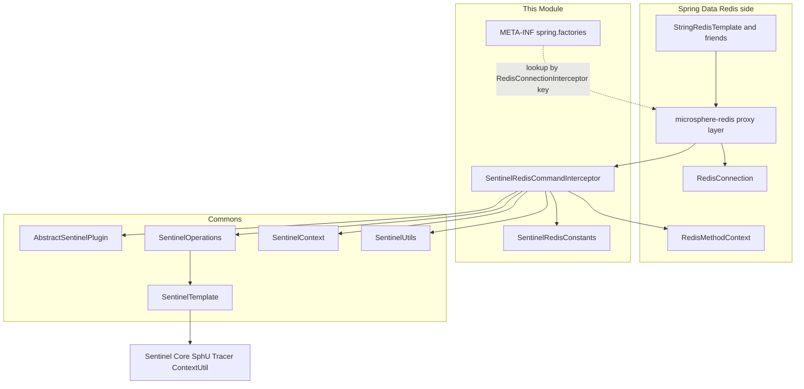
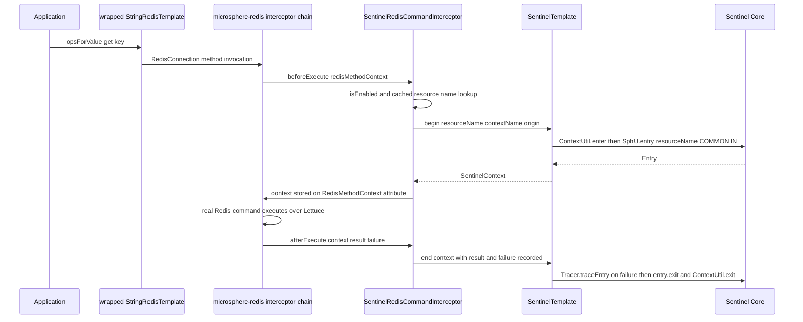
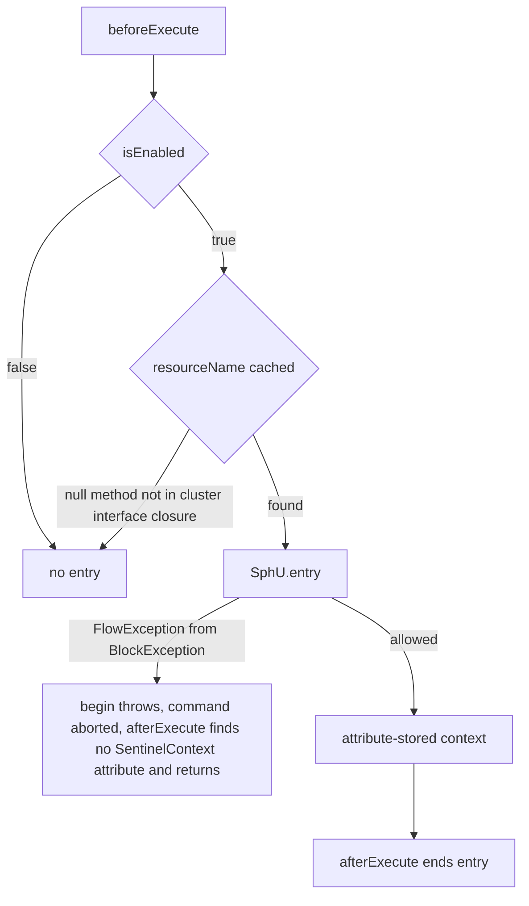
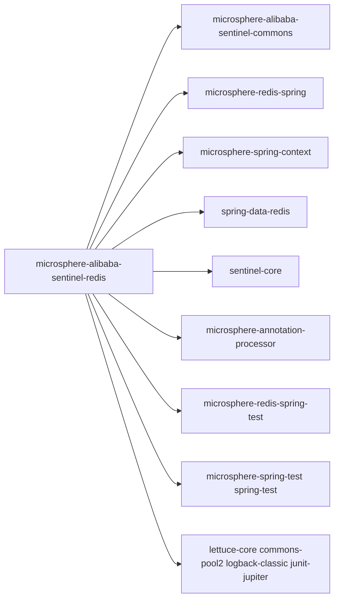

# microsphere-alibaba-sentinel-redis — Developer Guide

[中文版](zh/microsphere-alibaba-sentinel-redis.md)

> **Archived `1.x` line.** This page documents the internal design of the `0.1.x` artifacts (branch `release-1.x`, Java 8, Spring Boot 2.x, Spring Cloud Hoxton - 2021.0.x). The source tree is identical to the current line; only the POM baselines differ (javax Servlet API, `org.hibernate:hibernate-core`, `META-INF/spring.factories` auto-configuration registration). The current-line equivalent of this page is [../current/microsphere-alibaba-sentinel-redis.md](../current/microsphere-alibaba-sentinel-redis.md).

## Purpose and Scope

This module guards Spring Data Redis commands with Alibaba Sentinel.
`SentinelRedisCommandInterceptor` implements the `io.microsphere.redis.spring.interceptor.RedisConnectionInterceptor`
extension point from the sibling project `microsphere-redis` (artifact `microsphere-redis-spring`),
which decorates `RedisConnection` method invocations issued through wrapped `RedisTemplate`s.
Each intercepted connection method becomes one Sentinel resource.

Covered here:

- The `beforeExecute`/`afterExecute` interception pair and how it opens/closes a Sentinel entry.
- Resource-name construction from `RedisClusterConnection` interface methods via
  `SentinelUtils.buildResourceName(Method)` and a pre-populated method cache.
- What the module's `META-INF/spring.factories` registers.
- Enable/disable semantics and the Spring Boot auto-configuration seam.

Release line facts: 0.1.x, Java 8, `sentinel-core` 1.8.10; `sentinel-core`,
`microsphere-redis-spring`, `microsphere-spring-context` and `spring-data-redis` are optional.

## Architecture



## Source Analysis

### `io.microsphere.alibaba.sentinel.redis.spring.SentinelRedisCommandInterceptor`

Declared as
`public class SentinelRedisCommandInterceptor extends AbstractSentinelPlugin implements RedisConnectionInterceptor, InitializingBean, BeanClassLoaderAware`.

Fields and constructors:

- `private final Map<Method, String> methodResourceNamesCache = newFixedHashMap(512);`
- `private ClassLoader classLoader;` (injected by `BeanClassLoaderAware`).
- `private final SentinelOperations sentinelOperations;`
- `public SentinelRedisCommandInterceptor()` — `this(DEFAULT_CONTEXT_NAME, DEFAULT_ORIGIN)`.
- `public SentinelRedisCommandInterceptor(String contextName, String origin)` — calls
  `super(PLUGIN_NAME, contextName, origin)`; the three-argument `AbstractSentinelPlugin` form fixes
  `resourceType = ResourceTypeConstants.COMMON` and `trafficType = EntryType.IN` with
  `autoInstalled = true`, so the plugin self-registers into `SentinelPluginRepository.INSTANCE`
  with a shutdown-hook uninstall. Then `this.sentinelOperations = new SentinelTemplate(getResourceType(), getTrafficType())`.

Interception hooks:

- `public void beforeExecute(RedisMethodContext<RedisConnection> redisMethodContext) throws Throwable` —
  when `isEnabled()`: take `redisMethodContext.getMethod()`, look up its resource name in the cache
  (`private String getResourceName(Method method)`). A `null` name means the method is outside the
  cache scope: trace-log and return without opening an entry. Otherwise
  `sentinelOperations.begin(resourceName, getContextName(), getOrigin())` and
  `setContext(redisMethodContext, context)` — the `SentinelContext` travels on the
  `RedisMethodContext` attribute `sentinel-context` instead of a `ThreadLocal`, which is what makes
  the pairing safe across the proxy call.
- `public void afterExecute(RedisMethodContext<RedisConnection> redisMethodContext, Object result, Throwable failure)` —
  when `isEnabled()`: `getSentinelContext(redisMethodContext)`; if `null` (entry never opened) trace-log
  and return; else `sentinelContext.setResult(result)`, `sentinelContext.setFailure(failure)`, then
  `sentinelOperations.end(sentinelContext)` which runs `Tracer.traceEntry(failure, entry)` when the
  failure is non-`null`, then `entry.exit()` and `ContextUtil.exit()`.

Static context carriers:

- `public static void setContext(RedisMethodContext context, SentinelContext sentinelContext)` —
  `context.setAttribute(SENTINEL_CONTEXT_ATTRIBUTE_NAME, sentinelContext)`.
- `public static SentinelContext getSentinelContext(RedisMethodContext context)` — attribute cast back.

Initialization and ordering:

- `public void setBeanClassLoader(ClassLoader classLoader)` — stores the loader.
- `public void afterPropertiesSet()` — calls `initMethodResourceNamesCache()`.
- `private void initMethodResourceNamesCache()` — `ClassUtils.getAllInterfacesForClass(RedisClusterConnection.class, classLoader)`;
  for every returned interface, every `getMethods()` entry is cached under
  `SentinelUtils.buildResourceName(method)`, producing names of the shape
  `SimpleClassName.methodName(SimpleParamType1,SimpleParamType2)`. Methods not present in this
  cluster-connection interface closure are deliberately not intercepted.
- `public int getOrder()` — returns `DEFAULT_PRIORITY` (9 from commons `SentinelConstants`), placing
  this interceptor in the ordered interceptor chain of microsphere-redis.

### `io.microsphere.alibaba.sentinel.redis.SentinelRedisConstants`

Asserted by `SentinelRedisConstantsTest`:

- `String PLUGIN_NAME = "redis"`.
- `String DEFAULT_CONTEXT_NAME = "microsphere_sentinel_redis_context"`.
- `String DEFAULT_ORIGIN = "RedisConnection"`.
- `String ENABLED_PROPERTY_NAME = "microsphere.sentinel.redis.enabled"` — `@ConfigurationProperty`
  with sources `SYSTEM_PROPERTIES_SOURCE` and `APPLICATION_SOURCE`; the runtime check in
  `SentinelUtils.isPluginEnabled` reads it as a JVM system property, default `true`.

### `META-INF/spring.factories`

The file contains exactly one mapping — a microsphere-redis factory-lookup key, **not** a Spring Boot
auto-configuration key:

```
io.microsphere.redis.spring.interceptor.RedisConnectionInterceptor=\
io.microsphere.alibaba.sentinel.redis.spring.SentinelRedisCommandInterceptor
```

It contributes the interceptor class under the `RedisConnectionInterceptor` SPI-like key so the
microsphere-redis infrastructure can collect and chain it.

### Tests

`SentinelRedisCommandInterceptorTest` runs with `@SpringJUnitConfig(classes = {RedisConfig.class, test})`,
`@TestPropertySource(properties = {"microsphere.redis.enabled=true", "spring.application.name=test-app"})`
and `@EnableRedisInterceptor(wrapRedisTemplates = "stringRedisTemplate")`. `RedisConfig` comes from
`microsphere-redis-spring-test`; the test classpath adds `io.lettuce:lettuce-core` and
`org.apache.commons:commons-pool2` (test scope) as the Lettuce connection pool used by that config.

- `test()` — `valueOperations.set("key","value")` then `get`, asserting the value round-trips, plus
  `assertEquals(DEFAULT_PRIORITY, interceptor.getOrder())` and a `postTest()` that enters
  `microsphere_sentinel_redis_context`/`RedisConnection` and asserts non-empty entrance children.
- `testDisabled()` — `setEnabled(false)`, reruns the same flow without protection, then re-enables.
- `testResourceNotFound()` — builds a `RedisMethodContext` around an unrelated
  `getClass().getMethods()[0]`; both `beforeExecute` and `afterExecute(..., null, null)` must not throw
  (cache miss path).

## Design Patterns

- **Chain of Responsibility / Interceptor**: `RedisConnectionInterceptor` implementations are ordered
  (`getOrder()` = 9) around each connection-method invocation.
- **Decorator**: microsphere-redis wraps `RedisTemplate`s (`@EnableRedisInterceptor(wrapRedisTemplates = ...)`)
  so connection calls pass the interceptor chain.
- **Template**: the `AbstractSentinelPlugin` inheritance supplies enabled-state and metadata;
  `SentinelTemplate` supplies the entry lifecycle.
- **Cache/Memoization**: `methodResourceNamesCache` maps `Method` → resource name once at
  `afterPropertiesSet`.
- **Attribute-based context passing**: `SentinelContext` is stashed on `RedisMethodContext` under
  `sentinel-context`, a blackboard-style handoff between hooks.

## Core Flows

### Redis command protection flow



### Block and skip paths



## Dependencies



| Dependency | Scope in pom |
|---|---|
| io.github.microsphere-projects:microsphere-annotation-processor | compile, optional |
| io.github.microsphere-projects:microsphere-alibaba-sentinel-commons | compile |
| io.github.microsphere-projects:microsphere-redis-spring | compile, optional |
| io.github.microsphere-projects:microsphere-spring-context | compile, optional |
| com.alibaba.csp:sentinel-core | compile, optional |
| org.springframework.data:spring-data-redis | compile, optional |
| org.junit.jupiter:junit-jupiter | test |
| ch.qos.logback:logback-classic | test |
| io.github.microsphere-projects:microsphere-spring-test | test |
| io.github.microsphere-projects:microsphere-redis-spring-test | test |
| org.springframework:spring-test | test |
| io.lettuce:lettuce-core | test |
| org.apache.commons:commons-pool2 | test |

## Extension Points

- **Custom interceptor chain**: register additional `RedisConnectionInterceptor` implementations
  under the same `spring.factories` key or via `@EnableRedisInterceptor`; ordering is `Ordered`-driven.
- **Bean override**: `SentinelRedisAutoConfiguration` (spring-boot module) declares
  `sentinelRedisCommandInterceptor()` with `@Bean @ConditionalOnMissingBean`, guarded by
  `@ConditionalOnSentinelAvailable`, `@ConditionalOnRedisAvailable`,
  `@ConditionalOnRedisInterceptorEnabled` and `@ConditionalOnProperty(ENABLED_PROPERTY_NAME, matchIfMissing = true)` —
  define your own bean (e.g. with custom context name/origin) to replace it.
- **Resource naming**: the cache is built from `SentinelUtils.buildResourceName`; subclass and
  rebuild `methodResourceNamesCache` (or intercept earlier) for custom names.
- **Switching**: `setEnabled(false)` at runtime or `microsphere.sentinel.redis.enabled=false`.

## Related Modules

- Developer guide index: [README](./README.md)
- [microsphere-alibaba-sentinel-commons](./microsphere-alibaba-sentinel-commons.md) — `AbstractSentinelPlugin`,
  `SentinelTemplate`, `SentinelContext`, `SentinelUtils`, `SentinelConstants`.
- [microsphere-alibaba-sentinel-spring-boot](./microsphere-alibaba-sentinel-spring-boot.md) —
  `SentinelRedisAutoConfiguration`.
- [microsphere-alibaba-sentinel-spring-web](./microsphere-alibaba-sentinel-spring-web.md) — sibling
  interceptor plugin.
- User guide counterpart: [../../user-guide/1.x/microsphere-alibaba-sentinel-redis.md](../../user-guide/1.x/microsphere-alibaba-sentinel-redis.md)

---

## 中文

[中文版](zh/microsphere-alibaba-sentinel-redis.md)
