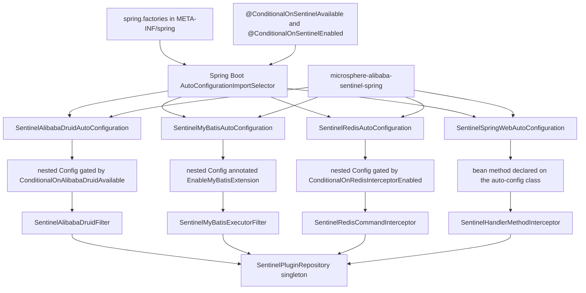
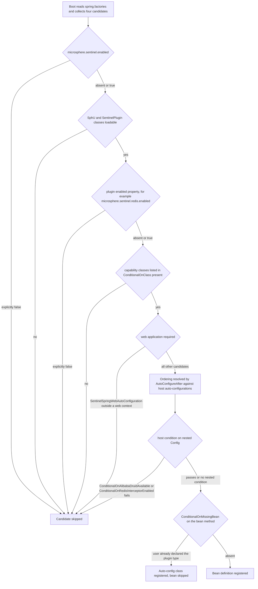
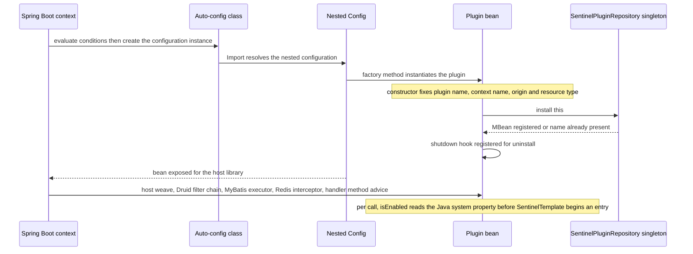
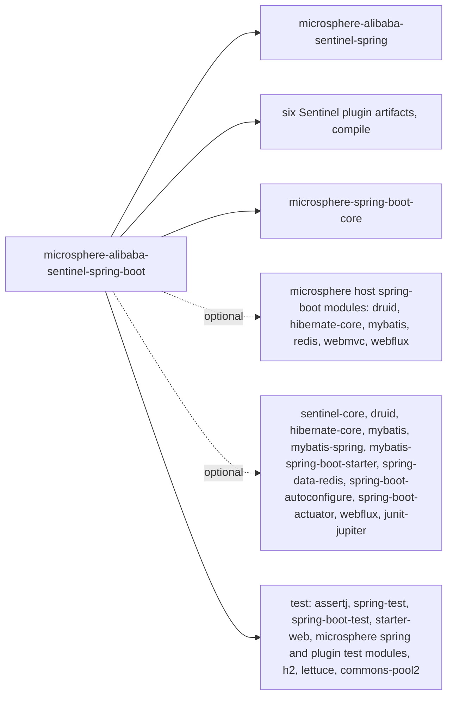

# microsphere-alibaba-sentinel-spring-boot — Developer Guide

[中文版](zh/microsphere-alibaba-sentinel-spring-boot.md)

> **Archived `1.x` line.** This page documents the internal design of the `0.1.x` artifacts (branch `release-1.x`, Java 8, Spring Boot 2.x, Spring Cloud Hoxton - 2021.0.x). The source tree is identical to the current line; only the POM baselines differ (javax Servlet API, `org.hibernate:hibernate-core`, `META-INF/spring.factories` auto-configuration registration). The current-line equivalent of this page is [../current/microsphere-alibaba-sentinel-spring-boot.md](../current/microsphere-alibaba-sentinel-spring-boot.md).

## Purpose and Scope

`microsphere-alibaba-sentinel-spring-boot` turns the Sentinel plugins into Spring Boot
auto-configurations. It owns exactly six Java types and one registration file:

| Type | Role |
|---|---|
| `SentinelAlibabaDruidAutoConfiguration` | Publishes `SentinelAlibabaDruidFilter` |
| `SentinelMyBatisAutoConfiguration` | Publishes `SentinelMyBatisExecutorFilter` and enables the MyBatis extension mechanism |
| `SentinelRedisAutoConfiguration` | Publishes `SentinelRedisCommandInterceptor` |
| `SentinelSpringWebAutoConfiguration` | Publishes `SentinelHandlerMethodInterceptor` in web applications |
| `@ConditionalOnSentinelEnabled` | Composite annotation over `@ConditionalOnProperty` |
| `@ConditionalOnSentinelAvailable` | Composite annotation over `@ConditionalOnSentinelEnabled` + `@ConditionalOnClass` |
| `META-INF/spring.factories` | Lists all four auto-config classes |

Scope limits worth knowing before you extend the module: there is no Hibernate auto-configuration,
no P6Spy auto-configuration, no `@ConfigurationProperties` class, no actuator endpoint and no
`spring-configuration-metadata.json` in this module. Properties are consumed by name through
constants defined in commons and in the plugin modules.

## Architecture



All four bean types register themselves into the commons plugin repository when they are
constructed, which is what makes them visible to the Spring Cloud feature report documented in
[./microsphere-alibaba-sentinel-spring-cloud.md](./microsphere-alibaba-sentinel-spring-cloud.md).

## Source Analysis

### Package layout

```
io.microsphere.alibaba.sentinel.spring.boot.autoconfigure   four auto-config classes
io.microsphere.alibaba.sentinel.spring.boot.condition       two composite condition annotations
META-INF/spring.factories
```

### The condition annotations

`ConditionalOnSentinelEnabled` is a `@Target({TYPE, METHOD})` annotation meta-annotated with
`@ConditionalOnProperty(name = ENABLED_PROPERTY_NAME, matchIfMissing = true)`, where the constant
comes from `SentinelConstants` and equals `microsphere.sentinel.enabled`.

`ConditionalOnSentinelAvailable` stacks `@ConditionalOnSentinelEnabled` and
`@ConditionalOnClass(name = {"com.alibaba.csp.sentinel.SphU", "io.microsphere.alibaba.sentinel.common.SentinelPlugin"})`.

Both are **meta-annotation compositions of Spring Boot conditions**, not subclasses of
`org.springframework.context.annotation.Condition`; the module declares no custom `Condition`
implementation. Their Javadoc states the same contract, and the tests confirm it: filtering out
`SphU` or `SentinelPlugin` with a `FilteredClassLoader` removes every auto-configured bean.

Two independent enable switches exist and are frequently confused:

1. Condition time — `@ConditionalOnProperty` reads the Spring `Environment`, so it decides
   whether a bean definition is registered at all.
2. Invocation time — `SentinelUtils.isPluginEnabled(pluginName)` reads the **Java system
   property** `microsphere.sentinel.<plugin>.enabled`, defaulting to enabled unless the value is
   the literal string `false`. This is what the plugin checks on every intercepted call.

### Auto-configuration anatomy

Every auto-config class follows the same template:

- gated by `@ConditionalOnSentinelAvailable`;
- gated by `@ConditionalOnProperty(name = <plugin ENABLED_PROPERTY_NAME>, matchIfMissing = true)`;
- gated by `@ConditionalOnClass(name = ...)` listing the host-library classes and the plugin
  classes, always by name so that missing types never trigger `NoClassDefFoundError`;
- ordered with `@AutoConfigureAfter(name = ...)` — all four name
  `com.alibaba.cloud.sentinel.custom.SentinelAutoConfiguration` first, so the Spring Cloud Alibaba
  Sentinel beans exist before ours, then the Microsphere host auto-configurations;
- `@Import` of a nested static `Config` class, except for the web one.

The bean factory methods are all `@Bean @ConditionalOnMissingBean` and take no arguments:

| Auto-config | Bean method | Instantiated type | Host-side weaving owner |
|---|---|---|---|
| `SentinelAlibabaDruidAutoConfiguration` | `sentinelAlibabaDruidFilter()` | `SentinelAlibabaDruidFilter`, a Druid statement filter built on `AbstractStatementFilter` | the Druid auto-configuration of `microsphere-alibaba-druid-spring-boot`, gated here by `@ConditionalOnAlibabaDruidAvailable` |
| `SentinelMyBatisAutoConfiguration` | `sentinelMyBatisExecutorFilter()` | `SentinelMyBatisExecutorFilter implements ExecutorFilter` | `@EnableMyBatisExtension` from `microsphere-mybatis-spring` |
| `SentinelRedisAutoConfiguration` | `sentinelRedisCommandInterceptor()` | `SentinelRedisCommandInterceptor implements RedisConnectionInterceptor` | `microsphere-redis-spring-boot` interceptor chain |
| `SentinelSpringWebAutoConfiguration` | `sentinelHandlerMethodInterceptor()` | `SentinelHandlerMethodInterceptor implements HandlerMethodInterceptor` | Microsphere WebMVC / WebFlux auto-configurations |

None of the factory methods "installs" anything explicitly. Installation happens inside the
plugin constructors: `AbstractSentinelPlugin` calls `SentinelPlugin.install(this)` when
`autoInstalled` is true, which is the case for MyBatis, Redis and Spring Web;
`SentinelAlibabaDruidFilter` composes a `SimpleSentinelPlugin` delegate with `autoInstalled = false`
and calls `install(this)` itself. `SentinelPlugin.install` writes into
`SentinelPluginRepository.INSTANCE` and registers a JVM shutdown hook that uninstalls the plugin.

### What is deliberately absent

- **Hibernate.** `SentinelHibernateEntityCallback` implements the `EntityCallback` SPI of
  Microsphere Hibernate and is registered by the service file
  `META-INF/services/io.microsphere.hibernate.entity.EntityCallback` shipped inside
  `microsphere-alibaba-sentinel-hibernate-core`. That SPI is consumed by the
  `microsphere-hibernate-core` optional dependency, so no Spring bean and therefore no
  auto-configuration is involved; this module still depends on
  `microsphere-alibaba-sentinel-hibernate-core` at compile scope, which puts the service file on
  the classpath of every Boot consumer.
- **P6Spy.** `microsphere-alibaba-sentinel-p6spy` is neither a dependency of this module nor
  referenced by any condition; it hooks in through
  `META-INF/services/com.p6spy.engine.event.JdbcEventListener`, i.e. the P6Spy JDBC agent, which
  is not a Spring concept.
- **`spring.factories`.** The module registers auto-configurations only through the Boot 2
  `spring.factories` file; a search across the `release-1.x` branch finds legacy
  `spring.factories` files only inside the Redis and Spring Web plugin jars, and those use custom
  SPI keys (`io.microsphere.redis.spring.interceptor.RedisConnectionInterceptor`,
  `io.microsphere.spring.web.method.support.HandlerMethodInterceptor`), not the
  `EnableAutoConfiguration` key.

### Tests

`AutoConfigurationTest<A>` is the shared fixture. Its constructor derives the auto-config class
from the generic parameter via `ResolvableType`, then builds both an `ApplicationContextRunner`
and a `WebApplicationContextRunner` configured with `AutoConfigurations.of(...)`. Three inherited
tests run for every subclass: `testAutoConfiguredClasses`, `testOnGlobalDisabledProperty`
(always includes `microsphere.sentinel.enabled=false`) and `testOnGlobalMissingClass` (always
includes `SphU` and `SentinelPlugin`). Subclasses add plugin-specific negative cases — for example
`SentinelRedisAutoConfigurationTest` filters `RedisConnection` and asserts
`microsphere.redis.interceptor.enabled=false`, and `SentinelSpringWebAutoConfigurationTest`
overrides `testAutoConfiguredClasses` to assert the opposite: the plain context has no bean while
the web context has both the auto-config class and the interceptor.
`SentinelAutoConfigurationTest` is the odd one out: a `@SpringBootTest` with
`webEnvironment = RANDOM_PORT` that boots MyBatis plus Redis configurations, exercises a mapper
call and a `StringRedisTemplate` round-trip, then asserts that the contexts
`microsphere_sentinel_alibaba_druid_context`, `microsphere_sentinel_mybatis_context` and
`microsphere_sentinel_redis_context` can be entered. It needs a local Redis, provided in CI by
`docker/test-services.yml`.

## Design Patterns

| Pattern | Implementation in this module |
|---|---|
| Auto-Configuration | Four classes registered through `spring.factories`, ordered with `@AutoConfigureAfter` |
| Condition | Composite annotations `@ConditionalOnSentinelEnabled` and `@ConditionalOnSentinelAvailable` built from Boot's `ConditionalOnProperty` and `ConditionalOnClass`; the host libraries contribute `@ConditionalOnAlibabaDruidAvailable` and `@ConditionalOnRedisInterceptorEnabled`, and `@ConditionalOnWebApplication` gates the web candidate |
| Nested configuration as conditional scope | A static `Config` class isolates the plugin bean from the ordering conditions of the outer class — gated for Druid and Redis, annotated `@EnableMyBatisExtension` for MyBatis, and simply absent for Spring Web where the bean method sits on the auto-config class |
| Facade | A bean factory method hides plugin construction details — plugin name, context name, origin, resource type and traffic type are all fixed inside the plugin classes |
| Registry | Every created plugin instance registers itself in the commons `SentinelPluginRepository` singleton, with a shutdown hook for uninstall |
| Template Method | `AbstractSentinelPlugin` supplies `isEnabled`, `getName`, `getContextName` and auto-install; the plugin `beforeExecute` / `afterExecute` hooks delegate to the commons `SentinelTemplate` |

## Core Flows

### Condition evaluation



### Startup sequence of one auto-configuration



## Dependencies



Direct dependency scopes declared in the pom:

| Group | Coordinates | Scope |
|---|---|---|
| Project, mandatory | `microsphere-alibaba-sentinel-spring`, `microsphere-alibaba-sentinel-alibaba-druid`, `microsphere-alibaba-sentinel-hibernate-core`, `microsphere-alibaba-sentinel-mybatis`, `microsphere-alibaba-sentinel-redis`, `microsphere-alibaba-sentinel-spring-web` | compile, version `${revision}` |
| Project, mandatory | `microsphere-spring-boot-core` | compile, version from the imported BOMs |
| Project, optional | `microsphere-alibaba-druid-spring-boot`, `microsphere-hibernate-core`, `microsphere-mybatis-spring-boot`, `microsphere-redis-spring-boot`, `microsphere-spring-boot-webmvc`, `microsphere-spring-boot-webflux` | compile, optional |
| Third-party, optional | `sentinel-core`, `druid`, `hibernate-core`, `mybatis`, `mybatis-spring`, `mybatis-spring-boot-starter`, `spring-data-redis`, `spring-boot-autoconfigure`, `spring-boot-actuator`, `spring-boot-starter-webflux`, `junit-jupiter` | compile, optional |
| Test | `assertj-core`, `spring-test`, `spring-boot-test`, `spring-boot-starter-web`, `microsphere-spring-test`, `microsphere-alibaba-druid-spring-test`, `microsphere-hibernate-test`, `microsphere-mybatis-spring-test`, `microsphere-redis-spring-test`, `h2`, `lettuce-core`, `commons-pool2` | test |

`junit-jupiter` is declared `optional` at compile scope rather than `test`, which keeps JUnit 5 on
this module's own classpath and lets downstream projects compile tests against it version-free.

## Extension Points

| Property | Effect when set to `false` | Source of the name |
|---|---|---|
| `microsphere.sentinel.enabled` | Every auto-configuration in this module is skipped | `SentinelConstants.ENABLED_PROPERTY_NAME` |
| `microsphere.sentinel.alibaba-druid.enabled` | Druid auto-config skipped | `SentinelAlibabaDruidConstants` with `PLUGIN_NAME` `alibaba-druid` |
| `microsphere.sentinel.mybatis.enabled` | MyBatis auto-config skipped | `SentinelMyBatisConstants` with `PLUGIN_NAME` `mybatis` |
| `microsphere.sentinel.redis.enabled` | Redis auto-config skipped | `SentinelRedisConstants` with `PLUGIN_NAME` `redis` |
| `microsphere.sentinel.spring-web.enabled` | Spring Web auto-config skipped | `SentinelSpringWebConstants` with `PLUGIN_NAME` `spring-web` |
| `microsphere.sentinel.hibernate.enabled` | No condition exists; only the runtime `isEnabled` check in the entity callback reacts | `SentinelHibernateConstants` |
| `microsphere.sentinel.p6spy.enabled` | Runtime check inside the P6Spy listener only | `SentinelP6SpyConstants` |

Host-library switches observed by the tests and also honoured: `microsphere.alibaba.druid.enabled`,
`microsphere.mybatis.enabled`, `microsphere.redis.enabled`, `microsphere.redis.interceptor.enabled`.

To add a plugin auto-configuration:

1. Add the plugin artifact as a `${revision}` compile dependency and its host library as `optional`.
2. Create `SentinelXxxAutoConfiguration` with the shared template described above, reusing
   `@ConditionalOnSentinelAvailable` and the plugin `ENABLED_PROPERTY_NAME` constant.
3. Append the fully qualified class name to `spring.factories`; a `spring.factories` key
   would be ignored by Boot 2.
4. Extend `AutoConfigurationTest<SentinelXxxAutoConfiguration>` and implement the three
   `configure...` hooks so the global disabled property and global missing class cases are covered.
5. Override a plugin bean by declaring your own bean of the same type; `@ConditionalOnMissingBean`
   lets the user definition win.

## Related Modules

- Developer guide index: [./README.md](./README.md)
- Spring classpath foundation: [./microsphere-alibaba-sentinel-spring.md](./microsphere-alibaba-sentinel-spring.md)
- Plugin model and repository: [./microsphere-alibaba-sentinel-commons.md](./microsphere-alibaba-sentinel-commons.md)
- Plugins wired here: [./microsphere-alibaba-sentinel-alibaba-druid.md](./microsphere-alibaba-sentinel-alibaba-druid.md), [./microsphere-alibaba-sentinel-mybatis.md](./microsphere-alibaba-sentinel-mybatis.md), [./microsphere-alibaba-sentinel-redis.md](./microsphere-alibaba-sentinel-redis.md), [./microsphere-alibaba-sentinel-spring-web.md](./microsphere-alibaba-sentinel-spring-web.md), [./microsphere-alibaba-sentinel-hibernate-core.md](./microsphere-alibaba-sentinel-hibernate-core.md), [./microsphere-alibaba-sentinel-p6spy.md](./microsphere-alibaba-sentinel-p6spy.md)
- Spring Cloud feature reporting: [./microsphere-alibaba-sentinel-spring-cloud.md](./microsphere-alibaba-sentinel-spring-cloud.md)
- Version management: [./microsphere-alibaba-sentinel-parent.md](./microsphere-alibaba-sentinel-parent.md)
- User-facing documentation: [../../user-guide/1.x/microsphere-alibaba-sentinel-spring-boot.md](../../user-guide/1.x/microsphere-alibaba-sentinel-spring-boot.md)

---

## 中文

[中文版](zh/microsphere-alibaba-sentinel-spring-boot.md)
