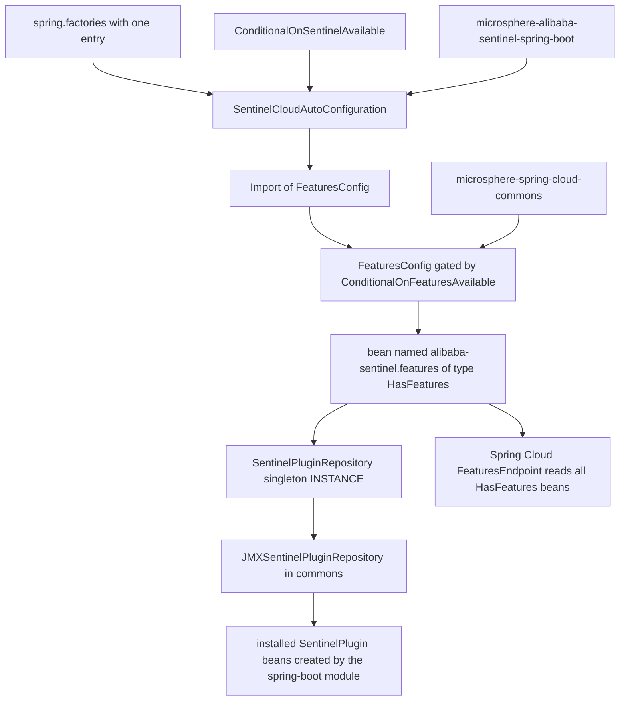
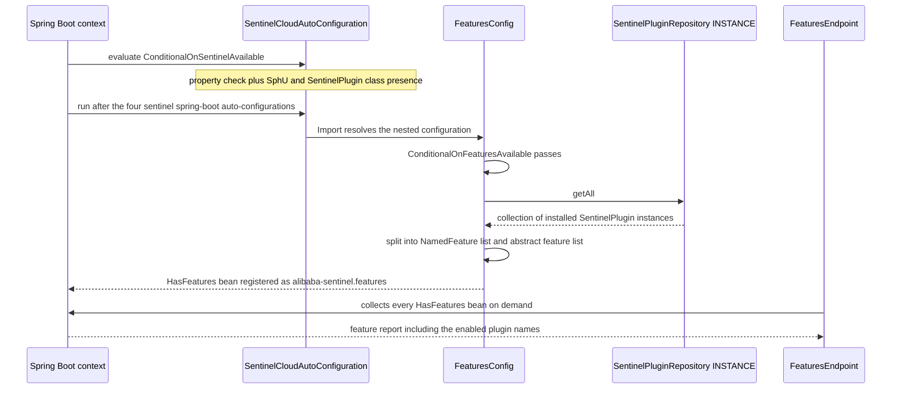
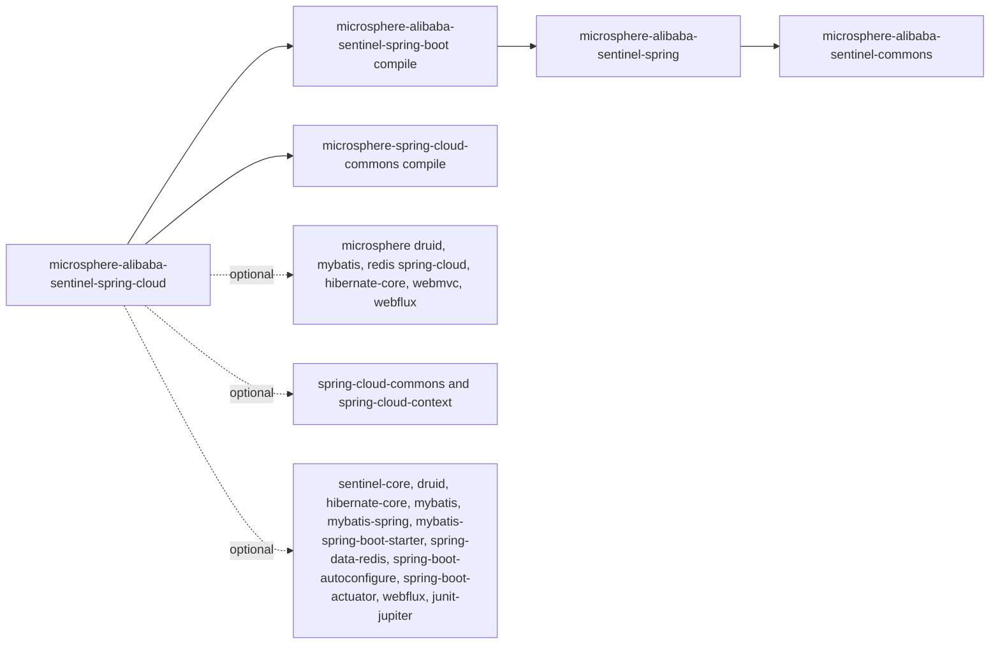

# microsphere-alibaba-sentinel-spring-cloud — Developer Guide

[中文版](zh/microsphere-alibaba-sentinel-spring-cloud.md)

> **Archived `1.x` line.** This page documents the internal design of the `0.1.x` artifacts (branch `release-1.x`, Java 8, Spring Boot 2.x, Spring Cloud Hoxton - 2021.0.x). The source tree is identical to the current line; only the POM baselines differ (javax Servlet API, `org.hibernate:hibernate-core`, `META-INF/spring.factories` auto-configuration registration). The current-line equivalent of this page is [../current/microsphere-alibaba-sentinel-spring-cloud.md](../current/microsphere-alibaba-sentinel-spring-cloud.md).

## Purpose and Scope

`microsphere-alibaba-sentinel-spring-cloud` is the thinnest layer of the library. On the
`release` branch it contributes exactly one auto-configuration class, one registration file and
one test:

| Artifact | Content |
|---|---|
| `SentinelCloudAutoConfiguration` | Declared in `io.microsphere.alibaba.sentinel.spring.cloud` |
| `SentinelCloudAutoConfiguration.FeaturesConfig` | Nested configuration holding the feature bean |
| `META-INF/spring.factories` | Single line naming `SentinelCloudAutoConfiguration` |
| `SentinelCloudAutoConfigurationTest` | `@SpringBootTest` asserting the features endpoint |

The only behaviour added on top of `microsphere-alibaba-sentinel-spring-boot` is **Spring Cloud
feature reporting**: an `alibaba-sentinel.features` bean of type
`org.springframework.cloud.client.actuator.HasFeatures` is published so that the Spring Cloud
`FeaturesEndpoint` lists every installed and enabled Sentinel plugin.

Explicitly out of scope, verified against the source: the module declares **no** bootstrap
`ApplicationContext` contribution, **no** `RefreshScope` or `@RefreshScope` usage, no `ContextRefresher`
hook, no `spring.factories` file, and no configuration-properties binding. Everything refresh-aware
or bootstrap-aware comes from the sibling Spring Cloud modules of the host libraries
(`microsphere-alibaba-druid-spring-cloud`, `microsphere-mybatis-spring-cloud`,
`microsphere-redis-spring-cloud`), which this module only orders itself after.

## Architecture

The repository lookup is a read-only traversal: `INSTANCE.getAll()` returns the collection of
plugins that the four Boot auto-configurations created earlier in the same context.

## Source Analysis

### Class structure

`SentinelCloudAutoConfiguration` carries three annotations and no fields or methods of its own:

- `@ConditionalOnSentinelAvailable` — reuse of the spring-boot module condition, i.e.
  `microsphere.sentinel.enabled` must not be `false` and both `com.alibaba.csp.sentinel.SphU` and
  `io.microsphere.alibaba.sentinel.common.SentinelPlugin` must be loadable.
- `@AutoConfigureAfter(name = {...})` with nine names: `com.alibaba.cloud.sentinel.custom.SentinelAutoConfiguration`,
  the three Microsphere Cloud auto-configurations for Druid, MyBatis and Redis,
  `ConfigurationPropertyHasFeaturesAutoConfiguration` from `microsphere-spring-cloud-commons`,
  and the four `microsphere-alibaba-sentinel-spring-boot` auto-configurations. Using class names
  instead of `Class` literals keeps the ordering declarative when those optional libraries are absent.
- `@Import(SentinelCloudAutoConfiguration.FeaturesConfig.class)`.

The nested `FeaturesConfig` is `public static` and annotated with `@ConditionalOnFeaturesAvailable`
from `io.microsphere.spring.cloud.client.condition`. It exposes the constant
`BEAN_NAME = "alibaba-sentinel.features"`.

### The feature bean algorithm

`features()` is the only `@Bean` method:

1. Read `SentinelPluginRepository.INSTANCE`.
2. Call `getAll()` to obtain every installed `SentinelPlugin`.
3. For each plugin, ask `isEnabled()`; enabled plugins become `new NamedFeature(plugin.getName(), plugin.getClass())`
   and are added to `namedFeatures`.
4. Disabled plugins are not reported by name; their `Class` objects are collected in
   `abstractFeatures` instead, which is the `HasFeatures` convention for features that exist but
   are not activatable.
5. Return `new HasFeatures(abstractFeatures, namedFeatures)`.

Both lists come from `ListUtils.newLinkedList()`. There is no `@ConditionalOnMissingBean`, so a
duplicate bean name would clash; downstream applications override by name rather than by type.

Because the bean is materialised once, the report is a snapshot of the repository at the moment
the features bean is created — which is precisely why the nine `@AutoConfigureAfter` names matter:
they push this auto-configuration to the end so that all plugin beans are already instantiated.

### Repository indirection

`SentinelPluginRepository.INSTANCE` is loaded with
`loadFirstService(SentinelPluginRepository.class, true)`. The commons jar ships
`META-INF/services/io.microsphere.alibaba.sentinel.common.SentinelPluginRepository` naming
`io.microsphere.alibaba.sentinel.jmx.JMXSentinelPluginRepository`, so the "registry" that this
module reads is the JMX one. It is a decorator: `install` registers a `StandardMBean` over the
`SentinelPlugin` interface under the domain `io.microsphere.sentinel` with the object name pattern
`type=SentinelPlugin,name=<plugin>`, then forwards to an internal
`SimpleSentinelPluginRepository`; `getAll` queries the registered MBean names and returns an empty
list when none exist, otherwise it returns the delegate collection. `clear` iterates the queried
names and uninstalls each one. The class implements `Prioritized` with `DEFAULT_PRIORITY` 9; since
the service file declares this single implementation, it is the resolved singleton, and the
priority only becomes decisive when a consumer contributes a second service entry. The net effect
for this module is that the plugin list is also inspectable with standard JMX tooling.

### Test

`SentinelCloudAutoConfigurationTest` boots with `webEnvironment = NONE`,
`@EnableAutoConfiguration`, and the properties `spring.application.name=test-app` plus
`management.endpoints.web.exposure.include=features`. It autowires `Map<String, HasFeatures>` and
`FeaturesEndpoint`, asserts the bean name constant equals `alibaba-sentinel.features`, asserts the
map contains that key and asserts `featuresEndpoint.features()` is not null. No condition-negative
test exists here, unlike the spring-boot module: skipping behaviour is inherited from
`@ConditionalOnSentinelAvailable` and is covered by the spring-boot tests.

## Design Patterns

| Pattern | Implementation in this module |
|---|---|
| Auto-Configuration | One class registered through `spring.factories`; ordering enforced by nine `@AutoConfigureAfter` names |
| Condition | `@ConditionalOnSentinelAvailable` for the class and `@ConditionalOnFeaturesAvailable` for the nested config — both composite meta-annotation conditions, no custom `Condition` subclass |
| Facade | `features()` presents the whole plugin subsystem as one Spring Cloud actuator feature record; callers never touch plugin types |
| Registry | Reads the commons `SentinelPluginRepository` singleton, backed by `JMXSentinelPluginRepository`, populated by plugin constructors in the spring-boot layer |
| Snapshot on creation | The report is computed inside the factory method, so `@AutoConfigureAfter` ordering is part of the correctness of the pattern |

## Core Flows

## Dependencies

| Group | Coordinates | Scope |
|---|---|---|
| Project, mandatory | `microsphere-alibaba-sentinel-spring-boot` | compile, version `${revision}` |
| Project, mandatory | `microsphere-spring-cloud-commons` | compile, version from `microsphere-spring-cloud-dependencies` 0.1.26 |
| Project, optional | `microsphere-alibaba-druid-spring-cloud`, `microsphere-hibernate-core`, `microsphere-mybatis-spring-cloud`, `microsphere-redis-spring-cloud`, `microsphere-spring-boot-webmvc`, `microsphere-spring-boot-webflux` | compile, optional |
| Third-party, optional | `sentinel-core`, `druid`, `hibernate-core`, `mybatis`, `mybatis-spring`, `mybatis-spring-boot-starter`, `spring-data-redis`, `spring-cloud-commons`, `spring-cloud-context`, `spring-boot-autoconfigure`, `spring-boot-actuator`, `spring-boot-starter-webflux`, `junit-jupiter` | compile, optional |
| Test | `assertj-core`, `spring-test`, `spring-boot-test`, `spring-boot-starter-web`, `microsphere-spring-test`, `microsphere-alibaba-druid-spring-test`, `microsphere-hibernate-test`, `microsphere-mybatis-spring-test`, `microsphere-redis-spring-test`, `h2`, `lettuce-core`, `commons-pool2` | test |

`HasFeatures`, `NamedFeature` and `FeaturesEndpoint` all live in the
`org.springframework.cloud.client.actuator` package of `spring-cloud-commons`. The entry is declared
`optional`, which only stops Maven from propagating it to consumers — the library is still on this
module's own compile and test classpath, which is why the test can autowire `FeaturesEndpoint`
while applications that consume this artifact must bring `spring-cloud-commons` themselves.

Note that the six Sentinel plugin artifacts are **not** declared directly here — they reach the
classpath transitively from the spring-boot dependency, which is why the module can still see
`SentinelPlugin` implementations without repeating the list.

## Extension Points

| Need | How |
|---|---|
| Report a new plugin as a feature | Nothing to change here as long as the plugin implements `SentinelPlugin` and is constructed by an auto-configuration; it appears in `getAll()` automatically |
| Guarantee a new auto-configuration is counted | Append its fully qualified name to the `@AutoConfigureAfter` list of `SentinelCloudAutoConfiguration` |
| Disable the feature bean | Set `microsphere.sentinel.enabled=false`, or remove `spring-cloud-commons`, or satisfy the negative branch of `@ConditionalOnFeaturesAvailable` |
| Replace the feature bean | Declare your own bean with the name `alibaba-sentinel.features`; there is no `@ConditionalOnMissingBean` guard, so the later definition wins according to the usual bean-overriding rules |
| Change what "disabled" means | `SentinelPlugin.isEnabled()` in commons, currently resolved through `SentinelUtils.isPluginEnabled` and the Java system property `microsphere.sentinel.<plugin>.enabled` |
| Publish the artifact | It is already managed in [./microsphere-alibaba-sentinel-dependencies.md](./microsphere-alibaba-sentinel-dependencies.md); versions come from [./microsphere-alibaba-sentinel-parent.md](./microsphere-alibaba-sentinel-parent.md) |

## Related Modules

- Developer guide index: [./README.md](./README.md)
- Layer below: [./microsphere-alibaba-sentinel-spring-boot.md](./microsphere-alibaba-sentinel-spring-boot.md)
- Plugin registry it reads: [./microsphere-alibaba-sentinel-commons.md](./microsphere-alibaba-sentinel-commons.md)
- Spring classpath foundation: [./microsphere-alibaba-sentinel-spring.md](./microsphere-alibaba-sentinel-spring.md)
- Aggregated plugins: [./microsphere-alibaba-sentinel-plugins.md](./microsphere-alibaba-sentinel-plugins.md)
- Version management: [./microsphere-alibaba-sentinel-parent.md](./microsphere-alibaba-sentinel-parent.md), [./microsphere-alibaba-sentinel-dependencies.md](./microsphere-alibaba-sentinel-dependencies.md)
- User-facing documentation: [../../user-guide/1.x/microsphere-alibaba-sentinel-spring-cloud.md](../../user-guide/1.x/microsphere-alibaba-sentinel-spring-cloud.md)

---

## 中文

[中文版](zh/microsphere-alibaba-sentinel-spring-cloud.md)
