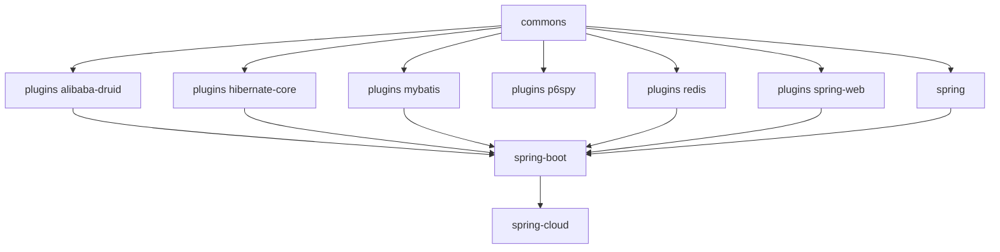

# 开发者指南 — 1.x（release-1.x 分支，0.1.x）

[English](../README.md) · [开发者指南总目录](../../zh/README.md)

这些文档分析 `release-1.x` 分支（`0.1.x` 版本线）的实现，该版本线面向遗留的
Java 8 / Spring Boot 2.x 应用持续维护。

## 实现基线

| 项目                  | 值                                                             |
|-----------------------|----------------------------------------------------------------|
| 源码分支         | `release-1.x`（修订号 `0.1.6-SNAPSHOT`，已发布 `0.1.0` – `0.1.5`） |
| 语言级别        | Java 8                                                         |
| 框架代际  | Spring Boot 2.x / Spring Cloud Hoxton – 2021.0.x               |
| Sentinel              | `sentinel-core` 1.8.10                                         |
| 自动配置机制 | `META-INF/spring.factories`（`EnableAutoConfiguration` 键）    |
| Servlet 命名空间     | `javax.servlet`                                                |

## 阅读顺序

1. [commons](microsphere-alibaba-sentinel-commons.md) —— 架构核心：插件生命周期、`SentinelOperations`
   的 begin/end 协议、`ThreadLocal` 承载的 `SentinelContext`、SPI 加载、slot 回调插桩、JMX 与节点事件。
2. [plugins](microsphere-alibaba-sentinel-plugins.md) —— 插件如何挂载到宿主框架。
3. 每种集成各一篇插件文档：
   [alibaba-druid](microsphere-alibaba-sentinel-alibaba-druid.md) ·
   [hibernate-core](microsphere-alibaba-sentinel-hibernate-core.md) ·
   [mybatis](microsphere-alibaba-sentinel-mybatis.md) ·
   [p6spy](microsphere-alibaba-sentinel-p6spy.md) ·
   [redis](microsphere-alibaba-sentinel-redis.md) ·
   [spring-web](microsphere-alibaba-sentinel-spring-web.md)
4. Spring 层：[spring](microsphere-alibaba-sentinel-spring.md) ·
   [spring-boot](microsphere-alibaba-sentinel-spring-boot.md) ·
   [spring-cloud](microsphere-alibaba-sentinel-spring-cloud.md)
5. 构建层：[parent](microsphere-alibaba-sentinel-parent.md) ·
   [dependencies](microsphere-alibaba-sentinel-dependencies.md)

## 模块依赖关系

## 与 `0.2.x` 实现的差异

除少量例外，生产源码与 `release` 分支上的文件相同。实现差异全部集中在构建/注册层：

- 自动配置注册使用 `spring.factories`，而不是 Boot 3 的 `AutoConfiguration.imports`（Boot 3
  的那个文件只出现在 `spring-cloud` 模块中）。
- POM 基线锁定 javax Servlet API 与遗留的 `org.hibernate` 坐标。
- 配套 microsphere BOM 与 fastjson 的版本低一个次版本线；部分测试存在差异（例如
  `SimpleSentinelPluginTest`、web/hibernate 的断言）。

## 已绘制成图的流程

- 插件的安装 / 卸载生命周期，包含 JVM 关闭钩子触发的卸载
- `begin` → `ContextUtil.enter` → `SphU.entry` → callback → `Tracer.traceEntry` → `end` → `exit`，
  含 `BlockException` 分支
- SPI 发现：`SentinelPluginRepository` 的 ServiceLoader 与 Sentinel 的 `InitFunc`
- Spring Boot 2.x 自动配置的条件求值（`@ConditionalOnSentinelAvailable`、`@ConditionalOnSentinelEnabled`）
- 各插件的拦截流程

## 配套文档集

同一分支面向使用的文档位于
[用户指南 · 1.x 分支](../../../user-guide/1.x/zh/README.md)。使用当前版本线的开发者应改读
[0.2.x 用户指南](../../current/zh/README.md)。

---

## English

[English 版本](../README.md)
