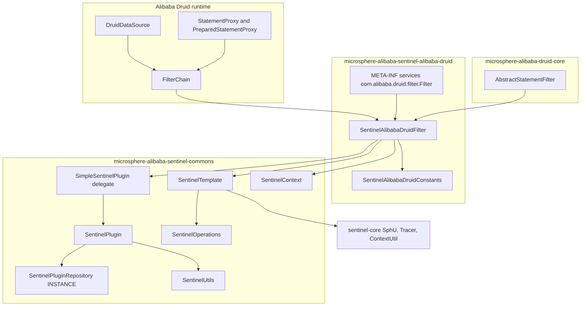
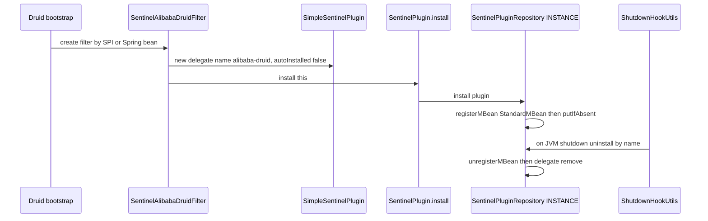
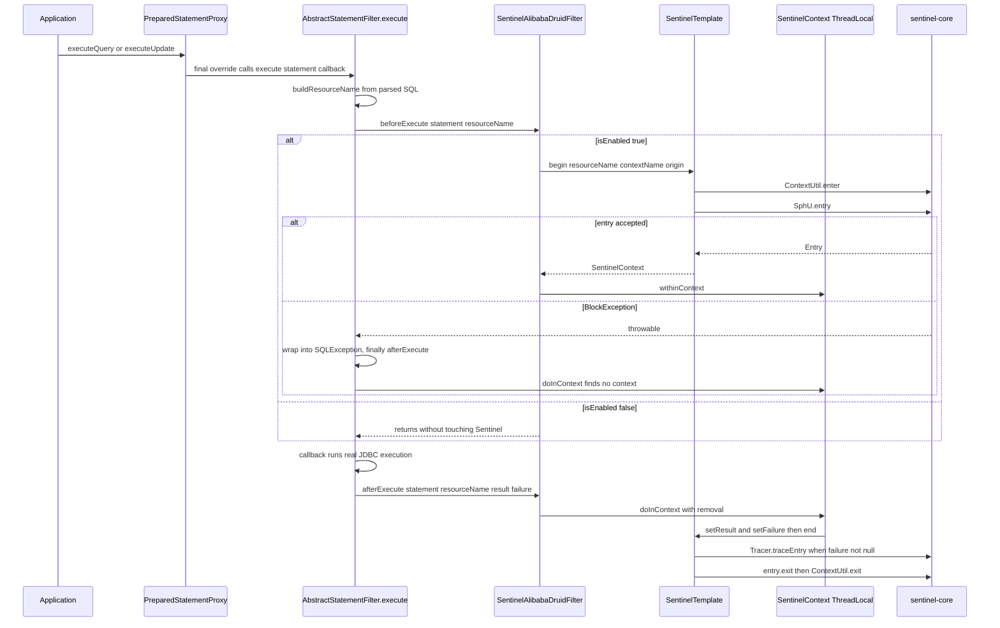
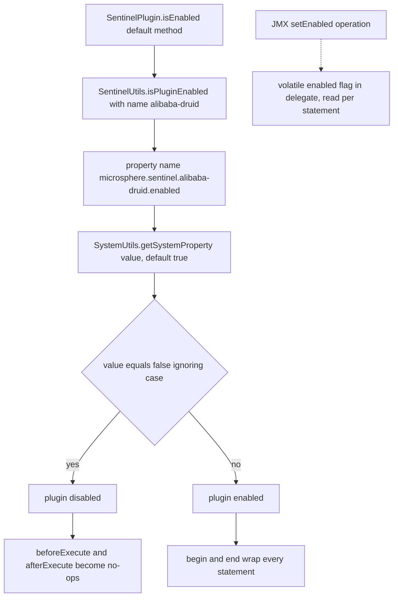
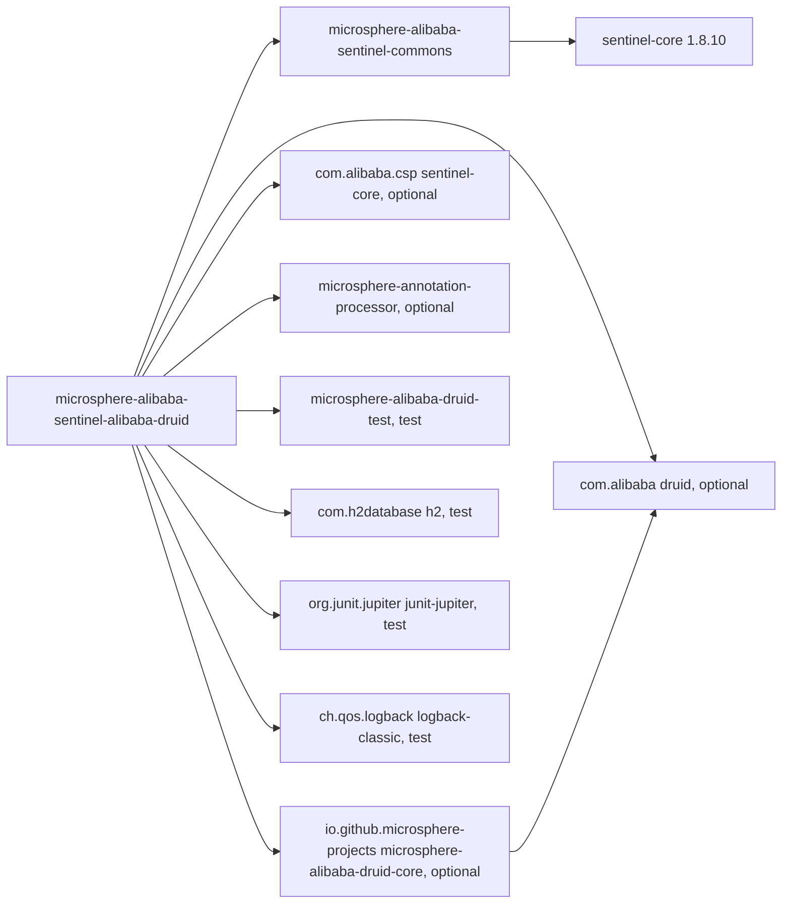

# microsphere-alibaba-sentinel-alibaba-druid — 开发者指南

[English](../microsphere-alibaba-sentinel-alibaba-druid.md)

> **已归档的 `1.x` 分支。** 本页记录 `0.1.x` 构件的内部设计（分支 `release-1.x`、Java 8、Spring Boot 2.x、Spring Cloud Hoxton - 2021.0.x）。源码树与当前分支完全一致，仅 POM 基线不同（javax Servlet API、`org.hibernate:hibernate-core`、通过 `META-INF/spring.factories` 注册自动配置）。本页在主干文档中的对应页面是 [../current/microsphere-alibaba-sentinel-alibaba-druid.md](../../current/zh/microsphere-alibaba-sentinel-alibaba-druid.md)。

## 目的与范围

`microsphere-alibaba-sentinel-alibaba-druid`（目录
`microsphere-alibaba-sentinel-plugins/microsphere-alibaba-sentinel-alibaba-druid`）使用 Alibaba Sentinel
为 Alibaba Druid 上的 JDBC 语句执行提供防护。它只贡献一个生产类 `SentinelAlibabaDruidFilter` 加一个常量
接口，并通过 Druid SPI 文件
`src/main/resources/META-INF/services/com.alibaba.druid.filter.Filter` 注册该 filter。

这里涉及两层源码。拦截骨架 —— Druid `FilterAdapter` 回调、SQL 解析、资源命名 —— 来自
`microsphere-alibaba-druid-core` 0.1.20 中的
`io.microsphere.alibaba.druid.filter.AbstractStatementFilter`。Sentinel 语义 —— `begin` / `end`、entry
簿记、失败追踪、插件注册 —— 来自 `microsphere-alibaba-sentinel-commons`。本文解释这两层的交汇点，而这正是
修改该模块时最关键的部分。

版本上下文：`0.1.x` 线（已发布 `0.1.0`–`0.1.5`，`revision` = `0.1.6-SNAPSHOT`），Java 8，
`sentinel-core` 1.8.10，自动配置路径使用 Spring Boot 2.x / Spring Cloud Hoxton-2021。面向用户的配置见
[用户指南](../../../user-guide/1.x/zh/microsphere-alibaba-sentinel-alibaba-druid.md)。

## 架构



## 源码分析

### SentinelAlibabaDruidConstants

四个常量，全部由 `SentinelAlibabaDruidConstantsTest` 锁定：

```java
String PLUGIN_NAME = "alibaba-druid";
String DEFAULT_CONTEXT_NAME = "microsphere_sentinel_alibaba_druid_context";
String DEFAULT_ORIGIN = "Filter";
String ENABLED_PROPERTY_NAME = PROPERTY_NAME_PREFIX + PLUGIN_NAME + DOT + PropertyConstants.ENABLED_PROPERTY_NAME;
```

因此 `ENABLED_PROPERTY_NAME` 等于 `microsphere.sentinel.alibaba-druid.enabled`，并被断言与
`SentinelUtils.getPluginEnabledPropertyName(PLUGIN_NAME)` 完全一致；它标注了
`@ConfigurationProperty(type = boolean.class, defaultValue = "true", source =
SYSTEM_PROPERTIES_SOURCE)`，这与 `SentinelUtils.isPluginEnabled` 只从 JVM 系统属性解析该开关的事实相符。
注意 `DEFAULT_CONTEXT_NAME` 使用的是下划线，而
`SentinelUtils.getDefaultContextName(PLUGIN_NAME)` 会依据带连字符的插件名生成
`microsphere_sentinel_alibaba-druid_context`；filter 始终使用显式常量，因此上下文名是下划线形式。

### SentinelAlibabaDruidFilter

```java
public class SentinelAlibabaDruidFilter extends AbstractStatementFilter implements SentinelPlugin
```

由于 `AbstractStatementFilter` 已经占用了父类位置，它无法继承 `AbstractSentinelPlugin`，于是身份信息存放在
委托对象中：

```java
public SentinelAlibabaDruidFilter(String contextName, String origin) {
    this.delegate = new SimpleSentinelPlugin(PLUGIN_NAME, contextName, origin, COMMON_DB_SQL, IN, false);
    this.sentinelOperations = new SentinelTemplate(getResourceType(), getTrafficType());
    install(this);
}
```

有三处细节至关重要：

1. 委托对象上的 `autoInstalled = false` 阻止 `SimpleSentinelPlugin` 注册自身；
   `SentinelPlugin.install(this)` 注册的是 *filter 本身*，这才是 JMX 客户端和
   `SentinelPluginRepository.get("alibaba-druid")` 所看到的对象，同时它也添加了负责卸载的关闭钩子回调。
2. `SentinelTemplate` 由 `getResourceType()`/`getTrafficType()` 构建 —— 取值来自委托对象：
   `ResourceTypeConstants.COMMON_DB_SQL` 与 `EntryType.IN`。因此一个 filter 实例把所有 SQL 流量都上报到
   同一个 Sentinel 资源类型之下。
3. 这里的 `install` 是静态方法 `SentinelPlugin.install`，是有意直接 import 的；无参构造器
   `SentinelAlibabaDruidFilter()` 通过 `this(DEFAULT_CONTEXT_NAME, DEFAULT_ORIGIN)` 链式调用。

全部八个 `SentinelPlugin` 成员都是一行的委托转发：`isAutoInstalled`、`isEnabled`、`setEnabled`、`getName`、
`getContextName`、`getOrigin`、`getResourceType`、`getTrafficType`。除委托对象的 `volatile enabled` 标志之外，
该类自身不持有任何可变状态。

两个钩子实现就是模板方法契约：

```java
@Override
protected void beforeExecute(StatementProxy statement, String resourceName) throws Throwable {
    if (isEnabled()) {
        SentinelContext context = this.sentinelOperations.begin(resourceName, getContextName(), getOrigin());
        context.withinContext();
    }
}

@Override
protected void afterExecute(StatementProxy statement, String resourceName, Object result, Throwable failure) {
    if (isEnabled()) {
        doInContext(context -> {
            context.setResult(result);
            context.setFailure(failure);
            this.sentinelOperations.end(context);
        }, true);
    }
}
```

`beforeExecute` 声明了 `throws Throwable`，从而允许 `begin` 把 `BlockException` 向上抛出。
`afterExecute` 是无条件被调用的 `finally` 阶段，因此必须能容忍“没有上下文绑定”。
`SentinelContext.doInContext(consumer, true)` 会在运行 consumer **之前**移除 ThreadLocal 绑定，这既为同一
池化线程上的下一条语句释放了槽位，也避免了重入式消费。

### 从 AbstractStatementFilter 继承的行为（microsphere-alibaba-druid-core 0.1.20）

`AbstractStatementFilter extends FilterAdapter`，真正的 Druid 集成都在那里；Sentinel 模块只填充两个抽象
钩子。

- `public final void init(DataSourceProxy dataSource)` 缓存该 proxy，并在它是 `DruidDataSource` 时缓存其
  `validationSQL`。它是 `final` 的，因此 Sentinel filter 无法覆写初始化过程。
- 每个语句入口都被覆写为 `final`：`preparedStatement_execute`、`preparedStatement_executeQuery`、
  `preparedStatement_executeUpdate`、`statement_executeQuery`、四个 `statement_execute` 重载、
  `statement_executeBatch` 以及四个 `statement_executeUpdate` 重载。它们全部汇聚到
  `protected <T> T execute(StatementProxy statement, ThrowableSupplier<T> callback) throws SQLException`。
- 该模板方法解析资源名、调用 `beforeExecute`、运行 callback、把任何 `Throwable` 捕获进 `failure`、以
  `wrap(e, SQLException.class)` 重新抛出，并始终在 `finally` 中调用
  `afterExecute(statement, resourceName, result, failure)`。
- 调试时值得牢记的推论：由于 `beforeExecute` 在该 `try` 内运行，Sentinel 的 `BlockException` 在到达应用代码
  之前会被包装成 `java.sql.SQLException`。应用看到的是 SQL 失败，而不是 FlowException 类型。
- `protected String buildResourceName(StatementProxy statement)` 取
  `statement.getLastExecuteSql()`；若它等于数据源的校验查询，则把原始 SQL 直接作为资源名；否则用
  `SQLUtils.parseStatements(sql, dataSource.getDbType())` 解析 SQL，并把第一个 `SQLStatement` 分派给按类型
  区分的构建器，生成表级资源名 `SELECT <table>`、`UPDATE <table>`、`INSERT <table>`、`DELETE <table>`
  （经由 `computeAlias()`），当解析失败或语句类型不受支持时回退为字面量 `"UNRECOGNIZED"`。因此资源粒度是按
  动词、按表，而不是按语句文本。

由于所有 `execute` 路径都在调用 JDBC 的线程上运行，且两个钩子都通过 `SentinelContext` 的 `ThreadLocal`
交换状态，因此连接池共享同一个 filter 实例依然是正确的。需要留意的一处不对称：若在 `beforeExecute` 与
`afterExecute` 之间发生 `setEnabled(false)`，`afterExecute` 的保护判断会跳过 `end`，于是该 entry 不会退出，
ThreadLocal 绑定会一直存活到该线程上下一次 `doInContext(..., true)`。运行时切换该标志只应在流量静止的时刻
进行。

## 设计模式

| 模式 | 实现类 | 说明 |
| --- | --- | --- |
| 模板方法（Template Method） | `AbstractStatementFilter.execute`，其 `beforeExecute`/`afterExecute` 由 `SentinelAlibabaDruidFilter` 实现 | 固定骨架位于外部 core 模块中 |
| 适配器（Adapter） | `SentinelAlibabaDruidFilter` 适配 `com.alibaba.druid.filter.FilterAdapter` | JDBC 回调面 → Sentinel entry |
| 委托（Delegation） | `SentinelAlibabaDruidFilter` 持有 `private final SentinelPlugin delegate`（`SimpleSentinelPlugin`） | 身份与 enabled 标志由委托对象持有 |
| 门面（Facade） | 实现 `SentinelOperations` 的 `SentinelTemplate` | 隐藏 `SphU.entry`、`Tracer.traceEntry`、`ContextUtil.enter`/`exit` |
| 注册表 / 单例（Registry / Singleton） | `SentinelPlugin.install(this)` → `SentinelPluginRepository.INSTANCE` | JMX 可见的 `io.microsphere.sentinel:type=SentinelPlugin,name=alibaba-druid` |
| SPI | `META-INF/services/com.alibaba.druid.filter.Filter` | 提供者行是全限定的 filter 类名 |
| 命令（Command） | 包装 `super.preparedStatement_execute(...)` 的 `ThrowableSupplier<T>` | 延迟执行的业务调用 |
| 标记（Marker） | 作为常量接口的 `SentinelAlibabaDruidConstants` | 不存在实例 |

## 核心流程

### Druid filter 的插件安装生命周期



### 每条语句的 Druid filter 链与 Sentinel entry



### enabled 的解析



构造器只快照该属性一次；此后 `volatile` 字段是唯一事实来源，只由 `setEnabled` 修改。

## 依赖



| 依赖 | 作用域 | 职责 |
| --- | --- | --- |
| `io.github.microsphere-projects:microsphere-alibaba-sentinel-commons` | compile | `SentinelPlugin`、`SimpleSentinelPlugin`、`SentinelTemplate`、`SentinelContext`、`SentinelUtils` |
| `io.github.microsphere-projects:microsphere-alibaba-druid-core` | compile，`optional` | `AbstractStatementFilter`，含 Druid `FilterAdapter`、SQL 解析与资源命名 |
| `com.alibaba.csp:sentinel-core` (1.8.10) | compile，`optional` | `ResourceTypeConstants.COMMON_DB_SQL`、`EntryType.IN`、`Entry` |
| `com.alibaba:druid` | compile，`optional` | `Filter`、`FilterChain`、`StatementProxy`、`PreparedStatementProxy` |
| `io.github.microsphere-projects:microsphere-annotation-processor` | compile，`optional` | 为 `@ConfigurationProperty` 生成元数据 |
| `org.junit.jupiter:junit-jupiter` | test | 测试引擎 |
| `io.github.microsphere-projects:microsphere-alibaba-druid-test` | test | 基于真实 `DruidDataSource` 的 `AbstractAlibabaDruidTest` 测试框架 |
| `com.h2database:h2` | test | filter 测试使用的内存数据库 |
| `ch.qos.logback:logback-classic` | test | `io.microsphere.logging` 的日志后端 |

`druid`、`microsphere-alibaba-druid-core` 与 `sentinel-core` 刻意声明为 `optional`：该模块不得为消费者锁定
Druid 或 Sentinel 版本，而 Spring Boot 用户会通过 `sentinel-core`/Druid starter 自带它们。版本由
`microsphere-alibaba-sentinel-parent` 管理（`microsphere-alibaba-druid.version` 0.1.20、
`sentinel.version` 1.8.10）。

测试：`SentinelAlibabaDruidFilterTest` 继承 `AbstractAlibabaDruidTest`，在 `customize(DruidDataSource)` 中用
`dataSource.getProxyFilters().add(filter)` 注册 filter，在每个测试前调用
`SentinelUtils.resetContextMap()`，并在切换 `setEnabled` 之后分别驱动 `testEnable` 与 `testDisable`；随后断言
`ContextUtil.enter(filter.getContextName(), filter.getOrigin())` 得到名为
`microsphere_sentinel_alibaba_druid_context` 的上下文。

## 扩展点

- **自定义资源命名。** `SentinelAlibabaDruidFilter` 从 `AbstractStatementFilter` 继承
  `buildResourceName(...)`。可以继承该 filter 并覆写
  `protected String buildResourceName(StatementProxy statement)`，改为按完整 SQL 文本、按 schema 或按调用栈
  来索引规则，而不是默认的 `VERB table` 粒度。资源名必须保持稳定 —— 它们是 Sentinel 流控规则和指标的键。
- **自定义 context 或 origin。** 使用双参构造器
  `SentinelAlibabaDruidFilter(String contextName, String origin)`；Spring Boot 自动配置把无参 bean 放在
  `@ConditionalOnMissingBean` 之后，因此声明你自己的 bean 即可替换它。
- **改用其他 traffic type 或 resource type。** 委托对象以 `COMMON_DB_SQL` 与 `IN` 构建；若要改变其中之一，
  就自行构造 `SimpleSentinelPlugin`（或继承该 filter 并暴露可覆写的身份方法），并据此构建
  `SentinelTemplate`。
- **以编程方式安装多个 filter。** 每个实例都注册在同一个插件名 `alibaba-druid` 之下，因此第二次 `install`
  会让 `SentinelPluginRepository.install` 返回 `false` 并打印重复告警；多数据源场景应共享同一个 filter 实例，
  而不是创建多个副本。
- **运行时切换。** `setEnabled` 是 `io.microsphere.sentinel:type=SentinelPlugin,name=alibaba-druid` 上的一个
  MBean 操作；`isInstalled`/`get`/`uninstall` 通过同一个 `JMXSentinelPluginRepository` 提供。
- **无需改代码的禁用方式。** 在 Sentinel 或 Druid 类初始化之前设置
  `-Dmicrosphere.sentinel.alibaba-druid.enabled=false`；此外还有模块级开关
  `microsphere.sentinel.enabled`，由 `microsphere-alibaba-sentinel-spring-boot` 中的
  `@ConditionalOnSentinelEnabled` 处理。

## 相关模块

- 索引：[开发者指南 README](./README.md)
- 核心抽象：[microsphere-alibaba-sentinel-commons](./microsphere-alibaba-sentinel-commons.md)
- 同级插件：[microsphere-alibaba-sentinel-mybatis](./microsphere-alibaba-sentinel-mybatis.md)、
  [插件总览](./microsphere-alibaba-sentinel-plugins.md)
- 自动配置：`microsphere-alibaba-sentinel-spring-boot` ——
  `SentinelAlibabaDruidAutoConfiguration` 以
  `io.microsphere.alibaba.druid.spring.boot.condition.ConditionalOnAlibabaDruidAvailable` 以及
  `io.microsphere.alibaba.sentinel.alibaba.druid.SentinelAlibabaDruidFilter` 存在为条件，执行顺序位于
  `com.alibaba.cloud.sentinel.custom.SentinelAutoConfiguration` 与
  `io.microsphere.alibaba.druid.spring.boot.autoconfigure.AlibabaDruidAutoConfiguration` 之后，并用
  `@ConditionalOnMissingBean` 定义 filter bean
- 用户指南对应页面：[用户指南](../../../user-guide/1.x/zh/microsphere-alibaba-sentinel-alibaba-druid.md)
- 源码：`microsphere-alibaba-sentinel-plugins/microsphere-alibaba-sentinel-alibaba-druid/src/{main,test}/java`
  以及 `src/main/resources/META-INF/services/com.alibaba.druid.filter.Filter`

---

## English

[English 版本](../microsphere-alibaba-sentinel-alibaba-druid.md)
