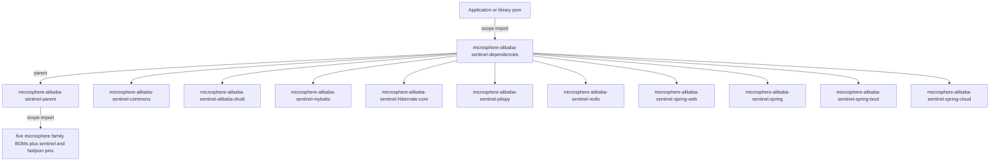
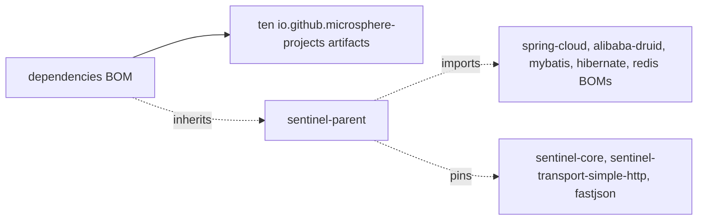

# microsphere-alibaba-sentinel-dependencies — 开发者指南

[English](../microsphere-alibaba-sentinel-dependencies.md)

> **已归档的 `1.x` 分支。** 本页记录 `0.1.x` 构件的内部设计（分支 `release-1.x`、Java 8、Spring Boot 2.x、Spring Cloud Hoxton - 2021.0.x）。源码树与当前分支完全一致，仅 POM 基线不同（javax Servlet API、`org.hibernate:hibernate-core`、通过 `META-INF/spring.factories` 注册自动配置）。本页在主干文档中的对应页面是 [../current/microsphere-alibaba-sentinel-dependencies.md](../../current/zh/microsphere-alibaba-sentinel-dependencies.md)。

## 目的与范围

`microsphere-alibaba-sentinel-dependencies` 是本项目的已发布物料清单（BOM）。它是一个
仅含 POM 的模块：`<packaging>pom</packaging>`，没有源码，没有 `<properties>`，没有
`<dependencies>`，没有 `<build>`，也没有 `<modules>`。它的整个内容就是一个
`<dependencyManagement>` 块，列出仓库的**十个可消费构件**，每个都带
`<version>${revision}</version>`。

| POM 类型 | 是否在此管理 |
|---|---|
| 消费者所依赖的库构件 | 是——commons、六个插件、spring、spring-boot、spring-cloud |
| reactor 根 `microsphere-alibaba-sentinel` | 否——构建期聚合器，不是依赖 |
| `microsphere-alibaba-sentinel-plugins` | 否——没有自身构件的中间 `pom` 聚合 |
| `microsphere-alibaba-sentinel-parent` | 否——它是本 BOM 的父 |
| 第三方库 | 否——那些在父 POM 中固定 |

## 架构

由于已发布的 POM 保留了它的 `<parent>` 引用，导入本 BOM 的消费者也会解析整条父链，
并随之解析在 [microsphere-alibaba-sentinel-parent](./microsphere-alibaba-sentinel-parent.md) 中声明的第三方版本。这就是下面
的条目除 `${revision}` 外无需自己指定版本的原因。

## 源码分析

### 结构剖析

- `parent`：`microsphere-alibaba-sentinel-parent`、`${revision}`，以及显式的
  `relativePath ../microsphere-alibaba-sentinel-parent/pom.xml`。
- `artifactId` / `version`：`microsphere-alibaba-sentinel-dependencies` / `${revision}`。
  `revision` 在上方两级的 reactor 根中声明，并被继承。
- `dependencyManagement`：十个条目，全部为 `io.github.microsphere-projects`，全部为 `${revision}`，
  没有一个带 `<type>pom</type>`，也没有一个带 `<scope>import</scope>`——本 BOM 管理 jar，而非 BOM。

声明顺序匹配依赖图而非字母序：先是 commons，然后按插件聚合
的顺序列出六个插件，最后是三个 Spring 层。BOM 内部的排序只是外观性的，因为没有哪个坐标被声明
两次；只有导入 BOM 的顺序才有意义。

### 对照 reactor 的覆盖检查

根 POM 列出七个模块：parent、commons、plugins、spring、spring-boot、spring-cloud 和
dependencies。展开插件聚合会再增加六个。去掉三个非制品 POM——
根、插件聚合、父——以及本 BOM 自身后，剩下的恰好是此处管理的十个条目，因此项目每个可部署构件
都被覆盖了。

## 设计模式

| 模式 | 实现 |
|---|---|
| 物料清单 | 唯一载荷是针对项目构件的 `<dependencyManagement>` 的 POM |
| 版本对齐 | 单个 `${revision}` 值绑定全部十个构件，因此在构造上就不可能只升级其中一部分 |
| 分层管理 | 第三方版本位于父 POM，项目版本位于此处，两者在消费者导入本 BOM 时会合 |
| 基于继承的发布 | 本 POM 从父继承，因此消费者解析父链并隐式接收导入的家族 BOM |

## 核心流程

### 构建与发布流程

```mermaid
flowchart LR
    A["Reactor root declares revision 0.1.6-SNAPSHOT"] --> B["This BOM references the ten artifacts with revision"]
    B --> C["CI runs deploy with -Drevision set to the release version"]
    C --> D["Published POMs resolve the project version to a literal value"]
    D --> E["Parent POM and imported family BOMs are deployed together"]
    E --> F["Consumer imports this BOM with scope import and type pom"]
    F --> G["Consumer declares any of the ten coordinates without a version"]
    G --> H["Maven resolves the parent chain for the third-party versions"]
```

在已发布的 POM 中，有两类引用以占位符形式保留下来——父的
`<dependencyManagement>` 内部的 `${microsphere-*.version}`、`${sentinel.version}` 和 `${fastjson.version}`
引用——而 `${revision}` 会被解析。因此消费者可以从已部署的父 POM 读到确切的家族版本。

## 依赖

| 受管理的坐标 | 版本 | 它是什么 |
|---|---|---|
| `microsphere-alibaba-sentinel-commons` | `${revision}` | 插件模型、仓库、模板与工具类 |
| `microsphere-alibaba-sentinel-alibaba-druid` | `${revision}` | Druid `Filter` 插件 |
| `microsphere-alibaba-sentinel-mybatis` | `${revision}` | MyBatis `ExecutorFilter` 插件 |
| `microsphere-alibaba-sentinel-hibernate-core` | `${revision}` | Hibernate `EntityCallback` 插件，SPI 已注册 |
| `microsphere-alibaba-sentinel-p6spy` | `${revision}` | P6Spy `JdbcEventListener` 插件，SPI 已注册 |
| `microsphere-alibaba-sentinel-redis` | `${revision}` | Redis 命令拦截器插件 |
| `microsphere-alibaba-sentinel-spring-web` | `${revision}` | `HandlerMethodInterceptor` 插件 |
| `microsphere-alibaba-sentinel-spring` | `${revision}` | Spring 依赖聚合，无源码 |
| `microsphere-alibaba-sentinel-spring-boot` | `${revision}` | 四个自动配置类 |
| `microsphere-alibaba-sentinel-spring-cloud` | `${revision}` | 针对 Spring Cloud actuator 的特性上报 |

本 POM 中没有直接的 `<dependencies>`，因此没有作用域可列；`<type>pom</type>`
与 `<scope>import</scope>` 这一组合属于导入本构件的消费者 POM。

## 扩展点

| 改动 | 做法 |
|---|---|
| 发布新模块 | 添加一个带 `io.github.microsphere-projects` 坐标和 `<version>${revision}</version>` 的条目；若忘记，消费者就必须在每次声明时指定版本 |
| 停用某模块 | 移除该条目并让根 `<modules>` 保持同步，否则该构件仍会被构建，却不受管理 |
| 让某插件与不同的 Sentinel 版本对齐 | 更改父 POM 中的 `sentinel.version`，而非此处 |
| 消费者需要不同的项目版本 | 在导入本 BOM **之前**，在你自己的 `<dependencyManagement>` 中显式声明该坐标——第一个受管理的版本胜出 |
| 消费者需要不同的第三方版本 | 在导入之前，在你自己的 `<dependencyManagement>` 中声明该第三方坐标，因为被导入 POM 的属性无法从外部覆盖 |
| 发布新的线 | 发布工作流会提升 reactor 根中的 `revision`；本 BOM 无需编辑，因为每个条目都使用该属性 |

## 相关模块

- 开发者指南索引：[./README.md](./README.md)
- 第三方版本归属方：[./microsphere-alibaba-sentinel-parent.md](./microsphere-alibaba-sentinel-parent.md)
- 受管理的构件：[./microsphere-alibaba-sentinel-commons.md](./microsphere-alibaba-sentinel-commons.md)、[./microsphere-alibaba-sentinel-plugins.md](./microsphere-alibaba-sentinel-plugins.md)、[./microsphere-alibaba-sentinel-spring.md](./microsphere-alibaba-sentinel-spring.md)、[./microsphere-alibaba-sentinel-spring-boot.md](./microsphere-alibaba-sentinel-spring-boot.md)、[./microsphere-alibaba-sentinel-spring-cloud.md](./microsphere-alibaba-sentinel-spring-cloud.md)
- 面向用户的文档：[../../user-guide/1.x/microsphere-alibaba-sentinel-dependencies.md](../../../user-guide/1.x/zh/microsphere-alibaba-sentinel-dependencies.md)

---

## English

[English 版本](../microsphere-alibaba-sentinel-dependencies.md)
