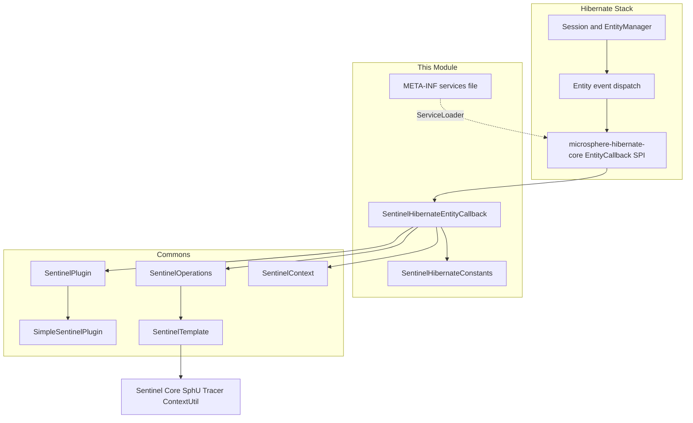
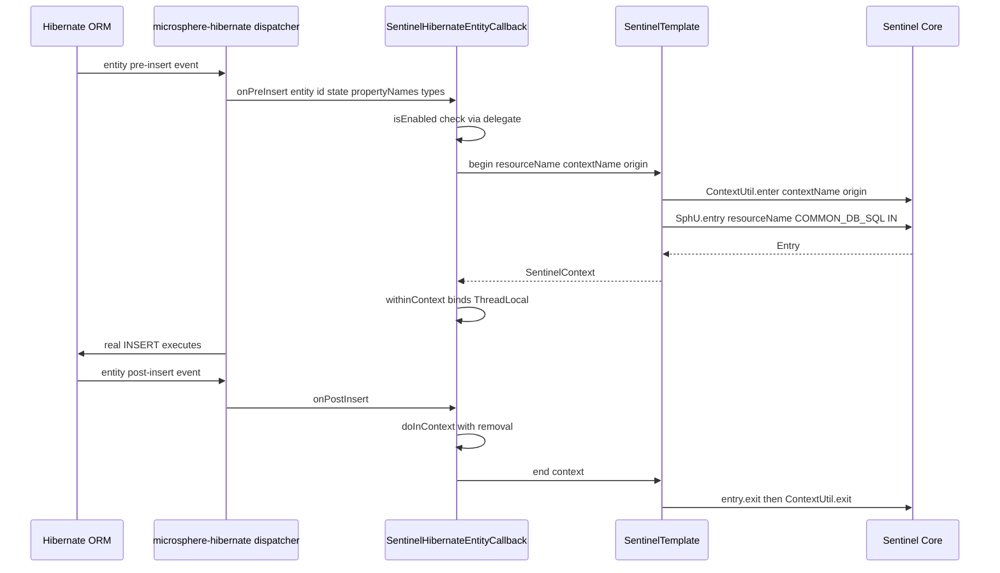
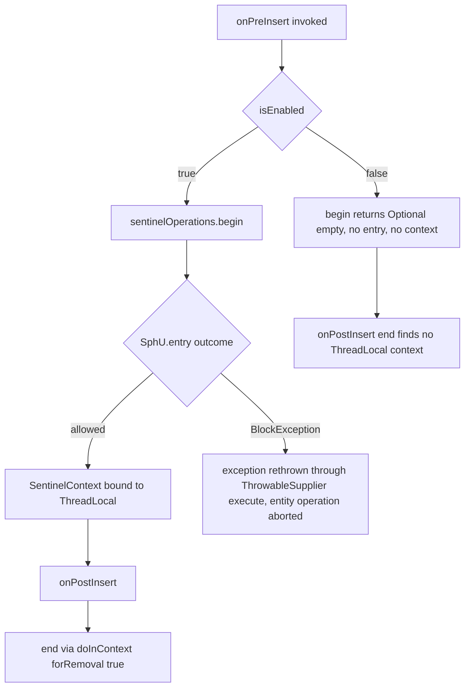
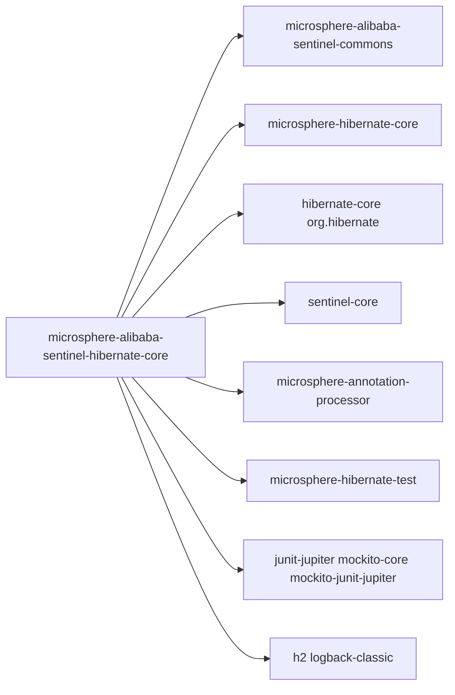

# microsphere-alibaba-sentinel-hibernate-core — 开发者指南

[English](../microsphere-alibaba-sentinel-hibernate-core.md)

> **已归档的 `1.x` 分支。** 本页记录 `0.1.x` 构件的内部设计（分支 `release-1.x`、Java 8、Spring Boot 2.x、Spring Cloud Hoxton - 2021.0.x）。源码树与当前分支完全一致，仅 POM 基线不同（javax Servlet API、`org.hibernate:hibernate-core`、通过 `META-INF/spring.factories` 注册自动配置）。本页在主干文档中的对应页面是 [../current/microsphere-alibaba-sentinel-hibernate-core.md](../../current/zh/microsphere-alibaba-sentinel-hibernate-core.md)。

## 目的与范围

本模块使用 Alibaba Sentinel 流控保护 Hibernate 的实体持久化操作。它提供
`SentinelHibernateEntityCallback`，即兄弟项目 `microsphere-hibernate-core` 发布的
`io.microsphere.hibernate.entity.EntityCallback` SPI 的一个实现。该回调通过
`META-INF/services/io.microsphere.hibernate.entity.EntityCallback` 被发现，因此只要把 jar 放到 classpath
上，就会激活对实体 `INSERT`、`UPDATE`、`LOAD` 与 `DELETE` 操作的拦截。

本指南的范围：

- 前置/后置实体回调如何开启与关闭一个 Sentinel entry（`begin` / `end`）。
- 资源名以及 Sentinel context name/origin 如何构造。
- 由 `microsphere.sentinel.hibernate.enabled` 驱动的启用/禁用语义。
- 在本发布线（0.1.x、Java 8、`sentinel-core` 1.8.10）上，该模块运行在使用 `jakarta` 命名空间的
  Hibernate ORM 6 之上，测试的 `src/test/resources/META-INF/persistence.xml` 可以佐证。

## 架构

## 源码分析

### `io.microsphere.alibaba.sentinel.hibernate.entity.SentinelHibernateEntityCallback`

声明为 `public class SentinelHibernateEntityCallback implements EntityCallback, SentinelPlugin`。
注意它**不**继承 `AbstractSentinelPlugin`，而是持有一个插件委托对象。

字段与构造器：

- `private final SentinelPlugin delegate;`
- `private final SentinelOperations sentinelOperations;`
- `public SentinelHibernateEntityCallback()` — 使用 `SentinelHibernateConstants` 中的
  `DEFAULT_CONTEXT_NAME` 与 `DEFAULT_ORIGIN` 调用双参构造器。
- `public SentinelHibernateEntityCallback(@Nonnull String contextName, @Nonnull String origin)` —
  创建 `new SimpleSentinelPlugin(PLUGIN_NAME, contextName, origin, COMMON_DB_SQL, IN, false)`
  （该 `false` 抑制 `AbstractSentinelPlugin` 的自我安装），随后
  `new SentinelTemplate(getResourceType(), getTrafficType())`，再调用静态方法
  `SentinelPlugin.install(this)`，后者把该回调注册进 `SentinelPluginRepository.INSTANCE`，并添加一个负责
  卸载的 JVM 关闭钩子回调。

实体生命周期钩子 —— `EntityCallback` SPI 为每种动作暴露成对的前置/后置通知：

- `public void onPreInsert(Object entity, Object id, Object[] state, String[] propertyNames, Type[] propertyTypes)`
  — `begin(entity, "INSERT").ifPresent(SentinelContext::withinContext)`。
- `public void onPostInsert(Object entity, Object id, Object[] state, String[] propertyNames, Type[] propertyTypes)` — `end()`。
- `public void onPreUpdate(Object entity, Object id, Object[] state, String[] propertyNames, Type[] propertyTypes)`
  — `begin(entity, "UPDATE").ifPresent(SentinelContext::withinContext)`。
- `public void onPostUpdate(Object entity, Object id, Object[] state, String[] propertyNames, Type[] propertyTypes)` — `end()`。
- `public void onPreLoad(Object entity, Object id, Object[] state, String[] propertyNames, Type[] types)`
  — `begin(entity, "LOAD").ifPresent(SentinelContext::withinContext)`。
- `public void onPostLoad(Object entity, Object id, String[] propertyNames, Type[] types)` — `end()`。
- `public void onPreDelete(Object entity, Object id, Object[] state, String[] propertyNames, Type[] types)`
  — `begin(entity, "DELETE").ifPresent(SentinelContext::withinContext)`。
- `public void onPostDelete(Object entity, Object id, Object[] state, String[] propertyNames, Type[] types)` — `end()`。

受保护的核心操作：

- `protected Optional<SentinelContext> begin(Object entity, String action)` — 仅当 `isEnabled()`：
  构造 `resourceName = getSentinelResourceName(entity, action)`，从委托对象读取 `contextName` 与 `origin`，
  并返回 `Optional.of(execute(() -> sentinelOperations.begin(resourceName, contextName, origin)))`，其中
  `execute` 是 `io.microsphere.lang.function.ThrowableSupplier.execute`，它会重新抛出任何 `Throwable`
  —— 包括由 `SphU.entry` 抛出的 Sentinel `BlockException`。禁用时返回 `Optional.empty()`。
- `protected void end()` — 仅当 `isEnabled()`：`doInContext(this.sentinelOperations::end, true)`，
  该调用会把当前 `SentinelContext` 从 `ThreadLocal` 移除并关闭它。
- `protected String getSentinelResourceName(Object entity, String action)` —
  返回 `"Entity:" + action + ":" + entity.getClass().getName()`；覆写它即可自定义命名。

资源/上下文构造小结：资源名完全由实体类名与操作动作推导；上下文名与 origin 来自委托插件
（`microsphere_sentinel_hibernate_context` / `SessionFactory`）。在 `SentinelTemplate.begin` 中，空白的
上下文名或 origin 会在执行 `ContextUtil.enter` 与
`SphU.entry(resourceName, resourceType, trafficType)` 之前回退为
`SentinelConstants.DEFAULT_CONTEXT_NAME` / `DEFAULT_ORIGIN`。

插件接口方法（`isAutoInstalled`、`isEnabled`、`setEnabled`、`getName`、`getContextName`、`getOrigin`、
`getResourceType`、`getTrafficType`）全部转发给 `delegate`。

### `io.microsphere.alibaba.sentinel.hibernate.SentinelHibernateConstants`

一个常量 `interface`，由 `SentinelHibernateConstantsTest` 断言：

- `String PLUGIN_NAME = "hibernate"`。
- `String DEFAULT_CONTEXT_NAME = "microsphere_sentinel_hibernate_context"` — 符合 commons 的
  `microsphere_sentinel_{}_context` 模板。
- `String DEFAULT_ORIGIN = "SessionFactory"`。
- `String ENABLED_PROPERTY_NAME = "microsphere.sentinel.hibernate.enabled"` — 由
  `PROPERTY_NAME_PREFIX + PLUGIN_NAME + DOT + enabled` 构造，标注
  `@ConfigurationProperty(type = boolean.class, defaultValue = "true", source = SYSTEM_PROPERTIES_SOURCE)`。

### SPI 注册

`src/main/resources/META-INF/services/io.microsphere.hibernate.entity.EntityCallback` 恰好只有一行：
`io.microsphere.alibaba.sentinel.hibernate.entity.SentinelHibernateEntityCallback`。

### 测试

- `SentinelHibernateEntityCallbackTest` 继承 `AbstractHibernateH2Test`（microsphere-hibernate-test，
  H2 配置在 `src/test/resources/META-INF/persistence.xml`，持久化单元 `CRM`，实体
  `io.microsphere.sentinel.hibernate.test.entity.User`）。其 `@AfterEach postTest()` 以 origin
  `SessionFactory` 进入上下文 `microsphere_sentinel_hibernate_context`，并断言 entrance node 的子节点列表
  非空 —— 这证明基类测试所执行的 CRUD 操作确实创建了 Sentinel 节点。
- `SentinelHibernateEntityCallbackDisabledTest` 在 `@BeforeAll` 中设置系统属性
  `microsphere.sentinel.hibernate.enabled=false`（在 `@AfterAll` 中恢复），于是同样的生命周期在
  所有 `begin`/`end` 工作被短路的情况下运行。

## 设计模式

- **SPI（服务提供者注册）**：`SentinelHibernateEntityCallback` 通过 `META-INF/services` 注册为
  `io.microsphere.hibernate.entity.EntityCallback` 的实现，并由宿主项目通过 `ServiceLoader` 加载。
- **委托/适配器（Delegate/Adapter）**：该类实现 `SentinelPlugin`，但把全部插件元数据与 enabled 状态委托给
  私有的 `SimpleSentinelPlugin`（后者自身继承 `AbstractSentinelPlugin`），从而让 `EntityCallback` 类不携带
  插件状态字段。
- **模板方法（Template Method，操作执行）**：所有 Sentinel 机制都集中在
  `SentinelOperations`/`SentinelTemplate` 中；回调只提供资源名、上下文名与 origin，并选择两阶段调用。
- **观察者（Observer，前置/后置事件）**：Hibernate 的实体动作通知成对驱动 `begin`/`end`。
- **线程局部上下文耦合**：`SentinelContext.withinContext()` 与
  `SentinelContext.doInContext(consumer, true)` 在前置/后置钩子之间绑定并弹出上下文，因此二者必须运行在
  同一线程上。

## 核心流程

### 实体操作防护流程

### 禁用与限流拒绝路径

关于错误追踪的说明：与一次性 `SentinelOperations.call`（对非 `BlockException` throwable 调用
`Tracer.trace`）不同，也与 p6spy/redis/spring-web 插件（调用 `SentinelContext.setFailure`，从而让
`SentinelTemplate.end` 执行 `Tracer.traceEntry`）不同，`EntityCallback` 的 post 钩子不接收异常参数，因此
`end()` 永远不会携带已记录的失败对象，该插件的 `traceEntry` 会被跳过。

## 依赖

| 依赖 | pom 中的作用域 |
|---|---|
| io.github.microsphere-projects:microsphere-annotation-processor | compile, optional |
| io.github.microsphere-projects:microsphere-alibaba-sentinel-commons | compile |
| io.github.microsphere-projects:microsphere-hibernate-core | compile, optional |
| com.alibaba.csp:sentinel-core | compile, optional |
| org.hibernate:hibernate-core | compile, optional |
| org.junit.jupiter:junit-jupiter | test |
| org.mockito:mockito-core | test |
| org.mockito:mockito-junit-jupiter | test |
| io.github.microsphere-projects:microsphere-hibernate-test | test |
| ch.qos.logback:logback-classic | test |
| com.h2database:h2 | test |

## 扩展点

- **自定义资源命名**：继承 `SentinelHibernateEntityCallback` 并覆写
  `getSentinelResourceName(Object entity, String action)`（例如改用简单类名或按 schema 命名）。
- **调整 context/origin**：使用 `SentinelHibernateEntityCallback(contextName, origin)` 构造，而不走默认值。
- **运行时切换**：通过委托对象调用 `setEnabled(false)`/`enable()`/`disable()`，或在插件构造之前设置
  `microsphere.sentinel.hibernate.enabled` JVM 系统属性；`-Dmicrosphere.sentinel.hibernate.enabled=false`
  可整体关闭拦截。
- **替换 SPI 条目**：通过同样的 `META-INF/services` 机制注册你自己的 `EntityCallback`；
  `SentinelPlugin.install(SentinelPlugin)` 允许任何自定义插件加入 `SentinelPluginRepository`，从而被监控与
  卸载。

## 相关模块

- 开发者指南索引：[README](./README.md)
- [microsphere-alibaba-sentinel-commons](./microsphere-alibaba-sentinel-commons.md) — `SentinelPlugin`、
  `AbstractSentinelPlugin`、`SimpleSentinelPlugin`、`SentinelOperations`、`SentinelTemplate`、
  `SentinelContext`、`SentinelUtils`。
- [microsphere-alibaba-sentinel-alibaba-druid](./microsphere-alibaba-sentinel-alibaba-druid.md) 与
  [microsphere-alibaba-sentinel-p6spy](./microsphere-alibaba-sentinel-p6spy.md) — 同为 JDBC 层的同级插件。
- 用户指南对应页面：[../../user-guide/1.x/microsphere-alibaba-sentinel-hibernate-core.md](../../../user-guide/1.x/zh/microsphere-alibaba-sentinel-hibernate-core.md)

---

## English

[English 版本](../microsphere-alibaba-sentinel-hibernate-core.md)
