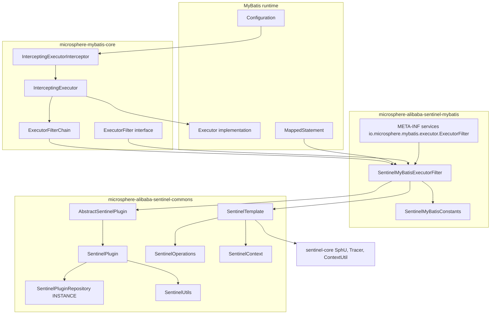
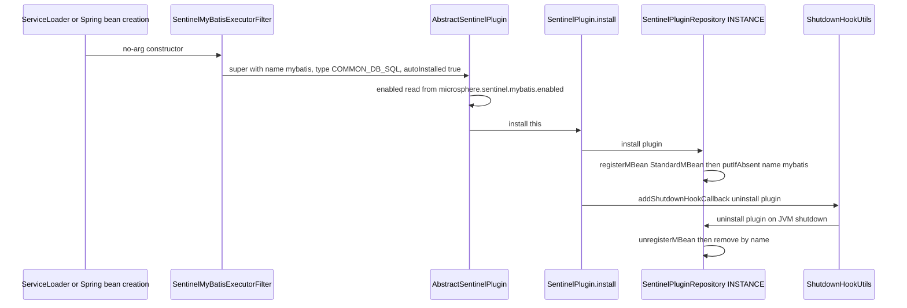
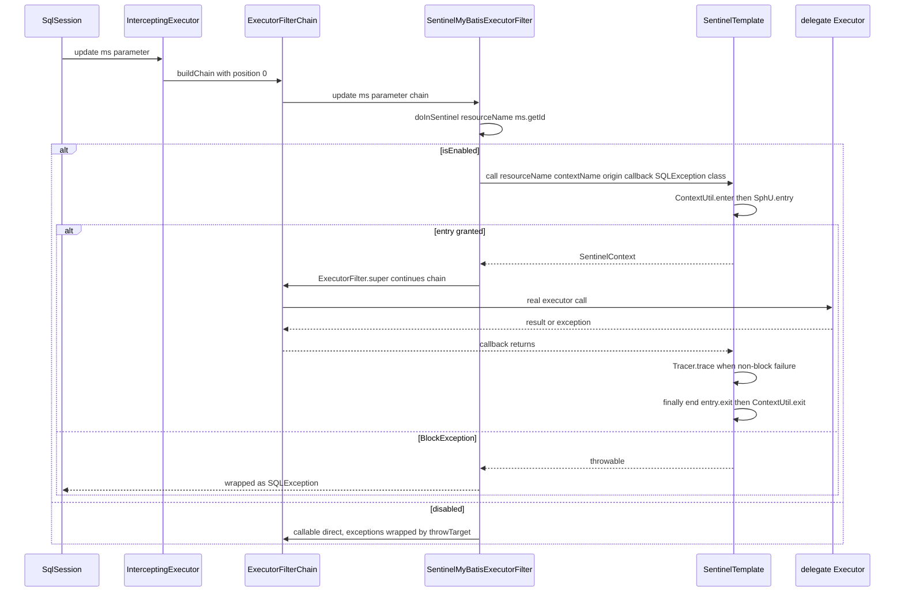
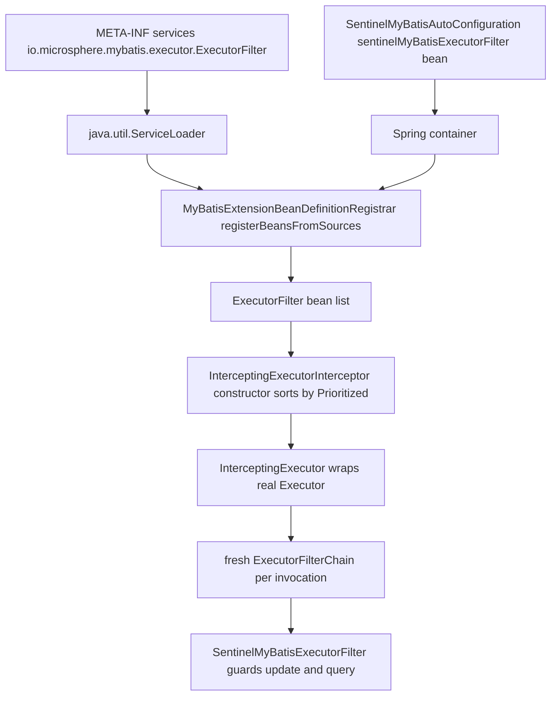
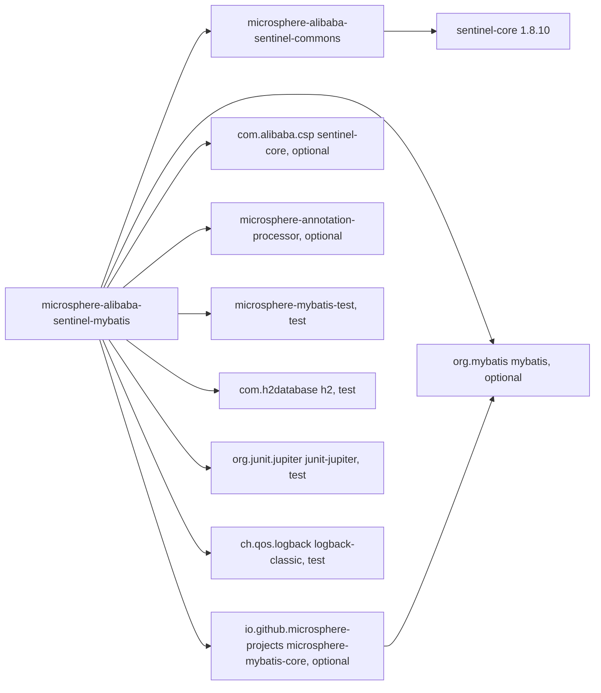

# microsphere-alibaba-sentinel-mybatis — 开发者指南

[English](../microsphere-alibaba-sentinel-mybatis.md)

> **已归档的 `1.x` 分支。** 本页记录 `0.1.x` 构件的内部设计（分支 `release-1.x`、Java 8、Spring Boot 2.x、Spring Cloud Hoxton - 2021.0.x）。源码树与当前分支完全一致，仅 POM 基线不同（javax Servlet API、`org.hibernate:hibernate-core`、通过 `META-INF/spring.factories` 注册自动配置）。本页在主干文档中的对应页面是 [../current/microsphere-alibaba-sentinel-mybatis.md](../../current/zh/microsphere-alibaba-sentinel-mybatis.md)。

## 目的与范围

`microsphere-alibaba-sentinel-mybatis`（目录
`microsphere-alibaba-sentinel-plugins/microsphere-alibaba-sentinel-mybatis`）使用 Alibaba Sentinel 保护
MyBatis `Executor` 流量。它提供一个插件类 `SentinelMyBatisExecutorFilter`、一个常量接口，以及 SPI 声明
`src/main/resources/META-INF/services/io.microsphere.mybatis.executor.ExecutorFilter`。与 Druid 插件不同，
它直接继承 `AbstractSentinelPlugin`，并使用一次性 `SentinelOperations.call(...)` 形式，而不是两阶段的
`begin`/`end` 配对。

资源粒度是每个 mapped statement 对应一个 Sentinel 资源：`getSentinelResourceName(ms)` 返回 `ms.getId()`，
例如 `io.microsphere.mybatis.test.mapper.UserMapper.selectById`。资源类型为
`ResourceTypeConstants.COMMON_DB_SQL`，流量类型为 `EntryType.IN`。

版本上下文：`0.1.x` 线（已发布 `0.1.0`–`0.1.5`，`revision` = `0.1.6-SNAPSHOT`），Java 8，
`sentinel-core` 1.8.10，`microsphere-mybatis` 0.1.15，Spring Boot 2.x / Spring Cloud Hoxton-2021。
终端用户的配置由[用户指南](../../../user-guide/1.x/zh/microsphere-alibaba-sentinel-mybatis.md)覆盖。

## 架构



## 源码分析

### SentinelMyBatisConstants

```java
String PLUGIN_NAME = "mybatis";
String DEFAULT_CONTEXT_NAME = "microsphere_sentinel_mybatis_context";
String DEFAULT_ORIGIN = "Executor";
String ENABLED_PROPERTY_NAME = PROPERTY_NAME_PREFIX + PLUGIN_NAME + DOT + PropertyConstants.ENABLED_PROPERTY_NAME;
```

`SentinelMyBatisConstantsTest` 锁定这四个值，断言
`ENABLED_PROPERTY_NAME == "microsphere.sentinel.mybatis.enabled"`，并断言它等于
`SentinelUtils.getPluginEnabledPropertyName(PLUGIN_NAME)`。这里的常量与推导出的
`SentinelUtils.getDefaultContextName(PLUGIN_NAME)` 是一致的，因为插件名不含连字符。
`@ConfigurationProperty(source = SYSTEM_PROPERTIES_SOURCE)` 注解与运行时解析方式相符，后者只读取 JVM
系统属性。

### SentinelMyBatisExecutorFilter

```java
public class SentinelMyBatisExecutorFilter extends AbstractSentinelPlugin implements ExecutorFilter {

    public SentinelMyBatisExecutorFilter() { this(DEFAULT_CONTEXT_NAME, DEFAULT_ORIGIN); }

    public SentinelMyBatisExecutorFilter(String contextName, String origin) {
        super(PLUGIN_NAME, contextName, origin, COMMON_DB_SQL);
        this.sentinelOperations = new SentinelTemplate(getResourceType(), getTrafficType());
    }
```

四参数的 `AbstractSentinelPlugin` 构造器会套用默认值 `EntryType.IN` 与 `autoInstalled = true`；自动安装意味着
构造器自身会调用 `SentinelPlugin.install(this)`，后者把插件注册进
`SentinelPluginRepository.INSTANCE`，并添加负责卸载的 JVM 关闭钩子回调。同一个构造器从
`microsphere.sentinel.mybatis.enabled`（默认 `true`）快照 `enabled`，存入基类的 `volatile` 字段。无参构造器是
`java.util.ServiceLoader` 与 Spring bean 定义所要求的。

只覆写了三个 `ExecutorFilter` 方法；该接口的其他所有方法都保持默认的直通行为：

```java
@Override
public int update(MappedStatement ms, Object parameter, ExecutorFilterChain chain) throws SQLException {
    return doInSentinel(ms, () -> ExecutorFilter.super.update(ms, parameter, chain));
}

@Override
public <E> List<E> query(MappedStatement ms, Object parameter, RowBounds rowBounds, ResultHandler resultHandler,
                         CacheKey cacheKey, BoundSql boundSql, ExecutorFilterChain chain) throws SQLException {
    return doInSentinel(ms, () -> ExecutorFilter.super.query(ms, parameter, rowBounds, resultHandler, cacheKey, boundSql, chain));
}

@Override
public <E> List<E> query(MappedStatement ms, Object parameter, RowBounds rowBounds, ResultHandler resultHandler,
                         ExecutorFilterChain chain) throws SQLException {
    return doInSentinel(ms, () -> ExecutorFilter.super.query(ms, parameter, rowBounds, resultHandler, chain));
}
```

`ExecutorFilter.super.<method>` 就是让链继续执行的调用；漏掉 `chain` 会中断链并跳过下游 filter。
`queryCursor`、`commit`、`rollback`、`createCacheKey`、`deferLoad`、`getTransaction` 与 `close`
有意不加保护，因此游标抓取与事务边界不会消耗 Sentinel entry。

该类的核心：

```java
protected <T> T doInSentinel(MappedStatement ms, Callable<T> callable) throws SQLException {
    if (isEnabled()) {
        String resourceName = getSentinelResourceName(ms);
        return sentinelOperations.call(resourceName, getContextName(), getOrigin(),
                context -> callable.call(), SQLException.class);
    } else {
        try {
            return callable.call();
        } catch (Exception e) {
            throw throwTarget(e, SQLException.class);
        }
    }
}

protected String getSentinelResourceName(MappedStatement ms) {
    return ms.getId();
}
```

两个分支都保证 `SQLException` 签名：启用分支使用
`SentinelOperations.call(String, String, String, ThrowableFunction, Class<TR>)`，其
`try { return call(...); } catch (Throwable t) { throw throwTarget(t, throwableClass); }` 包装会把任何其他异常
—— 包括 `SphU.entry` 抛出的 `BlockException` 以及 callable 抛出的受检异常 —— 转换为 `SQLException`；禁用分支
用 `ExceptionUtils.throwTarget` 显式转换。在未加限定的 `call` 内部，`SentinelOperations` 在 `try` **之前**执行
`begin(...)`，运行 callback，对任何非阻塞 throwable 调用 `Tracer.trace(e)`，打印一行 error 日志，重新抛出，
并始终在 `finally` 中执行 `end(context)`。

追踪语义与 Druid 插件不同，重构时很容易写错：一次性形式用 `Tracer.trace` 上报失败，而 `end` 看到的
`context.getFailure() == null`，因为没有任何地方调用 `setFailure`。在此处显式加上 `setFailure` 会让错误被
重复计数。`Tracer.trace` 与 `Tracer.traceEntry` 喂给的是同一份异常统计，因此每条调用路径恰好只使用其中一个是
不变式。

线程安全：实例持有来自 `AbstractSentinelPlugin` 的 `final` 身份字段、一个 `final SentinelOperations`
以及 `volatile enabled` 标志，因此在所有 `SqlSession` 实例之间共享单个 filter 是安全的。保护逻辑不使用
`SentinelContext.withinContext()`，也不使用任何插件级 ThreadLocal；context 对象只 confined 在 `doInSentinel`
的栈帧内，这也使该插件在嵌套或异步 executor 调用下依然正确。`AbstractSentinelPlugin` 本身不是 `Prioritized`，
该 filter 也没有覆写 `getPriority()`，因此 `ExecutorFilter` 的默认 `NORMAL_PRIORITY = 0` 决定它在
`InterceptingExecutorInterceptor` 排序后数组中的位置。

### 与 microsphere-mybatis-core 的协作

在有人把插件装进 executor 链之前，插件本身是被动的：

- `InterceptingExecutorInterceptor`（来自 `microsphere-mybatis-core`）接收一个
  `ExecutorFilter[]`，用 `Prioritized` 比较器排序，并在 `plugin(Object target)` 中把真实的 `Executor`
  包装成 `InterceptingExecutor`。
- `InterceptingExecutor` 每次调用都会构建一个*全新*的
  `ExecutorFilterChain(delegate, properties, filters)`；该链是一个位置游标（`position < size` 时调用
  `filters[position++]`，否则调用被委托的 `Executor`），因此链状态 confined 在栈内且线程安全。
- `ExecutorFilterChain.applySQL(...)` 把失败包装成 `SQLException`，与插件契约一致。
- 在 Spring 上下文中，`@EnableMyBatisExtension` 触发
  `MyBatisExtensionBeanDefinitionRegistrar.registerExecutorFilters(...)`，其
  `registerBeansFromSources(ExecutorFilter.class, sources)` 会从 Spring Factories 或 SPI 源收集实现 —— 这正是
  让本模块的 `META-INF/services/io.microsphere.mybatis.executor.ExecutorFilter` 条目生效的消费方。

## 设计模式

| 模式 | 实现类 | 说明 |
| --- | --- | --- |
| 责任链（Chain of Responsibility） | `ExecutorFilterChain` 与 `InterceptingExecutor`，`SentinelMyBatisExecutorFilter` 是其中一个环节 | `ExecutorFilter.super` 让链继续 |
| 装饰器（Decorator） | `InterceptingExecutor` 包装被委托的 `Executor` | MyBatis 插件机制 |
| 适配器（Adapter） | `SentinelMyBatisExecutorFilter implements ExecutorFilter` | executor 回调转成 Sentinel entry |
| 模板方法（Template Method） | `doInSentinel(ms, callable)` 作为固定骨架，三处调用点 | 也包括 `AbstractSentinelPlugin` 的构造器默认值 |
| 门面（Facade） | `SentinelOperations` 背后的 `SentinelTemplate` | 隐藏 `SphU.entry`、`Tracer.trace`、`ContextUtil.enter`/`exit` |
| 注册表 / 单例（Registry / Singleton） | 经由 `SentinelPluginRepository.INSTANCE` 的 `SentinelPlugin.install` | JMX 对象名 `io.microsphere.sentinel:type=SentinelPlugin,name=mybatis` |
| SPI | `META-INF/services/io.microsphere.mybatis.executor.ExecutorFilter` | 只有一行提供者声明 |
| 策略（Strategy） | 在构造时选定 `resourceType` / `trafficType` | `COMMON_DB_SQL`、`IN` |

## 核心流程

### 插件安装生命周期（含关闭钩子）



### 受保护语句的 executor filter 链流程



### SPI 与拦截器装配



## 依赖



| 依赖 | 作用域 | 职责 |
| --- | --- | --- |
| `io.github.microsphere-projects:microsphere-alibaba-sentinel-commons` | compile | `AbstractSentinelPlugin`、`SentinelOperations`、`SentinelTemplate`、`SentinelContext`、`SentinelUtils` |
| `io.github.microsphere-projects:microsphere-mybatis-core` | compile，`optional` | `ExecutorFilter`、`ExecutorFilterChain`、`InterceptingExecutor`、`InterceptingExecutorInterceptor` |
| `com.alibaba.csp:sentinel-core` (1.8.10) | compile，`optional` | `ResourceTypeConstants.COMMON_DB_SQL`、`EntryType.IN`、`Entry`、`Tracer` |
| `org.mybatis:mybatis` | compile，`optional` | `MappedStatement`、`CacheKey`、`BoundSql`、`RowBounds`、`ResultHandler`、`Executor` |
| `io.github.microsphere-projects:microsphere-annotation-processor` | compile，`optional` | `@ConfigurationProperty` 元数据生成 |
| `org.junit.jupiter:junit-jupiter` | test | 测试引擎 |
| `io.github.microsphere-projects:microsphere-mybatis-test` | test | `AbstractMapperTest` 与 `InterceptingExecutorInterceptor` 测试框架 |
| `com.h2database:h2` | test | 内存数据库 |
| `ch.qos.logback:logback-classic` | test | `io.microsphere.logging` 的日志后端 |

`optional` 让 MyBatis 与 Sentinel 不进入消费者的传递依赖图。版本从
`microsphere-alibaba-sentinel-parent` 解析（`microsphere-mybatis.version` 0.1.15、
`sentinel.version` 1.8.10）。

### 测试

`SentinelMyBatisExecutorFilterTest` 继承 `AbstractMapperTest`，覆写
`customize(Configuration)` 来构造 filter，并通过
`configuration.addInterceptor(interceptor)` 注册
`new InterceptingExecutorInterceptor(ofArray(this.filter))`，分别在启用与禁用状态下运行整套 mapper 测试
（`testDisabled` 会翻转 `setEnabled(false)`），并在 `postTest()` 中以 origin `Executor` 进入
`microsphere_sentinel_mybatis_context`，断言 entrance node 的 `childList` 非空 —— 这证明 entry 确实被记录在
该上下文之下。`SentinelMyBatisConstantsTest` 守护常量契约。

## 扩展点

- **资源命名。** 覆写 `protected String getSentinelResourceName(MappedStatement ms)`，改为按 SQL 片段、按
  namespace 或按 namespace 加 database id 来索引规则，而不是 `ms.getId()`。资源名是流控规则与指标之间的关联键，
  因此必须在重启之间保持稳定。
- **保护更多 executor 方法。** 为 `queryCursor`、`commit`、`rollback` 或 `close` 添加覆写，并把它们路由到
  `doInSentinel(ms, () -> ExecutorFilter.super.<method>(...))`；现有辅助方法已经保证了 `SQLException` 签名。
- **按环境设置 context 与 origin。** 使用双参构造器；在 Spring Boot 中，声明你自己的
  `SentinelMyBatisExecutorFilter` bean 即可取代自动配置的那个（`@ConditionalOnMissingBean`）。
- **切换到两阶段保护。** 如果某个 filter 需要让结果与失败在 context 上可见，就在 `chain` 续接调用前后调用
  `sentinelOperations.begin(...)`/`end(...)`，并设置 `context.setResult(...)` / `context.setFailure(...)`；
  此时必须让 `Tracer.trace` 离开该路径，以保证错误只计数一次。
- **与其他 filter 的排序。** `ExecutorFilter extends Prioritized`；覆写 `getPriority()` 可以把 Sentinel filter
  在 `InterceptingExecutorInterceptor` 使用的排序数组中前移或后移。
- **运行时控制。** `-Dmicrosphere.sentinel.mybatis.enabled=false`（在构造时读取），或 JMX MBean
  `io.microsphere.sentinel:type=SentinelPlugin,name=mybatis` 上的 `setEnabled` 操作；
  `SentinelPluginRepository.INSTANCE` 暴露 `isInstalled`、`get`、`uninstall` 与 `clear`。

## 相关模块

- 索引：[开发者指南 README](./README.md)
- 核心抽象：[microsphere-alibaba-sentinel-commons](./microsphere-alibaba-sentinel-commons.md)
- 同级插件：[microsphere-alibaba-sentinel-alibaba-druid](./microsphere-alibaba-sentinel-alibaba-druid.md)、
  [插件总览](./microsphere-alibaba-sentinel-plugins.md)
- 自动配置：`microsphere-alibaba-sentinel-spring-boot` ——
  `SentinelMyBatisAutoConfiguration` 要求 classpath 上存在
  `io.microsphere.mybatis.spring.annotation.EnableMyBatisExtension` 以及本模块的 filter 类，执行顺序位于
  `MybatisAutoConfiguration`、`MybatisPlusAutoConfiguration` 与
  `com.alibaba.cloud.sentinel.custom.SentinelAutoConfiguration` 之后，import 一个标注了
  `@EnableMyBatisExtension` 的 `Config` 类，并用 `@ConditionalOnMissingBean` 声明 filter bean；这一切都受
  `@ConditionalOnSentinelEnabled`（`microsphere.sentinel.enabled`，`matchIfMissing = true`）门控
- 用户指南对应页面：[用户指南](../../../user-guide/1.x/zh/microsphere-alibaba-sentinel-mybatis.md)
- 源码：`microsphere-alibaba-sentinel-plugins/microsphere-alibaba-sentinel-mybatis/src/{main,test}/java`
  以及 `src/main/resources/META-INF/services/io.microsphere.mybatis.executor.ExecutorFilter`

---

## English

[English 版本](../microsphere-alibaba-sentinel-mybatis.md)
