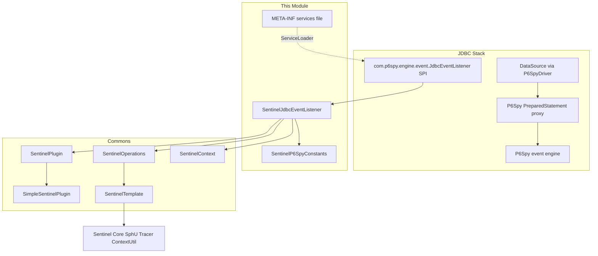
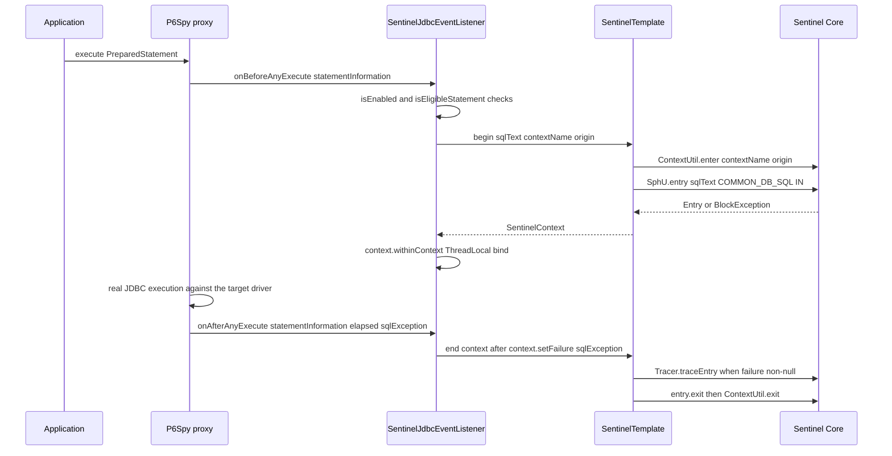
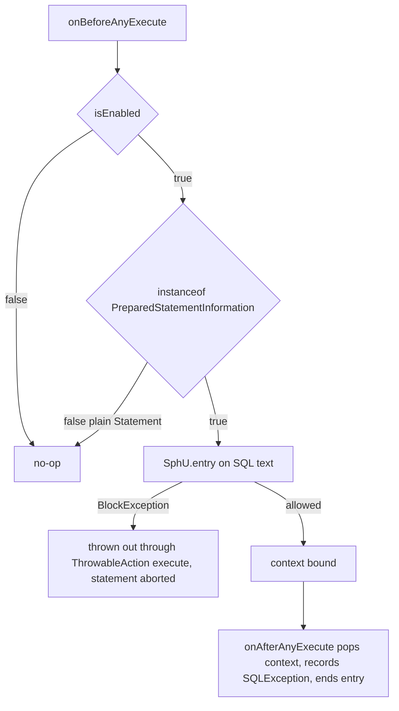
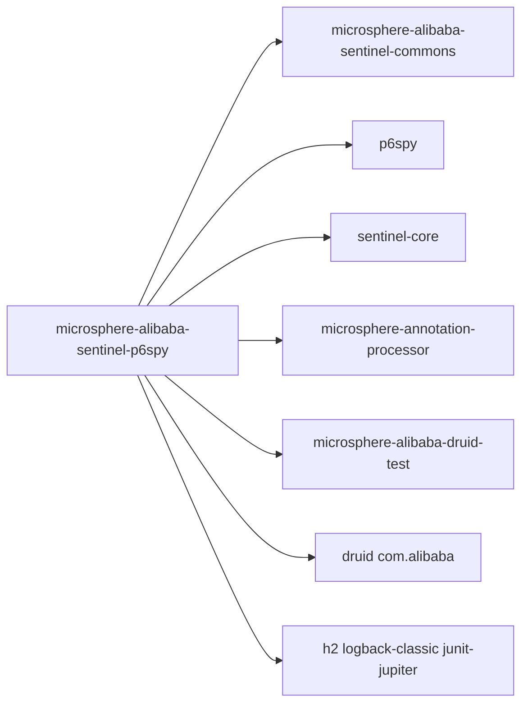

# microsphere-alibaba-sentinel-p6spy — 开发者指南

[English](../microsphere-alibaba-sentinel-p6spy.md)

> **已归档的 `1.x` 分支。** 本页记录 `0.1.x` 构件的内部设计（分支 `release-1.x`、Java 8、Spring Boot 2.x、Spring Cloud Hoxton - 2021.0.x）。源码树与当前分支完全一致，仅 POM 基线不同（javax Servlet API、`org.hibernate:hibernate-core`、通过 `META-INF/spring.factories` 注册自动配置）。本页在主干文档中的对应页面是 [../current/microsphere-alibaba-sentinel-p6spy.md](../../current/zh/microsphere-alibaba-sentinel-p6spy.md)。

## 目的与范围

本模块通过 P6Spy 使用 Alibaba Sentinel 计量 JDBC 语句执行。
`SentinelJdbcEventListener` 继承 `com.p6spy.engine.event.SimpleJdbcEventListener`（后者实现
`com.p6spy.engine.event.JdbcEventListener`），并作为服务提供者发布在
`META-INF/services/com.p6spy.engine.event.JdbcEventListener` 中，因此一旦 jar 位于 classpath 上且数据源使用
P6Spy 驱动（`com.p6spy.engine.spy.P6SpyDriver`，URL 前缀 `jdbc:p6spy:`），P6Spy 自身的事件注册表就会自动
装载它。

此处覆盖的关键行为：

- 语句执行的前置/后置钩子，以及它们开启与关闭的两阶段 Sentinel entry。
- 基于所执行 SQL 文本的资源命名，且仅限预处理语句。
- `SQLException` 的记录与追踪语义。
- 通过 `microsphere.sentinel.p6spy.enabled` 启用/禁用。

发布线事实：0.1.x，Java 8，`sentinel-core` 1.8.10，P6Spy 与 `sentinel-core` 都声明为 optional，由消费者
自行带入兼容版本。

## 架构

## 源码分析

### `io.microsphere.alibaba.sentinel.p6spy.SentinelJdbcEventListener`

声明为 `public class SentinelJdbcEventListener extends SimpleJdbcEventListener implements SentinelPlugin`。
与 Hibernate 插件一样，它**不**继承 `AbstractSentinelPlugin`；插件状态存放在 `SimpleSentinelPlugin`
委托对象中。

字段与构造器：

- `private static final Logger logger`（microsphere-logging 门面）。
- `private final SentinelPlugin delegate;`
- `private final SentinelOperations sentinelOperations;`
- `public SentinelJdbcEventListener()` — 调用 `this(DEFAULT_CONTEXT_NAME, DEFAULT_ORIGIN)`。
- `public SentinelJdbcEventListener(String contextName, String origin)` — 创建
  `new SimpleSentinelPlugin(PLUGIN_NAME, contextName, origin, COMMON_DB_SQL, IN, false)`，随后
  `new SentinelTemplate(getResourceType(), getTrafficType())`，再 `SentinelPlugin.install(this)`
  （注册表注册加上关闭钩子卸载）。

语句生命周期钩子（继承自 `SimpleJdbcEventListener`，即 P6Spy 的前置/后置配对）：

- `public void onBeforeAnyExecute(StatementInformation statementInformation)` — 当 `isEnabled()` 且
  `isEligibleStatement(statementInformation)` 时，在
  `io.microsphere.lang.function.ThrowableAction.execute` 内执行：
  `resourceName = getResourceName(statementInformation)`、
  `SentinelContext context = sentinelOperations.begin(resourceName, getContextName(), getOrigin())`，
  然后 `context.withinContext()` 把上下文绑定到当前线程。
- `public void onAfterAnyExecute(StatementInformation statementInformation, long timeElapsedNanos, SQLException e)` —
  启用且符合条件时：`doInContext(context -> { context.setFailure(e); sentinelOperations.end(context); }, true)`；
  `SentinelContext` 从 `ThreadLocal` 弹出，`SQLException`（可能为 `null`）记录到其上，而
  `SentinelTemplate.end` 只在记录的失败对象非 `null` 时调用
  `Tracer.traceEntry(failure, entry)`，随后执行 `entry.exit()` 与 `ContextUtil.exit()`。

受保护的扩展接缝：

- `protected String getResourceName(StatementInformation statementInformation)` — 返回
  `statementInformation.getSql()`；所执行的 SQL 字符串就是 Sentinel 资源名，并以 trace 级别记录日志。
- `protected boolean isEligibleStatement(StatementInformation statementInformation)` — 返回
  `statementInformation instanceof PreparedStatementInformation`；默认不计量普通 `Statement` 的执行。

`SentinelPlugin` 接口面：`isAutoInstalled`、`isEnabled`、`setEnabled`、`getName`、`getContextName`、
`getOrigin` 转发给 `delegate`；`getResourceType()` 直接返回 `COMMON_DB_SQL`，`getTrafficType()` 直接返回
`IN`（绕开了委托路径）。

### `io.microsphere.alibaba.sentinel.p6spy.SentinelP6SpyConstants`

由 `SentinelP6SpyConstantsTest` 断言：

- `String PLUGIN_NAME = "p6spy"`。
- `String DEFAULT_CONTEXT_NAME = "microsphere_sentinel_p6spy_context"` — 遵循 commons 的
  `microsphere_sentinel_{}_context` 模板。
- `String DEFAULT_ORIGIN = "Statement"`。
- `String ENABLED_PROPERTY_NAME = "microsphere.sentinel.p6spy.enabled"` — 标注
  `@ConfigurationProperty(type = boolean.class, defaultValue = "true", source = SYSTEM_PROPERTIES_SOURCE)`。

### SPI 注册与 spy.properties

- `src/main/resources/META-INF/services/com.p6spy.engine.event.JdbcEventListener` 恰好只包含
  `io.microsphere.alibaba.sentinel.p6spy.SentinelJdbcEventListener`。
- `src/test/resources/spy.properties` 只包含 `driverlist=org.h2.Driver`；监听器本身是通过 services 文件
  到达的，而不是通过该 properties 文件。

### 测试

`SentinelJdbcEventListenerTest` 继承 `AbstractAlibabaDruidTest`（microsphere-alibaba-druid-test），并覆写
`buildDruidDataSource()` 以使用驱动 `com.p6spy.engine.spy.P6SpyDriver`、URL
`jdbc:p6spy:h2:mem:test_mem`、用户 `sa` —— 因此真实 JDBC 流量会经过 P6Spy 与监听器。

- `testDefaults()` — 断言新建的监听器 `isEnabled()`，名称为 `p6spy`，上下文名与 origin 与常量一致。
- `testDisabled()` — `setEnabled(false)`，随后调用 `onBeforeAnyExecute(null)` 与
  `onAfterAnyExecute(null, 0L, null)`；二者都必须是安全的空操作，且 `isEnabled()` 为 `false`。
- `@AfterEach postTest()` — 以 origin `Statement` 进入
  `microsphere_sentinel_p6spy_context`，并断言 entrance node 有子节点，证明 SQL 资源已被注册。

## 设计模式

- **SPI（服务提供者）**：通过
  `META-INF/services/com.p6spy.engine.event.JdbcEventListener` 注册，由 P6Spy 的入口加载。
- **观察者（Observer）**：`onBeforeAnyExecute` / `onAfterAnyExecute` 是 P6Spy 针对被代理连接上每次语句执行
  的广播钩子。
- **委托（Delegate）**：插件元数据与 enabled 状态由 `SimpleSentinelPlugin`（一个
  `AbstractSentinelPlugin` 子类）持有；监听器以适配视图的形态实现 `SentinelPlugin`。
- **模板方法 / 两阶段执行（Template Method / two-phase execution）**：Sentinel entry 机制完全委托给
  `SentinelOperations`/`SentinelTemplate`（`begin` → `ContextUtil.enter` + `SphU.entry`；
  `end` → 可选 `Tracer.traceEntry` → `entry.exit` → `ContextUtil.exit`）。
- **过滤器钩子（Filter hook）**：`isEligibleStatement` 决定哪些语句类型会被计量。

## 核心流程

### 语句生命周期防护流程

### 禁用、被过滤与限流拒绝路径

插件被禁用时，`onAfterAnyExecute` 的保护判断同样会跳过弹出动作，因此在禁用之前绑定的上下文会一直留在线程本地
变量中直到被移除；测试只在两个钩子上覆盖“完全禁用”这一种状态。

## 依赖

| 依赖 | pom 中的作用域 |
|---|---|
| io.github.microsphere-projects:microsphere-annotation-processor | compile, optional |
| io.github.microsphere-projects:microsphere-alibaba-sentinel-commons | compile |
| com.alibaba.csp:sentinel-core | compile, optional |
| p6spy:p6spy | compile, optional |
| org.junit.jupiter:junit-jupiter | test |
| ch.qos.logback:logback-classic | test |
| io.github.microsphere-projects:microsphere-alibaba-druid-test | test |
| com.alibaba:druid | test |
| com.h2database:h2 | test |

## 扩展点

- **自定义资源命名**：继承该类并覆写 `getResourceName(StatementInformation)` —— 例如把 SQL 中的字面量
  归一化为稳定的资源键。
- **扩大或收窄覆盖范围**：覆写 `isEligibleStatement(StatementInformation)`，以纳入普通 `Statement` 调用或
  排除特定语句。
- **context/origin**：使用 `(contextName, origin)` 构造器，或为自定义插件实例调用 `SentinelPlugin.install`。
- **切换**：运行时 `setEnabled(boolean)`（转发给委托对象），或在构造时读取
  `microsphere.sentinel.p6spy.enabled=false` JVM 系统属性。
- **注册**：随你的 jar 提供自己的
  `META-INF/services/com.p6spy.engine.event.JdbcEventListener` 条目；P6Spy 把服务文件契约作为集成点。

## 相关模块

- 开发者指南索引：[README](./README.md)
- [microsphere-alibaba-sentinel-commons](./microsphere-alibaba-sentinel-commons.md) — `SentinelPlugin`、
  `SentinelOperations`、`SentinelTemplate`、`SentinelContext`。
- [microsphere-alibaba-sentinel-alibaba-druid](./microsphere-alibaba-sentinel-alibaba-druid.md) — 同为
  JDBC 层的 Druid filter 替代方案。
- [microsphere-alibaba-sentinel-hibernate-core](./microsphere-alibaba-sentinel-hibernate-core.md) —
  同级的持久层插件。
- 用户指南对应页面：[../../user-guide/1.x/microsphere-alibaba-sentinel-p6spy.md](../../../user-guide/1.x/zh/microsphere-alibaba-sentinel-p6spy.md)

---

## English

[English 版本](../microsphere-alibaba-sentinel-p6spy.md)
