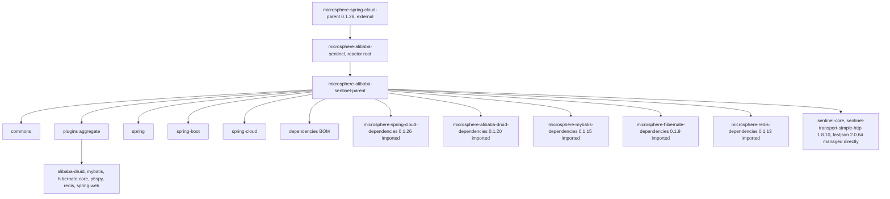
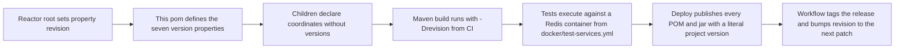
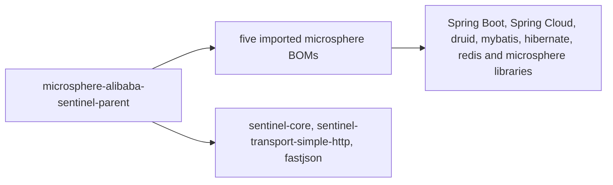

# microsphere-alibaba-sentinel-parent — 开发者指南

[English](../microsphere-alibaba-sentinel-parent.md)

> **已归档的 `1.x` 分支。** 本页记录 `0.1.x` 构件的内部设计（分支 `release-1.x`、Java 8、Spring Boot 2.x、Spring Cloud Hoxton - 2021.0.x）。源码树与当前分支完全一致，仅 POM 基线不同（javax Servlet API、`org.hibernate:hibernate-core`、通过 `META-INF/spring.factories` 注册自动配置）。本页在主干文档中的对应页面是 [../current/microsphere-alibaba-sentinel-parent.md](../../current/zh/microsphere-alibaba-sentinel-parent.md)。

## 目的与范围

`microsphere-alibaba-sentinel-parent` 是一个仅含 POM 的模块：`<packaging>pom</packaging>`，没有 `src`
目录，没有 `<build>`，没有 `<modules>`，也没有 `<dependencies>` 元素。它只持有若干属性和一个
`<dependencyManagement>` 块，并且是另外十二个 POM 的 Maven 父——commons、插件聚合、
六个插件模块、spring、spring-boot、spring-cloud 以及 BOM。它的职责是版本仲裁：子模块声明坐标，
版本一律来自此处或来自在此导入的某个 BOM。

## 架构

两个角色被分开：reactor 根 `microsphere-alibaba-sentinel` 聚合这七个模块，
同时是本 POM 的父；而本 POM 是每个制品模块所继承的父。
六个插件叶子节点跳过插件聚合，直接从此处继承。

## 源码分析

### 属性

| 属性 | 值 | 被谁消费 |
|---|---|---|
| `microsphere-spring-cloud.version` | 0.1.26 | 对 `microsphere-spring-cloud-dependencies` 的 BOM 导入 |
| `microsphere-alibaba-druid.version` | 0.1.20 | 对 `microsphere-alibaba-druid-dependencies` 的 BOM 导入 |
| `microsphere-mybatis.version` | 0.1.15 | 对 `microsphere-mybatis-dependencies` 的 BOM 导入 |
| `microsphere-hibernate.version` | 0.1.9 | 对 `microsphere-hibernate-dependencies` 的 BOM 导入 |
| `microsphere-redis.version` | 0.1.13 | 对 `microsphere-redis-dependencies` 的 BOM 导入 |
| `sentinel.version` | 1.8.10 | `sentinel-core` 和 `sentinel-transport-simple-http` |
| `fastjson.version` | 2.0.64 | `com.alibaba:fastjson` |

`revision` 和 `java.version` 在此**不**声明：reactor 根将 `revision` 设为
`0.1.6-SNAPSHOT`，将 `java.version` 设为 8，而分支 README 将 0.1.5 列为该线最新
发布的版本。每个模块都声明了 `<version>${revision}</version>`。

### dependencyManagement 剖析

五个带有 `<type>pom</type>` 和 `<scope>import</scope>` 的导入，按声明顺序为：spring-cloud、
alibaba-druid、mybatis、hibernate、redis。导入顺序很重要——Maven 保留它为某个坐标所管理的第一个
版本，因此排在最前的 `microsphere-spring-cloud-dependencies` 对它也管理的任何坐标拥有最终
决定权，例如 Spring Boot 和 Spring Framework 制品。

随后是三个直接管理的条目：`sentinel-core`、`sentinel-transport-simple-http` 和 `fastjson`。
`sentinel-core` 由 commons 声明，并被几乎每个模块标记为 optional，
`sentinel-transport-simple-http` 仅由 commons 声明，而 `fastjson` 在本快照中没有任何模块声明它——
它的条目纯粹是为了固定 Sentinel 自身 transport 所引入的版本。
此处没有 `<repositories>`、`<distributionManagement>` 或 `<pluginManagement>`；这些，加上工作流所激活的
`test`、`coverage`、`publish`、`ci` 以及 `spring-cloud-hoxton`、`spring-cloud-2020` 和 `spring-cloud-2021` profile，
都来自外部的 `microsphere-spring-cloud-parent`。

### 子模块继承契约

十二个子模块都重复同一个 `<parent>` 块：`microsphere-alibaba-sentinel-parent`、
`<version>${revision}</version>`，以及一个指回本目录的显式 `<relativePath>`，
正是它使得 reactor 无需先安装父模块即可构建。

## 设计模式

| 模式 | 实现 |
|---|---|
| 物料清单 | 带有五个 `scope import` 条目和三个直接固定的 `<dependencyManagement>` |
| 父 / 模板 POM | 子模块中仅声明坐标的依赖 |
| 属性间接层 | 七个 `*.version` 属性把"哪个版本"的决定与"哪个 BOM"的决定分离开来 |
| 聚合与继承分离 | reactor 根负责聚合；本 POM 向子模块继承；插件聚合不添加任何自己的版本 |

## 核心流程

### 构建与发布流程

发布工作流向 `deploy` 传入 `-Drevision=<major.minor.patch>`，并带上 `publish` 和 `ci`
profile；构建工作流则使用一次性的 `0.0.1-SNAPSHOT`。`${revision}` 会为项目版本被解析，但上述七个
属性在已部署的 POM 中仍保持为占位符，因此必须发布整条父链，消费者才能解析导入的 BOM。

## 依赖

本 POM 不声明任何依赖；它只管理依赖。

| 受管理的坐标 | 声明版本 | 类型 |
|---|---|---|
| `io.github.microsphere-projects:microsphere-spring-cloud-dependencies` | `${microsphere-spring-cloud.version}` = 0.1.26 | BOM 导入 |
| `io.github.microsphere-projects:microsphere-alibaba-druid-dependencies` | `${microsphere-alibaba-druid.version}` = 0.1.20 | BOM 导入 |
| `io.github.microsphere-projects:microsphere-mybatis-dependencies` | `${microsphere-mybatis.version}` = 0.1.15 | BOM 导入 |
| `io.github.microsphere-projects:microsphere-hibernate-dependencies` | `${microsphere-hibernate.version}` = 0.1.9 | BOM 导入 |
| `io.github.microsphere-projects:microsphere-redis-dependencies` | `${microsphere-redis.version}` = 0.1.13 | BOM 导入 |
| `com.alibaba.csp:sentinel-core` | `${sentinel.version}` = 1.8.10 | 直接固定 |
| `com.alibaba.csp:sentinel-transport-simple-http` | `${sentinel.version}` = 1.8.10 | 直接固定 |
| `com.alibaba:fastjson` | `${fastjson.version}` = 2.0.64 | 直接固定 |

## 扩展点

| 改动 | 应在何处进行 |
|---|---|
| 升级 Sentinel 本身 | 此处的 `sentinel.version`；两个 Sentinel 构件因共享该属性而一同变动 |
| 升级某个 Microsphere 家族 | 此处对应的 `microsphere-*.version` 属性；切勿在子 pom 中添加 `<version>` |
| 添加新的第三方固定 | 在 `<dependencyManagement>` 内追加一个带新 `*.version` 属性的 `<dependency>` |
| 暴露新的项目构件 | 将其加入 [./microsphere-alibaba-sentinel-dependencies.md](./microsphere-alibaba-sentinel-dependencies.md)，后者继承本 POM |
| 更改 Java 基线 | reactor 根中的 `java.version`，由 `.github/workflows/maven-build.yml` 中的 CI 矩阵对应镜像 |
| 覆盖某个版本 | 在仓库内部，编辑此处的属性，因为子模块从不固定版本。从消费者构建来看，属性不会跨越构件边界：在导入本项目 BOM **之前** 声明你自己带显式版本的 `<dependencyManagement>` 条目，因为第一个受管理的声明胜出 |

## 相关模块

- 开发者指南索引：[./README.md](./README.md)
- 项目构件 BOM：[./microsphere-alibaba-sentinel-dependencies.md](./microsphere-alibaba-sentinel-dependencies.md)
- 继承本 POM 的模块：[./microsphere-alibaba-sentinel-commons.md](./microsphere-alibaba-sentinel-commons.md)、[./microsphere-alibaba-sentinel-plugins.md](./microsphere-alibaba-sentinel-plugins.md)、[./microsphere-alibaba-sentinel-spring.md](./microsphere-alibaba-sentinel-spring.md)、[./microsphere-alibaba-sentinel-spring-boot.md](./microsphere-alibaba-sentinel-spring-boot.md)、[./microsphere-alibaba-sentinel-spring-cloud.md](./microsphere-alibaba-sentinel-spring-cloud.md)
- 面向用户的文档：[../../user-guide/1.x/microsphere-alibaba-sentinel-parent.md](../../../user-guide/1.x/zh/microsphere-alibaba-sentinel-parent.md)

---

## English

[English 版本](../microsphere-alibaba-sentinel-parent.md)
