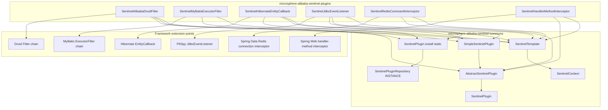
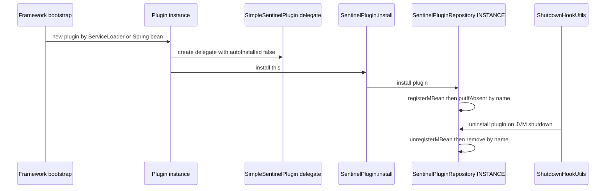
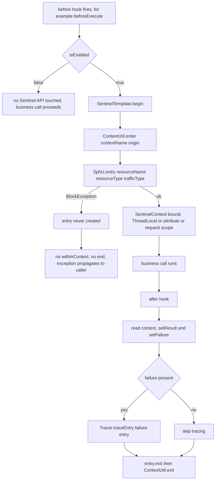
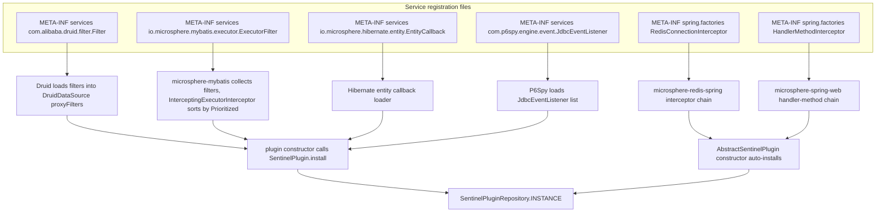
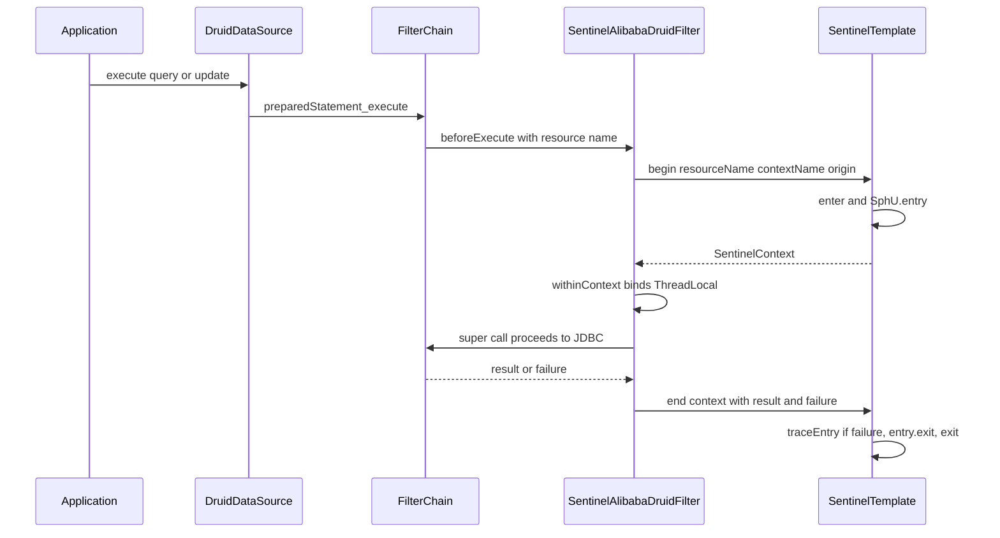
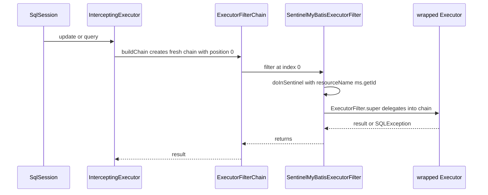
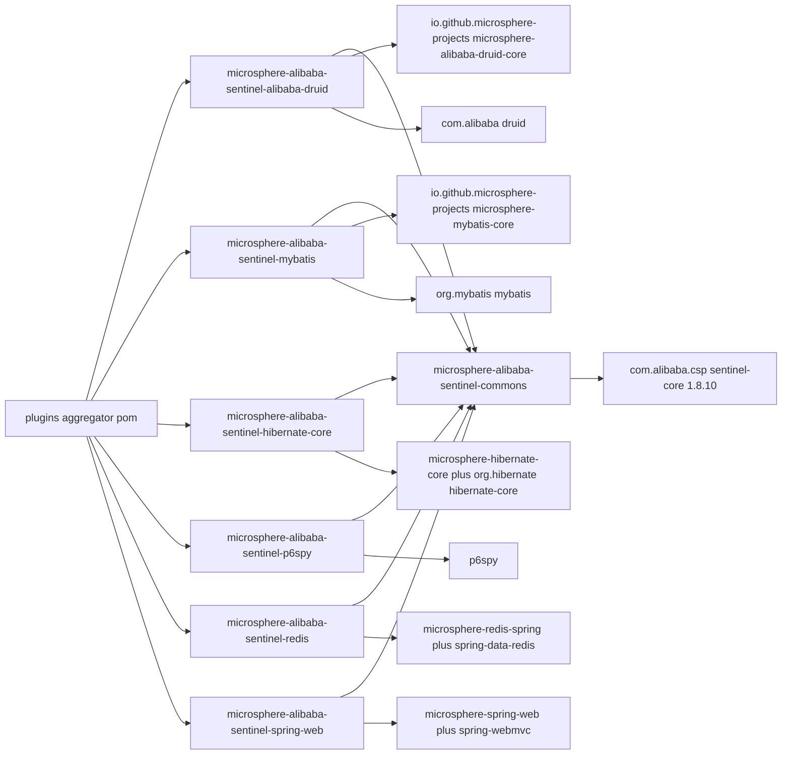

# microsphere-alibaba-sentinel-plugins — 开发者指南

[English](../microsphere-alibaba-sentinel-plugins.md)

> **已归档的 `1.x` 分支。** 本页记录 `0.1.x` 构件的内部设计（分支 `release-1.x`、Java 8、Spring Boot 2.x、Spring Cloud Hoxton - 2021.0.x）。源码树与当前分支完全一致，仅 POM 基线不同（javax Servlet API、`org.hibernate:hibernate-core`、通过 `META-INF/spring.factories` 注册自动配置）。本页在主干文档中的对应页面是 [../current/microsphere-alibaba-sentinel-plugins.md](../../current/zh/microsphere-alibaba-sentinel-plugins.md)。

## 目的与范围

`microsphere-alibaba-sentinel-plugins` 是一个 `pom` 聚合器
（`microsphere-alibaba-sentinel-plugins/pom.xml`），负责构建六个集成模块，它们把框架扩展点转化为受
Sentinel 保护的资源：

| 子 artifactId | 实现的扩展接口 | 插件名 | `resourceType` | origin |
| --- | --- | --- | --- | --- |
| `microsphere-alibaba-sentinel-alibaba-druid` | `io.microsphere.alibaba.druid.filter.AbstractStatementFilter` + `SentinelPlugin` | `alibaba-druid` | `COMMON_DB_SQL` | `Filter` |
| `microsphere-alibaba-sentinel-mybatis` | `io.microsphere.mybatis.executor.ExecutorFilter` | `mybatis` | `COMMON_DB_SQL` | `Executor` |
| `microsphere-alibaba-sentinel-hibernate-core` | `io.microsphere.hibernate.entity.EntityCallback` + `SentinelPlugin` | `hibernate` | `COMMON_DB_SQL` | `SessionFactory` |
| `microsphere-alibaba-sentinel-p6spy` | `com.p6spy.engine.event.SimpleJdbcEventListener` + `SentinelPlugin` | `p6spy` | `COMMON_DB_SQL` | `Statement` |
| `microsphere-alibaba-sentinel-redis` | `io.microsphere.redis.spring.interceptor.RedisConnectionInterceptor` | `redis` | `COMMON`（默认） | `RedisConnection` |
| `microsphere-alibaba-sentinel-spring-web` | `io.microsphere.spring.web.method.support.HandlerMethodInterceptor` | `spring-web` | `COMMON_WEB` | `HandlerMethod` |

每个子模块都依赖（非 optional）`microsphere-alibaba-sentinel-commons`，并把 `sentinel-core` 1.8.10
连同各自的框架 jar 声明为 `optional`。版本事实：`0.1.x` 线（已发布 `0.1.0`–`0.1.5`，`revision` =
`0.1.6-SNAPSHOT`），Java 8，消费方使用 Spring Boot 2.x 与 Spring Cloud Hoxton-2021。版本表位于用户指南
（`../../user-guide/1.x/microsphere-alibaba-sentinel-plugins.md`）。

新增或修改插件时阅读本指南；插件所编译依赖的抽象见
[microsphere-alibaba-sentinel-commons.md](./microsphere-alibaba-sentinel-commons.md)。

## 架构



这种结构性划分是有意为之：必须继承框架基类的适配器（`FilterAdapter`、`SimpleJdbcEventListener`、
`EntityCallback` 宿主类型）无法同时继承 `AbstractSentinelPlugin`，因此它们实现 `SentinelPlugin`，把身份信息
委托给以 `autoInstalled = false` 构造的 `SimpleSentinelPlugin`，并在构造器末尾显式调用
`SentinelPlugin.install(this)`。父类空闲的插件（`SentinelMyBatisExecutorFilter`、
`SentinelRedisCommandInterceptor`、`SentinelHandlerMethodInterceptor`）继承 `AbstractSentinelPlugin`，
从而继承“构造即自动安装”的行为。

## 源码分析

### SentinelAlibabaDruidFilter (`.../alibaba/druid/SentinelAlibabaDruidFilter.java`)

继承 `AbstractStatementFilter`（来自 microsphere-alibaba-druid-core，其本身是 Druid 的 `FilterAdapter`），
并通过委托实现 `SentinelPlugin`。构造器
`SentinelAlibabaDruidFilter(String contextName, String origin)` 依次构建
`new SimpleSentinelPlugin(PLUGIN_NAME, contextName, origin, COMMON_DB_SQL, IN, false)`、
`SentinelTemplate(getResourceType(), getTrafficType())`，然后调用 `install(this)` —— 注册表的键是这个
filter 实例而不是委托对象，因此 JMX 在活动的 Druid filter 上暴露 `setEnabled`。
`beforeExecute(StatementProxy, String resourceName)` 调用 `sentinelOperations.begin(...)` 和
`context.withinContext()`；`afterExecute(StatementProxy, String, Object result, Throwable failure)` 执行
`doInContext(context -> { setResult; setFailure; end; }, true)`。全部八个 getter（`getName`、
`getContextName`、`getOrigin`、`getResourceType`、`getTrafficType`、`isAutoInstalled`、`isEnabled`、
`setEnabled`）都转发给委托对象。`AbstractStatementFilter` 继承而来的 SQL 资源命名规则见
[microsphere-alibaba-sentinel-alibaba-druid.md](./microsphere-alibaba-sentinel-alibaba-druid.md)。

### SentinelMyBatisExecutorFilter (`.../mybatis/executor/SentinelMyBatisExecutorFilter.java`)

继承 `AbstractSentinelPlugin` 并使用 `super(PLUGIN_NAME, contextName, origin, COMMON_DB_SQL)`，因此
`EntryType.IN` 且 `autoInstalled = true` —— 仅构造动作就完成了注册并挂上卸载钩子。它只覆写三个
`ExecutorFilter` 方法：

```java
public int update(MappedStatement ms, Object parameter, ExecutorFilterChain chain) throws SQLException
public <E> List<E> query(MappedStatement ms, Object parameter, RowBounds rowBounds,
                         ResultHandler resultHandler, CacheKey cacheKey, BoundSql boundSql,
                         ExecutorFilterChain chain) throws SQLException
public <E> List<E> query(MappedStatement ms, Object parameter, RowBounds rowBounds,
                         ResultHandler resultHandler, ExecutorFilterChain chain) throws SQLException
```

每个方法都委托给 `doInSentinel(ms, () -> ExecutorFilter.super.<method>(...))`，即一次性形式 ——
`sentinelOperations.call(resourceName, getContextName(), getOrigin(), context -> callable.call(), SQLException.class)`
—— 因此 `Tracer.trace` 覆盖 MyBatis 异常，`end(...)` 在 `finally` 中执行。
`getSentinelResourceName(MappedStatement)` 返回 `ms.getId()`，即每个 mapped statement 对应一个资源。
其余 `ExecutorFilter` 默认实现（`queryCursor`、`commit`、`rollback`、`createCacheKey`、`deferLoad`、
`getTransaction`、`close`）不受保护地直通，且该类没有覆写 `getPriority()` —— 于是 `Prioritized` 的默认值
`NORMAL_PRIORITY = 0` 决定了它在 `InterceptingExecutorInterceptor` 构建的链中的位置。禁用路径直接调用
callable，并用 `ExceptionUtils.throwTarget(e, SQLException.class)` 重新包装任何异常。

### SentinelHibernateEntityCallback (`.../hibernate/entity/SentinelHibernateEntityCallback.java`)

以同样的委托模式实现 `EntityCallback, SentinelPlugin`（`COMMON_DB_SQL`、`IN`、
`autoInstalled = false`，然后 `install(this)`）。八个前置/后置钩子成对出现：
`onPreInsert/onPostInsert`、`onPreUpdate/onPostUpdate`、`onPreLoad/onPostLoad`、
`onPreDelete/onPostDelete`。`begin(Object entity, String action)` 返回 `Optional<SentinelContext>`，
并把 `sentinelOperations.begin` 包在 `ThrowableSupplier.execute(...)` 中，因此 pre 钩子内部的
`BlockException` 不会中断 Hibernate 的操作链；`onPostInsert` 等调用 `end()` →
`doInContext(this.sentinelOperations::end, true)`。资源名为
`"Entity:" + action + ":" + entity.getClass().getName()`（由
`getSentinelResourceName(Object, String)` 构造），所以规则是按实体类、按动作分别定义的。由于 post
钩子收不到 throwable，`failure` 始终为 `null`，只有 Sentinel 自身的阻塞/异常统计会生效。注册方式是
`META-INF/services/io.microsphere.hibernate.entity.EntityCallback`；
`SentinelHibernateEntityCallbackTest` 与 `SentinelHibernateEntityCallbackDisabledTest` 覆盖两种状态，
测试用 `META-INF/persistence.xml` 提供持久化单元。

### SentinelJdbcEventListener (`.../p6spy/SentinelJdbcEventListener.java`)

继承 `SimpleJdbcEventListener` 并以委托模式实现 `SentinelPlugin`。
`onBeforeAnyExecute(StatementInformation)` 以
`if (isEnabled() && isEligibleStatement(info))` 保护，随后执行
`execute(() -> { begin(...); context.withinContext(); })`，通过 `ThrowableAction.execute` 吞掉受检异常。
`isEligibleStatement` 只接受 `PreparedStatementInformation`，因此普通 `Statement` 流量不被计量；
`getResourceName` 返回原始 `statementInformation.getSql()`。
`onAfterAnyExecute(..., long timeElapsedNanos, SQLException e)` 在 `end` 之前只设置失败对象
（`context.setFailure(e)`），耗时被忽略 —— Sentinel 的 RT 统计来自 `entry.exit`，而非 P6Spy。与其他使用
委托的插件不同，这里 `getResourceType()` 直接返回 `COMMON_DB_SQL`、`getTrafficType()` 直接返回 `IN`，
而不是读取委托对象；两者与委托构造时的取值一致，但这种重复是一个改动易错点。注册方式：
`META-INF/services/com.p6spy.engine.event.JdbcEventListener`，测试用 `src/test/resources/spy.properties`
启用 P6Spy 驱动。

### SentinelRedisCommandInterceptor (`.../redis/spring/SentinelRedisCommandInterceptor.java`)

以三参数形式继承 `AbstractSentinelPlugin`，因此 `resourceType = COMMON`、`trafficType = IN`；它同时实现
`RedisConnectionInterceptor`、`InitializingBean` 与 `BeanClassLoaderAware`，且 `getOrder()` 返回
`SentinelConstants.DEFAULT_PRIORITY`（9）。上下文的传递**不**使用 `SentinelContext.withinContext()`：
`beforeExecute(RedisMethodContext)` 开启一个 entry，并以
`SENTINEL_CONTEXT_ATTRIBUTE_NAME = "sentinel-context"` 为键通过 `setContext(redisMethodContext, context)`
存储；`afterExecute(...)` 用 `getSentinelContext(...)` 取回，设置 result/failure 后调用 `end`。这样避免了
ThreadLocal 在异步 Reactor 命令链路上的泄漏。资源名在 `afterPropertiesSet()` →
`initMethodResourceNamesCache()` 中预先计算，该方法遍历
`ClassUtils.getAllInterfacesForClass(RedisClusterConnection.class, classLoader)`，并把
`SentinelUtils.buildResourceName(method)`（例如 `StringRedisConnection.get(String)`）存入一个固定容量的
缓存；查找结果为 `null` 表示“不是 Redis 连接方法”，拦截器直接返回而不进入 Sentinel。发现机制是
`META-INF/spring.factories` 中的 `io.microsphere.redis.spring.interceptor.RedisConnectionInterceptor` 键。

### SentinelHandlerMethodInterceptor (`.../spring/web/SentinelHandlerMethodInterceptor.java`)

以 `COMMON_WEB` 继承 `AbstractSentinelPlugin`，实现 `HandlerMethodInterceptor`、
`ApplicationListener<WebEndpointMappingsReadyEvent>` 与 `Ordered`（order 可设置，默认
`DEFAULT_PRIORITY`），并发布了 `BEAN_NAME = "sentinelHandlerMethodInterceptor"`。收到
`WebEndpointMappingsReadyEvent` 时，它从所有 endpoint 为 `HandlerMethod` 的 `WebEndpointMapping` 重建
`methodResourceNamesCache`，使用 `webEndpointMapping.toExpression() + "#" + handlerMethod`。
`beforeExecute` 以 `computeIfAbsent(method, m -> PLUGIN_NAME + ":" + handlerMethod)` 查找名称（作为未进入
映射快照的 handler method 的兜底），开启 entry，并通过
`WebScope.REQUEST.setAttribute(request, SENTINEL_CONTEXT_ATTRIBUTE_NAME, context)` 把 `SentinelContext`
存入请求作用域；`afterExecute` 取回它、设置返回值与错误，然后调用 `end`。缺失上下文时以 trace 级别记录并
跳过，这使得请求从未到达 controller 时 `afterExecute` 依然安全。发现机制是 `META-INF/spring.factories`
中的 `io.microsphere.spring.web.method.support.HandlerMethodInterceptor`；应用上下文上的
`@EnableWebExtension` 会激活收集它的 microsphere-spring-web 机制。

### 常量接口

每个模块暴露一个 `SentinelXxxConstants` 接口，包含 `PLUGIN_NAME`、`DEFAULT_CONTEXT_NAME`
（`microsphere_sentinel_<plugin>_context`）、`DEFAULT_ORIGIN`，以及标注了
`@ConfigurationProperty(type = boolean.class, defaultValue = "true", ...)` 的
`ENABLED_PROPERTY_NAME = PROPERTY_NAME_PREFIX + PLUGIN_NAME + DOT + "enabled"`。只有 Redis 与 Spring Web
的常量在 `SYSTEM_PROPERTIES_SOURCE` 之外还列出 `APPLICATION_SOURCE`；JDBC 侧的常量（Druid、MyBatis、
Hibernate、P6Spy）只声明 `SYSTEM_PROPERTIES_SOURCE`，这与 `SentinelUtils.isPluginEnabled` 读取 JVM 系统
属性的事实相符。这些常量由 `SentinelAlibabaDruidConstantsTest`、`SentinelMyBatisConstantsTest`、
`SentinelHibernateConstantsTest`、`SentinelP6SpyConstantsTest`、`SentinelRedisConstantsTest` 与
`SentinelSpringWebConstantsTest` 锁定，每个测试同时断言
`ENABLED_PROPERTY_NAME == SentinelUtils.getPluginEnabledPropertyName(PLUGIN_NAME)`。

## 设计模式

| 模式 | 实现类 | 源码依据 |
| --- | --- | --- |
| 适配器（Adapter） | `SentinelAlibabaDruidFilter`（Druid `FilterAdapter`）、`SentinelJdbcEventListener`（`SimpleJdbcEventListener`）、`SentinelMyBatisExecutorFilter`（`ExecutorFilter`）、`SentinelHibernateEntityCallback`（`EntityCallback`）、`SentinelRedisCommandInterceptor`、`SentinelHandlerMethodInterceptor` | 框架回调 → Sentinel entry |
| 委托（Delegation） | `SentinelAlibabaDruidFilter`、`SentinelJdbcEventListener`、`SentinelHibernateEntityCallback` 持有 `private final SentinelPlugin delegate` | 身份 getter 转发给 `SimpleSentinelPlugin` |
| 模板方法（Template Method） | `AbstractStatementFilter.beforeExecute`/`afterExecute` 配对；`SentinelMyBatisExecutorFilter.doInSentinel`；`SentinelHibernateEntityCallback.begin`/`end` | 固定骨架、可变主体 |
| 责任链（Chain of Responsibility） | `com.alibaba.druid.filter.FilterChain`、`io.microsphere.mybatis.executor.ExecutorFilterChain` | `chain.update(ms, parameter)` 让链继续 |
| 门面（Facade） | 六个插件共用的 `SentinelOperations`/`SentinelTemplate` | 隐藏 `SphU`、`Tracer`、`ContextUtil` |
| 注册表 + 单例（Registry + Singleton） | `SentinelPlugin.install(this)` → `SentinelPluginRepository.INSTANCE` | 每个插件名只注册一次 |
| SPI / ServiceLoader | 上文列出的所有 `META-INF/services` 与 `META-INF/spring.factories` 文件 | 无需显式 `new` |
| 观察者（Observer） | 作为 `ApplicationListener<WebEndpointMappingsReadyEvent>` 的 `SentinelHandlerMethodInterceptor`；commons 的 `SentinelNodeEventPublisher` | 事件驱动地构建缓存 |
| 缓存查找（Cached lookups） | Redis 与 Spring Web 插件中的 `methodResourceNamesCache` | 资源名只解析一次 |

## 核心流程

### 插件安装与卸载生命周期



对于 `AbstractSentinelPlugin` 的子类，委托对象那一步消失了：父构造器从系统属性读取 `isEnabled()`，并在
`autoInstalled` 为 `true` 时调用 `install(this)`。

### 带限流拒绝路径的两阶段保护



MyBatis 插件用一次性 `call(...)` 重载替换了步骤 `A`–`P`：`begin` 位于 `try` 之外，`catch` 中对非阻塞
throwable 执行 `Tracer.trace(e)`，`end` 在 `finally` 中执行。

### 插件提供者的 SPI 加载



commons 层的 SPI 组合（`io.microsphere.alibaba.sentinel.common.SentinelPluginRepository` 与
`com.alibaba.csp.sentinel.init.InitFunc`）在每个 JVM 中只解析一次，且早于任何插件运行；见
[microsphere-alibaba-sentinel-commons.md](./microsphere-alibaba-sentinel-commons.md)。

### Druid filter 链流程



### MyBatis executor filter 链流程



## 依赖



| 依赖 | 声明位置 | 作用域 |
| --- | --- | --- |
| `microsphere-alibaba-sentinel-commons` | 全部六个子模块 | compile |
| `microsphere-annotation-processor` | 全部六个子模块 | compile，`optional` |
| `com.alibaba.csp:sentinel-core` | 全部六个子模块 | compile，`optional` |
| `microsphere-alibaba-druid-core`、`com.alibaba:druid` | druid 子模块 | compile，`optional` |
| `microsphere-mybatis-core`、`org.mybatis:mybatis` | mybatis 子模块 | compile，`optional` |
| `microsphere-hibernate-core`、`hibernate-core` | hibernate 子模块 | compile，`optional` |
| `p6spy` | p6spy 子模块 | compile，`optional` |
| `microsphere-redis-spring`、`microsphere-spring-context`、`spring-data-redis` | redis 子模块 | compile，`optional` |
| `microsphere-spring-web`、`spring-webmvc` | spring-web 子模块 | compile，`optional` |
| `javax.servlet-api` | spring-web 子模块 | `provided` |
| `junit-jupiter`、`mockito-core`、`mockito-junit-jupiter` | 按需引入的子模块 | test |
| `h2`、`microsphere-*-test`、`microsphere-spring-test`、`logback-classic` | 子模块 | test |

版本由 `microsphere-alibaba-sentinel-parent` 决定：`sentinel.version` 1.8.10、
`microsphere-alibaba-druid.version` 0.1.20、`microsphere-mybatis.version` 0.1.15、
`microsphere-hibernate.version` 0.1.9、`microsphere-redis.version` 0.1.13，以及导入的
`microsphere-spring-cloud-dependencies` 0.1.26 BOM。

## 扩展点

新增第七个插件的步骤：

1. 在 `microsphere-alibaba-sentinel-plugins/` 下创建子模块，在聚合 `pom.xml` 中添加其 `<module>` 条目，并在
   `microsphere-alibaba-sentinel-dependencies/pom.xml` 的依赖管理中添加该构件。
2. 继承 `microsphere-alibaba-sentinel-parent`；把 `commons` 声明为 compile 依赖，把框架 jar 与
   `sentinel-core` 声明为 `optional` —— 绝不把框架版本强加给用户。
3. 添加 `Sentinel<Framework>Constants`，包含 `PLUGIN_NAME`、形如
   `microsphere_sentinel_<plugin>_context` 的 `DEFAULT_CONTEXT_NAME`、`DEFAULT_ORIGIN` 与
   `ENABLED_PROPERTY_NAME`，并配套 `*ConstantsTest`。
4. 选择身份实现路径：类没有其他父类时继承 `AbstractSentinelPlugin`；否则实现 `SentinelPlugin`，保留一个以
   `autoInstalled = false` 构造的 `SimpleSentinelPlugin` 委托，并在构造器最后调用
   `SentinelPlugin.install(this)`。
5. 选择与流量匹配的 `ResourceTypeConstants`（存储用 `COMMON_DB_SQL`、HTTP 用 `COMMON_WEB`、其余用
   `COMMON`），并构建 `new SentinelTemplate(getResourceType(), getTrafficType())`。
6. 当框架只暴露单一包裹点时优先使用一次性
   `call(resourceName, contextName, origin, callback, DeclaredException.class)`；前置/后置成对时使用配合
   `SentinelContext.withinContext()` + `doInContext(consumer, true)` 的 `begin`/`end`；当两个钩子可能运行在
   不同线程时，使用显式的 attribute/请求槽位（Redis、Spring Web）。
7. 两个钩子都要用 `isEnabled()` 保护，从而 `-Dmicrosphere.sentinel.<plugin>.enabled=false` 会退化为透传，
   完全不触碰 Sentinel 类。
8. 注册提供者文件或 `spring.factories` 条目，保持资源名稳定（它们是 Sentinel 中的规则键），并像现有模块
   使用 H2 与 `AbstractAlibabaDruidTest` / `AbstractMapperTest` 那样，添加一个驱动真实框架路径的测试。

## 相关模块

- 索引：[开发者指南 README](./README.md)
- 核心抽象：[microsphere-alibaba-sentinel-commons](./microsphere-alibaba-sentinel-commons.md)
- JDBC 插件：[microsphere-alibaba-sentinel-alibaba-druid](./microsphere-alibaba-sentinel-alibaba-druid.md)、
  [microsphere-alibaba-sentinel-mybatis](./microsphere-alibaba-sentinel-mybatis.md)
- 这些插件的自动配置：`microsphere-alibaba-sentinel-spring-boot`
  （`SentinelAlibabaDruidAutoConfiguration`、`SentinelMyBatisAutoConfiguration`、
  `SentinelRedisAutoConfiguration`、`SentinelSpringWebAutoConfiguration`，受
  `@ConditionalOnSentinelEnabled` / `@ConditionalOnSentinelAvailable` 门控）
- 面向用户的配置：[用户指南](../../../user-guide/1.x/zh/microsphere-alibaba-sentinel-plugins.md)

---

## English

[English 版本](../microsphere-alibaba-sentinel-plugins.md)
