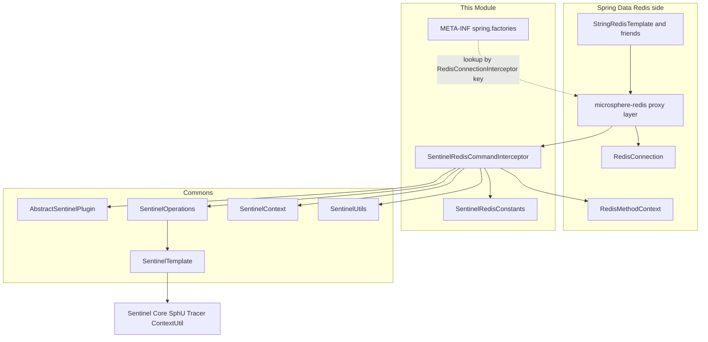
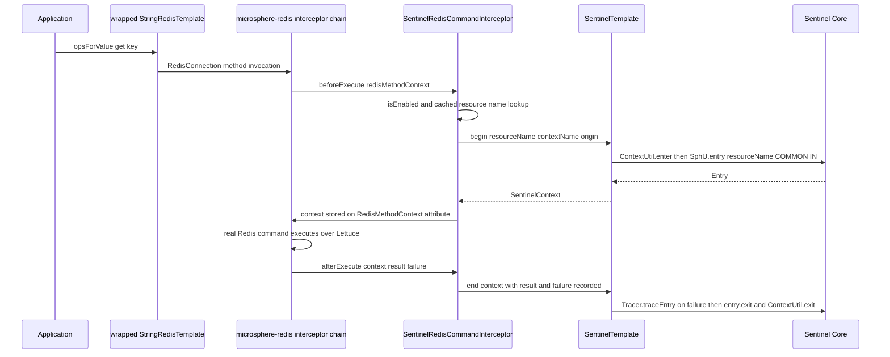
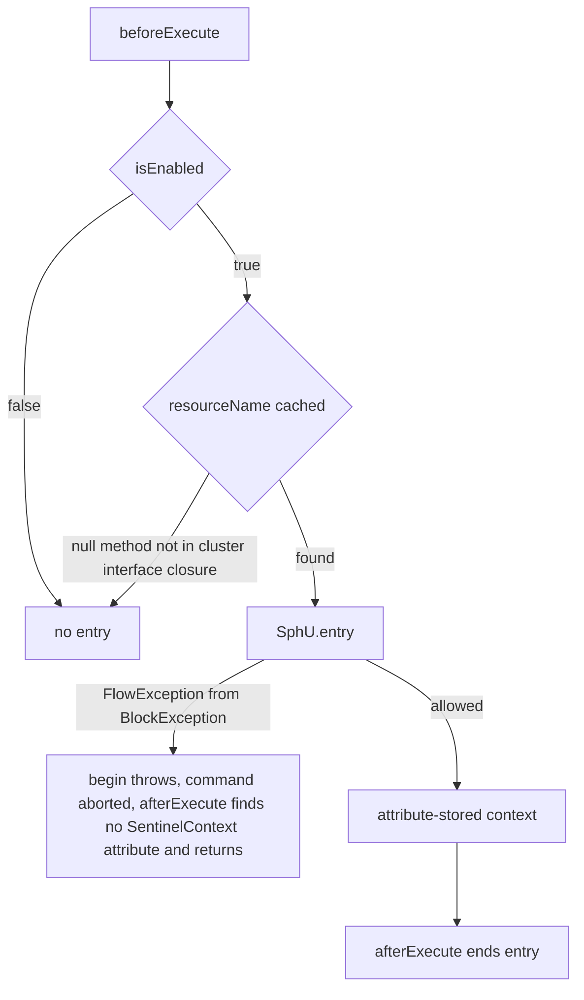
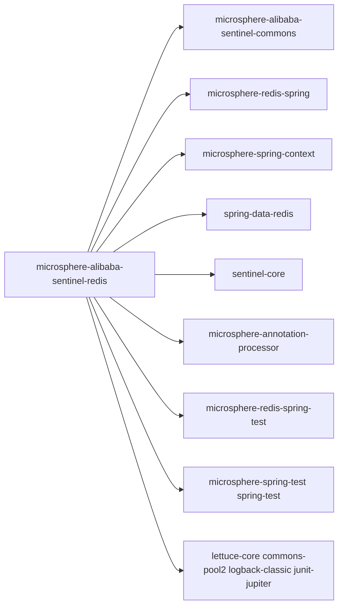

# microsphere-alibaba-sentinel-redis — 开发者指南

[English](../microsphere-alibaba-sentinel-redis.md)

> **已归档的 `1.x` 分支。** 本页记录 `0.1.x` 构件的内部设计（分支 `release-1.x`、Java 8、Spring Boot 2.x、Spring Cloud Hoxton - 2021.0.x）。源码树与当前分支完全一致，仅 POM 基线不同（javax Servlet API、`org.hibernate:hibernate-core`、通过 `META-INF/spring.factories` 注册自动配置）。本页在主干文档中的对应页面是 [../current/microsphere-alibaba-sentinel-redis.md](../../current/zh/microsphere-alibaba-sentinel-redis.md)。

## 目的与范围

本模块使用 Alibaba Sentinel 保护 Spring Data Redis 命令。
`SentinelRedisCommandInterceptor` 实现兄弟项目 `microsphere-redis`（构件
`microsphere-redis-spring`）的
`io.microsphere.redis.spring.interceptor.RedisConnectionInterceptor` 扩展点，该扩展点装饰经由被包装的
`RedisTemplate` 发出的 `RedisConnection` 方法调用。每个被拦截的连接方法都成为一个 Sentinel 资源。

此处覆盖的内容：

- `beforeExecute`/`afterExecute` 拦截配对，以及它如何开启/关闭一个 Sentinel entry。
- 通过 `SentinelUtils.buildResourceName(Method)` 与预先填充的方法缓存，从 `RedisClusterConnection`
  接口方法构造资源名。
- 本模块的 `META-INF/spring.factories` 注册了什么。
- 启用/禁用语义以及与 Spring Boot 自动配置的衔接点。

发布线事实：0.1.x，Java 8，`sentinel-core` 1.8.10；`sentinel-core`、`microsphere-redis-spring`、
`microsphere-spring-context` 与 `spring-data-redis` 均为 optional。

## 架构



## 源码分析

### `io.microsphere.alibaba.sentinel.redis.spring.SentinelRedisCommandInterceptor`

声明为
`public class SentinelRedisCommandInterceptor extends AbstractSentinelPlugin implements RedisConnectionInterceptor, InitializingBean, BeanClassLoaderAware`。

字段与构造器：

- `private final Map<Method, String> methodResourceNamesCache = newFixedHashMap(512);`
- `private ClassLoader classLoader;`（由 `BeanClassLoaderAware` 注入）。
- `private final SentinelOperations sentinelOperations;`
- `public SentinelRedisCommandInterceptor()` — `this(DEFAULT_CONTEXT_NAME, DEFAULT_ORIGIN)`。
- `public SentinelRedisCommandInterceptor(String contextName, String origin)` — 调用
  `super(PLUGIN_NAME, contextName, origin)`；三参数的 `AbstractSentinelPlugin` 形态固定
  `resourceType = ResourceTypeConstants.COMMON` 与 `trafficType = EntryType.IN`，且
  `autoInstalled = true`，因此插件会自我注册进 `SentinelPluginRepository.INSTANCE` 并附带关闭钩子卸载。
  随后 `this.sentinelOperations = new SentinelTemplate(getResourceType(), getTrafficType())`。

拦截钩子：

- `public void beforeExecute(RedisMethodContext<RedisConnection> redisMethodContext) throws Throwable` —
  当 `isEnabled()`：取 `redisMethodContext.getMethod()`，在缓存中查找其资源名
  （`private String getResourceName(Method method)`）。名称为 `null` 表示该方法不在缓存范围内：以 trace
  记录日志并直接返回，不开启 entry。否则调用
  `sentinelOperations.begin(resourceName, getContextName(), getOrigin())` 并
  `setContext(redisMethodContext, context)` —— `SentinelContext` 挂在 `RedisMethodContext` 的
  `sentinel-context` 属性上而不是 `ThreadLocal` 上，正是这一点让配对在代理调用之间保持安全。
- `public void afterExecute(RedisMethodContext<RedisConnection> redisMethodContext, Object result, Throwable failure)` —
  当 `isEnabled()`：`getSentinelContext(redisMethodContext)`；若为 `null`（entry 从未开启）则以 trace
  记录并返回；否则 `sentinelContext.setResult(result)`、`sentinelContext.setFailure(failure)`，然后调用
  `sentinelOperations.end(sentinelContext)`，后者在失败对象非 `null` 时执行
  `Tracer.traceEntry(failure, entry)`，随后执行 `entry.exit()` 与 `ContextUtil.exit()`。

静态上下文载体：

- `public static void setContext(RedisMethodContext context, SentinelContext sentinelContext)` —
  `context.setAttribute(SENTINEL_CONTEXT_ATTRIBUTE_NAME, sentinelContext)`。
- `public static SentinelContext getSentinelContext(RedisMethodContext context)` — 把该属性转回类型。

初始化与排序：

- `public void setBeanClassLoader(ClassLoader classLoader)` — 保存该 loader。
- `public void afterPropertiesSet()` — 调用 `initMethodResourceNamesCache()`。
- `private void initMethodResourceNamesCache()` —
  `ClassUtils.getAllInterfacesForClass(RedisClusterConnection.class, classLoader)`；对返回的每个接口，
  把每个 `getMethods()` 条目以 `SentinelUtils.buildResourceName(method)` 为键缓存，生成形如
  `SimpleClassName.methodName(SimpleParamType1,SimpleParamType2)` 的名称。不在该 cluster 连接接口闭包中的
  方法被刻意排除在拦截之外。
- `public int getOrder()` — 返回 `DEFAULT_PRIORITY`（来自 commons `SentinelConstants` 的 9），把该拦截器
  安放在 microsphere-redis 的有序拦截器链中。

### `io.microsphere.alibaba.sentinel.redis.SentinelRedisConstants`

由 `SentinelRedisConstantsTest` 断言：

- `String PLUGIN_NAME = "redis"`。
- `String DEFAULT_CONTEXT_NAME = "microsphere_sentinel_redis_context"`。
- `String DEFAULT_ORIGIN = "RedisConnection"`。
- `String ENABLED_PROPERTY_NAME = "microsphere.sentinel.redis.enabled"` — `@ConfigurationProperty`
  的来源为 `SYSTEM_PROPERTIES_SOURCE` 与 `APPLICATION_SOURCE`；`SentinelUtils.isPluginEnabled` 中的运行时检查
  把它当作 JVM 系统属性读取，默认 `true`。

### `META-INF/spring.factories`

该文件恰好只包含一个映射 —— 这是 microsphere-redis 的工厂查找键，**不是** Spring Boot 自动配置键：

```
io.microsphere.redis.spring.interceptor.RedisConnectionInterceptor=\
io.microsphere.alibaba.sentinel.redis.spring.SentinelRedisCommandInterceptor
```

它在 `RedisConnectionInterceptor` 这个类 SPI 的键下贡献拦截器类，从而使 microsphere-redis 的基础设施能够收集
并串联它。

### 测试

`SentinelRedisCommandInterceptorTest` 以 `@SpringJUnitConfig(classes = {RedisConfig.class, test})`、
`@TestPropertySource(properties = {"microsphere.redis.enabled=true", "spring.application.name=test-app"})`
与 `@EnableRedisInterceptor(wrapRedisTemplates = "stringRedisTemplate")` 运行。`RedisConfig` 来自
`microsphere-redis-spring-test`；测试 classpath 额外加入 `io.lettuce:lettuce-core` 与
`org.apache.commons:commons-pool2`（test 作用域），即该配置所使用的 Lettuce 连接池。

- `test()` — 先 `valueOperations.set("key","value")` 再 `get`，断言值能正确往返，另有
  `assertEquals(DEFAULT_PRIORITY, interceptor.getOrder())`，以及一个以
  `microsphere_sentinel_redis_context`/`RedisConnection` 进入上下文并断言 entrance node 子节点非空的
  `postTest()`。
- `testDisabled()` — `setEnabled(false)`，在无保护的情况下重跑同样的流程，然后重新启用。
- `testResourceNotFound()` — 围绕无关的 `getClass().getMethods()[0]` 构造一个
  `RedisMethodContext`；`beforeExecute` 与 `afterExecute(..., null, null)` 都必须不抛异常（缓存未命中路径）。

## 设计模式

- **责任链 / 拦截器（Chain of Responsibility / Interceptor）**：`RedisConnectionInterceptor` 的实现是有序的
  （`getOrder()` = 9），环绕每次连接方法调用。
- **装饰器（Decorator）**：microsphere-redis 包装 `RedisTemplate`
  （`@EnableRedisInterceptor(wrapRedisTemplates = ...)`），使连接调用经过拦截器链。
- **模板（Template）**：`AbstractSentinelPlugin` 继承提供 enabled 状态与元数据；`SentinelTemplate`
  提供 entry 生命周期。
- **缓存/记忆化（Cache/Memoization）**：`methodResourceNamesCache` 在 `afterPropertiesSet` 时一次性把
  `Method` → 资源名建立映射。
- **基于属性的上下文传递**：`SentinelContext` 以 `sentinel-context` 为键挂在 `RedisMethodContext` 上，
  是一种黑板式的钩子间交接。

## 核心流程

### Redis 命令防护流程



### 限流拒绝与跳过路径



## 依赖



| 依赖 | pom 中的作用域 |
|---|---|
| io.github.microsphere-projects:microsphere-annotation-processor | compile, optional |
| io.github.microsphere-projects:microsphere-alibaba-sentinel-commons | compile |
| io.github.microsphere-projects:microsphere-redis-spring | compile, optional |
| io.github.microsphere-projects:microsphere-spring-context | compile, optional |
| com.alibaba.csp:sentinel-core | compile, optional |
| org.springframework.data:spring-data-redis | compile, optional |
| org.junit.jupiter:junit-jupiter | test |
| ch.qos.logback:logback-classic | test |
| io.github.microsphere-projects:microsphere-spring-test | test |
| io.github.microsphere-projects:microsphere-redis-spring-test | test |
| org.springframework:spring-test | test |
| io.lettuce:lettuce-core | test |
| org.apache.commons:commons-pool2 | test |

## 扩展点

- **自定义拦截器链**：在同一个 `spring.factories` 键下注册更多 `RedisConnectionInterceptor` 实现，或通过
  `@EnableRedisInterceptor`；顺序由 `Ordered` 决定。
- **bean 覆盖**：`SentinelRedisAutoConfiguration`（spring-boot 模块）以
  `@Bean @ConditionalOnMissingBean` 声明 `sentinelRedisCommandInterceptor()`，并受
  `@ConditionalOnSentinelAvailable`、`@ConditionalOnRedisAvailable`、
  `@ConditionalOnRedisInterceptorEnabled` 与
  `@ConditionalOnProperty(ENABLED_PROPERTY_NAME, matchIfMissing = true)` 保护 —— 定义你自己的 bean
  （例如使用自定义上下文名/origin）即可替换它。
- **资源命名**：缓存由 `SentinelUtils.buildResourceName` 构建；若需自定义名称，可继承该类并重建
  `methodResourceNamesCache`（或更早地介入拦截）。
- **切换**：运行时 `setEnabled(false)`，或 `microsphere.sentinel.redis.enabled=false`。

## 相关模块

- 开发者指南索引：[README](./README.md)
- [microsphere-alibaba-sentinel-commons](./microsphere-alibaba-sentinel-commons.md) — `AbstractSentinelPlugin`、
  `SentinelTemplate`、`SentinelContext`、`SentinelUtils`、`SentinelConstants`。
- [microsphere-alibaba-sentinel-spring-boot](./microsphere-alibaba-sentinel-spring-boot.md) —
  `SentinelRedisAutoConfiguration`。
- [microsphere-alibaba-sentinel-spring-web](./microsphere-alibaba-sentinel-spring-web.md) — 同级的拦截器
  插件。
- 用户指南对应页面：[../../user-guide/1.x/microsphere-alibaba-sentinel-redis.md](../../../user-guide/1.x/zh/microsphere-alibaba-sentinel-redis.md)

---

## English

[English 版本](../microsphere-alibaba-sentinel-redis.md)
