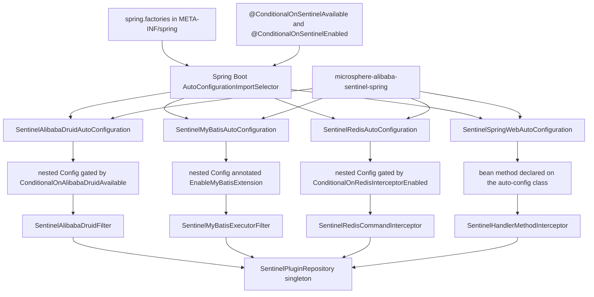
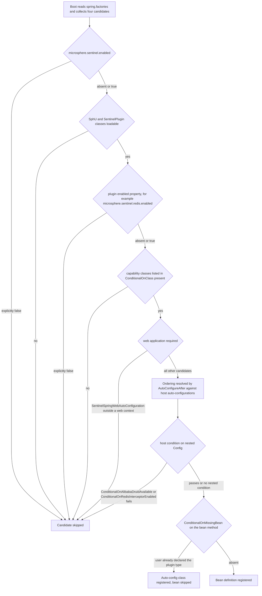
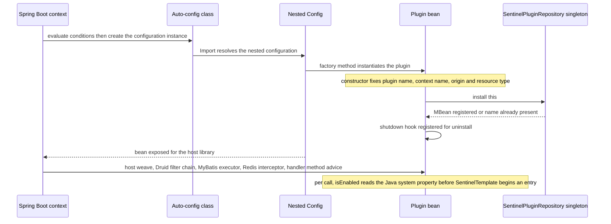
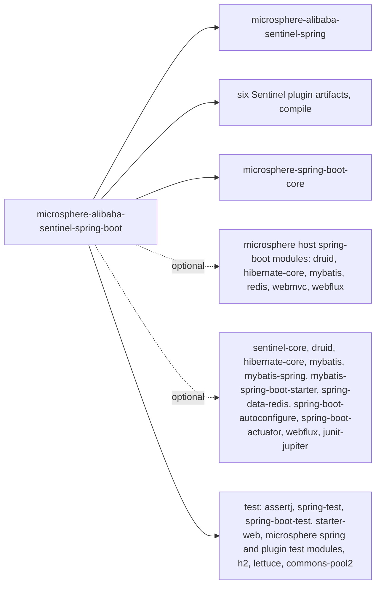

# microsphere-alibaba-sentinel-spring-boot — 开发者指南

[English](../microsphere-alibaba-sentinel-spring-boot.md)

> **已归档的 `1.x` 分支。** 本页记录 `0.1.x` 构件的内部设计（分支 `release-1.x`、Java 8、Spring Boot 2.x、Spring Cloud Hoxton - 2021.0.x）。源码树与当前分支完全一致，仅 POM 基线不同（javax Servlet API、`org.hibernate:hibernate-core`、通过 `META-INF/spring.factories` 注册自动配置）。本页在主干文档中的对应页面是 [../current/microsphere-alibaba-sentinel-spring-boot.md](../../current/zh/microsphere-alibaba-sentinel-spring-boot.md)。

## 目的与范围

`microsphere-alibaba-sentinel-spring-boot` 将 Sentinel 插件转化为 Spring Boot
自动配置。它恰好拥有六个 Java 类型和一个注册文件：

| 类型 | 角色 |
|---|---|
| `SentinelAlibabaDruidAutoConfiguration` | 发布 `SentinelAlibabaDruidFilter` |
| `SentinelMyBatisAutoConfiguration` | 发布 `SentinelMyBatisExecutorFilter` 并启用 MyBatis 扩展机制 |
| `SentinelRedisAutoConfiguration` | 发布 `SentinelRedisCommandInterceptor` |
| `SentinelSpringWebAutoConfiguration` | 在 Web 应用中发布 `SentinelHandlerMethodInterceptor` |
| `@ConditionalOnSentinelEnabled` | 基于 `@ConditionalOnProperty` 的复合注解 |
| `@ConditionalOnSentinelAvailable` | 基于 `@ConditionalOnSentinelEnabled` + `@ConditionalOnClass` 的复合注解 |
| `META-INF/spring.factories` | 列出全部四个自动配置类 |

在扩展本模块之前值得了解的边界限制：本模块没有 Hibernate 自动配置，
没有 P6Spy 自动配置，没有 `@ConfigurationProperties` 类，没有 actuator 端点，也没有
`spring-configuration-metadata.json`。属性通过 commons 及各插件模块中定义的常量按名称消费。

## 架构



这四种 bean 类型在被构造时都会自行注册到 commons 的插件仓库中，
这正是使它们能被 [./microsphere-alibaba-sentinel-spring-cloud.md](./microsphere-alibaba-sentinel-spring-cloud.md) 所记录的 Spring Cloud
特性报告所看到的原因。

## 源码分析

### 包结构

```
io.microsphere.alibaba.sentinel.spring.boot.autoconfigure   four auto-config classes
io.microsphere.alibaba.sentinel.spring.boot.condition       two composite condition annotations
META-INF/spring.factories
```

### 条件注解

`ConditionalOnSentinelEnabled` 是一个 `@Target({TYPE, METHOD})` 注解，
它以 `@ConditionalOnProperty(name = ENABLED_PROPERTY_NAME, matchIfMissing = true)` 作为元注解，其中该常量
来自 `SentinelConstants`，值为 `microsphere.sentinel.enabled`。

`ConditionalOnSentinelAvailable` 叠加了 `@ConditionalOnSentinelEnabled` 和
`@ConditionalOnClass(name = {"com.alibaba.csp.sentinel.SphU", "io.microsphere.alibaba.sentinel.common.SentinelPlugin"})`。

两者都是 **Spring Boot 条件的元注解组合**，而非
`org.springframework.context.annotation.Condition` 的子类；本模块没有声明任何自定义的 `Condition`
实现。它们的 Javadoc 陈述了相同的契约，测试也证实了这一点：用 `FilteredClassLoader`
过滤掉 `SphU` 或 `SentinelPlugin` 就会移除每一个自动配置出来的 bean。

存在两个相互独立的启用开关，且经常被混淆：

1. 条件求值时——`@ConditionalOnProperty` 读取 Spring 的 `Environment`，因此它决定
   一个 bean 定义究竟是否被注册。
2. 调用时——`SentinelUtils.isPluginEnabled(pluginName)` 读取 **Java 系统
   属性** `microsphere.sentinel.<plugin>.enabled`，除非值为字面字符串 `false`，否则默认启用。
   这就是插件在每次被拦截调用时所做的检查。

### 自动配置剖析

每个自动配置类都遵循同一模板：

- 由 `@ConditionalOnSentinelAvailable` 门控；
- 由 `@ConditionalOnProperty(name = <plugin ENABLED_PROPERTY_NAME>, matchIfMissing = true)` 门控；
- 由 `@ConditionalOnClass(name = ...)` 门控，其中列出宿主库的类与插件的
  类，一律按名称给出，从而缺失的类型绝不会触发 `NoClassDefFoundError`；
- 用 `@AutoConfigureAfter(name = ...)` 排序——四者都首先
  列出 `com.alibaba.cloud.sentinel.custom.SentinelAutoConfiguration`，以确保 Spring Cloud Alibaba Sentinel
  的 bean 先于我们的 bean 存在，随后是 Microsphere 的宿主自动配置；
- 通过 `@Import` 引入一个嵌套的静态 `Config` 类，Web 那个除外。

这些 bean 工厂方法全都是 `@Bean @ConditionalOnMissingBean` 且不带参数：

| 自动配置 | bean 方法 | 实例化的类型 | 宿主侧织入的归属方 |
|---|---|---|---|
| `SentinelAlibabaDruidAutoConfiguration` | `sentinelAlibabaDruidFilter()` | `SentinelAlibabaDruidFilter`，一个基于 `AbstractStatementFilter` 构建的 Druid 语句过滤器 | `microsphere-alibaba-druid-spring-boot` 的 Druid 自动配置，在此由 `@ConditionalOnAlibabaDruidAvailable` 门控 |
| `SentinelMyBatisAutoConfiguration` | `sentinelMyBatisExecutorFilter()` | `SentinelMyBatisExecutorFilter implements ExecutorFilter` | 来自 `microsphere-mybatis-spring` 的 `@EnableMyBatisExtension` |
| `SentinelRedisAutoConfiguration` | `sentinelRedisCommandInterceptor()` | `SentinelRedisCommandInterceptor implements RedisConnectionInterceptor` | `microsphere-redis-spring-boot` 拦截器链 |
| `SentinelSpringWebAutoConfiguration` | `sentinelHandlerMethodInterceptor()` | `SentinelHandlerMethodInterceptor implements HandlerMethodInterceptor` | Microsphere WebMVC / WebFlux 自动配置 |

这些工厂方法都不会显式地"安装"任何东西。安装发生在插件构造器内部：
`AbstractSentinelPlugin` 在 `autoInstalled` 为 true 时调用 `SentinelPlugin.install(this)`，
MyBatis、Redis 和 Spring Web 都属于这种情况；`SentinelAlibabaDruidFilter`
组合了一个 `autoInstalled = false` 的 `SimpleSentinelPlugin` 委托并自行调用 `install(this)`。
`SentinelPlugin.install` 会写入 `SentinelPluginRepository.INSTANCE`，并注册一个用于卸载插件的 JVM 关停钩子。

### 刻意缺失的部分

- **Hibernate。** `SentinelHibernateEntityCallback` 实现了
  Microsphere Hibernate 的 `EntityCallback` SPI，并由打包在
  `microsphere-alibaba-sentinel-hibernate-core` 内部的服务文件
  `META-INF/services/io.microsphere.hibernate.entity.EntityCallback` 注册。该 SPI 由
  可选依赖 `microsphere-hibernate-core` 消费，因此不涉及任何 Spring bean，也就不涉及
  自动配置；本模块仍以 compile 作用域依赖
  `microsphere-alibaba-sentinel-hibernate-core`，从而将该服务文件放到每个 Boot 消费者的类路径上。
- **P6Spy。** `microsphere-alibaba-sentinel-p6spy` 既不是本模块的依赖，也不被
  任何条件引用；它通过
  `META-INF/services/com.p6spy.engine.event.JdbcEventListener`（即 P6Spy JDBC 代理）挂钩，
  而这不是 Spring 的概念。
- **`spring.factories`。** 本模块仅通过 Boot 2
  的 `spring.factories` 文件注册自动配置；在整个 `release-1.x` 分支上搜索，只能在 Redis 和 Spring Web
  插件 jar 内部找到遗留的 `spring.factories` 文件，且它们使用的是自定义
  SPI 键（`io.microsphere.redis.spring.interceptor.RedisConnectionInterceptor`、
  `io.microsphere.spring.web.method.support.HandlerMethodInterceptor`），而非
  `EnableAutoConfiguration` 键。

### 测试

`AutoConfigurationTest<A>` 是共享的测试夹具。其构造器经由 `ResolvableType`
从泛型参数推导出自动配置类，随后分别用 `AutoConfigurations.of(...)` 构建
`ApplicationContextRunner` 与 `WebApplicationContextRunner`。每个子类都会运行三项继承而来的测试：
`testAutoConfiguredClasses`、`testOnGlobalDisabledProperty`（总是包含 `microsphere.sentinel.enabled=false`）和
`testOnGlobalMissingClass`（总是包含 `SphU` 和 `SentinelPlugin`）。子类还会补充各插件特有的否定用例——例如
`SentinelRedisAutoConfigurationTest` 过滤 `RedisConnection` 并断言
`microsphere.redis.interceptor.enabled=false`；而 `SentinelSpringWebAutoConfigurationTest`
覆盖 `testAutoConfiguredClasses` 以断言相反的结果：普通上下文中没有 bean，而
Web 上下文同时拥有自动配置类和拦截器。
`SentinelAutoConfigurationTest` 是个例外：一个带
`webEnvironment = RANDOM_PORT` 的 `@SpringBootTest`，启动 MyBatis 加 Redis 配置，执行一次 mapper
调用和一次 `StringRedisTemplate` 往返，然后断言能够进入
`microsphere_sentinel_alibaba_druid_context`、`microsphere_sentinel_mybatis_context` 和
`microsphere_sentinel_redis_context` 这些上下文。它需要一个本地 Redis，在 CI 中由
`docker/test-services.yml` 提供。

## 设计模式

| 模式 | 在本模块中的实现 |
|---|---|
| 自动配置 | 通过 `spring.factories` 注册四个类，用 `@AutoConfigureAfter` 排序 |
| 条件 | 由 Boot 的 `ConditionalOnProperty` 和 `ConditionalOnClass` 构建的复合注解 `@ConditionalOnSentinelEnabled` 与 `@ConditionalOnSentinelAvailable`；宿主库贡献了 `@ConditionalOnAlibabaDruidAvailable` 和 `@ConditionalOnRedisInterceptorEnabled`，而 `@ConditionalOnWebApplication` 对 Web 候选者进行门控 |
| 以嵌套配置充当条件作用域 | 静态 `Config` 类将插件 bean 与外层类的排序条件隔离开来——Druid 与 Redis 采用门控，MyBatis 标注 `@EnableMyBatisExtension`，而 Spring Web 干脆没有它，其 bean 方法直接位于自动配置类上 |
| 外观 | bean 工厂方法隐藏了插件的构造细节——插件名、上下文名、来源、资源类型与流量类型都在插件类内部固定 |
| 注册表 | 每个创建的插件实例都在 commons 的 `SentinelPluginRepository` 单例中注册自身，并带有用于卸载的关停钩子 |
| 模板方法 | `AbstractSentinelPlugin` 提供 `isEnabled`、`getName`、`getContextName` 与自动安装；插件的 `beforeExecute` / `afterExecute` 钩子委托给 commons 的 `SentinelTemplate` |

## 核心流程

### 条件求值



### 单个自动配置的启动序列



## 依赖



pom 中声明的直接依赖作用域：

| 分组 | 坐标 | 作用域 |
|---|---|---|
| 项目，强制 | `microsphere-alibaba-sentinel-spring`、`microsphere-alibaba-sentinel-alibaba-druid`、`microsphere-alibaba-sentinel-hibernate-core`、`microsphere-alibaba-sentinel-mybatis`、`microsphere-alibaba-sentinel-redis`、`microsphere-alibaba-sentinel-spring-web` | compile，版本 `${revision}` |
| 项目，强制 | `microsphere-spring-boot-core` | compile，版本来自导入的 BOM |
| 项目，可选 | `microsphere-alibaba-druid-spring-boot`、`microsphere-hibernate-core`、`microsphere-mybatis-spring-boot`、`microsphere-redis-spring-boot`、`microsphere-spring-boot-webmvc`、`microsphere-spring-boot-webflux` | compile，optional |
| 第三方，可选 | `sentinel-core`、`druid`、`hibernate-core`、`mybatis`、`mybatis-spring`、`mybatis-spring-boot-starter`、`spring-data-redis`、`spring-boot-autoconfigure`、`spring-boot-actuator`、`spring-boot-starter-webflux`、`junit-jupiter` | compile，optional |
| 测试 | `assertj-core`、`spring-test`、`spring-boot-test`、`spring-boot-starter-web`、`microsphere-spring-test`、`microsphere-alibaba-druid-spring-test`、`microsphere-hibernate-test`、`microsphere-mybatis-spring-test`、`microsphere-redis-spring-test`、`h2`、`lettuce-core`、`commons-pool2` | test |

`junit-jupiter` 在 compile 作用域声明为 `optional` 而非 `test`，这让 JUnit 5 留在
本模块自身的类路径上，并使下游项目能够无需指定版本即可针对它编译测试。

## 扩展点

| 属性 | 设为 `false` 时的效果 | 名称的来源 |
|---|---|---|
| `microsphere.sentinel.enabled` | 本模块中每个自动配置都被跳过 | `SentinelConstants.ENABLED_PROPERTY_NAME` |
| `microsphere.sentinel.alibaba-druid.enabled` | 跳过 Druid 自动配置 | `SentinelAlibabaDruidConstants`，其 `PLUGIN_NAME` 为 `alibaba-druid` |
| `microsphere.sentinel.mybatis.enabled` | 跳过 MyBatis 自动配置 | `SentinelMyBatisConstants`，其 `PLUGIN_NAME` 为 `mybatis` |
| `microsphere.sentinel.redis.enabled` | 跳过 Redis 自动配置 | `SentinelRedisConstants`，其 `PLUGIN_NAME` 为 `redis` |
| `microsphere.sentinel.spring-web.enabled` | 跳过 Spring Web 自动配置 | `SentinelSpringWebConstants`，其 `PLUGIN_NAME` 为 `spring-web` |
| `microsphere.sentinel.hibernate.enabled` | 不存在任何条件；只有实体回调中运行时的 `isEnabled` 检查会响应 | `SentinelHibernateConstants` |
| `microsphere.sentinel.p6spy.enabled` | 仅在 P6Spy 监听器内部做运行时检查 | `SentinelP6SpyConstants` |

测试观察到且同样会被遵从的宿主库开关：`microsphere.alibaba.druid.enabled`、
`microsphere.mybatis.enabled`、`microsphere.redis.enabled`、`microsphere.redis.interceptor.enabled`。

要添加一个插件自动配置：

1. 将插件构件作为 `${revision}` compile 依赖添加，并将其宿主库作为 `optional`。
2. 按照上文描述的共享模板创建 `SentinelXxxAutoConfiguration`，复用
   `@ConditionalOnSentinelAvailable` 与插件的 `ENABLED_PROPERTY_NAME` 常量。
3. 将全限定类名追加到 `spring.factories`；`spring.factories` 键
   会被 Boot 2 忽略。
4. 继承 `AutoConfigurationTest<SentinelXxxAutoConfiguration>` 并实现三个
   `configure...` 钩子，从而覆盖全局禁用属性与全局缺失类这两种情形。
5. 通过声明一个同类型的你自己的 bean 来覆盖插件 bean；`@ConditionalOnMissingBean`
   会让用户定义胜出。

## 相关模块

- 开发者指南索引：[./README.md](./README.md)
- Spring 类路径基础：[./microsphere-alibaba-sentinel-spring.md](./microsphere-alibaba-sentinel-spring.md)
- 插件模型与仓库：[./microsphere-alibaba-sentinel-commons.md](./microsphere-alibaba-sentinel-commons.md)
- 在此装配的插件：[./microsphere-alibaba-sentinel-alibaba-druid.md](./microsphere-alibaba-sentinel-alibaba-druid.md)、[./microsphere-alibaba-sentinel-mybatis.md](./microsphere-alibaba-sentinel-mybatis.md)、[./microsphere-alibaba-sentinel-redis.md](./microsphere-alibaba-sentinel-redis.md)、[./microsphere-alibaba-sentinel-spring-web.md](./microsphere-alibaba-sentinel-spring-web.md)、[./microsphere-alibaba-sentinel-hibernate-core.md](./microsphere-alibaba-sentinel-hibernate-core.md)、[./microsphere-alibaba-sentinel-p6spy.md](./microsphere-alibaba-sentinel-p6spy.md)
- Spring Cloud 特性上报：[./microsphere-alibaba-sentinel-spring-cloud.md](./microsphere-alibaba-sentinel-spring-cloud.md)
- 版本管理：[./microsphere-alibaba-sentinel-parent.md](./microsphere-alibaba-sentinel-parent.md)
- 面向用户的文档：[../../user-guide/1.x/microsphere-alibaba-sentinel-spring-boot.md](../../../user-guide/1.x/zh/microsphere-alibaba-sentinel-spring-boot.md)

---

## English

[English 版本](../microsphere-alibaba-sentinel-spring-boot.md)
