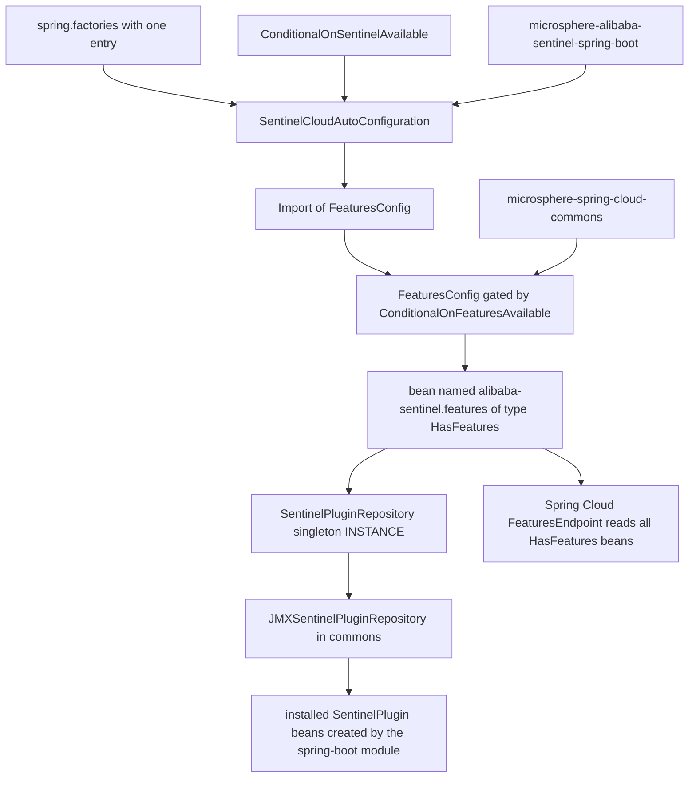
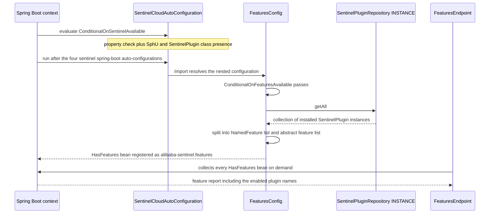
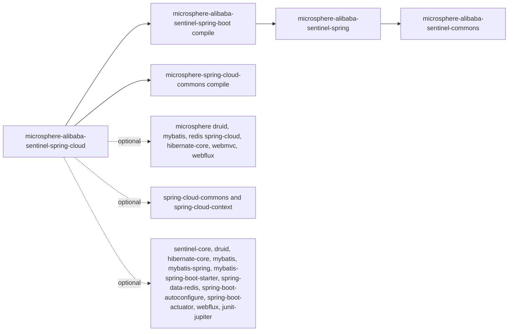

# microsphere-alibaba-sentinel-spring-cloud — 开发者指南

[English](../microsphere-alibaba-sentinel-spring-cloud.md)

> **已归档的 `1.x` 分支。** 本页记录 `0.1.x` 构件的内部设计（分支 `release-1.x`、Java 8、Spring Boot 2.x、Spring Cloud Hoxton - 2021.0.x）。源码树与当前分支完全一致，仅 POM 基线不同（javax Servlet API、`org.hibernate:hibernate-core`、通过 `META-INF/spring.factories` 注册自动配置）。本页在主干文档中的对应页面是 [../current/microsphere-alibaba-sentinel-spring-cloud.md](../../current/zh/microsphere-alibaba-sentinel-spring-cloud.md)。

## 目的与范围

`microsphere-alibaba-sentinel-spring-cloud` 是该库最薄的一层。在
`release` 分支上，它恰好贡献一个自动配置类、一个注册文件和一个测试：

| 构件 | 内容 |
|---|---|
| `SentinelCloudAutoConfiguration` | 声明于 `io.microsphere.alibaba.sentinel.spring.cloud` |
| `SentinelCloudAutoConfiguration.FeaturesConfig` | 持有特性 bean 的嵌套配置 |
| `META-INF/spring.factories` | 单行，指定 `SentinelCloudAutoConfiguration` |
| `SentinelCloudAutoConfigurationTest` | 对 features 端点进行断言的 `@SpringBootTest` |

在 `microsphere-alibaba-sentinel-spring-boot` 之上唯一新增的行为是 **Spring Cloud
特性上报**：会发布一个类型为
`org.springframework.cloud.client.actuator.HasFeatures`、名为 `alibaba-sentinel.features` 的 bean，从而让 Spring Cloud
的 `FeaturesEndpoint` 列出每一个已安装且已启用的 Sentinel 插件。

明确不在范围内（已对照源码核实）：本模块**不**声明
任何 bootstrap `ApplicationContext` 贡献，**不**
使用 `RefreshScope` 或 `@RefreshScope`，没有 `ContextRefresher`
钩子，没有 `spring.factories` 文件，也没有配置属性绑定。一切与刷新或 bootstrap
相关的能力都来自宿主库的那些同族 Spring Cloud 模块
（`microsphere-alibaba-druid-spring-cloud`、`microsphere-mybatis-spring-cloud`、
`microsphere-redis-spring-cloud`），本模块只是把自身排在它们之后。

## 架构

对仓库的查找是一次只读遍历：`INSTANCE.getAll()` 返回在同一
上下文中此前由四个 Boot 自动配置所创建的插件集合。

## 源码分析

### 类结构

`SentinelCloudAutoConfiguration` 携带三个注解，自身没有字段或方法：

- `@ConditionalOnSentinelAvailable` — 复用 spring-boot 模块的条件，即
  `microsphere.sentinel.enabled` 不得为 `false`，并且 `com.alibaba.csp.sentinel.SphU` 和
  `io.microsphere.alibaba.sentinel.common.SentinelPlugin` 都必须可加载。
- `@AutoConfigureAfter(name = {...})` 带有九个名称：`com.alibaba.cloud.sentinel.custom.SentinelAutoConfiguration`、
  Druid、MyBatis 与 Redis 的三个 Microsphere Cloud 自动配置、
  来自 `microsphere-spring-cloud-commons` 的 `ConfigurationPropertyHasFeaturesAutoConfiguration`，
  以及四个 `microsphere-alibaba-sentinel-spring-boot` 自动配置。使用类名
  而非 `Class` 字面量，可在那些可选库缺失时让排序保持声明式。
- `@Import(SentinelCloudAutoConfiguration.FeaturesConfig.class)`。

嵌套的 `FeaturesConfig` 是 `public static` 的，并带有来自
`io.microsphere.spring.cloud.client.condition` 的 `@ConditionalOnFeaturesAvailable`
注解。它暴露常量 `BEAN_NAME = "alibaba-sentinel.features"`。

### 特性 bean 算法

`features()` 是唯一的 `@Bean` 方法：

1. 读取 `SentinelPluginRepository.INSTANCE`。
2. 调用 `getAll()` 以获取每一个已安装的 `SentinelPlugin`。
3. 对每个插件询问 `isEnabled()`；已启用的插件成为 `new NamedFeature(plugin.getName(), plugin.getClass())`
   并被加入 `namedFeatures`。
4. 被禁用的插件不按名称上报；而是把它们的 `Class` 对象收集到
   `abstractFeatures` 中，这是 `HasFeatures` 针对存在但无法激活的特性的约定。
5. 返回 `new HasFeatures(abstractFeatures, namedFeatures)`。

两个列表都来自 `ListUtils.newLinkedList()`。这里没有 `@ConditionalOnMissingBean`，因此
重复的 bean 名称会发生冲突；下游应用按名称而非按类型进行覆盖。

由于该 bean 只物化一次，因此这份报告是 features bean 创建那一刻仓库的
快照——这恰恰是九个 `@AutoConfigureAfter` 名称重要的原因：
它们把此自动配置推到最后，以确保所有插件 bean 都已实例化。

### 仓库间接层

`SentinelPluginRepository.INSTANCE` 通过
`loadFirstService(SentinelPluginRepository.class, true)` 加载。commons jar 附带了
`META-INF/services/io.microsphere.alibaba.sentinel.common.SentinelPluginRepository`，其中指定了
`io.microsphere.alibaba.sentinel.jmx.JMXSentinelPluginRepository`，因此本模块所读取的"注册表"是 JMX
那个。它是一个装饰器：`install` 在 `io.microsphere.sentinel` 域下、以对象名模式
`type=SentinelPlugin,name=<plugin>` 为 `SentinelPlugin` 接口注册一个 `StandardMBean`，然后转发给内部的
`SimpleSentinelPluginRepository`；`getAll` 查询已注册的 MBean 名称，当不存在任何名称时返回空
列表，否则返回委托对象的集合。`clear` 遍历查询到的名称并逐一卸载。该类实现 `Prioritized`，其
`DEFAULT_PRIORITY` 为 9；由于服务文件只声明了这一个实现，它就是被解析出的单例，而该
优先级只有在消费者提供了第二个服务条目时才会起决定作用。对本模块而言，最终效果
是这份插件列表也可以用标准 JMX 工具进行检视。

### 测试

`SentinelCloudAutoConfigurationTest` 以 `webEnvironment = NONE`、
`@EnableAutoConfiguration`，以及属性 `spring.application.name=test-app` 加上
`management.endpoints.web.exposure.include=features` 启动。它自动注入 `Map<String, HasFeatures>` 和
`FeaturesEndpoint`，断言 bean 名称常量等于 `alibaba-sentinel.features`，断言该
映射包含这个键，并断言 `featuresEndpoint.features()` 不为 null。与 spring-boot 模块不同，
这里没有条件为否定的测试：跳过行为继承自
`@ConditionalOnSentinelAvailable`，并由 spring-boot 的测试覆盖。

## 设计模式

| 模式 | 在本模块中的实现 |
|---|---|
| 自动配置 | 通过 `spring.factories` 注册一个类；由九个 `@AutoConfigureAfter` 名称强制排序 |
| 条件 | 类上使用 `@ConditionalOnSentinelAvailable`，嵌套配置上使用 `@ConditionalOnFeaturesAvailable`——两者都是复合的元注解条件，没有自定义的 `Condition` 子类 |
| 外观 | `features()` 将整个插件子系统呈现为一条 Spring Cloud actuator 特性记录；调用者从不接触插件类型 |
| 注册表 | 读取 commons 的 `SentinelPluginRepository` 单例，由 `JMXSentinelPluginRepository` 支撑，并由 spring-boot 层的插件构造器填充 |
| 创建时快照 | 报告在工厂方法内部计算，因此 `@AutoConfigureAfter` 排序是该模式正确性的一部分 |

## 核心流程

## 依赖

| 分组 | 坐标 | 作用域 |
|---|---|---|
| 项目，强制 | `microsphere-alibaba-sentinel-spring-boot` | compile，版本 `${revision}` |
| 项目，强制 | `microsphere-spring-cloud-commons` | compile，版本来自 `microsphere-spring-cloud-dependencies` 0.1.26 |
| 项目，可选 | `microsphere-alibaba-druid-spring-cloud`、`microsphere-hibernate-core`、`microsphere-mybatis-spring-cloud`、`microsphere-redis-spring-cloud`、`microsphere-spring-boot-webmvc`、`microsphere-spring-boot-webflux` | compile，optional |
| 第三方，可选 | `sentinel-core`、`druid`、`hibernate-core`、`mybatis`、`mybatis-spring`、`mybatis-spring-boot-starter`、`spring-data-redis`、`spring-cloud-commons`、`spring-cloud-context`、`spring-boot-autoconfigure`、`spring-boot-actuator`、`spring-boot-starter-webflux`、`junit-jupiter` | compile，optional |
| 测试 | `assertj-core`、`spring-test`、`spring-boot-test`、`spring-boot-starter-web`、`microsphere-spring-test`、`microsphere-alibaba-druid-spring-test`、`microsphere-hibernate-test`、`microsphere-mybatis-spring-test`、`microsphere-redis-spring-test`、`h2`、`lettuce-core`、`commons-pool2` | test |

`HasFeatures`、`NamedFeature` 和 `FeaturesEndpoint` 都位于
`spring-cloud-commons` 的 `org.springframework.cloud.client.actuator` 包中。该条目被声明为
`optional`，这只会阻止 Maven 将其传递给消费者——该库仍在模块自身的 compile 与 test 类路径上，
这正是测试能够自动注入 `FeaturesEndpoint`，而消费本构件的应用必须自行引入 `spring-cloud-commons` 的原因。

请注意，六个 Sentinel 插件构件在此**不**被直接声明——它们从 spring-boot 依赖
传递性地进入类路径，这就是本模块无需重复列出清单也仍能看到
`SentinelPlugin` 实现的原因。

## 扩展点

| 需求 | 做法 |
|---|---|
| 将新插件上报为一项特性 | 只要插件实现 `SentinelPlugin` 并由某个自动配置构造，此处就无需任何改动；它会自动出现在 `getAll()` 中 |
| 确保新的自动配置被计入 | 将其全限定名称追加到 `SentinelCloudAutoConfiguration` 的 `@AutoConfigureAfter` 列表 |
| 禁用特性 bean | 设置 `microsphere.sentinel.enabled=false`，或移除 `spring-cloud-commons`，或满足 `@ConditionalOnFeaturesAvailable` 的否定分支 |
| 替换特性 bean | 用名称 `alibaba-sentinel.features` 声明你自己的 bean；这里没有 `@ConditionalOnMissingBean` 保护，因此按通常的 bean 覆盖规则，后定义者胜出 |
| 改变"禁用"的含义 | commons 中的 `SentinelPlugin.isEnabled()`，当前通过 `SentinelUtils.isPluginEnabled` 和 Java 系统属性 `microsphere.sentinel.<plugin>.enabled` 解析 |
| 发布本构件 | 它已在 [./microsphere-alibaba-sentinel-dependencies.md](./microsphere-alibaba-sentinel-dependencies.md) 中受管理；版本来自 [./microsphere-alibaba-sentinel-parent.md](./microsphere-alibaba-sentinel-parent.md) |

## 相关模块

- 开发者指南索引：[./README.md](./README.md)
- 下一层：[./microsphere-alibaba-sentinel-spring-boot.md](./microsphere-alibaba-sentinel-spring-boot.md)
- 它所读取的插件注册表：[./microsphere-alibaba-sentinel-commons.md](./microsphere-alibaba-sentinel-commons.md)
- Spring 类路径基础：[./microsphere-alibaba-sentinel-spring.md](./microsphere-alibaba-sentinel-spring.md)
- 聚合的插件：[./microsphere-alibaba-sentinel-plugins.md](./microsphere-alibaba-sentinel-plugins.md)
- 版本管理：[./microsphere-alibaba-sentinel-parent.md](./microsphere-alibaba-sentinel-parent.md)、[./microsphere-alibaba-sentinel-dependencies.md](./microsphere-alibaba-sentinel-dependencies.md)
- 面向用户的文档：[../../user-guide/1.x/microsphere-alibaba-sentinel-spring-cloud.md](../../../user-guide/1.x/zh/microsphere-alibaba-sentinel-spring-cloud.md)

---

## English

[English 版本](../microsphere-alibaba-sentinel-spring-cloud.md)
