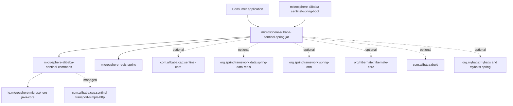
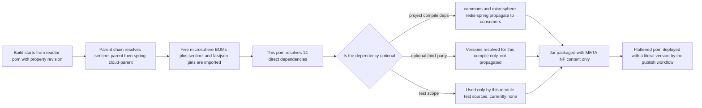
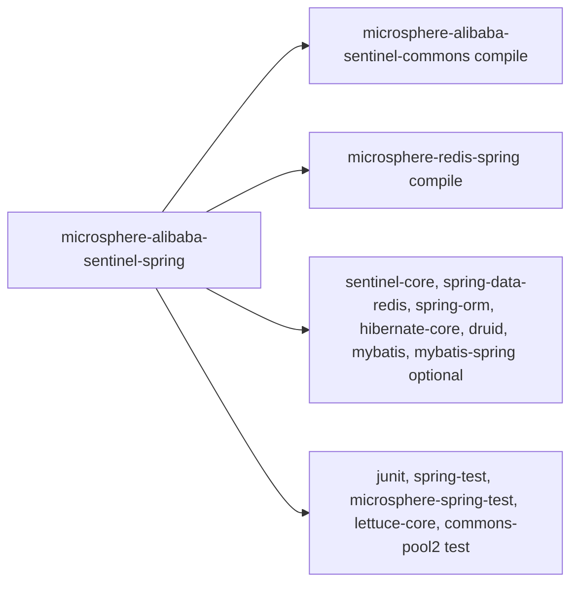

# microsphere-alibaba-sentinel-spring — 开发者指南

[English](../microsphere-alibaba-sentinel-spring.md)

> **已归档的 `1.x` 分支。** 本页记录 `0.1.x` 构件的内部设计（分支 `release-1.x`、Java 8、Spring Boot 2.x、Spring Cloud Hoxton - 2021.0.x）。源码树与当前分支完全一致，仅 POM 基线不同（javax Servlet API、`org.hibernate:hibernate-core`、通过 `META-INF/spring.factories` 注册自动配置）。本页在主干文档中的对应页面是 [../current/microsphere-alibaba-sentinel-spring.md](../../current/zh/microsphere-alibaba-sentinel-spring.md)。

## 目的与范围

`microsphere-alibaba-sentinel-spring` 是 Microsphere Alibaba Sentinel 库的 Spring 层聚合模块。
在 `release` 分支上，它以 `<packaging>jar</packaging>` 声明，但模块目录中只有 `pom.xml`：没有
`src/main/java`，没有 `src/test/java`，也没有资源目录。因此 0.1.x 线发布的构件是一个几乎为空的
jar——仅含 `META-INF/MANIFEST.MF`、内嵌的 Maven pom 以及一条 `git.properties`，别无其他。

该模块以**依赖契约**的形式存在，而非代码：

- 它向普通的 Spring Framework 应用提供一个单一的 Maven 坐标，引入 Sentinel 核心 API 以及
  Sentinel 插件所织入的那些面向 Spring 的库（`spring-data-redis`、`spring-orm`、`hibernate-core`、
  `druid`、`mybatis`、`mybatis-spring`）。
- 它声明了每个 Spring 消费者都需要的两个强制传递依赖：
  `microsphere-alibaba-sentinel-commons`（插件模型）与 `microsphere-redis-spring`
  （Redis 命令拦截器扩展点）。
- 它是 `microsphere-alibaba-sentinel-spring-boot` 的直接父依赖，后者在其之上添加了
  自动配置层。

本指南面向需要理解为何发布一个空 jar、以及需要修改该模块依赖面的开发者。

## 架构

只有两条实线的项目边会传递给消费者。所有第三方边在 pom 中都标记为
`<optional>true</optional>`，因此 Maven 就此终止传递性：消费者必须
已经自行引入其想要织入的库。那些虚线的 commons 边声明在 commons 的
pom 中，而非此处，列出它们是为了说明 `commons` 会牵入哪些依赖。

## 源码分析

### pom 结构剖析

| 段落 | 内容 | 说明 |
|---|---|---|
| `parent` | `microsphere-alibaba-sentinel-parent`，其 `relativePath ../microsphere-alibaba-sentinel-parent/pom.xml` | 通过导入的 BOM 提供所有第三方版本 |
| `version` | `${revision}` | 根 pom 将 `revision` 设为 `0.1.6-SNAPSHOT`；CI 会覆盖它 |
| `packaging` | `jar` | 即使没有源码也会产出真实构件 |
| `name` / `description` | `Microsphere :: Alibaba Sentinel :: Spring` | Reactor 命名约定 |
| `dependencies` | 2 个项目 + 7 个可选第三方 + 5 个测试 | 第三方条目没有 `<version>` |
| `build` | 缺失 | 无插件定制，也无源码目录可编译 |

所声明的依赖分为三个区块，由 pom 注释
`Microsphere Sentinel Core`、`Third-Party Dependencies` 和 `Testing` 分隔：

1. 强制项目依赖：`microsphere-alibaba-sentinel-commons`（显式
   `${revision}`）与 `microsphere-redis-spring`（省略版本）。
2. 可选能力依赖：`sentinel-core`、`spring-data-redis`、`spring-orm`、
   `hibernate-core`、`druid`、`mybatis`、`mybatis-spring`。
3. 测试作用域依赖：`junit` 4、`spring-test`、`microsphere-spring-test`、
   `lettuce-core`、`commons-pool2`——由于当前没有测试源码而暂未使用，但予以保留，
   以便该模块日后能够再次承载 Spring XML 集成测试。

### 空 jar 为何存在

- **单一坐标。** 一个非 Boot 的 Spring 应用通过单个
  `<dependency>` 即可获得一致的类路径，而无需重复声明 Redis、ORM 与连接池库。
- **版本仲裁集中于一处。** 这里的第三方依赖都不带版本；父 pom 导入
  `microsphere-spring-cloud-dependencies`、`microsphere-redis-dependencies`、
  `microsphere-hibernate-dependencies`、`microsphere-mybatis-dependencies` 和
  `microsphere-alibaba-druid-dependencies`，因此本模块不会与它们产生偏移。
- **为 Boot 模块提供稳定的依赖目标。** `microsphere-alibaba-sentinel-spring-boot`
  以 `${revision}` 依赖本构件，因此 Spring 层能力只需声明一次。
- **以可选依赖充当特性开关。** 将第三方条目标记为可选，意味着本模块绝不会把 Druid、MyBatis
  或 Hibernate 强加到类路径上；某个类是否存在，正是 Boot 的条件日后所要探测的内容。

### 模块不包含的内容

没有 `spring.factories`，没有 `spring.factories`，也没有 SPI 服务文件。自动配置
位于 `microsphere-alibaba-sentinel-spring-boot`；插件实现位于
`microsphere-alibaba-sentinel-plugins/*`。

## 设计模式

由于本模块没有代码，下面所列的都是结构性（pom 层）模式；行为型
模式——注册表（`SentinelPluginRepository`）、外观（`SentinelTemplate`）、
策略与模板方法——属于 commons，记录于
[./microsphere-alibaba-sentinel-commons.md](./microsphere-alibaba-sentinel-commons.md)。

| 模式 | 应用之处 | 依据 |
|---|---|---|
| 物料清单（BOM）风格的聚合 | 单一坐标发布一套一致的 Spring 类路径 | `<packaging>jar</packaging>` 而源码缺失 |
| 可选依赖 / 能力门控 | 被织入的库对消费者而言是自愿选用 | 7 个 `<optional>true</optional>` 条目 |
| 无版本声明 | 所有第三方版本都由导入的 BOM 解析 | 两个项目条目之外没有 `<version>` |
| 面向内部实现的分层外观 | 消费者依赖 Spring，而非直接依赖 commons | `microsphere-alibaba-sentinel-spring-boot` 引用本构件 |

## 核心流程

本模块内部没有任何运行时流程。真正重要的流程是 Maven 依赖解析，
以及产出该构件的发布流水线。

打包仍会运行标准的 `maven-jar-plugin` 目标，这正是发布了一个空但合法的 jar
的原因；`<packaging>pom</packaging>` 的模块无法作为类路径条目
被消费。

## 依赖

| 坐标 | 声明作用域 | 可选 | 版本解析 |
|---|---|---|---|
| `io.github.microsphere-projects:microsphere-alibaba-sentinel-commons` | compile | no | 在本 pom 中内联写出的 `${revision}` |
| `io.github.microsphere-projects:microsphere-redis-spring` | compile | no | `microsphere-redis-dependencies` 0.1.13，由父 pom 导入 |
| `com.alibaba.csp:sentinel-core` | compile | yes | 父属性 `sentinel.version` = 1.8.10 |
| `org.springframework.data:spring-data-redis` | compile | yes | 经 `microsphere-spring-cloud-dependencies` 0.1.26 的 Spring Boot 依赖链 |
| `org.springframework:spring-orm` | compile | yes | 同上 |
| `org.hibernate:hibernate-core` | compile | yes | `microsphere-hibernate-dependencies` 0.1.9 |
| `com.alibaba:druid` | compile | yes | `microsphere-alibaba-druid-dependencies` 0.1.20 |
| `org.mybatis:mybatis` | compile | yes | `microsphere-mybatis-dependencies` 0.1.15 |
| `org.mybatis:mybatis-spring` | compile | yes | `microsphere-mybatis-dependencies` 0.1.15 |
| `junit:junit` | test | no | 由父链管理 |
| `org.springframework:spring-test` | test | no | 由父链管理 |
| `io.github.microsphere-projects:microsphere-spring-test` | test | no | 由 `microsphere-spring-cloud-dependencies` 管理 |
| `io.lettuce:lettuce-core` | test | no | 由 `microsphere-redis-dependencies` 管理 |
| `org.apache.commons:commons-pool2` | test | no | 由父链管理 |

整个仓库的父 pom 声明 `java.version` 为 17，因此构件以
`--release 17` 构建；CI 矩阵另外还在 Java 21 与 25 上编译并测试。

## 扩展点

| 任务 | 做法 |
|---|---|
| 新增一项被织入的能力 | 在此追加一个 `<optional>true</optional>` 依赖，在 `microsphere-alibaba-sentinel-plugins` 下添加匹配的插件，然后在 Boot 模块中添加一个 `SentinelXxxAutoConfiguration` |
| 修改某个受管理的版本 | 编辑 [./microsphere-alibaba-sentinel-parent.md](./microsphere-alibaba-sentinel-parent.md) 中的版本属性；切勿在本 pom 中添加 `<version>` |
| 让本模块传递某个库 | 移除 `<optional>true</optional>`——这是一个破坏性的决定，因为每个消费者都会继承该库 |
| 发布新的项目构件 | 将该坐标加入 [./microsphere-alibaba-sentinel-dependencies.md](./microsphere-alibaba-sentinel-dependencies.md) |
| 下游覆盖某个已解析的版本 | 声明一个带你自己版本的显式依赖；直接声明优先于传递声明，而你自己的 `dependencyManagement` 条目优先于导入的 BOM |
| 将代码移回本模块 | 创建 `src/main/java/io/microsphere/alibaba/sentinel/spring/...`；构建无需改动 pom，因为没有配置插件 |

## 相关模块

- 开发者指南索引：[./README.md](./README.md)
- 本模块向 Spring 应用暴露的能力：[./microsphere-alibaba-sentinel-commons.md](./microsphere-alibaba-sentinel-commons.md)
- 在其之上构建的自动配置：[./microsphere-alibaba-sentinel-spring-boot.md](./microsphere-alibaba-sentinel-spring-boot.md)
- Spring Cloud 层：[./microsphere-alibaba-sentinel-spring-cloud.md](./microsphere-alibaba-sentinel-spring-cloud.md)
- 被织入的插件：[./microsphere-alibaba-sentinel-plugins.md](./microsphere-alibaba-sentinel-plugins.md)
- 版本管理：[./microsphere-alibaba-sentinel-parent.md](./microsphere-alibaba-sentinel-parent.md)、[./microsphere-alibaba-sentinel-dependencies.md](./microsphere-alibaba-sentinel-dependencies.md)
- 面向用户的文档：[../../user-guide/1.x/microsphere-alibaba-sentinel-spring.md](../../../user-guide/1.x/zh/microsphere-alibaba-sentinel-spring.md)

---

## English

[English 版本](../microsphere-alibaba-sentinel-spring.md)
