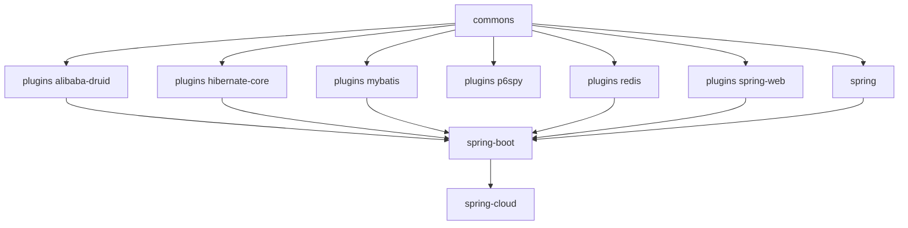

# Developer Guide — current (release branch, 0.2.x)

[中文版](zh/README.md) · [Developer Guide home](../README.md)

These documents analyse the implementation of the `release` branch (`0.2.x` line): architecture, source, design
patterns, and diagrammed flows.

## Implementation baseline

| Item                  | Value                                                          |
|-----------------------|----------------------------------------------------------------|
| Source branch         | `release` (revision `0.2.6-SNAPSHOT`, releases `0.2.0` – `0.2.5`) |
| Language level        | Java 17                                                        |
| Framework generation  | Spring Boot 3.x / Spring Cloud 2022.0.x – 2025.0.x             |
| Sentinel              | `sentinel-core` 1.8.10                                         |
| Auto-config mechanism | `META-INF/spring/org.springframework.boot.autoconfigure.AutoConfiguration.imports` |
| Servlet namespace     | `jakarta.servlet`                                              |

## Reading order

1. [commons](microsphere-alibaba-sentinel-commons.md) — the architectural core: plugin lifecycle, `SentinelOperations`
   begin/end protocol over `SphU.entry`, `ThreadLocal` `SentinelContext`, SPI repository loading, slot-callback
   instrumentation, JMX and node events.
2. [plugins](microsphere-alibaba-sentinel-plugins.md) — how a plugin attaches to a host framework.
3. One plugin document per integration:
   [alibaba-druid](microsphere-alibaba-sentinel-alibaba-druid.md) ·
   [hibernate-core](microsphere-alibaba-sentinel-hibernate-core.md) ·
   [mybatis](microsphere-alibaba-sentinel-mybatis.md) ·
   [p6spy](microsphere-alibaba-sentinel-p6spy.md) ·
   [redis](microsphere-alibaba-sentinel-redis.md) ·
   [spring-web](microsphere-alibaba-sentinel-spring-web.md)
4. Spring layer: [spring](microsphere-alibaba-sentinel-spring.md) ·
   [spring-boot](microsphere-alibaba-sentinel-spring-boot.md) ·
   [spring-cloud](microsphere-alibaba-sentinel-spring-cloud.md)
5. Build layer: [parent](microsphere-alibaba-sentinel-parent.md) ·
   [dependencies](microsphere-alibaba-sentinel-dependencies.md)

## Module dependencies

## Diagrammed flows you will find

- Plugin install / uninstall lifecycle including the JVM shutdown-hook uninstall
- `begin` → `ContextUtil.enter` → `SphU.entry` → callback → `Tracer.traceEntry` → `end` → `exit`, with the
  `BlockException` branch
- SPI discovery: `SentinelPluginRepository` ServiceLoader and the Sentinel `InitFunc`
- Spring Boot auto-configuration condition evaluation (`@ConditionalOnSentinelAvailable`, `@ConditionalOnSentinelEnabled`)
- Per-plugin interception flows (Druid filter chain, MyBatis executor filter chain, Hibernate entity callback,
  P6Spy statement events, Redis command interception, WebMVC handler-method interception)

## Companion set

Usage-oriented documentation for the same branch lives in the
[User Guide for the current branch](../../user-guide/current/README.md). The legacy implementation is documented in
the [1.x Developer Guide](../1.x/README.md).

---

## 中文

[当前版本开发者指南（中文版）](zh/README.md)
