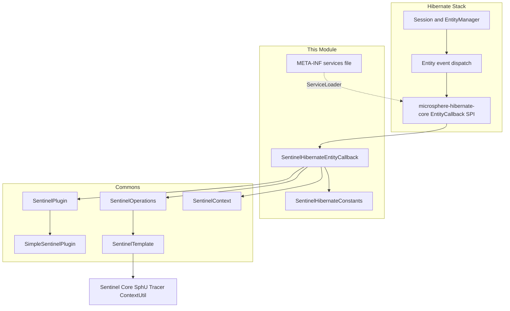
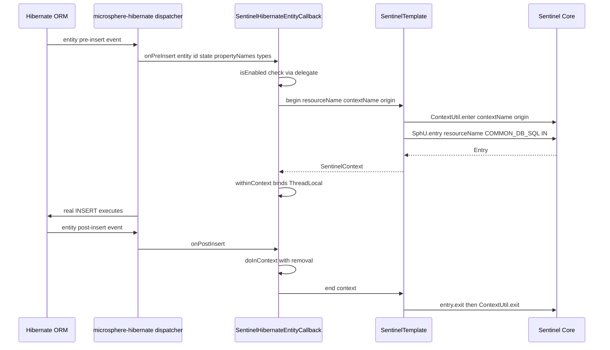
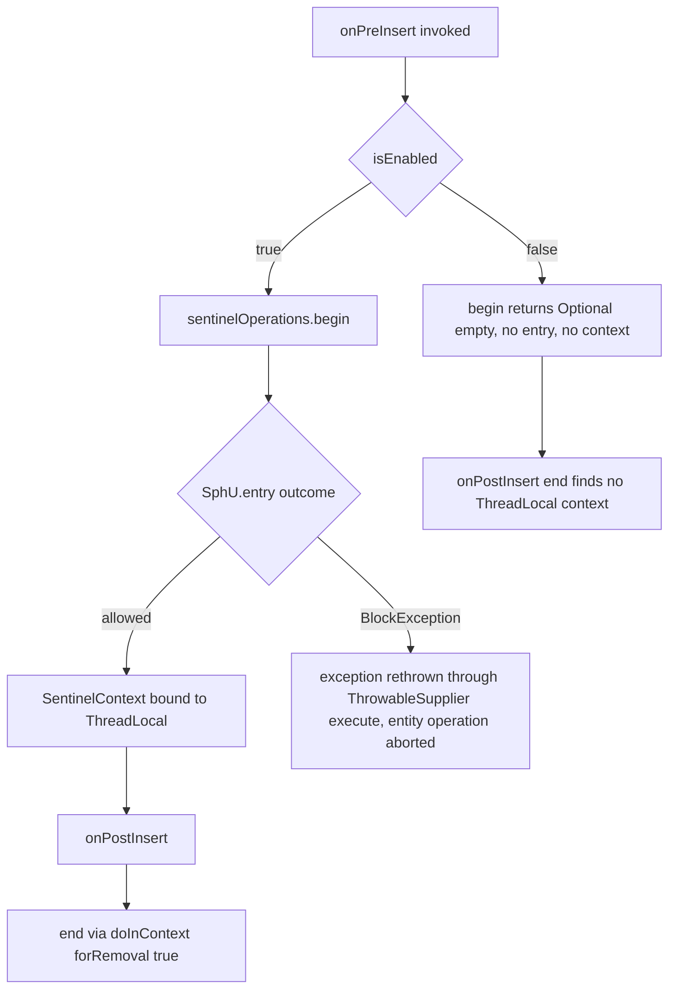
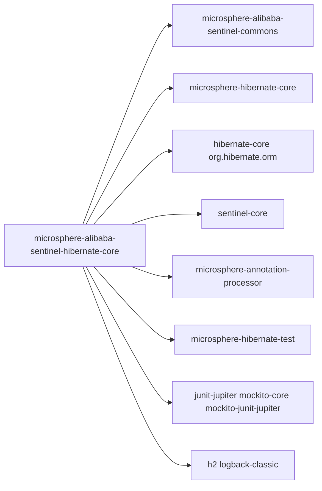

# microsphere-alibaba-sentinel-hibernate-core — Developer Guide

[中文版](zh/microsphere-alibaba-sentinel-hibernate-core.md)

## Purpose and Scope

This module protects Hibernate entity persistence operations with Alibaba Sentinel flow control.
It provides `SentinelHibernateEntityCallback`, an implementation of the
`io.microsphere.hibernate.entity.EntityCallback` SPI published by the sibling project
`microsphere-hibernate-core`. The callback is discovered through
`META-INF/services/io.microsphere.hibernate.entity.EntityCallback`, so simply placing the
jar on the classpath activates interception of entity `INSERT`, `UPDATE`, `LOAD` and
`DELETE` operations.

Scope of this guide:

- How the pre/post entity callbacks open and close a Sentinel entry (`begin` / `end`).
- How resource names and the Sentinel context name/origin are built.
- Enable/disable semantics driven by `microsphere.sentinel.hibernate.enabled`.
- On this release line (0.2.x, Java 17, `sentinel-core` 1.8.10) the module runs against
  Hibernate ORM 6 with the `jakarta` namespace, as shown by the test
  `src/test/resources/META-INF/persistence.xml`.

## Architecture

## Source Analysis

### `io.microsphere.alibaba.sentinel.hibernate.entity.SentinelHibernateEntityCallback`

Declared as `public class SentinelHibernateEntityCallback implements EntityCallback, SentinelPlugin`.
Note it does **not** extend `AbstractSentinelPlugin`; instead it holds a plugin delegate.

Fields and constructors:

- `private final SentinelPlugin delegate;`
- `private final SentinelOperations sentinelOperations;`
- `public SentinelHibernateEntityCallback()` — delegates to the two-argument constructor with
  `DEFAULT_CONTEXT_NAME` and `DEFAULT_ORIGIN` from `SentinelHibernateConstants`.
- `public SentinelHibernateEntityCallback(@Nonnull String contextName, @Nonnull String origin)` —
  creates `new SimpleSentinelPlugin(PLUGIN_NAME, contextName, origin, COMMON_DB_SQL, IN, false)`
  (the `false` suppresses `AbstractSentinelPlugin`'s self-install), then
  `new SentinelTemplate(getResourceType(), getTrafficType())`, then calls the static
  `SentinelPlugin.install(this)` which registers the callback in `SentinelPluginRepository.INSTANCE`
  and adds a JVM-shutdown callback that uninstalls it.

Entity lifecycle hooks — the `EntityCallback` SPI exposes paired pre/post notifications for each
action:

- `public void onPreInsert(Object entity, Object id, Object[] state, String[] propertyNames, Type[] propertyTypes)`
  — `begin(entity, "INSERT").ifPresent(SentinelContext::withinContext)`.
- `public void onPostInsert(Object entity, Object id, Object[] state, String[] propertyNames, Type[] propertyTypes)` — `end()`.
- `public void onPreUpdate(Object entity, Object id, Object[] state, String[] propertyNames, Type[] propertyTypes)`
  — `begin(entity, "UPDATE").ifPresent(SentinelContext::withinContext)`.
- `public void onPostUpdate(Object entity, Object id, Object[] state, String[] propertyNames, Type[] propertyTypes)` — `end()`.
- `public void onPreLoad(Object entity, Object id, Object[] state, String[] propertyNames, Type[] types)`
  — `begin(entity, "LOAD").ifPresent(SentinelContext::withinContext)`.
- `public void onPostLoad(Object entity, Object id, String[] propertyNames, Type[] types)` — `end()`.
- `public void onPreDelete(Object entity, Object id, Object[] state, String[] propertyNames, Type[] types)`
  — `begin(entity, "DELETE").ifPresent(SentinelContext::withinContext)`.
- `public void onPostDelete(Object entity, Object id, Object[] state, String[] propertyNames, Type[] types)` — `end()`.

Protected core operations:

- `protected Optional<SentinelContext> begin(Object entity, String action)` — only when `isEnabled()`:
  builds `resourceName = getSentinelResourceName(entity, action)`, reads `contextName` and `origin`
  from the delegate, and returns `Optional.of(execute(() -> sentinelOperations.begin(resourceName, contextName, origin)))`
  where `execute` is `io.microsphere.lang.function.ThrowableSupplier.execute`, which rethrows any
  `Throwable` — including a Sentinel `BlockException` raised by `SphU.entry`. When disabled it
  returns `Optional.empty()`.
- `protected void end()` — only when `isEnabled()`: `doInContext(this.sentinelOperations::end, true)`,
  which removes the current `SentinelContext` from the `ThreadLocal` and closes it.
- `protected String getSentinelResourceName(Object entity, String action)` —
  returns `"Entity:" + action + ":" + entity.getClass().getName()`; override to customize naming.

Resource/context construction summary: the resource name is derived purely from the entity class
name and operation; the context name and origin come from the delegate plugin
(`microsphere_sentinel_hibernate_context` / `SessionFactory`). In `SentinelTemplate.begin`, a blank
context name or origin falls back to `SentinelConstants.DEFAULT_CONTEXT_NAME` / `DEFAULT_ORIGIN`
before `ContextUtil.enter` and `SphU.entry(resourceName, resourceType, trafficType)` are executed.

Plugin interface methods (`isAutoInstalled`, `isEnabled`, `setEnabled`, `getName`, `getContextName`,
`getOrigin`, `getResourceType`, `getTrafficType`) all forward to `delegate`.

### `io.microsphere.alibaba.sentinel.hibernate.SentinelHibernateConstants`

An `interface` of constants, asserted by `SentinelHibernateConstantsTest`:

- `String PLUGIN_NAME = "hibernate"`.
- `String DEFAULT_CONTEXT_NAME = "microsphere_sentinel_hibernate_context"` — matches the commons
  pattern `microsphere_sentinel_{}_context`.
- `String DEFAULT_ORIGIN = "SessionFactory"`.
- `String ENABLED_PROPERTY_NAME = "microsphere.sentinel.hibernate.enabled"` — built from
  `PROPERTY_NAME_PREFIX + PLUGIN_NAME + DOT + enabled`, annotated `@ConfigurationProperty(type = boolean.class,
  defaultValue = "true", source = SYSTEM_PROPERTIES_SOURCE)`.

### SPI registration

`src/main/resources/META-INF/services/io.microsphere.hibernate.entity.EntityCallback` contains exactly
one line: `io.microsphere.alibaba.sentinel.hibernate.entity.SentinelHibernateEntityCallback`.

### Tests

- `SentinelHibernateEntityCallbackTest` extends `AbstractHibernateH2Test` (microsphere-hibernate-test,
  H2 in `src/test/resources/META-INF/persistence.xml`, unit `CRM`, entity `io.microsphere.sentinel.hibernate.test.entity.User`).
  Its `@AfterEach postTest()` enters the context `microsphere_sentinel_hibernate_context` with origin
  `SessionFactory` and asserts the entrance node child list is not empty — proof the CRUD exercised by
  the base test created Sentinel nodes.
- `SentinelHibernateEntityCallbackDisabledTest` sets the system property
  `microsphere.sentinel.hibernate.enabled=false` in `@BeforeAll` (restored in `@AfterAll`) so the same
  lifecycle runs with all `begin`/`end` work short-circuited.

## Design Patterns

- **SPI (service provider registration)**: `SentinelHibernateEntityCallback` is registered as an
  `io.microsphere.hibernate.entity.EntityCallback` implementation via `META-INF/services` and loaded
  by the host project through `ServiceLoader`.
- **Delegate/Adapter**: the class implements `SentinelPlugin` but delegates all plugin metadata and
  enabled state to a private `SimpleSentinelPlugin` (which itself extends `AbstractSentinelPlugin`),
  keeping the `EntityCallback` class free of plugin-state fields.
- **Template Method (operations execution)**: all Sentinel mechanics are centralized in
  `SentinelOperations`/`SentinelTemplate`; the callback only supplies resource name, context name
  and origin and chooses the two-phase calls.
- **Observer (pre/post events)**: Hibernate entity action notifications drive `begin`/`end` in pairs.
- **Thread-local context coupling**: `SentinelContext.withinContext()` and
  `SentinelContext.doInContext(consumer, true)` bind and pop the context across the pre/post hooks,
  which must run on the same thread.

## Core Flows

### Entity operation protection flow

### Disabled and blocked paths

Error tracing note: unlike the one-time `SentinelOperations.call` (which invokes `Tracer.trace` for
non-`BlockException` throwables) and unlike the p6spy/redis/spring-web plugins (which call
`SentinelContext.setFailure` so `SentinelTemplate.end` runs `Tracer.traceEntry`), the `EntityCallback`
post hooks receive no exception parameter, so `end()` never carries a recorded failure and
`traceEntry` is skipped for this plugin.

## Dependencies

| Dependency | Scope in pom |
|---|---|
| io.github.microsphere-projects:microsphere-annotation-processor | compile, optional |
| io.github.microsphere-projects:microsphere-alibaba-sentinel-commons | compile |
| io.github.microsphere-projects:microsphere-hibernate-core | compile, optional |
| com.alibaba.csp:sentinel-core | compile, optional |
| org.hibernate.orm:hibernate-core | compile, optional |
| org.junit.jupiter:junit-jupiter | test |
| org.mockito:mockito-core | test |
| org.mockito:mockito-junit-jupiter | test |
| io.github.microsphere-projects:microsphere-hibernate-test | test |
| ch.qos.logback:logback-classic | test |
| com.h2database:h2 | test |

## Extension Points

- **Custom resource naming**: subclass `SentinelHibernateEntityCallback` and override
  `getSentinelResourceName(Object entity, String action)` (e.g. to use simple class names or
  per-schema names).
- **Context/origin tuning**: construct with `SentinelHibernateEntityCallback(contextName, origin)`
  instead of the defaults.
- **Runtime switching**: `setEnabled(false)`/`enable()`/`disable()` through the delegate, or the
  `microsphere.sentinel.hibernate.enabled` JVM system property before plugin construction;
  `-Dmicrosphere.sentinel.hibernate.enabled=false` disables interception wholesale.
- **Replacement SPI entry**: register your own `EntityCallback` via the same `META-INF/services`
  mechanism; `SentinelPlugin.install(SentinelPlugin)` lets any custom plugin join the
  `SentinelPluginRepository` for monitoring/uninstall.

## Related Modules

- Developer guide index: [README](./README.md)
- [microsphere-alibaba-sentinel-commons](./microsphere-alibaba-sentinel-commons.md) — `SentinelPlugin`,
  `AbstractSentinelPlugin`, `SimpleSentinelPlugin`, `SentinelOperations`, `SentinelTemplate`,
  `SentinelContext`, `SentinelUtils`.
- [microsphere-alibaba-sentinel-alibaba-druid](./microsphere-alibaba-sentinel-alibaba-druid.md) and
  [microsphere-alibaba-sentinel-p6spy](./microsphere-alibaba-sentinel-p6spy.md) — sibling JDBC-layer plugins.
- User guide counterpart: [../../user-guide/current/microsphere-alibaba-sentinel-hibernate-core.md](../../user-guide/current/microsphere-alibaba-sentinel-hibernate-core.md)

---

## 中文

[中文版](zh/microsphere-alibaba-sentinel-hibernate-core.md)
