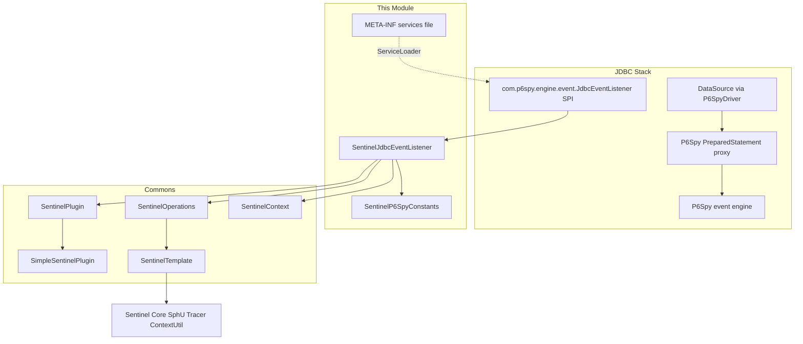
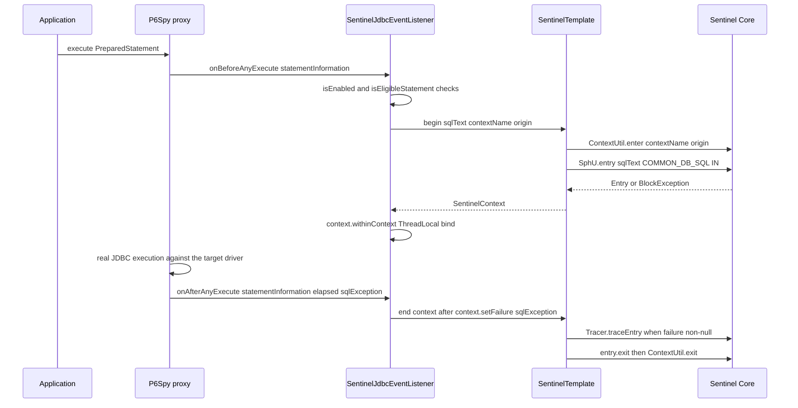
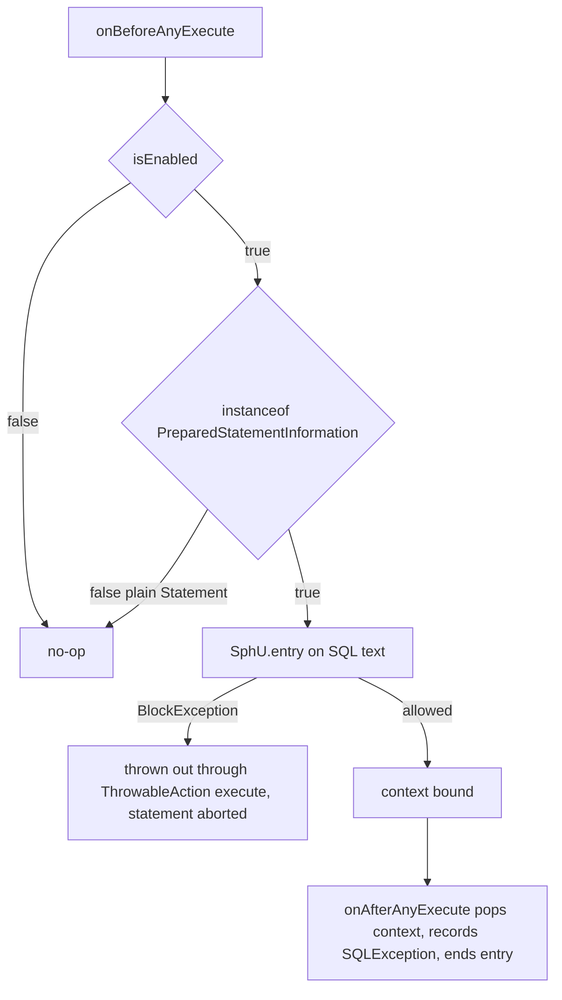
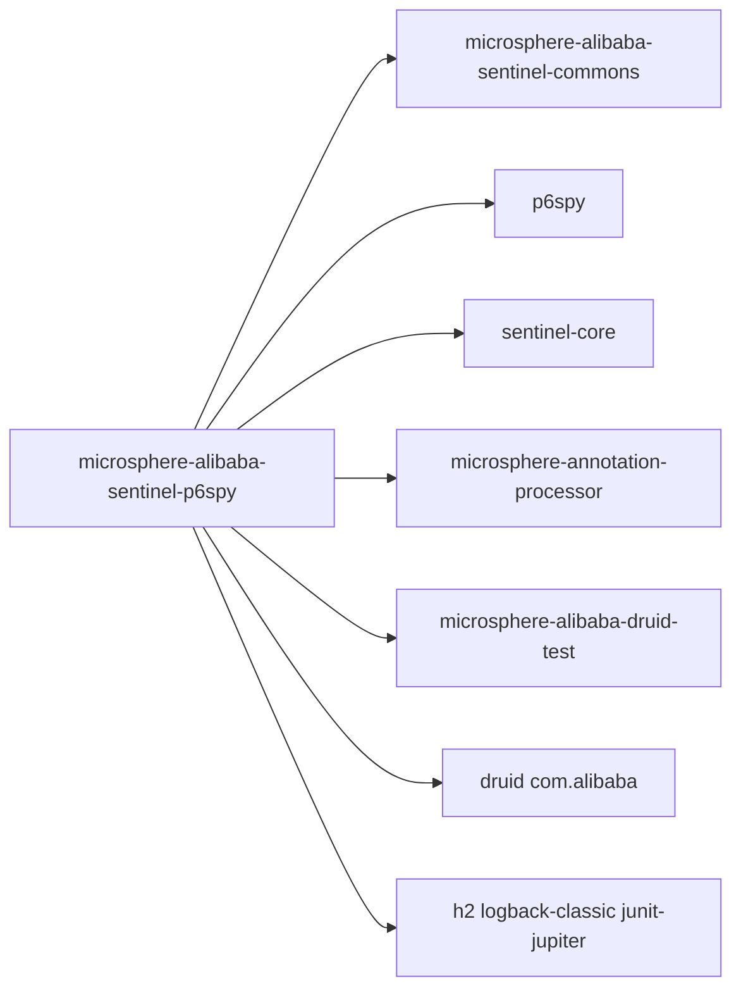

# microsphere-alibaba-sentinel-p6spy — Developer Guide

[中文版](zh/microsphere-alibaba-sentinel-p6spy.md)

## Purpose and Scope

This module meters JDBC statement execution through P6Spy with Alibaba Sentinel.
`SentinelJdbcEventListener` extends `com.p6spy.engine.event.SimpleJdbcEventListener` (which
implements `com.p6spy.engine.event.JdbcEventListener`) and is published as a service provider in
`META-INF/services/com.p6spy.engine.event.JdbcEventListener`, so P6Spy's own event registry picks
it up automatically once the jar is on the classpath and the datasource uses the P6Spy driver
(`com.p6spy.engine.spy.P6SpyDriver`, URL prefix `jdbc:p6spy:`).

Key behaviours covered here:

- The before/after statement-execution hooks and the two-phase Sentinel entry they open and close.
- Resource naming from the executed SQL text, restricted to prepared statements.
- `SQLException` recording and tracing semantics.
- Enable/disable via `microsphere.sentinel.p6spy.enabled`.

Release line facts: 0.2.x, Java 17, `sentinel-core` 1.8.10, P6Spy and `sentinel-core` are declared
optional so consumers bring compatible versions.

## Architecture

## Source Analysis

### `io.microsphere.alibaba.sentinel.p6spy.SentinelJdbcEventListener`

Declared as `public class SentinelJdbcEventListener extends SimpleJdbcEventListener implements SentinelPlugin`.
Like the Hibernate plugin it does **not** extend `AbstractSentinelPlugin`; plugin state lives in a
`SimpleSentinelPlugin` delegate.

Fields and constructors:

- `private static final Logger logger` (microsphere-logging facade).
- `private final SentinelPlugin delegate;`
- `private final SentinelOperations sentinelOperations;`
- `public SentinelJdbcEventListener()` — calls `this(DEFAULT_CONTEXT_NAME, DEFAULT_ORIGIN)`.
- `public SentinelJdbcEventListener(String contextName, String origin)` — creates
  `new SimpleSentinelPlugin(PLUGIN_NAME, contextName, origin, COMMON_DB_SQL, IN, false)`, then
  `new SentinelTemplate(getResourceType(), getTrafficType())`, then `SentinelPlugin.install(this)`
  (repository registration plus shutdown-hook uninstall).

Statement lifecycle hooks (inherited from `SimpleJdbcEventListener`, the P6Spy before/after pair):

- `public void onBeforeAnyExecute(StatementInformation statementInformation)` — when `isEnabled()`
  and `isEligibleStatement(statementInformation)`, executes inside
  `io.microsphere.lang.function.ThrowableAction.execute`:
  `resourceName = getResourceName(statementInformation)`,
  `SentinelContext context = sentinelOperations.begin(resourceName, getContextName(), getOrigin())`,
  then `context.withinContext()` to bind the context to the current thread.
- `public void onAfterAnyExecute(StatementInformation statementInformation, long timeElapsedNanos, SQLException e)` —
  when enabled and eligible: `doInContext(context -> { context.setFailure(e); sentinelOperations.end(context); }, true)`;
  the `SentinelContext` is popped from the `ThreadLocal`, the `SQLException` (possibly `null`) is
  recorded on it, and `SentinelTemplate.end` calls `Tracer.traceEntry(failure, entry)` only when the
  recorded failure is non-`null`, followed by `entry.exit()` and `ContextUtil.exit()`.

Protected extension seams:

- `protected String getResourceName(StatementInformation statementInformation)` — returns
  `statementInformation.getSql()`; the executed SQL string is the Sentinel resource name, logged at
  trace level.
- `protected boolean isEligibleStatement(StatementInformation statementInformation)` — returns
  `statementInformation instanceof PreparedStatementInformation`; plain `Statement` executions are
  not metered by default.

`SentinelPlugin` surface: `isAutoInstalled`, `isEnabled`, `setEnabled`, `getName`, `getContextName`,
`getOrigin` forward to `delegate`; `getResourceType()` returns `COMMON_DB_SQL` and
`getTrafficType()` returns `IN` directly (overriding the delegate path).

### `io.microsphere.alibaba.sentinel.p6spy.SentinelP6SpyConstants`

Asserted by `SentinelP6SpyConstantsTest`:

- `String PLUGIN_NAME = "p6spy"`.
- `String DEFAULT_CONTEXT_NAME = "microsphere_sentinel_p6spy_context"` — follows the commons
  `microsphere_sentinel_{}_context` pattern.
- `String DEFAULT_ORIGIN = "Statement"`.
- `String ENABLED_PROPERTY_NAME = "microsphere.sentinel.p6spy.enabled"` — annotated
  `@ConfigurationProperty(type = boolean.class, defaultValue = "true", source = SYSTEM_PROPERTIES_SOURCE)`.

### SPI registration and spy.properties

- `src/main/resources/META-INF/services/com.p6spy.engine.event.JdbcEventListener` contains exactly
  `io.microsphere.alibaba.sentinel.p6spy.SentinelJdbcEventListener`.
- `src/test/resources/spy.properties` contains only `driverlist=org.h2.Driver`; the listener itself
  arrives via the services file, not via that properties file.

### Tests

`SentinelJdbcEventListenerTest` extends `AbstractAlibabaDruidTest` (microsphere-alibaba-druid-test)
and overrides `buildDruidDataSource()` to use driver `com.p6spy.engine.spy.P6SpyDriver`, URL
`jdbc:p6spy:h2:mem:test_mem`, user `sa` — real JDBC traffic therefore passes through P6Spy and the
listener.

- `testDefaults()` — asserts a fresh listener `isEnabled()`, name `p6spy`, context name and origin
  match the constants.
- `testDisabled()` — `setEnabled(false)`, then calls `onBeforeAnyExecute(null)` and
  `onAfterAnyExecute(null, 0L, null)`; both must be safe no-ops, and `isEnabled()` is `false`.
- `@AfterEach postTest()` — enters `microsphere_sentinel_p6spy_context` with origin `Statement` and
  asserts the entrance node has children, proving SQL resources were registered.

## Design Patterns

- **SPI (service provider)**: registration through
  `META-INF/services/com.p6spy.engine.event.JdbcEventListener`, loaded by P6Spy's entry point.
- **Observer**: `onBeforeAnyExecute` / `onAfterAnyExecute` are P6Spy broadcast hooks for every
  statement execution on the proxied connection.
- **Delegate**: plugin metadata and enabled-state are held by `SimpleSentinelPlugin` (an
  `AbstractSentinelPlugin` subclass); the listener implements `SentinelPlugin` as an adapter view.
- **Template Method / two-phase execution**: Sentinel entry mechanics are fully delegated to
  `SentinelOperations`/`SentinelTemplate` (`begin` → `ContextUtil.enter` + `SphU.entry`;
  `end` → optional `Tracer.traceEntry` → `entry.exit` → `ContextUtil.exit`).
- **Filter hook**: `isEligibleStatement` gates which statement kinds are metered.

## Core Flows

### Statement lifecycle protection flow

### Disabled, filtered, and blocked paths

When the plugin is disabled the `onAfterAnyExecute` guard also skips the pop, so a context bound
before disabling stays in the thread-local until removed; tests exercise only the fully-disabled
state at both hooks.

## Dependencies

| Dependency | Scope in pom |
|---|---|
| io.github.microsphere-projects:microsphere-annotation-processor | compile, optional |
| io.github.microsphere-projects:microsphere-alibaba-sentinel-commons | compile |
| com.alibaba.csp:sentinel-core | compile, optional |
| p6spy:p6spy | compile, optional |
| org.junit.jupiter:junit-jupiter | test |
| ch.qos.logback:logback-classic | test |
| io.github.microsphere-projects:microsphere-alibaba-druid-test | test |
| com.alibaba:druid | test |
| com.h2database:h2 | test |

## Extension Points

- **Custom resource naming**: subclass and override `getResourceName(StatementInformation)` — for
  example to normalize SQL literals into stable resource keys.
- **Widen or narrow coverage**: override `isEligibleStatement(StatementInformation)` to include
  plain `Statement` calls or exclude particular statements.
- **Context/origin**: the `(contextName, origin)` constructor or `SentinelPlugin.install` for
  custom plugin instances.
- **Switching**: `setEnabled(boolean)` at runtime (propagated to the delegate) or the
  `microsphere.sentinel.p6spy.enabled=false` JVM system property read at construction.
- **Registration**: ship your own `META-INF/services/com.p6spy.engine.event.JdbcEventListener`
  entry; P6Spy keeps the service-file contract as the integration point.

## Related Modules

- Developer guide index: [README](./README.md)
- [microsphere-alibaba-sentinel-commons](./microsphere-alibaba-sentinel-commons.md) — `SentinelPlugin`,
  `SentinelOperations`, `SentinelTemplate`, `SentinelContext`.
- [microsphere-alibaba-sentinel-alibaba-druid](./microsphere-alibaba-sentinel-alibaba-druid.md) — the
  Druid-filter alternative at the same JDBC layer.
- [microsphere-alibaba-sentinel-hibernate-core](./microsphere-alibaba-sentinel-hibernate-core.md) —
  sibling persistence plugin.
- User guide counterpart: [../../user-guide/current/microsphere-alibaba-sentinel-p6spy.md](../../user-guide/current/microsphere-alibaba-sentinel-p6spy.md)

---

## 中文

[中文版](zh/microsphere-alibaba-sentinel-p6spy.md)
