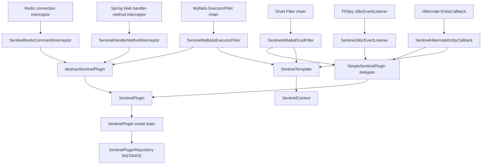
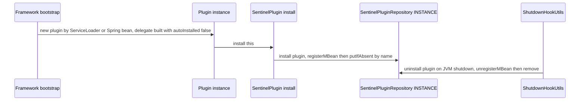
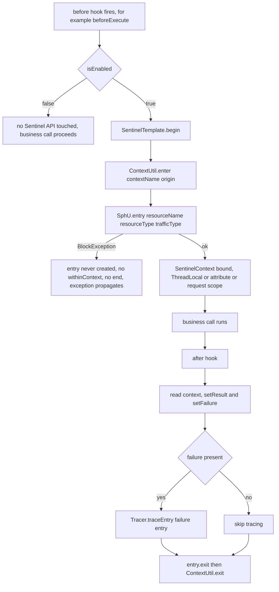
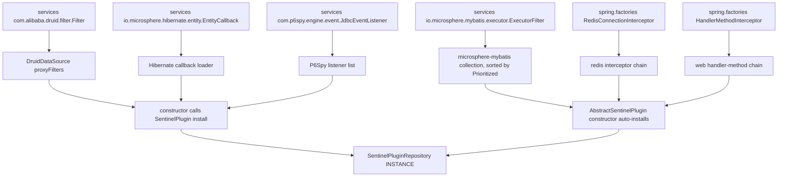
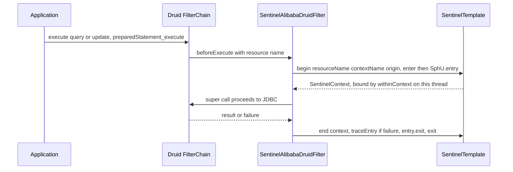
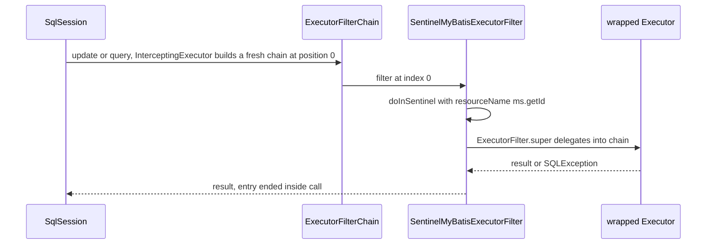
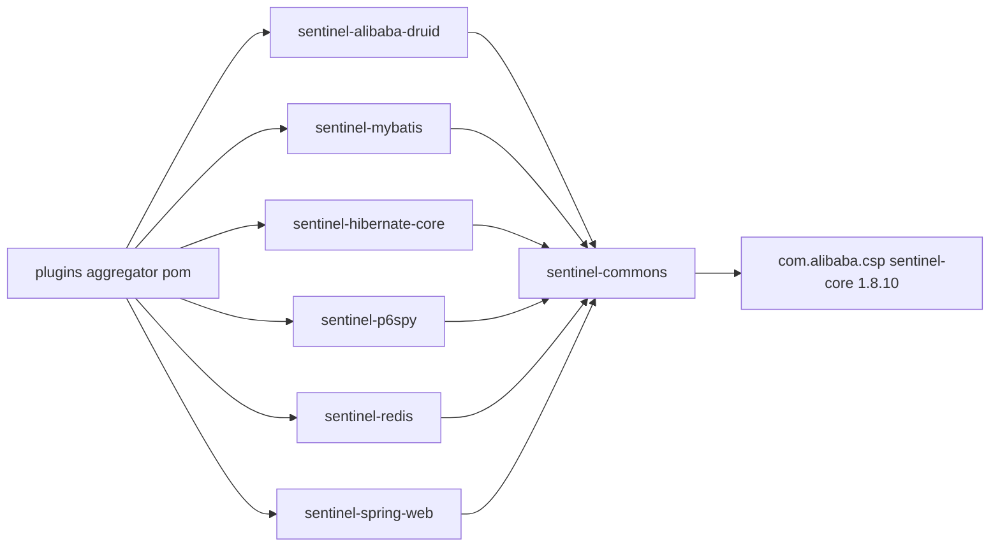

# microsphere-alibaba-sentinel-plugins — Developer Guide

[中文版](zh/microsphere-alibaba-sentinel-plugins.md)

## Purpose and Scope

`microsphere-alibaba-sentinel-plugins` is a `pom` aggregator (`microsphere-alibaba-sentinel-plugins/pom.xml`) that builds the six
integration modules turning framework extension points into guarded Sentinel resources:

| Child artifactId | Extension interface implemented | Plugin name | `resourceType` | Origin |
| --- | --- | --- | --- | --- |
| `microsphere-alibaba-sentinel-alibaba-druid` | `io.microsphere.alibaba.druid.filter.AbstractStatementFilter` + `SentinelPlugin` | `alibaba-druid` | `COMMON_DB_SQL` | `Filter` |
| `microsphere-alibaba-sentinel-mybatis` | `io.microsphere.mybatis.executor.ExecutorFilter` | `mybatis` | `COMMON_DB_SQL` | `Executor` |
| `microsphere-alibaba-sentinel-hibernate-core` | `io.microsphere.hibernate.entity.EntityCallback` + `SentinelPlugin` | `hibernate` | `COMMON_DB_SQL` | `SessionFactory` |
| `microsphere-alibaba-sentinel-p6spy` | `com.p6spy.engine.event.SimpleJdbcEventListener` + `SentinelPlugin` | `p6spy` | `COMMON_DB_SQL` | `Statement` |
| `microsphere-alibaba-sentinel-redis` | `io.microsphere.redis.spring.interceptor.RedisConnectionInterceptor` | `redis` | `COMMON` (default) | `RedisConnection` |
| `microsphere-alibaba-sentinel-spring-web` | `io.microsphere.spring.web.method.support.HandlerMethodInterceptor` | `spring-web` | `COMMON_WEB` | `HandlerMethod` |

Every child depends on `microsphere-alibaba-sentinel-commons` (non-optional) and on `sentinel-core` 1.8.10 plus its own framework
jar as `optional`. Version facts: `0.2.x` line (`0.2.0`–`0.2.5` released, `revision` = `0.2.6-SNAPSHOT`), Java 17, Spring Boot 3.x
and Spring Cloud 2022–2025; version tables live in the [user guide](../../user-guide/current/microsphere-alibaba-sentinel-plugins.md).
Read [microsphere-alibaba-sentinel-commons.md](./microsphere-alibaba-sentinel-commons.md) for the abstractions they compile against.

## Architecture

Every plugin type builds its guarding calls on `SentinelTemplate`/`SentinelContext`. The split is deliberate: adapters that must
extend a framework base class (`FilterAdapter`, `SimpleJdbcEventListener`, the Hibernate callback host type) cannot also extend
`AbstractSentinelPlugin`, so they implement `SentinelPlugin` over a `SimpleSentinelPlugin` delegate built with
`autoInstalled = false` and call `SentinelPlugin.install(this)` last in their constructor; plugins with a free superclass extend
`AbstractSentinelPlugin` and inherit auto-install-on-construction.

## Source Analysis

### SentinelAlibabaDruidFilter (`.../alibaba/druid/SentinelAlibabaDruidFilter.java`)

Extends `AbstractStatementFilter` (microsphere-alibaba-druid-core, itself a Druid `FilterAdapter`) and implements
`SentinelPlugin` by delegation: the constructor builds `new SimpleSentinelPlugin(PLUGIN_NAME, contextName, origin,
COMMON_DB_SQL, IN, false)` plus `SentinelTemplate(getResourceType(), getTrafficType())`, then `install(this)` — the registry
entry is the filter instance, so JMX exposes `setEnabled` on the live filter. `beforeExecute(StatementProxy, String resourceName)`
calls `begin(...)` then `context.withinContext()`; `afterExecute(StatementProxy, String, Object, Throwable)` runs
`doInContext(context -> { setResult; setFailure; end; }, true)`; all eight `SentinelPlugin` members are one-line delegations.
SQL resource naming is detailed in [the Druid guide](./microsphere-alibaba-sentinel-alibaba-druid.md).

### SentinelMyBatisExecutorFilter (`.../mybatis/executor/SentinelMyBatisExecutorFilter.java`)

Extends `AbstractSentinelPlugin` via `super(PLUGIN_NAME, contextName, origin, COMMON_DB_SQL)`, so `EntryType.IN` and
`autoInstalled = true` — construction alone registers the plugin and hooks the uninstall. Only three `ExecutorFilter` methods
are overridden — `int update(MappedStatement, Object, ExecutorFilterChain)` and the two
`<E> List<E> query(MappedStatement, ..., ExecutorFilterChain)` overloads — each delegating to
`doInSentinel(ms, () -> ExecutorFilter.super.<method>(...))`, the one-time form
`sentinelOperations.call(resourceName, getContextName(), getOrigin(), context -> callable.call(), SQLException.class)`, so
`Tracer.trace` covers MyBatis exceptions and `end(...)` runs in the `finally`. `getSentinelResourceName(ms)` returns `ms.getId()`:
one resource per mapped statement. The remaining defaults (`queryCursor`, `commit`, `rollback`, `createCacheKey`, `deferLoad`,
`getTransaction`, `close`) pass through unguarded, `getPriority()` is not overridden so `NORMAL_PRIORITY = 0` orders the filter
inside the chain built by `InterceptingExecutorInterceptor`, and the disabled path calls the callable directly after
re-wrapping with `ExceptionUtils.throwTarget(e, SQLException.class)`.

### SentinelHibernateEntityCallback (`.../hibernate/entity/SentinelHibernateEntityCallback.java`)

Implements `EntityCallback, SentinelPlugin` with the delegate pattern (`COMMON_DB_SQL`, `IN`, `autoInstalled = false`, then
`install(this)`). The eight hooks pair up: `onPreInsert/onPostInsert`, `onPreUpdate/onPostUpdate`, `onPreLoad/onPostLoad`,
`onPreDelete/onPostDelete`. `begin(Object entity, String action)` returns `Optional<SentinelContext>` and wraps
`sentinelOperations.begin` in `ThrowableSupplier.execute(...)`, so a `BlockException` inside a pre-hook cannot abort the
Hibernate operation chain; post-hooks call `end()` → `doInContext(this.sentinelOperations::end, true)`. Resource names are
`"Entity:" + action + ":" + entity.getClass().getName()` (`getSentinelResourceName(Object, String)`), so rules are per entity
class and per action; because post-hooks receive no throwable, `failure` stays `null`. Registration is
`META-INF/services/io.microsphere.hibernate.entity.EntityCallback`, covered by `SentinelHibernateEntityCallbackTest` and its
`...DisabledTest` counterpart with a test `persistence.xml`.

### SentinelJdbcEventListener (`.../p6spy/SentinelJdbcEventListener.java`)

Extends `SimpleJdbcEventListener` and implements `SentinelPlugin` by delegation. `onBeforeAnyExecute(StatementInformation)` guards
with `if (isEnabled() && isEligibleStatement(info))` then `execute(() -> { begin(...); context.withinContext(); })`, swallowing
checked exceptions through `ThrowableAction.execute`. `isEligibleStatement` accepts only `PreparedStatementInformation`, so plain
`Statement` traffic is not metered, and `getResourceName` returns the raw `statementInformation.getSql()`.
`onAfterAnyExecute(..., long timeElapsedNanos, SQLException e)` sets only the failure before `end`; elapsed time is ignored because
Sentinel RT statistics come from `entry.exit`, not P6Spy. Unlike the other delegate plugins, `getResourceType()` returns
`COMMON_DB_SQL` and `getTrafficType()` returns `IN` directly instead of reading the delegate — consistent today, but a
change-magnet. Registration: `META-INF/services/com.p6spy.engine.event.JdbcEventListener`, driver enabled in tests by
`src/test/resources/spy.properties`.

### SentinelRedisCommandInterceptor (`.../redis/spring/SentinelRedisCommandInterceptor.java`)

Extends `AbstractSentinelPlugin` with the three-argument form (`resourceType = COMMON`, `trafficType = IN`), implements
`RedisConnectionInterceptor`, `InitializingBean` and `BeanClassLoaderAware`, and `getOrder()` returns
`SentinelConstants.DEFAULT_PRIORITY` (9). Context carriage does **not** use `SentinelContext.withinContext()`:
`beforeExecute(RedisMethodContext)` begins an entry and stores it with `setContext(redisMethodContext, context)` under
`SENTINEL_CONTEXT_ATTRIBUTE_NAME = "sentinel-context"`, and `afterExecute(...)` reads it back via `getSentinelContext(...)`, sets
result/failure and calls `end` — avoiding ThreadLocal leakage across asynchronous Reactor command paths. Resource names are
pre-computed in `afterPropertiesSet()` → `initMethodResourceNamesCache()`, which walks
`ClassUtils.getAllInterfacesForClass(RedisClusterConnection.class, classLoader)` and stores
`SentinelUtils.buildResourceName(method)` (e.g. `StringRedisConnection.get(String)`); a `null` lookup means "not a Redis connection
method" and the interceptor returns without entering Sentinel. Discovery: `META-INF/spring.factories` under the
`io.microsphere.redis.spring.interceptor.RedisConnectionInterceptor` key.

### SentinelHandlerMethodInterceptor (`.../spring/web/SentinelHandlerMethodInterceptor.java`)

Extends `AbstractSentinelPlugin` with `COMMON_WEB`, implements `HandlerMethodInterceptor`, `ApplicationListener<WebEndpointMappingsReadyEvent>`
and `Ordered` (settable, default `DEFAULT_PRIORITY`), and publishes `BEAN_NAME = "sentinelHandlerMethodInterceptor"`. On the ready
event it rebuilds `methodResourceNamesCache` from every `WebEndpointMapping` whose endpoint is a `HandlerMethod`, using
`webEndpointMapping.toExpression() + "#" + handlerMethod`. `beforeExecute` resolves the name with
`computeIfAbsent(method, m -> PLUGIN_NAME + ":" + handlerMethod)` (a safety net for handler methods missing from the snapshot),
begins the entry and stores the `SentinelContext` in request scope via
`WebScope.REQUEST.setAttribute(request, SENTINEL_CONTEXT_ATTRIBUTE_NAME, context)`; `afterExecute` retrieves it, sets return value
and error, and calls `end`. A missing context is logged at trace level and skipped, which keeps `afterExecute` safe when the request
never reached a controller. Discovery: `META-INF/spring.factories` under
`io.microsphere.spring.web.method.support.HandlerMethodInterceptor`, collected by the `@EnableWebExtension` machinery.

### Constants interfaces

Each module exposes one `SentinelXxxConstants` interface with `PLUGIN_NAME`, `DEFAULT_CONTEXT_NAME`
(`microsphere_sentinel_<plugin>_context`), `DEFAULT_ORIGIN` and
`ENABLED_PROPERTY_NAME = PROPERTY_NAME_PREFIX + PLUGIN_NAME + DOT + "enabled"` annotated
`@ConfigurationProperty(type = boolean.class, defaultValue = "true", ...)`. Only Redis and Spring Web list `APPLICATION_SOURCE`
alongside `SYSTEM_PROPERTIES_SOURCE`; the JDBC-side constants declare `SYSTEM_PROPERTIES_SOURCE` only, matching
`SentinelUtils.isPluginEnabled` reading JVM system properties. Each `*ConstantsTest` pins the values and asserts the derived name.

## Design Patterns

| Pattern | Implementing classes | Evidence in source |
| --- | --- | --- |
| Adapter | `SentinelAlibabaDruidFilter` (Druid `FilterAdapter`), `SentinelJdbcEventListener` (`SimpleJdbcEventListener`), `SentinelMyBatisExecutorFilter` (`ExecutorFilter`), `SentinelHibernateEntityCallback` (`EntityCallback`), `SentinelRedisCommandInterceptor`, `SentinelHandlerMethodInterceptor` | framework callback becomes a Sentinel entry |
| Delegation | `SentinelAlibabaDruidFilter`, `SentinelJdbcEventListener`, `SentinelHibernateEntityCallback` hold `private final SentinelPlugin delegate` | identity getters forward to `SimpleSentinelPlugin` |
| Template Method | `AbstractStatementFilter.beforeExecute`/`afterExecute`, `SentinelMyBatisExecutorFilter.doInSentinel`, `SentinelHibernateEntityCallback.begin`/`end` | fixed skeleton, variable body |
| Chain of Responsibility | `com.alibaba.druid.filter.FilterChain`, `io.microsphere.mybatis.executor.ExecutorFilterChain` | `chain.update(ms, parameter)` continues the chain |
| Facade | `SentinelOperations`/`SentinelTemplate` used by all six plugins | hides `SphU`, `Tracer`, `ContextUtil` |
| Registry, Singleton | `SentinelPlugin.install(this)` → `SentinelPluginRepository.INSTANCE` | one registration per plugin name |
| SPI, ServiceLoader | all `META-INF/services` and `META-INF/spring.factories` files above | no explicit `new` required |
| Observer | `SentinelHandlerMethodInterceptor` as `ApplicationListener<WebEndpointMappingsReadyEvent>`, commons `SentinelNodeEventPublisher` | event-driven cache build |

## Core Flows

### Plugin install and uninstall lifecycle

For `AbstractSentinelPlugin` subclasses the delegate step disappears: the super constructor reads `isEnabled()` from the system
property and calls `install(this)` when `autoInstalled` is `true`.

### Two-phase guarding with block path

The MyBatis plugin swaps steps `A`–`P` for the one-time `call(...)` overload described above.

### SPI loading of plugin providers

The commons-level SPI pair, `SentinelPluginRepository` and `com.alibaba.csp.sentinel.init.InitFunc`, is resolved once per JVM.

### Druid filter chain flow

### MyBatis executor filter chain flow

## Dependencies

| Dependency | Declared in | Scope |
| --- | --- | --- |
| `microsphere-alibaba-sentinel-commons` | all six children | compile |
| `microsphere-annotation-processor` | all six children | compile, `optional` |
| `com.alibaba.csp:sentinel-core` | all six children | compile, `optional` |
| `microsphere-alibaba-druid-core`, `com.alibaba:druid` | druid child | compile, `optional` |
| `microsphere-mybatis-core`, `org.mybatis:mybatis` | mybatis child | compile, `optional` |
| `microsphere-hibernate-core`, `hibernate-core` | hibernate child | compile, `optional` |
| `p6spy` | p6spy child | compile, `optional` |
| `microsphere-redis-spring`, `microsphere-spring-context`, `spring-data-redis` | redis child | compile, `optional` |
| `microsphere-spring-web`, `spring-webmvc` | spring-web child | compile, `optional` |
| `jakarta.servlet-api` | spring-web child | `provided` |
| `junit-jupiter`, `mockito-core`, `h2`, `microsphere-*-test`, `logback-classic` | children as needed | test |

Versions come from `microsphere-alibaba-sentinel-parent`: `sentinel.version` 1.8.10, `microsphere-alibaba-druid.version` 0.2.20,
`microsphere-mybatis.version` 0.2.16, `microsphere-hibernate.version` 0.2.10, `microsphere-redis.version` 0.2.14, plus the
imported `microsphere-spring-cloud-dependencies` 0.2.26 BOM.

## Extension Points

To add a seventh plugin:

1. Create the child module under `microsphere-alibaba-sentinel-plugins/`, add its `<module>` entry to the aggregator `pom.xml`
   and its artifact to `microsphere-alibaba-sentinel-dependencies/pom.xml`, inheriting `microsphere-alibaba-sentinel-parent`.
2. Declare `commons` as compile and the framework jar plus `sentinel-core` as `optional` — never force a framework version on
   users — and add `Sentinel<Framework>Constants` (`PLUGIN_NAME`, `DEFAULT_CONTEXT_NAME` in the
   `microsphere_sentinel_<plugin>_context` shape, `DEFAULT_ORIGIN`, `ENABLED_PROPERTY_NAME`) with a `*ConstantsTest`.
3. Choose the identity path: extend `AbstractSentinelPlugin` when the class has no other superclass; otherwise implement
   `SentinelPlugin` over a `SimpleSentinelPlugin` delegate with `autoInstalled = false` and call
   `SentinelPlugin.install(this)` last in the constructor.
4. Pick a `ResourceTypeConstants` for the traffic (`COMMON_DB_SQL`, `COMMON_WEB`, else `COMMON`) and build
   `new SentinelTemplate(getResourceType(), getTrafficType())`.
5. Prefer the one-time `call(resourceName, contextName, origin, callback, DeclaredException.class)` for a single wrap-point; use
   `begin`/`end` with `withinContext()` plus `doInContext(consumer, true)` for pre/post pairs, or an explicit attribute/request
   slot (Redis, Spring Web) when hooks may run on different threads.
6. Guard both hooks with `isEnabled()` so `-Dmicrosphere.sentinel.<plugin>.enabled=false` degrades to pass-through, register the
   provider file or `spring.factories` entry, keep resource names stable because they are Sentinel rule keys, and drive the real
   framework path in tests as the existing modules do with H2 and `AbstractAlibabaDruidTest` / `AbstractMapperTest`.

## Related Modules

- Index: [developer guide README](./README.md)
- Core abstractions: [microsphere-alibaba-sentinel-commons](./microsphere-alibaba-sentinel-commons.md)
- JDBC plugins: [microsphere-alibaba-sentinel-alibaba-druid](./microsphere-alibaba-sentinel-alibaba-druid.md),
  [microsphere-alibaba-sentinel-mybatis](./microsphere-alibaba-sentinel-mybatis.md)
- Auto-configuration: `microsphere-alibaba-sentinel-spring-boot` (`SentinelAlibabaDruidAutoConfiguration`,
  `SentinelMyBatisAutoConfiguration`, `SentinelRedisAutoConfiguration`, `SentinelSpringWebAutoConfiguration`, gated by
  `@ConditionalOnSentinelEnabled` / `@ConditionalOnSentinelAvailable`)
- User-facing configuration: [user guide](../../user-guide/current/microsphere-alibaba-sentinel-plugins.md)

---

## 中文

[中文版](zh/microsphere-alibaba-sentinel-plugins.md)
