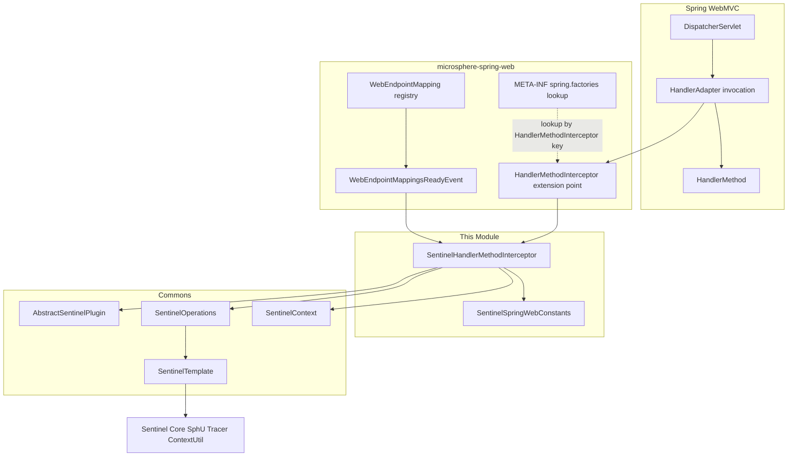
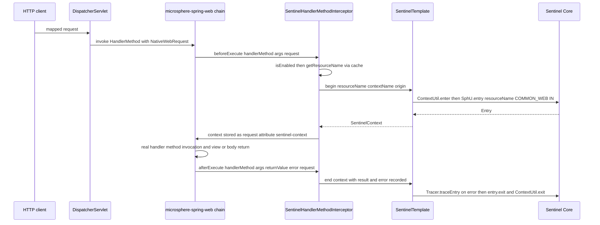
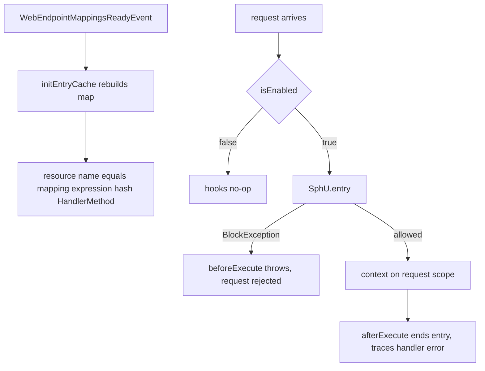
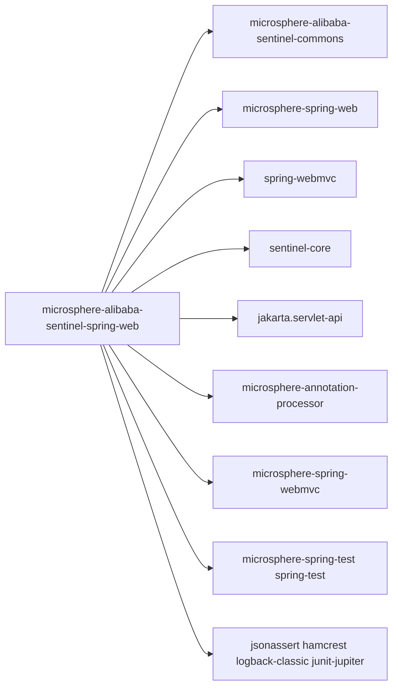

# microsphere-alibaba-sentinel-spring-web — Developer Guide

[中文版](zh/microsphere-alibaba-sentinel-spring-web.md)

## Purpose and Scope

This module applies Alibaba Sentinel flow control to Spring WebMVC handler methods.
`SentinelHandlerMethodInterceptor` implements the
`io.microsphere.spring.web.method.support.HandlerMethodInterceptor` extension point from the
sibling project `microsphere-spring-web`, surrounding each dispatch of a `HandlerMethod` with a
Sentinel entry. Resource names are keyed by the request mapping expression plus handler method,
pre-computed when the endpoint mappings become ready.

Covered here:

- The `beforeExecute`/`afterExecute` interception pair over `HandlerMethod` dispatch.
- Request-scoped `SentinelContext` handoff via `NativeWebRequest` attributes.
- The `WebEndpointMappingsReadyEvent` listener that builds the resource-name cache.
- What `META-INF/spring.factories` registers, and the jakarta.servlet alignment of this branch.

Release line facts: 0.2.x, Java 17, Spring Boot 3.x generation (`sentinel-core` 1.8.10);
the pom pins the Servlet API as `jakarta.servlet:jakarta.servlet-api` with `provided` scope,
consistent with Spring Framework 6's `jakarta` namespace.

## Architecture



## Source Analysis

### `io.microsphere.alibaba.sentinel.spring.web.SentinelHandlerMethodInterceptor`

Declared as
`public class SentinelHandlerMethodInterceptor extends AbstractSentinelPlugin implements HandlerMethodInterceptor, ApplicationListener<WebEndpointMappingsReadyEvent>, Ordered`.

Fields and constants:

- `public static final String BEAN_NAME = "sentinelHandlerMethodInterceptor"` — asserted by the test.
- `private final SentinelOperations sentinelOperations;`
- `private int order;` and `private Map<Method, String> methodResourceNamesCache;`

Constructors:

- `public SentinelHandlerMethodInterceptor()` — `this(DEFAULT_CONTEXT_NAME, DEFAULT_ORIGIN)`.
- `public SentinelHandlerMethodInterceptor(String contextName, String origin)` —
  `super(PLUGIN_NAME, contextName, origin, COMMON_WEB)`; the four-argument `AbstractSentinelPlugin`
  form sets `resourceType = ResourceTypeConstants.COMMON_WEB`, `trafficType = EntryType.IN`,
  `autoInstalled = true` (self-install into `SentinelPluginRepository.INSTANCE` with shutdown-hook
  uninstall). Then `new SentinelTemplate(getResourceType(), getTrafficType())` and
  `this.setOrder(DEFAULT_PRIORITY)` (9).

Interception hooks:

- `public void beforeExecute(HandlerMethod handlerMethod, Object[] args, NativeWebRequest request) throws Exception` —
  when `isEnabled()`: `resourceName = getResourceName(handlerMethod)`;
  `sentinelOperations.begin(resourceName, getContextName(), getOrigin())` performs
  `ContextUtil.enter` then `SphU.entry(resourceName, COMMON_WEB, IN)`; a `BlockException` propagates
  out of this hook and aborts the handler invocation. The context is then stored on the request via
  `setSentinelContext(context, request)`.
- `public void afterExecute(HandlerMethod handlerMethod, Object[] args, Object returnValue, Throwable error, NativeWebRequest request)` —
  when `isEnabled()`: `getSentinelContext(request)`; if absent, trace-log and return. Otherwise
  `context.setResult(returnValue).setFailure(error)` and `sentinelOperations.end(context)`, which
  invokes `Tracer.traceEntry(error, entry)` when an error was recorded, then `entry.exit()` and
  `ContextUtil.exit()`.

Request-scoped carriers (attribute name `sentinel-context` from commons `SentinelConstants`):

- `public static void setSentinelContext(@Nonnull SentinelContext context, @Nonnull NativeWebRequest request)` —
  `REQUEST.setAttribute(request, SENTINEL_CONTEXT_ATTRIBUTE_NAME, context)` using
  `io.microsphere.spring.web.util.WebScope.REQUEST`.
- `@Nonnull public static SentinelContext getSentinelContext(NativeWebRequest request)` —
  `REQUEST.getAttribute(request, SENTINEL_CONTEXT_ATTRIBUTE_NAME)`.

Event-driven cache construction:

- `public void onApplicationEvent(WebEndpointMappingsReadyEvent event)` — calls `initEntryCache(event)`.
- `protected void initEntryCache(WebEndpointMappingsReadyEvent event)` — rebuilds a fresh
  `newFixedHashMap` sized to `event.getMappings()`; for each `WebEndpointMapping` whose
  `getEndpoint()` is a `HandlerMethod`, caches `buildResourceName(handlerMethod, webEndpointMapping)`
  against `handlerMethod.getMethod()`.
- `protected String buildResourceName(HandlerMethod handlerMethod, WebEndpointMapping webEndpointMapping)` —
  returns `webEndpointMapping.toExpression() + "#" + handlerMethod`.
- `public String getResourceName(HandlerMethod handlerMethod)` —
  `methodResourceNamesCache.computeIfAbsent(method, m -> PLUGIN_NAME + ":" + handlerMethod)`; unknown
  methods still get a non-null fallback name prefixed `spring-web:`.
- `public int getOrder()` / `public void setOrder(int order)` — mutable `Ordered` support.

### `io.microsphere.alibaba.sentinel.spring.web.SentinelSpringWebConstants`

Asserted by `SentinelSpringWebConstantsTest`:

- `String PLUGIN_NAME = "spring-web"`.
- `String DEFAULT_CONTEXT_NAME = "microsphere_sentinel_spring_web_context"`.
- `String DEFAULT_ORIGIN = "HandlerMethod"`.
- `String ENABLED_PROPERTY_NAME = "microsphere.sentinel.spring-web.enabled"` — `@ConfigurationProperty`
  with `SYSTEM_PROPERTIES_SOURCE` and `APPLICATION_SOURCE`; `SentinelUtils.isPluginEnabled` reads the
  JVM system property, default `true`, evaluated once in the `AbstractSentinelPlugin` constructor.

### `META-INF/spring.factories`

The file contains exactly one mapping — the microsphere-spring-web interceptor lookup key, **not** a
Spring Boot auto-configuration key:

```
io.microsphere.spring.web.method.support.HandlerMethodInterceptor=\
io.microsphere.alibaba.sentinel.spring.web.SentinelHandlerMethodInterceptor
```

### Tests

`SentinelHandlerMethodInterceptorTest` extends `AbstractWebMvcTest` and runs under
`@WebAppConfiguration @SpringJUnitConfig(classes = {SentinelHandlerMethodInterceptor.class, test})
@EnableWebMvc @EnableWebMvcExtension(registerHandlerInterceptors = true)` — the microsphere-spring-webmvc
extension registers the interceptor chain into the MVC invocation.

- `testConstants()` — asserts `BEAN_NAME` equals `sentinelHandlerMethodInterceptor`.
- `test()` — invokes inherited mock-MVC calls `testHelloWorld()` and `testGreeting()`, then
  `postTest()` enters `microsphere_sentinel_spring_web_context`/`HandlerMethod` and asserts the
  entrance node has children (mapping-based resources were registered).
- `testDisabled()` — `setEnabled(false)`, reruns the same requests unprotected, re-enables.
- `testAfterExecuteWithoutSentinelContext()` — calls `afterExecute(null, null, null, null,
  MockServletWebRequest)`; no exception and `getSentinelContext(request)` stays `null`.

## Design Patterns

- **Chain of Responsibility / Decorator hook**: `HandlerMethodInterceptor` (from microsphere-spring-web)
  decorates `HandlerMethod` invocation inside Spring WebMVC dispatch, ordered by `Ordered` (9).
- **Observer**: `ApplicationListener<WebEndpointMappingsReadyEvent>` rebuilds the resource-name cache
  when endpoint mappings become ready.
- **Template Method**: entry mechanics centralized in `SentinelOperations`/`SentinelTemplate`;
  `AbstractSentinelPlugin` inheritance supplies enabled-state and plugin metadata.
- **Cache/Memoization**: `methodResourceNamesCache` keyed by `java.lang.reflect.Method` with a
  `computeIfAbsent` fallback.
- **Attribute Blackboard**: `SentinelContext` handed from before- to after-hook through
  `NativeWebRequest` request scope (`WebScope.REQUEST`), avoiding `ThreadLocal` coupling.

## Core Flows

### Handler method protection flow



### Mapping-ready cache build and block path



## Dependencies



| Dependency | Scope in pom |
|---|---|
| io.github.microsphere-projects:microsphere-annotation-processor | compile, optional |
| io.github.microsphere-projects:microsphere-alibaba-sentinel-commons | compile |
| io.github.microsphere-projects:microsphere-spring-web | compile, optional |
| com.alibaba.csp:sentinel-core | compile, optional |
| org.springframework:spring-webmvc | compile, optional |
| jakarta.servlet:jakarta.servlet-api | provided |
| org.junit.jupiter:junit-jupiter | test |
| ch.qos.logback:logback-classic | test |
| io.github.microsphere-projects:microsphere-spring-webmvc | test |
| io.github.microsphere-projects:microsphere-spring-test | test |
| org.springframework:spring-test | test |
| org.skyscreamer:jsonassert | test |
| org.hamcrest:hamcrest | test |

## Extension Points

- **Custom resource naming**: subclass and override `buildResourceName(HandlerMethod, WebEndpointMapping)`
  (e.g. drop the `HandlerMethod` suffix) or replace the whole map via `initEntryCache`.
- **Ordering**: `setOrder(int)` repositions the interceptor in the handler-interceptor chain; default
  is `DEFAULT_PRIORITY` 9.
- **Context/origin**: the `(contextName, origin)` constructor; in Spring Boot,
  `SentinelSpringWebAutoConfiguration` declares `sentinelHandlerMethodInterceptor()` with
  `@Bean @ConditionalOnMissingBean` under `@ConditionalOnWebApplication(type = ANY)`,
  `@ConditionalOnSentinelAvailable` and `@ConditionalOnProperty(ENABLED_PROPERTY_NAME, matchIfMissing = true)` —
  register your own bean to take over.
- **Switching**: `setEnabled(false)` at runtime or `microsphere.sentinel.spring-web.enabled=false`
  (JVM system property at construction time).
- **Registration**: additional `HandlerMethodInterceptor` providers can be published under the same
  `META-INF/spring.factories` key.

## Related Modules

- Developer guide index: [README](./README.md)
- [microsphere-alibaba-sentinel-commons](./microsphere-alibaba-sentinel-commons.md) — `AbstractSentinelPlugin`,
  `SentinelOperations`, `SentinelTemplate`, `SentinelContext`, `SentinelConstants`.
- [microsphere-alibaba-sentinel-spring-boot](./microsphere-alibaba-sentinel-spring-boot.md) —
  `SentinelSpringWebAutoConfiguration`.
- [microsphere-alibaba-sentinel-spring-cloud](./microsphere-alibaba-sentinel-spring-cloud.md) — Cloud-level
  coordination built on Spring Cloud Alibaba Sentinel.
- User guide counterpart: [../../user-guide/current/microsphere-alibaba-sentinel-spring-web.md](../../user-guide/current/microsphere-alibaba-sentinel-spring-web.md)

---

## 中文

[中文版](zh/microsphere-alibaba-sentinel-spring-web.md)
