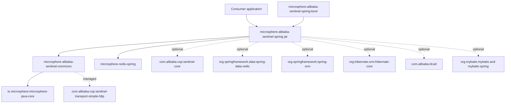
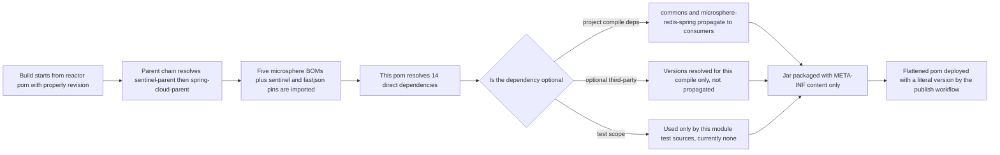
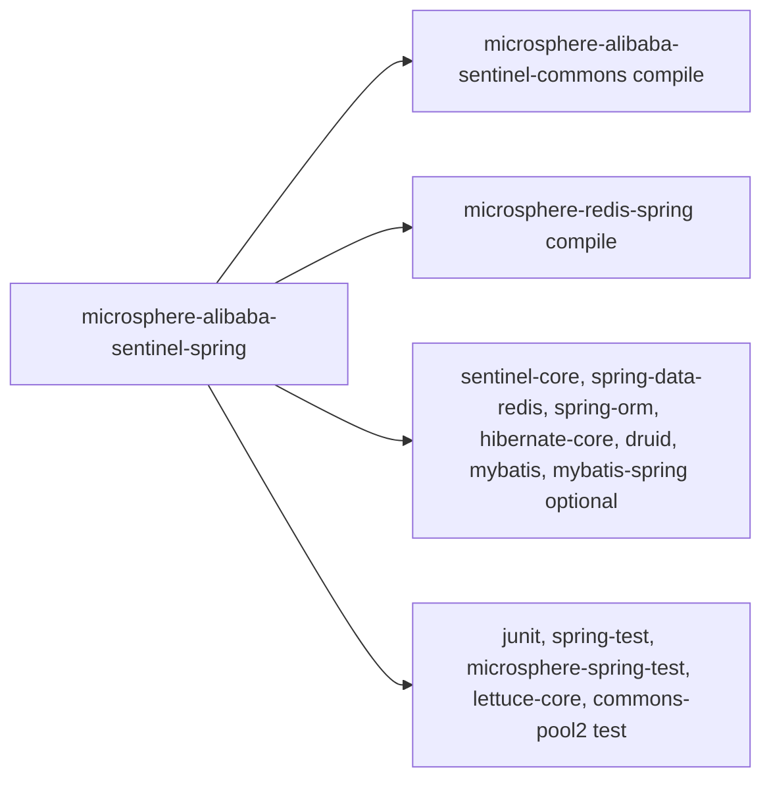

# microsphere-alibaba-sentinel-spring — Developer Guide

[中文版](zh/microsphere-alibaba-sentinel-spring.md)

## Purpose and Scope

`microsphere-alibaba-sentinel-spring` is the Spring-layer aggregation module of the
Microsphere Alibaba Sentinel library. On the `release` branch it is declared with
`<packaging>jar</packaging>`, yet the module directory contains only `pom.xml`: there is no
`src/main/java`, no `src/test/java` and no resource directory. The published artifact for the
0.2.x line therefore ships an almost empty jar — `META-INF/MANIFEST.MF`, the embedded Maven
pom and a `git.properties` entry, nothing else.

The module exists as a **dependency contract**, not as code:

- It gives plain Spring Framework applications a single Maven coordinate that pulls in the
  Sentinel core API plus the Spring-facing libraries the Sentinel plugins instrument
  (`spring-data-redis`, `spring-orm`, `hibernate-core`, `druid`, `mybatis`, `mybatis-spring`).
- It declares the two mandatory transitive dependencies every Spring consumer needs:
  `microsphere-alibaba-sentinel-commons` (the plugin model) and `microsphere-redis-spring`
  (the Redis command-interceptor extension point).
- It is the direct parent dependency of `microsphere-alibaba-sentinel-spring-boot`, which adds
  the auto-configuration layer on top of it.

This guide is for developers who need to understand why an empty jar is published, and who
modify the dependency surface of the module.

## Architecture

Only the two solid project edges propagate to consumers. All third-party edges are marked
`<optional>true</optional>` in the pom, so Maven stops transitivity there: a consumer must
already own the library it wants instrumented. The dotted commons edges are declared in the
commons pom, not here, and are listed to explain what `commons` drags in.

## Source Analysis

### pom anatomy

| Section | Content | Notes |
|---|---|---|
| `parent` | `microsphere-alibaba-sentinel-parent` with `relativePath ../microsphere-alibaba-sentinel-parent/pom.xml` | Supplies every third-party version through imported BOMs |
| `version` | `${revision}` | Root pom sets `revision` to `0.2.6-SNAPSHOT`; CI overrides it |
| `packaging` | `jar` | Produces a real artifact even without sources |
| `name` / `description` | `Microsphere :: Alibaba Sentinel :: Spring` | Reactor naming convention |
| `dependencies` | 2 project + 7 optional third-party + 5 test | No `<version>` on third-party entries |
| `build` | absent | No plugin customization, no source directory to compile |

Declared dependencies fall into three blocks, separated by the pom comments
`Microsphere Sentinel Core`, `Third-Party Dependencies` and `Testing`:

1. Mandatory project dependencies: `microsphere-alibaba-sentinel-commons` (explicit
   `${revision}`) and `microsphere-redis-spring` (version omitted).
2. Optional capability dependencies: `sentinel-core`, `spring-data-redis`, `spring-orm`,
   `hibernate-core`, `druid`, `mybatis`, `mybatis-spring`.
3. Test-scope dependencies: `junit` 4, `spring-test`, `microsphere-spring-test`,
   `lettuce-core`, `commons-pool2` — currently unused because no test sources exist, but kept
   so the module can host Spring XML integration tests again later.

### Why an empty jar exists

- **Single coordinate.** A non-Boot Spring application gets a coherent classpath in one
  `<dependency>` instead of re-declaring Redis, ORM and pool libraries.
- **Version arbitration in one place.** None of the third-party dependencies carry versions
  here; the parent pom imports `microsphere-spring-cloud-dependencies`, `microsphere-redis-dependencies`,
  `microsphere-hibernate-dependencies`, `microsphere-mybatis-dependencies` and
  `microsphere-alibaba-druid-dependencies`, so this module cannot drift from them.
- **Stable dependency target for the Boot module.** `microsphere-alibaba-sentinel-spring-boot`
  depends on this artifact with `${revision}`, so Spring-level capabilities are declared once.
- **Optional-as-feature-flag.** Marking the third-party entries optional means the module never
  forces Druid, MyBatis or Hibernate onto a classpath; the presence of a class is exactly what
  the Boot conditions later probe.

### What the module does not contain

No `spring.factories`, no `AutoConfiguration.imports`, no SPI service files. Auto-configuration
lives in `microsphere-alibaba-sentinel-spring-boot`; plugin implementations live in
`microsphere-alibaba-sentinel-plugins/*`.

## Design Patterns

Because the module has no code, the patterns below are structural (pom-level) patterns; the
behavioural patterns — Registry (`SentinelPluginRepository`), Facade (`SentinelTemplate`),
Strategy and Template Method — belong to commons and are documented in
[./microsphere-alibaba-sentinel-commons.md](./microsphere-alibaba-sentinel-commons.md).

| Pattern | Where it applies | Evidence |
|---|---|---|
| Bill-of-Materials style aggregation | One coordinate publishes a coherent Spring classpath | `<packaging>jar</packaging>` with sources absent |
| Optional dependency / capability gating | Instrumented libraries are opt-in for consumers | 7 `<optional>true</optional>` entries |
| Version-less declaration | All third-party versions resolve from imported BOMs | No `<version>` outside the two project entries |
| Layered façade over internals | Consumers depend on Spring, not on commons directly | `microsphere-alibaba-sentinel-spring-boot` imports this artifact |

## Core Flows

There is no runtime flow inside this module. The flow that matters is Maven dependency
resolution plus the release pipeline that produces the artifact.

Packaging still runs the standard `maven-jar-plugin` goal, which is why an empty but valid jar
is published; a module with `<packaging>pom</packaging>` would not be consumable as a classpath
entry.

## Dependencies

| Coordinate | Declared scope | Optional | Version resolution |
|---|---|---|---|
| `io.github.microsphere-projects:microsphere-alibaba-sentinel-commons` | compile | no | `${revision}` written inline in this pom |
| `io.github.microsphere-projects:microsphere-redis-spring` | compile | no | `microsphere-redis-dependencies` 0.2.14, imported by the parent |
| `com.alibaba.csp:sentinel-core` | compile | yes | parent property `sentinel.version` = 1.8.10 |
| `org.springframework.data:spring-data-redis` | compile | yes | Spring Boot dependency chain via `microsphere-spring-cloud-dependencies` 0.2.26 |
| `org.springframework:spring-orm` | compile | yes | same chain |
| `org.hibernate.orm:hibernate-core` | compile | yes | `microsphere-hibernate-dependencies` 0.2.10 |
| `com.alibaba:druid` | compile | yes | `microsphere-alibaba-druid-dependencies` 0.2.20 |
| `org.mybatis:mybatis` | compile | yes | `microsphere-mybatis-dependencies` 0.2.16 |
| `org.mybatis:mybatis-spring` | compile | yes | `microsphere-mybatis-dependencies` 0.2.16 |
| `junit:junit` | test | no | managed by the parent chain |
| `org.springframework:spring-test` | test | no | managed by the parent chain |
| `io.github.microsphere-projects:microsphere-spring-test` | test | no | managed by `microsphere-spring-cloud-dependencies` |
| `io.lettuce:lettuce-core` | test | no | managed by `microsphere-redis-dependencies` |
| `org.apache.commons:commons-pool2` | test | no | managed by the parent chain |

The parent pom of the whole repository declares `java.version` 17, so the artifact is built
with `--release 17`; the CI matrix additionally compiles and tests on Java 21 and 25.

## Extension Points

| Task | How |
|---|---|
| Add a new instrumented capability | Append an `<optional>true</optional>` dependency here, add the matching plugin under `microsphere-alibaba-sentinel-plugins`, then a `SentinelXxxAutoConfiguration` in the Boot module |
| Change a managed version | Edit the version property in [./microsphere-alibaba-sentinel-parent.md](./microsphere-alibaba-sentinel-parent.md); never add `<version>` to this pom |
| Let the module propagate a library | Remove `<optional>true</optional>` — this is a breaking decision because every consumer inherits the library |
| Publish a new project artifact | Add the coordinate to [./microsphere-alibaba-sentinel-dependencies.md](./microsphere-alibaba-sentinel-dependencies.md) |
| Downstream override of a resolved version | Declare an explicit dependency with your own version; direct declarations win over transitive ones, and your own `dependencyManagement` entries win over imported BOMs |
| Move code back into this module | Create `src/main/java/io/microsphere/alibaba/sentinel/spring/...`; the build needs no pom change because no plugin is configured |

## Related Modules

- Developer guide index: [./README.md](./README.md)
- Features this module exposes to Spring applications: [./microsphere-alibaba-sentinel-commons.md](./microsphere-alibaba-sentinel-commons.md)
- Auto-configuration built on top of it: [./microsphere-alibaba-sentinel-spring-boot.md](./microsphere-alibaba-sentinel-spring-boot.md)
- Spring Cloud layer: [./microsphere-alibaba-sentinel-spring-cloud.md](./microsphere-alibaba-sentinel-spring-cloud.md)
- Instrumented plugins: [./microsphere-alibaba-sentinel-plugins.md](./microsphere-alibaba-sentinel-plugins.md)
- Version management: [./microsphere-alibaba-sentinel-parent.md](./microsphere-alibaba-sentinel-parent.md), [./microsphere-alibaba-sentinel-dependencies.md](./microsphere-alibaba-sentinel-dependencies.md)
- User-facing documentation: [../../user-guide/current/microsphere-alibaba-sentinel-spring.md](../../user-guide/current/microsphere-alibaba-sentinel-spring.md)

---

## 中文

[中文版](zh/microsphere-alibaba-sentinel-spring.md)
