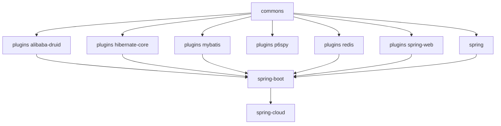

# 开发者指南 — current（release 分支，0.2.x）

[English](../README.md) · [开发者指南总目录](../../zh/README.md)

这些文档分析 `release` 分支（`0.2.x` 版本线）的实现：架构、源码、设计模式，以及绘制成图的流程。

## 实现基线

| 项目                  | 值                                                             |
|-----------------------|----------------------------------------------------------------|
| 源码分支         | `release`（修订号 `0.2.6-SNAPSHOT`，已发布 `0.2.0` – `0.2.5`） |
| 语言级别        | Java 17                                                        |
| 框架代际  | Spring Boot 3.x / Spring Cloud 2022.0.x – 2025.0.x             |
| Sentinel              | `sentinel-core` 1.8.10                                         |
| 自动配置机制 | `META-INF/spring/org.springframework.boot.autoconfigure.AutoConfiguration.imports` |
| Servlet 命名空间     | `jakarta.servlet`                                              |

## 阅读顺序

1. [commons](microsphere-alibaba-sentinel-commons.md) —— 架构核心：插件生命周期、基于 `SphU.entry`
   的 `SentinelOperations` begin/end 协议、`ThreadLocal` 承载的 `SentinelContext`、SPI 仓储加载、slot
   回调插桩、JMX 与节点事件。
2. [plugins](microsphere-alibaba-sentinel-plugins.md) —— 插件如何挂载到宿主框架。
3. 每种集成各一篇插件文档：
   [alibaba-druid](microsphere-alibaba-sentinel-alibaba-druid.md) ·
   [hibernate-core](microsphere-alibaba-sentinel-hibernate-core.md) ·
   [mybatis](microsphere-alibaba-sentinel-mybatis.md) ·
   [p6spy](microsphere-alibaba-sentinel-p6spy.md) ·
   [redis](microsphere-alibaba-sentinel-redis.md) ·
   [spring-web](microsphere-alibaba-sentinel-spring-web.md)
4. Spring 层：[spring](microsphere-alibaba-sentinel-spring.md) ·
   [spring-boot](microsphere-alibaba-sentinel-spring-boot.md) ·
   [spring-cloud](microsphere-alibaba-sentinel-spring-cloud.md)
5. 构建层：[parent](microsphere-alibaba-sentinel-parent.md) ·
   [dependencies](microsphere-alibaba-sentinel-dependencies.md)

## 模块依赖关系

## 已绘制成图的流程

- 插件的安装 / 卸载生命周期，包含 JVM 关闭钩子触发的卸载
- `begin` → `ContextUtil.enter` → `SphU.entry` → callback → `Tracer.traceEntry` → `end` → `exit`，
  含 `BlockException` 分支
- SPI 发现：`SentinelPluginRepository` 的 ServiceLoader 与 Sentinel 的 `InitFunc`
- Spring Boot 自动配置的条件求值（`@ConditionalOnSentinelAvailable`、`@ConditionalOnSentinelEnabled`）
- 各插件的拦截流程（Druid 过滤器链、MyBatis executor 过滤器链、Hibernate 实体回调、
  P6Spy 语句事件、Redis 命令拦截、WebMVC 处理器方法拦截）

## 配套文档集

同一分支面向使用的文档位于
[用户指南 · current 分支](../../../user-guide/current/zh/README.md)。遗留版本的实现记录在
[1.x 开发者指南](../../1.x/zh/README.md)中。

---

## English

[English 版本](../README.md)
