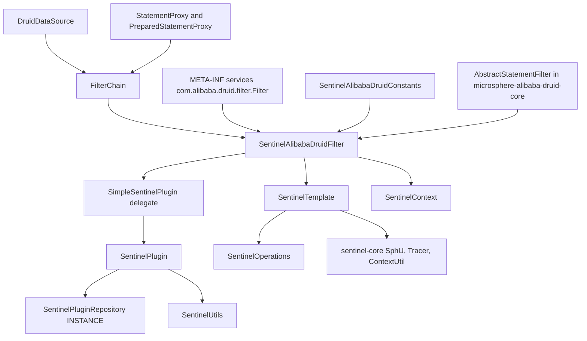
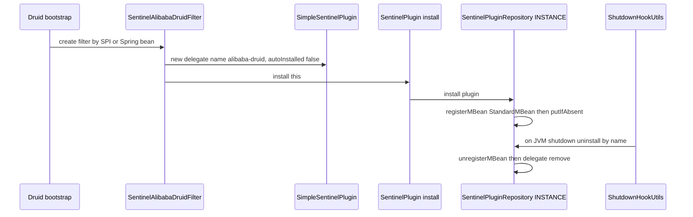
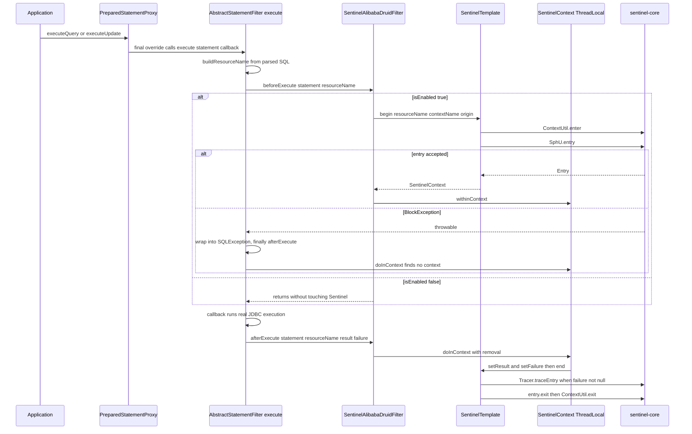
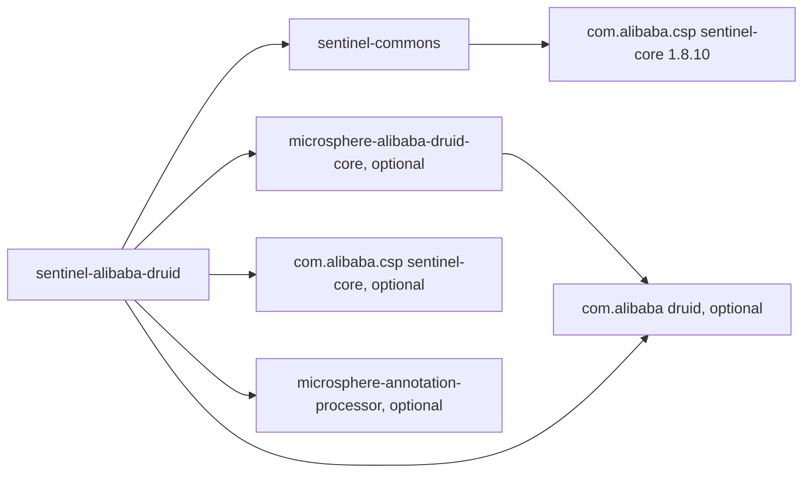

# microsphere-alibaba-sentinel-alibaba-druid — 开发者指南

[English](../microsphere-alibaba-sentinel-alibaba-druid.md)

## 目的与范围

`microsphere-alibaba-sentinel-alibaba-druid`（目录
`microsphere-alibaba-sentinel-plugins/microsphere-alibaba-sentinel-alibaba-druid`）用 Alibaba Sentinel 为 Alibaba Druid 上的
JDBC 语句执行提供守卫。它只贡献一个生产类 `SentinelAlibabaDruidFilter` 加上一个常量接口，并通过 Druid SPI 文件
`src/main/resources/META-INF/services/com.alibaba.druid.filter.Filter` 注册该 filter。

这里交汇了两个源码层。拦截骨架 —— Druid `FilterAdapter` 回调、SQL 解析、资源命名 —— 来自
`microsphere-alibaba-druid-core` 0.2.20 中的 `io.microsphere.alibaba.druid.filter.AbstractStatementFilter`；Sentinel 语义 ——
`begin`/`end`、entry 记账、失败追踪、插件注册 —— 来自 `microsphere-alibaba-sentinel-commons`。本指南记录的正是这个衔接点，
也就是修改本模块时真正要紧的部分。版本背景：`0.2.x` 系列（已发布 `0.2.0`–`0.2.5`，`revision` = `0.2.6-SNAPSHOT`），
Java 17，`sentinel-core` 1.8.10，自动配置路径使用 Spring Boot 3.x / Spring Cloud 2022–2025。面向用户的安装说明见
[用户指南](../../../user-guide/current/zh/microsphere-alibaba-sentinel-alibaba-druid.md)。

## 架构



## 源码分析

### SentinelAlibabaDruidConstants

四个常量，全部由 `SentinelAlibabaDruidConstantsTest` 固定校验：

```java
String PLUGIN_NAME = "alibaba-druid";
String DEFAULT_CONTEXT_NAME = "microsphere_sentinel_alibaba_druid_context";
String DEFAULT_ORIGIN = "Filter";
String ENABLED_PROPERTY_NAME = PROPERTY_NAME_PREFIX + PLUGIN_NAME + DOT + PropertyConstants.ENABLED_PROPERTY_NAME;
```

因此 `ENABLED_PROPERTY_NAME` 等于 `microsphere.sentinel.alibaba-druid.enabled`，并被断言与
`SentinelUtils.getPluginEnabledPropertyName(PLUGIN_NAME)` 完全一致；它标注了
`@ConfigurationProperty(type = boolean.class, defaultValue = "true", source = SYSTEM_PROPERTIES_SOURCE)`，
这与 `SentinelUtils.isPluginEnabled` 只从 JVM 系统属性解析该标志这一事实相符。需要注意
`DEFAULT_CONTEXT_NAME` 是用下划线书写的，而 `SentinelUtils.getDefaultContextName(PLUGIN_NAME)` 会基于带连字符的插件名
产出 `microsphere_sentinel_alibaba-druid_context`；filter 始终使用显式常量，所以上下文名是下划线形态。

### SentinelAlibabaDruidFilter

```java
public class SentinelAlibabaDruidFilter extends AbstractStatementFilter implements SentinelPlugin
```

它无法继承 `AbstractSentinelPlugin`，因为 `AbstractStatementFilter` 已经占用了父类位置，所以身份信息存放在委托对象中：

```java
public SentinelAlibabaDruidFilter(String contextName, String origin) {
    this.delegate = new SimpleSentinelPlugin(PLUGIN_NAME, contextName, origin, COMMON_DB_SQL, IN, false);
    this.sentinelOperations = new SentinelTemplate(getResourceType(), getTrafficType());
    install(this);
}
```

有三个细节起着承重作用：

1. 委托上的 `autoInstalled = false` 阻止 `SimpleSentinelPlugin` 自我注册；`SentinelPlugin.install(this)` 注册的是
   *filter 本身*，这正是 JMX 客户端和 `SentinelPluginRepository.get("alibaba-druid")` 所看到的对象，同时它还添加了
   用于卸载的关闭钩子回调。
2. `SentinelTemplate` 由 `getResourceType()`/`getTrafficType()` 构建，其取值来自委托：
   `ResourceTypeConstants.COMMON_DB_SQL` 与 `EntryType.IN`，因此一个 filter 实例会把全部 SQL 流量上报到同一个资源类型下。
3. `install` 是静态方法 `SentinelPlugin.install`，这是刻意 import 的；`SentinelAlibabaDruidFilter()` 链式调用
   `(DEFAULT_CONTEXT_NAME, DEFAULT_ORIGIN)`。

八个 `SentinelPlugin` 成员全都是一行委托：`isAutoInstalled`、`isEnabled`、`setEnabled`、
`getName`、`getContextName`、`getOrigin`、`getResourceType`、`getTrafficType`。除委托那个 `volatile enabled` 标志之外，
该类自身不持有任何可变状态。两个钩子实现就是模板方法契约：

```java
@Override
protected void beforeExecute(StatementProxy statement, String resourceName) throws Throwable {
    if (isEnabled()) {
        SentinelContext context = this.sentinelOperations.begin(resourceName, getContextName(), getOrigin());
        context.withinContext();
    }
}

@Override
protected void afterExecute(StatementProxy statement, String resourceName, Object result, Throwable failure) {
    if (isEnabled()) {
        doInContext(context -> {
            context.setResult(result);
            context.setFailure(failure);
            this.sentinelOperations.end(context);
        }, true);
    }
}
```

`beforeExecute` 声明了 `throws Throwable`，这让 `begin` 能把 `BlockException` 向上抛出。`afterExecute` 是被无条件调用的
`finally` 阶段，因此它必须容忍"没有绑定上下文"的情形。
`SentinelContext.doInContext(consumer, true)` 会在运行 consumer *之前*移除 ThreadLocal 绑定，这既为同一池化线程上的下一条
语句释放了槽位，也防止了重入式消费。

### 从 AbstractStatementFilter 继承的行为（microsphere-alibaba-druid-core 0.2.20）

`AbstractStatementFilter extends FilterAdapter`，真正的 Druid 集成都在它内部；Sentinel 模块只需填充两个抽象钩子。

- `public final void init(DataSourceProxy dataSource)` 缓存该 proxy，并且当它是 `DruidDataSource` 时缓存其
  `validationSQL`。该方法是 `final` 的，所以 Sentinel filter 无法覆盖初始化过程。
- 每个语句入口都被覆盖为 `final`：`preparedStatement_execute`、`preparedStatement_executeQuery`、
  `preparedStatement_executeUpdate`、`statement_executeQuery`、四个 `statement_execute` 重载、
  `statement_executeBatch` 以及四个 `statement_executeUpdate` 重载。它们都汇聚到
  `protected <T> T execute(StatementProxy statement, ThrowableSupplier<T> callback) throws SQLException`。
- 该模板方法解析资源名、调用 `beforeExecute`、运行 callback、把任何 `Throwable` 捕获进 `failure`、以
  `wrap(e, SQLException.class)` 重新抛出，并始终在 `finally` 中调用
  `afterExecute(statement, resourceName, result, failure)`。
- 调试时值得记住的推论：由于 `beforeExecute` 运行在那个 `try` 内部，Sentinel 的 `BlockException` 在到达应用代码之前会被
  包装成 `java.sql.SQLException` —— 应用看到的是一次 SQL 失败，而不是 `FlowException` 类型。
- `protected String buildResourceName(StatementProxy statement)` 取 `statement.getLastExecuteSql()`；若它等于数据源的
  校验查询，则原始 SQL 就是资源名；否则用 `SQLUtils.parseStatements(sql, dataSource.getDbType())` 解析 SQL，
  并把第一个 `SQLStatement` 分派给按类型区分的构建器，产出表级名称 `SELECT <table>`、`UPDATE <table>`、
  `INSERT <table>`、`DELETE <table>`（经由 `computeAlias()`），当解析失败或类型不受支持时回退为字面量 `"UNRECOGNIZED"`。
  资源粒度是按动词、按表，而不是按语句文本。

由于所有 `execute` 路径都在调用方的 JDBC 线程上运行，且两个钩子通过 `SentinelContext` 的 `ThreadLocal` 交换状态，
被一整池连接共享的单个 filter 实例依然正确。需要留意的不对称性：如果 `setEnabled(false)` 恰好发生在
`beforeExecute` 与 `afterExecute` 之间，`afterExecute` 的守卫会跳过 `end`，于是 entry 不会被退出，
ThreadLocal 绑定会一直存活到该线程上下一次 `doInContext(..., true)`。运行时开关只适合在系统静默时刻使用。

## 设计模式

| 模式 | 实现类 | 说明 |
| --- | --- | --- |
| 模板方法 | `AbstractStatementFilter.execute` 搭配由 `SentinelAlibabaDruidFilter` 实现的 `beforeExecute`/`afterExecute` | 固定骨架位于外部 core 模块中 |
| 适配器 | 基于 `com.alibaba.druid.filter.FilterAdapter` 的 `SentinelAlibabaDruidFilter` | JDBC 回调面 → Sentinel entries |
| 委托 | `SentinelAlibabaDruidFilter` 持有 `private final SentinelPlugin delegate`（`SimpleSentinelPlugin`） | 身份与 enabled 标志归委托所有 |
| 门面 | 实现 `SentinelOperations` 的 `SentinelTemplate` | 隐藏 `SphU.entry`、`Tracer.traceEntry`、`ContextUtil.enter`/`exit` |
| 注册表、单例 | `SentinelPlugin.install(this)` → `SentinelPluginRepository.INSTANCE` | JMX 可见的 `io.microsphere.sentinel:type=SentinelPlugin,name=alibaba-druid` |
| SPI | `META-INF/services/com.alibaba.druid.filter.Filter` | provider 行是 filter 的全限定类名 |
| 命令 | 包装 `super.preparedStatement_execute(...)` 的 `ThrowableSupplier<T>` | 延迟执行的业务调用 |
| 标记 | 作为常量接口的 `SentinelAlibabaDruidConstants` | 没有实例 |

## 核心流程

### Druid filter 的插件安装生命周期



### Druid 过滤器链与每条语句的 Sentinel entry



### 启用状态的解析

`isEnabled()` 通过 `SentinelUtils.isPluginEnabled` → `SystemUtils.getSystemProperty(name, "true")`
解析 `microsphere.sentinel.alibaba-druid.enabled`，其中只有大小写不敏感的 `"false"` 才会禁用；构造器只快照一次，
此后委托的 `volatile enabled` 字段就是唯一事实来源，仅由 `setEnabled` 变更 —— 即上文安装时序图中展示的那个 MBean 操作。

## 依赖关系



| 依赖 | 作用域 | 作用 |
| --- | --- | --- |
| `io.github.microsphere-projects:microsphere-alibaba-sentinel-commons` | compile | `SentinelPlugin`、`SimpleSentinelPlugin`、`SentinelTemplate`、`SentinelContext`、`SentinelUtils` |
| `io.github.microsphere-projects:microsphere-alibaba-druid-core` | compile, `optional` | 带 Druid `FilterAdapter`、SQL 解析与资源命名的 `AbstractStatementFilter` |
| `com.alibaba.csp:sentinel-core`（1.8.10） | compile, `optional` | `ResourceTypeConstants.COMMON_DB_SQL`、`EntryType.IN`、`Entry` |
| `com.alibaba:druid` | compile, `optional` | `Filter`、`FilterChain`、`StatementProxy`、`PreparedStatementProxy` |
| `io.github.microsphere-projects:microsphere-annotation-processor` | compile, `optional` | 为 `@ConfigurationProperty` 生成元数据 |
| `org.junit.jupiter:junit-jupiter` | test | 测试引擎 |
| `io.github.microsphere-projects:microsphere-alibaba-druid-test` | test | 使用真实 `DruidDataSource` 的 `AbstractAlibabaDruidTest` 测试基座 |
| `com.h2database:h2` | test | filter 测试使用的内存数据库 |
| `ch.qos.logback:logback-classic` | test | `io.microsphere.logging` 的日志后端 |

`druid`、`microsphere-alibaba-druid-core` 与 `sentinel-core` 刻意声明为 `optional`：本模块不应替消费方钉住某个
Druid 或 Sentinel 版本，而 Spring Boot 用户会通过 Druid/Sentinel starter 引入它们。版本由
`microsphere-alibaba-sentinel-parent` 统一管理（`microsphere-alibaba-druid.version` 0.2.20、
`sentinel.version` 1.8.10）。

测试：`SentinelAlibabaDruidFilterTest` 继承 `AbstractAlibabaDruidTest`，在 `customize(DruidDataSource)` 中用
`dataSource.getProxyFilters().add(filter)` 注册 filter，在每个测试前调用 `SentinelUtils.resetContextMap()`，
翻转 `setEnabled` 后分别驱动 `testEnable` 与 `testDisable`，并断言
`ContextUtil.enter(filter.getContextName(), filter.getOrigin())` 得到名为
`microsphere_sentinel_alibaba_druid_context` 的上下文。

## 扩展点

- **自定义资源命名。** filter 从 `AbstractStatementFilter` 继承 `buildResourceName(...)`。继承它并覆盖
  `protected String buildResourceName(StatementProxy statement)`，就可以按完整 SQL 文本、按 schema 或按调用方链路
  来组织规则键，取代默认的 `VERB table` 粒度。名称要保持稳定 —— 它们是 Sentinel 流控规则和指标的键。
- **自定义上下文或 origin。** 使用 `SentinelAlibabaDruidFilter(String contextName, String origin)`；
  Spring Boot 自动配置把无参 bean 声明在 `@ConditionalOnMissingBean` 之后，因此你的 bean 会取代它。
- **改变流量或资源类型。** 委托以 `COMMON_DB_SQL` 和 `IN` 构建；若要改变二者，需构造你自己的
  `SimpleSentinelPlugin`（或继承该 filter 并暴露可覆盖的身份方法），再据此构建 `SentinelTemplate`。
- **多个 filter。** 每个实例都以同一个插件名 `alibaba-druid` 注册，因此第二次 `install` 会从
  `SentinelPluginRepository.install` 返回 `false` 并打印重复告警；多数据源场景应共享一个 filter 实例而不是重复创建。
- **运行时开关。** `setEnabled` 是
  `io.microsphere.sentinel:type=SentinelPlugin,name=alibaba-druid` 上的一个 MBean 操作；`isInstalled`、`get` 与
  `uninstall` 可通过同一个 `JMXSentinelPluginRepository` 使用。
- **不改代码即禁用。** 在 Sentinel 或 Druid 类初始化之前设置 `-Dmicrosphere.sentinel.alibaba-druid.enabled=false`，
  再加上由 `microsphere-alibaba-sentinel-spring-boot` 中 `@ConditionalOnSentinelEnabled` 处理的模块级
  `microsphere.sentinel.enabled` 闸门。

## 相关模块

- 索引：[开发者指南 README](./README.md)
- 核心抽象：[microsphere-alibaba-sentinel-commons](./microsphere-alibaba-sentinel-commons.md)
- 同级插件：[microsphere-alibaba-sentinel-mybatis](./microsphere-alibaba-sentinel-mybatis.md)、
  [插件总览](./microsphere-alibaba-sentinel-plugins.md)
- 自动配置：`microsphere-alibaba-sentinel-spring-boot` —— `SentinelAlibabaDruidAutoConfiguration` 以
  `ConditionalOnAlibabaDruidAvailable` 以及 `SentinelAlibabaDruidFilter` 的存在为条件，运行在
  `com.alibaba.cloud.sentinel.custom.SentinelAutoConfiguration` 和
  `io.microsphere.alibaba.druid.spring.boot.autoconfigure.AlibabaDruidAutoConfiguration` 之后，并以
  `@ConditionalOnMissingBean` 声明 filter bean
- 对应用户指南：[用户指南](../../../user-guide/current/zh/microsphere-alibaba-sentinel-alibaba-druid.md)；源码位于
  `microsphere-alibaba-sentinel-plugins/microsphere-alibaba-sentinel-alibaba-druid/src/{main,test}/java`

---

## English

[English 版本](../microsphere-alibaba-sentinel-alibaba-druid.md)
