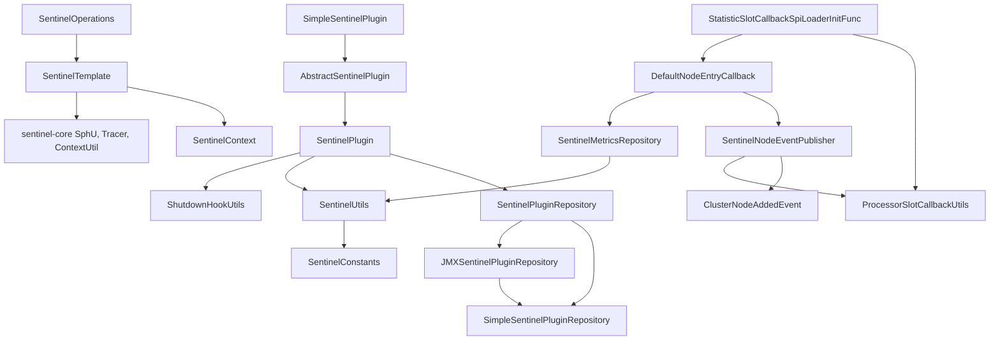
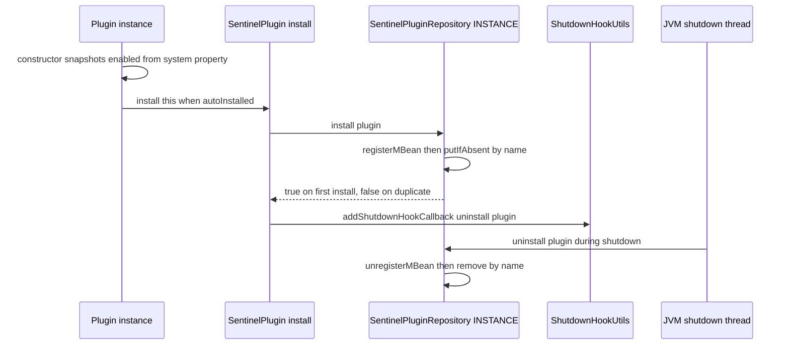
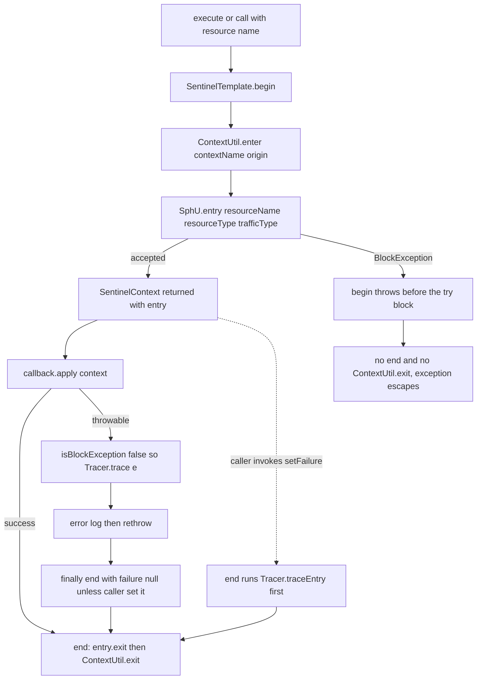
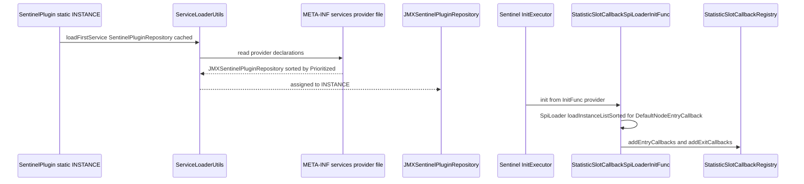
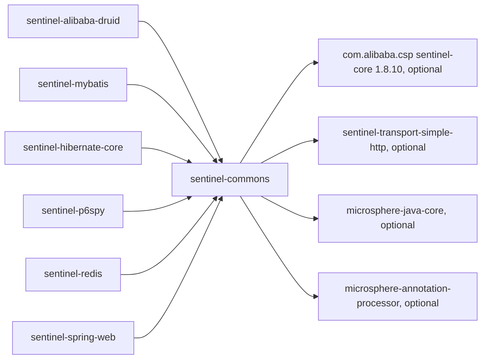

# microsphere-alibaba-sentinel-commons — 开发者指南

[English](../microsphere-alibaba-sentinel-commons.md)

## 目的与范围

`microsphere-alibaba-sentinel-commons` 是本库的架构核心：插件抽象 `SentinelPlugin` 及其注册表
`SentinelPluginRepository`、守卫 API（`SentinelOperations`、`SentinelTemplate`、`SentinelContext`）、
Sentinel 槽链钩子（`DefaultNodeEntryCallback`、`ProcessorSlotCallbackUtils`、`StatisticSlotCallbackSpiLoaderInitFunc`）、
节点/指标读模型（`SentinelNodeEventPublisher`、`SentinelMetricsRepository`）以及共享支撑类
（`SentinelUtils`、`SentinelConstants`）。所有集成模块 —— Druid、MyBatis、Hibernate、P6Spy、Redis、Spring Web ——
都是构建在其之上的轻量插件。本指南面向需要修改内部实现的开发者，而不是最终用户。

版本背景：发布分支属于 `0.2.x` 系列（已发布 `0.2.0`–`0.2.5`；根 `pom.xml` 的 `revision` = `0.2.6-SNAPSHOT`），
Java 17，`sentinel-core` 1.8.10，消费方使用 Spring Boot 3.x 搭配 Spring Cloud 2022–2025。更完整的版本对照表见
[用户指南](../../../user-guide/current/zh/microsphere-alibaba-sentinel-commons.md)。路径均相对于
`microsphere-alibaba-sentinel-commons/src/{main,test}`。

## 架构

## 源码分析

### SentinelPlugin (`common/SentinelPlugin.java`)

抽象成员：`boolean isAutoInstalled()`、`void setEnabled(boolean)`、`@Nonnull String getName()`、`@Nonnull String getOrigin()`、
`int getResourceType()`（一个 `ResourceTypeConstants` 取值）、`@Nonnull EntryType getTrafficType()`。默认成员：`isEnabled()` →
`isPluginEnabled(getName())`，以及 `getContextName()` → `getDefaultContextName(getName())`。生命周期入口是
`static void install(SentinelPlugin plugin) throws NullPointerException`，其方法体为 `SentinelPluginRepository repository = INSTANCE; repository.install(plugin);`
随后调用 `addShutdownHookCallback(() -> repository.uninstall(plugin))`。该工具方法是 `io.microsphere.util.ShutdownHookUtils.addShutdownHookCallback(Runnable)`，
它把 lambda 放入一个 `PriorityBlockingQueue<Runnable>`，由唯一注册的 JVM 关闭钩子线程排空，因此卸载动作一定会执行。
重复安装同一个插件会注册两个钩子回调，而第二次 `repository.install` 返回 `false`。

### SentinelPluginRepository (`common/SentinelPluginRepository.java`)

一个 SPI 接口，带有通过 ServiceLoader 解析的单例：`SentinelPluginRepository INSTANCE = loadFirstService(SentinelPluginRepository.class, true)`。
`ServiceLoaderUtils.loadFirstService(Class, boolean cached)` 包装了 `java.util.ServiceLoader`，对实现了 `io.microsphere.lang.Prioritized`
的提供者排序，并在没有任何声明时抛出 `IllegalArgumentException`。`src/main/resources/META-INF/services/io.microsphere.alibaba.sentinel.common.SentinelPluginRepository`
声明了 `io.microsphere.alibaba.sentinel.jmx.JMXSentinelPluginRepository`，因此 `INSTANCE` 默认由 JMX 支撑，并可被下游提供者覆盖。
契约：`boolean install(SentinelPlugin) throws NullPointerException`（仅首次注册返回 `true`）、`boolean isInstalled(String)`、
`@Nullable SentinelPlugin get(String)`、`@Nonnull Collection<SentinelPlugin> getAll()`、`default boolean uninstall(SentinelPlugin)` → `uninstall(plugin.getName())`、
`boolean uninstall(String) throws NullPointerException`、`void clear()`。键只使用插件名；资源到上下文、资源到节点的映射
存放在 `SentinelMetricsRepository` 与 `SentinelNodeEventPublisher` 中。

### 注册表：Simple 与 JMX

`SimpleSentinelPluginRepository` 持有一个以容量 8 创建的 `ConcurrentHashMap<String, SentinelPlugin>`：`install` 是 `putIfAbsent(name, plugin) == null`，
重复项会打印 `logger.warn("{} with name ['{}'] already exists", plugin)`（两个占位符、一个参数，因此第二个占位符按字面原样输出），`uninstall` 是
`remove(name) != null`，`getAll()` 返回活动的 `values()` 视图，而 `null` 插件或名称会以 `NullPointerException` 的形式从 `plugin.getName()` 或
`ConcurrentHashMap.remove` 抛出。`JMXSentinelPluginRepository` 装饰了一个私有的 `SimpleSentinelPluginRepository delegate`，`implements SentinelPluginRepository, Prioritized`
且 `getPriority() == DEFAULT_PRIORITY`（9），并声明了 `JMX_DOMAIN = "io.microsphere.sentinel"` 以及 `OBJECT_NAME_PATTERN = JMX_DOMAIN + ":type=SentinelPlugin,name={}"`。
`install` 会先用格式化出的 `ObjectName` 注册 `new StandardMBean(plugin, SentinelPlugin.class)`，然后再委托执行 —— 把 `SentinelPlugin` 用作管理接口
使其 getter 变成 MBean 属性、`setEnabled(boolean)` 变成一个操作。所有调用都经由
`doInMBeanServer(String, ThrowableBiFunction<MBeanServer, ObjectName, R>)`，它解析 `getPlatformMBeanServer()`，并在 `ThrowableSupplier.execute(...)`
之内于 `synchronized (delegate)` 块中执行主体，因此注册失败绝不会改动 delegate。`get(name)` 会自愈（一旦 MBean 消失就调用
`delegate.uninstall(name)` 并返回 `null`），`uninstall(String)` 显式拒绝 `null`，`clear()` 调用 `getAll(true)`，后者以 `name=*` 查询并逐个卸载命中项。
`SentinelPluginRepositoryTest` 是共享的契约测试；`Simple…` 与 `JMX…` 的测试只覆盖 `createSentinelPluginRepository()`。

### SentinelOperations (`common/SentinelOperations.java`)

六个 `execute(...)` 重载（`Runnable`、`Consumer<SentinelContext>`、`Function<SentinelContext,R>`，各自带与不带 `contextName`/`origin`）以及
基于 `ThrowableAction`、`ThrowableConsumer<SentinelContext>`、`ThrowableFunction<SentinelContext,R>` 的 `call(...)` 重载，最终都汇聚到
`<R> R call(String, String, String, ThrowableFunction<SentinelContext,R>) throws Throwable`：`begin(...)` 在 `try` **之外**执行，`callback.apply(context)`
在 `try` 之内，`catch (Throwable e)` 仅在 `!isBlockException(e)` 时调用 `Tracer.trace(e)`，以 error 级别记录日志并重新抛出，`finally { end(context); }`
则始终执行。只有
`@Nonnull SentinelContext begin(@Nonnull String resourceName, @Nullable String contextName, @Nullable String origin) throws Exception` 和
`void end(SentinelContext context)` 是抽象的。`execute` 一族委托给 `call(..., RuntimeException.class)`，并用
`ExceptionUtils.throwTarget` 转换受检异常。由于 `catch` 通过 `Tracer.trace` 上报而从不调用 `context.setFailure`，两阶段调用方必须自行设置失败对象，
`Tracer.traceEntry` 才会触发 —— 并且不能再自行调用 `Tracer.trace`，否则错误会被重复计数。

### SentinelTemplate (`common/SentinelTemplate.java`)

唯一实现，是对 `SphU`、`Tracer`、`ContextUtil` 的门面，`resourceType` 与 `trafficType` 由 `SentinelTemplate()`、
`SentinelTemplate(int)`、`SentinelTemplate(int, EntryType)` 以不可变方式确定（默认 `COMMON`、`IN`）。`begin` 在某个入参 `isBlank` 时以
`SentinelConstants.DEFAULT_CONTEXT_NAME`/`DEFAULT_ORIGIN` 替代，然后 `ContextUtil.enter(context, origin)`，再
`SphU.entry(resourceName, resourceType, trafficType)`，最后返回 `new SentinelContext(resourceName, actualContextName, actualOrigin, entry)`。
`end` 读取 `context.getEntry()` 与 `context.getFailure()`，当失败对象非空时调用 `Tracer.traceEntry(failure, entry)`，然后 `entry.exit()`
和 `ContextUtil.exit()` —— 顺序很关键，因为 `traceEntry` 需要一个仍然活动的 entry。日志使用受 `isTraceEnabled()` 保护的 `io.microsphere.logging.Logger`。

### SentinelContext (`common/SentinelContext.java`)

单次调用的上下文持有者，包含 `private static final ThreadLocal<SentinelContext> contextHolder`、`final` 的 `resourceName`、`contextName`、`origin`、`entry`，
外加可变的 `result`、`failure` 和惰性创建的 `Map<String,Object> attributes`。`protected` 构造器用 `assertNotEmpty`/`assertNotNull` 校验，因此
空白名称或 `null` entry 会抛出 `IllegalArgumentException`（`SentinelContextTest`）。链式成员 `setResult`、`setFailure`、`setAttribute`、
`removeAttributes` 和 `withinContext()` 都返回 `this`；读取方法为 `getResult`、`getFailure`、`getAttribute(name)`、`getAttribute(name, default)`、`hasAttribute`、
`removeAttribute` 和 `getAttributes()`（返回 `emptyMap()` 或 `unmodifiableMap(...)`）。静态方法：`getContext()`、`setContext(@Nullable)`（`null` 表示清除）、
`removeContext()`、`doInContext(Consumer)` 和 `doInContext(Consumer, boolean forRemoval)` —— 当 `forRemoval = true` 时，绑定会在 consumer 运行*之前*
被释放，这正是两阶段插件避免自我消费的做法。线程安全：attributes 使用普通 `HashMap`，因此一个 context 只属于单个线程；只有
`contextHolder` 区分线程，并且没有任何机制替你解绑，所以 `withinContext()` 必须与 `doInContext(..., true)` 配对使用。

### AbstractSentinelPlugin 与 SimpleSentinelPlugin

`AbstractSentinelPlugin` 把四个构造器层层收敛到 `(String name, String contextName, String origin, int resourceType, EntryType trafficType, boolean autoInstalled)`，
递进默认值为 `COMMON`、`IN`、`autoInstalled = true`。终结构造器为 `final` 字段赋值，快照
`this.enabled = SentinelPlugin.super.isEnabled()`（系统属性只读一次；后续变更需要 `setEnabled`），并在 `autoInstalled` 为真时调用 `install(this)`，
因此仅构造动作就完成插件注册并排好卸载。`enabled` 是 `volatile` 的，因为 JMX 线程写、请求线程读；`enable()`/`disable()` 包装 `setEnabled`；
`toString()` 把该标志标注为 `autoRegisterMBean=`，尽管字段名是 `autoInstalled`（历史遗留输出）。
`SimpleSentinelPlugin` 暴露全部几种构造器形态且不增加任何行为：它服务于测试，以及父类已被占用的插件。

### SentinelConstants (`common/constants/SentinelConstants.java`)

`FLOW_DATA_ID_PATTERN = "{}-flow-rules"`、`DEFAULT_CONTEXT_NAME_PATTERN = "microsphere_sentinel_{}_context"`、
`DEFAULT_CONTEXT_NAME = "microsphere_sentinel_default_context"`、`DEFAULT_ORIGIN = ""`、`PROPERTY_NAME_PREFIX = "microsphere.sentinel."`、
`ENABLED_PROPERTY_VALUE = "true"`、`ENABLED_PROPERTY_NAME = PROPERTY_NAME_PREFIX + PropertyConstants.ENABLED_PROPERTY_NAME`、
`SENTINEL_CONTEXT_ATTRIBUTE_NAME = "sentinel-context"`、`DEFAULT_PRIORITY = 9` —— 全部由 `SentinelConstantsTest` 固定校验。`microsphere.sentinel.enabled`
并*不*在 commons 内部被读取，commons 只用按插件的键；该全局属性由 `microsphere-alibaba-sentinel-spring-boot` 中的
`@ConditionalOnSentinelEnabled`（`matchIfMissing = true`）消费。

### SentinelUtils (`common/util/SentinelUtils.java`)

抽象工具类，带私有构造器。`resourceTypeToLabelMapping` 在类加载时通过反射 `ResourceTypeConstants` 的静态字段构建，
`getResourceTypeAsString(int)` 回退为 `"UNKNOWN"`。`getDefaultContextName(pluginName)` 按上下文模板格式化；
`getPluginEnabledPropertyName(pluginName)` 得到 `microsphere.sentinel.<plugin>.enabled`；`isPluginEnabled(pluginName)` 通过
`SystemUtils.getSystemProperty(name, "true")` 读取，且只把大小写不敏感的 `"false"` 视为禁用 —— 解析来源是 JVM 系统属性，而不是 Spring
`Environment`。`buildResourceName(Method)` 生成 `SimpleClass.method(ParamA,ParamB)`，`SentinelUtilsTest` 将其固定为 `SentinelUtils.buildResourceName(Method)`。
`resetContextMap()` 以 `invokeExact()` 调用 `findStatic(ContextUtil.class, "resetContextMap")`，并在静态代码块中被注册为关闭钩子回调，该静态块同时
在该 `volatile` 字段仍为 `null` 时调用 `shutdownOnExit(sentinelMetricsTaskExecutor)`。
`findSentinelMetricsTaskExecutor()` 通过反射读取 `FlowRuleManager.SCHEDULER`；`getSentinelMetricsTaskExecutor()` 以非原子的
check-then-act 方式缓存进 `volatile` 字段（无害：两个写入方解析到的是同一个值），否则创建名为 `sentinel-metrics-task` 的守护线程调度器。
`getMetricSearcher()` 在 `synchronized (SentinelUtils.class)` 下使用了正确的双重检查锁定，而 `newMetricSearcher()` 组合了
`SentinelConfig.getAppName()`、`PidUtil.getPid()`、`MetricWriter.METRIC_BASE_DIR` 和 `formMetricFileName`。

### 回调装配链路：DefaultNodeEntryCallback、ProcessorSlotCallbackUtils、InitFunc

`common/callback/DefaultNodeEntryCallback.java` 是一个标记接口 `interface DefaultNodeEntryCallback extends ProcessorSlotEntryCallback<DefaultNode>`。
`common/util/ProcessorSlotCallbackUtils.java`（抽象类、私有构造器、`implements Utils`）包装了 `StatisticSlotCallbackRegistry`：变参与 `Iterable`
形式的 `addEntryCallbacks`/`addExitCallbacks`、单个形式的 `addEntryCallback`/`addExitCallback`、`getEntryCallback(Class)`/`getExitCallback(Class)`
（用 `isInstance` 线性扫描，缺失时返回 `null`）以及 `removeEntryCallback(Class)`/`removeExitCallback(Class)`。注册表的键来自
`key(Object)`/`key(Class)` → `ClassUtils.getTypeName`，因此 lambda 必须用其生成的类来查找，正如 `ProcessorSlotCallbackUtilsTest` 所示。
`common/init/StatisticSlotCallbackSpiLoaderInitFunc.java` `implements com.alibaba.csp.sentinel.init.InitFunc`，并声明在
`src/main/resources/META-INF/services/com.alibaba.csp.sentinel.init.InitFunc` 中，因此 Sentinel 的 `InitExecutor` 会在首次启动时执行它；`init()` 调用
`SpiLoader.of(DefaultNodeEntryCallback.class).loadInstanceListSorted()` 和 `SpiLoader.of(ProcessorSlotExitCallback.class).loadInstanceListSorted()`，
把两个列表都喂给 `ProcessorSlotCallbackUtils`。这正是其他 jar 无需 Spring 也能贡献回调的接缝。`StatisticSlotCallbackSpiLoaderInitFuncTest`
通过 `AbstractSentinelTemplateTest` 来演练它，后者为每个资源加载一条 `count = 1` 的 `FLOW_GRADE_THREAD` 规则。

### SentinelNodeEventPublisher 与 SentinelMetricsRepository

`event/SentinelNodeEventPublisher.java` 带有 `@Spi` 并 `implements DefaultNodeEntryCallback`。`onPass` 与 `onBlocked` 都调用 `addNodeIfAbsent`，后者使用
`ConcurrentMap<String, ClusterNode> processedResourceClusterNodes` 配合 `computeIfAbsent(resourceName, k -> { onClusterNodeAdded(...); return clusterNode; })` ——
每个资源名最多只发一次 `ClusterNodeAddedEvent`（键忽略上下文名，且 lambda 在 map 的分桶锁内运行）。派发目标是
`io.microsphere.event.EventDispatcher`，由 `of(@Nullable Executor)` 构建，未提供 executor 时在调用线程上同步执行。
`addEventListener`/`removeEventListener` 返回 `this`，而 `getSentinelNodeEventPublisher()` 通过
`ProcessorSlotCallbackUtils.getEntryCallback(...)` 解析单例，从而把 Sentinel 注册表而非静态字段作为唯一事实来源。`event/ClusterNodeAddedEvent.java`
继承 `io.microsphere.event.Event`，以 `ClusterNode` 作为 source 并附带 `contextName`/`resourceName`；`event/ClusterNodeAddedEventListener.java` 是一个
`@FunctionalInterface extends EventListener<ClusterNodeAddedEvent>`。`SentinelNodeEventPublisherTest` 在两个并行线程上验证每个资源只派发一次。

`common/reposistory/SentinelMetricsRepository.java`（对外发布的包名确实拼作 `reposistory`）带有 `@Spi` 并 `implements DefaultNodeEntryCallback`：
`onPass`/`onBlocked` → `resourceToContextMapping.putIfAbsent(resource, context)`（首个上下文胜出，`ConcurrentHashMap` 容量 256），`getContext(String)` 默认
返回 `Constants.CONTEXT_DEFAULT_NAME`，构造器捕获 `SentinelUtils.getMetricSearcher()`。`findMetricNodes(long, int)`、`findMetricNodes(long, long)`
和 `findMetricNodes(long, long, String)` 都经由受保护的
`findMetricNodes(ThrowableFunction<MetricSearcher, List<MetricNode>>, Supplier<List<MetricNode>>)` 路由，该方法记录日志、失败时产出 `null` 并应用
`defaultIfNull`，因此不可读的指标文件不会向外传播；`findContextMetricNodesMap(long, long)` 按上下文分组进 `TreeMap` 并返回不可修改的 map。
`getSentinelMetricsRepository()` 与 publisher 一样通过注册表查找。

## 设计模式

| 模式 | 实现类型 | 依据 |
| --- | --- | --- |
| 模板方法 | `SentinelOperations`、`SentinelTemplate` | 一次性 `execute`/`call` 是建立在 `begin`/`end` 之上的固定骨架 |
| 门面 | `SentinelTemplate` | 隐藏 `SphU.entry`、`Tracer.traceEntry`、`ContextUtil.enter`/`exit` |
| 注册表、单例 | `SentinelPluginRepository.INSTANCE`、`SimpleSentinelPluginRepository`、`JMXSentinelPluginRepository` | 以插件名为键；`getSentinelNodeEventPublisher()` 与 `getSentinelMetricsRepository()` 是注册表支撑的单例 |
| 基于 ServiceLoader 的 SPI | `SentinelPluginRepository`、`com.alibaba.csp.sentinel.init.InitFunc` provider 文件、Sentinel `SpiLoader` | `src/main/resources/META-INF/services` 下有两个文件 |
| 装饰器 | `JMXSentinelPluginRepository` 装饰 `SimpleSentinelPluginRepository`；`StandardMBean` 装饰 `SentinelPlugin` | 不改变契约即提供管理视图 |
| 观察者 | `SentinelNodeEventPublisher`、`EventDispatcher`、`ClusterNodeAddedEvent`、`ClusterNodeAddedEventListener` | 每个资源只通知一次 |
| 策略 | 插件与 `SentinelTemplate` 上的 `resourceType` 和 `EntryType` | `COMMON`、`COMMON_DB_SQL`、`COMMON_WEB` |
| 生命周期钩子 | `SentinelPlugin.install` 与 `SentinelUtils` 中的 `ShutdownHookUtils.addShutdownHookCallback` | 对称的卸载与 `resetContextMap` |

## 核心流程

### 插件安装与卸载生命周期

### 守卫调用与限流抛出路径

### 注册表与 InitFunc 的 SPI 加载

## 依赖关系

| 依赖 | 作用域 | 作用 |
| --- | --- | --- |
| `io.github.microsphere-projects:microsphere-java-core` | compile, `optional` | `ServiceLoaderUtils`、`ShutdownHookUtils`、`Prioritized`、`Throwable*` 函数式接口、`io.microsphere.logging`、反射/文本/集合辅助类 |
| `com.alibaba.csp:sentinel-core` 1.8.10 | compile, `optional` | `SphU`、`Entry`、`Tracer`、`ContextUtil`、`StatisticSlotCallbackRegistry`、`SpiLoader`、`InitFunc`、`MetricSearcher`、`ResourceTypeConstants` |
| `com.alibaba.csp:sentinel-transport-simple-http` 1.8.10 | compile, `optional` | 由心跳与指标路径实际使用的传输层 |
| `io.github.microsphere-projects:microsphere-annotation-processor` | compile, `optional` | 为 `@ConfigurationProperty` 生成元数据 |
| `junit-jupiter`、`mockito-core`、`mockito-junit-jupiter` | test | 单元测试；`SentinelContextTest` 对 `Entry` 做 mock |
| `microsphere-java-test`、`microsphere-logging-test`、`microsphere-logback`、`logback-classic` | test | 测试辅助类与 `@LoggingLevelsClass` 日志级别控制 |

版本由 `microsphere-alibaba-sentinel-parent` 提供，它 import 了 `microsphere-spring-cloud-dependencies`
0.2.26；本模块自身不声明任何版本。所有 compile 依赖都是 `optional`，因此 commons jar 绝不会把
某个 Sentinel 或 microsphere 版本强加给应用。

## 扩展点

1. 声明 `Sentinel<Framework>Constants`，包含 `PLUGIN_NAME`、形如
   `microsphere_sentinel_<plugin>_context` 的 `DEFAULT_CONTEXT_NAME`、`DEFAULT_ORIGIN`，以及
   `ENABLED_PROPERTY_NAME = PROPERTY_NAME_PREFIX + PLUGIN_NAME + DOT + "enabled"`。
2. 确定身份：一个 `ResourceTypeConstants` 取值加上一个 `EntryType`（默认 `IN`）。
3. 实现宿主框架的扩展接口，然后要么继承 `AbstractSentinelPlugin`（在构造器中自动安装），
   要么基于 `autoInstalled = false` 构建的 `SimpleSentinelPlugin` 委托来实现 `SentinelPlugin`，
   并在构造器最后调用 `SentinelPlugin.install(this)` —— 当框架适配器已经占用父类时，必须采用后者。
4. 构建 `new SentinelTemplate(getResourceType(), getTrafficType())`；对前置/后置钩子使用 `begin`/`end`
   配合 `withinContext()` 与 `doInContext(consumer, true)`，对单一包装点使用一次性
   `call(resourceName, contextName, origin, callback, DeclaredException.class)`，并且在两阶段形态中始终调用 `setFailure`。
5. 两个阶段都要用 `isEnabled()` 做守卫；宿主对插件排序时使用 `DEFAULT_PRIORITY`（9）。
6. 通过贡献你自己的 `SentinelPluginRepository` provider 文件来替换注册表；通过实现
   `DefaultNodeEntryCallback` 或 `ProcessorSlotExitCallback` 供 Sentinel `SpiLoader` 加载来贡献统计钩子，
   由 `StatisticSlotCallbackSpiLoaderInitFunc` 统一收集。

## 相关模块

- 索引：[开发者指南 README](./README.md)
- 插件总览：[microsphere-alibaba-sentinel-plugins](./microsphere-alibaba-sentinel-plugins.md)
- 消费方：[microsphere-alibaba-sentinel-alibaba-druid](./microsphere-alibaba-sentinel-alibaba-druid.md)、
  [microsphere-alibaba-sentinel-mybatis](./microsphere-alibaba-sentinel-mybatis.md)
- 读取这些属性的 Spring 层：`microsphere-alibaba-sentinel-spring-boot`
  （`@ConditionalOnSentinelEnabled`、`@ConditionalOnSentinelAvailable`）
- 对应用户指南：[用户指南](../../../user-guide/current/zh/microsphere-alibaba-sentinel-commons.md)

---

## English

[English 版本](../microsphere-alibaba-sentinel-commons.md)
