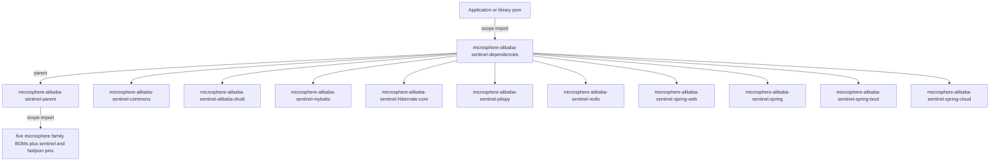
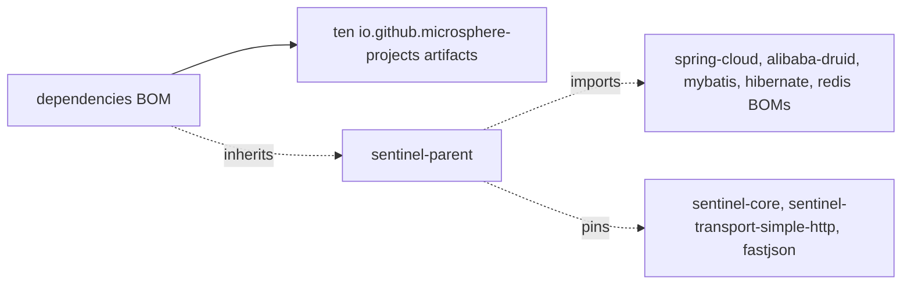

# microsphere-alibaba-sentinel-dependencies — 开发者指南

[English](../microsphere-alibaba-sentinel-dependencies.md)

## 目的与范围

`microsphere-alibaba-sentinel-dependencies` 是本项目对外发布的 Bill of Materials。它是一个纯
POM 模块：`<packaging>pom</packaging>`，没有源码，没有 `<properties>`，没有
`<dependencies>`，没有 `<build>`，也没有 `<modules>`。它的全部内容就是一个
`<dependencyManagement>` 块，列出仓库中**十个可被消费的构件**，每条都带
`<version>${revision}</version>`。

| POM 类型 | 是否在此受管 |
|---|---|
| 使用者会依赖的库构件 | 是 — commons、六个插件、spring、spring-boot、spring-cloud |
| reactor 根 `microsphere-alibaba-sentinel` | 否 — 构建期聚合器，不是依赖 |
| `microsphere-alibaba-sentinel-plugins` | 否 — 中间层 `pom` 聚合模块，自身没有构件 |
| `microsphere-alibaba-sentinel-parent` | 否 — 它是本 BOM 的父级 |
| 第三方库 | 否 — 那些版本在父 POM 中固定 |

## 架构

由于发布的 POM 保留了它的 `<parent>` 引用，导入本 BOM 的使用者同时也会解析父级链，并随之得到
[microsphere-alibaba-sentinel-parent](./microsphere-alibaba-sentinel-parent.md) 中声明的第三方版本。
这就是下面这些条目除 `${revision}` 之外不需要自己携带版本的原因。

## 源码分析

### 结构

- `parent`：`microsphere-alibaba-sentinel-parent`，`${revision}`，显式
  `relativePath ../microsphere-alibaba-sentinel-parent/pom.xml`。
- `artifactId` / `version`：`microsphere-alibaba-sentinel-dependencies` / `${revision}`。
  `revision` 在向上两级的 reactor 根中声明，并被继承下来。
- `dependencyManagement`：十条条目，全部属于 `io.github.microsphere-projects`，全部使用
  `${revision}`，没有一条带 `<type>pom</type>`，也没有一条带 `<scope>import</scope>` — 本
  BOM 管理的是 jar，而不是 BOM。

声明顺序与依赖图一致，而不是按字母排序：commons 在最前，然后是按插件聚合模块顺序排列的六个
插件，最后是三个 Spring 层。BOM 内部的顺序只是外观问题，因为没有坐标被声明两次；只有导入型 BOM 的
顺序才承载语义。

### 与 reactor 的覆盖核对

根 POM 列出七个模块：parent、commons、plugins、spring、spring-boot、spring-cloud 与
dependencies。展开插件聚合模块再增加六个。去掉三个非构件 POM —
根、插件聚合、parent — 以及本 BOM 自身，剩下的恰好就是此处受管的十条条目，因此项目每个可部署构件都被
覆盖到了。

## 设计模式

| 模式 | 实现 |
|---|---|
| Bill of Materials | 唯一载荷就是面向项目构件的 `<dependencyManagement>` 的 POM |
| 版本对齐 | 一个 `${revision}` 取值绑定全部十个构件，因此从构造上就不可能出现部分升级 |
| 分层管理 | 第三方版本位于父 POM，项目版本位于此处，两者在使用者导入本 BOM 时汇合 |
| 基于继承的发布 | 本 POM 继承自父 POM，因此使用者解析父级链时会隐式获得导入的家族 BOM |

## 核心流程

### 构建与发布流程

```mermaid
flowchart LR
    A["Reactor root declares revision 0.2.6-SNAPSHOT"] --> B["This BOM references the ten artifacts with revision"]
    B --> C["CI runs deploy with -Drevision set to the release version"]
    C --> D["Published POMs resolve the project version to a literal value"]
    D --> E["Parent POM and imported family BOMs are deployed together"]
    E --> F["Consumer imports this BOM with scope import and type pom"]
    F --> G["Consumer declares any of the ten coordinates without a version"]
    G --> H["Maven resolves the parent chain for the third-party versions"]
```

有两个属性在发布的 POM 中保留为占位符 — 即父 POM `<dependencyManagement>` 内部的
`${microsphere-*.version}`、`${sentinel.version}` 与 `${fastjson.version}` 引用 —
而 `${revision}` 会被解析。因此使用者可以从部署的父 POM 中读出确切的家族版本。

## 依赖

| 受管坐标 | 版本 | 它是什么 |
|---|---|---|
| `microsphere-alibaba-sentinel-commons` | `${revision}` | 插件模型、仓库、模板与工具类 |
| `microsphere-alibaba-sentinel-alibaba-druid` | `${revision}` | Druid `Filter` 插件 |
| `microsphere-alibaba-sentinel-mybatis` | `${revision}` | MyBatis `ExecutorFilter` 插件 |
| `microsphere-alibaba-sentinel-hibernate-core` | `${revision}` | Hibernate `EntityCallback` 插件，经 SPI 注册 |
| `microsphere-alibaba-sentinel-p6spy` | `${revision}` | P6Spy `JdbcEventListener` 插件，经 SPI 注册 |
| `microsphere-alibaba-sentinel-redis` | `${revision}` | Redis 命令拦截器插件 |
| `microsphere-alibaba-sentinel-spring-web` | `${revision}` | `HandlerMethodInterceptor` 插件 |
| `microsphere-alibaba-sentinel-spring` | `${revision}` | Spring 依赖聚合，无源码 |
| `microsphere-alibaba-sentinel-spring-boot` | `${revision}` | 四个自动配置类 |
| `microsphere-alibaba-sentinel-spring-cloud` | `${revision}` | 面向 Spring Cloud actuator 的特性上报 |

本 POM 中没有直接的 `<dependencies>`，因此也就没有作用域可列；`<type>pom</type>`
与 `<scope>import</scope>` 这一对属于导入本构件的使用者 POM。

## 扩展点

| 变更 | 做法 |
|---|---|
| 发布新模块 | 追加一条使用 `io.github.microsphere-projects` 坐标并带 `<version>${revision}</version>` 的条目；漏掉它会让使用者在每次声明时都必须指定版本 |
| 下线某模块 | 删除该条目，并保持根 `<modules>` 同步，否则构件仍会被构建但不再受管 |
| 让某个插件对齐另一个 Sentinel 发布版 | 修改父 POM 中的 `sentinel.version`，而不是这里 |
| 使用者需要不同的项目版本 | 在你自己的 `<dependencyManagement>` 中**在导入本 BOM 之前**显式声明该坐标 — 第一个受管版本生效 |
| 使用者需要不同的第三方版本 | 在导入之前把第三方坐标声明在你自己的 `<dependencyManagement>` 中，因为被导入 POM 的属性无法从外部覆盖 |
| 发布新的版本线 | 发布工作流会递增 reactor 根中的 `revision`；本 BOM 无需改动，因为每条条目都使用该属性 |

## 相关模块

- 开发者指南索引：[./README.md](./README.md)
- 第三方版本归属方：[./microsphere-alibaba-sentinel-parent.md](./microsphere-alibaba-sentinel-parent.md)
- 受管构件：[./microsphere-alibaba-sentinel-commons.md](./microsphere-alibaba-sentinel-commons.md)、[./microsphere-alibaba-sentinel-plugins.md](./microsphere-alibaba-sentinel-plugins.md)、[./microsphere-alibaba-sentinel-spring.md](./microsphere-alibaba-sentinel-spring.md)、[./microsphere-alibaba-sentinel-spring-boot.md](./microsphere-alibaba-sentinel-spring-boot.md)、[./microsphere-alibaba-sentinel-spring-cloud.md](./microsphere-alibaba-sentinel-spring-cloud.md)
- 面向用户的文档：[../../user-guide/current/zh/microsphere-alibaba-sentinel-dependencies.md](../../../user-guide/current/zh/microsphere-alibaba-sentinel-dependencies.md)

---

## English

[English 版本](../microsphere-alibaba-sentinel-dependencies.md)
