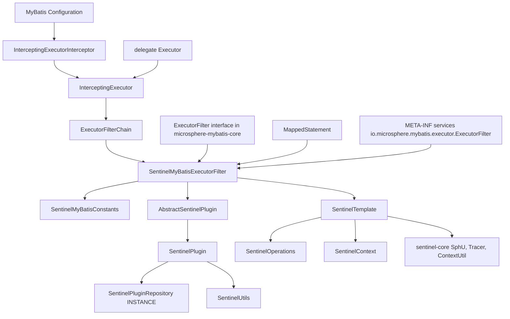
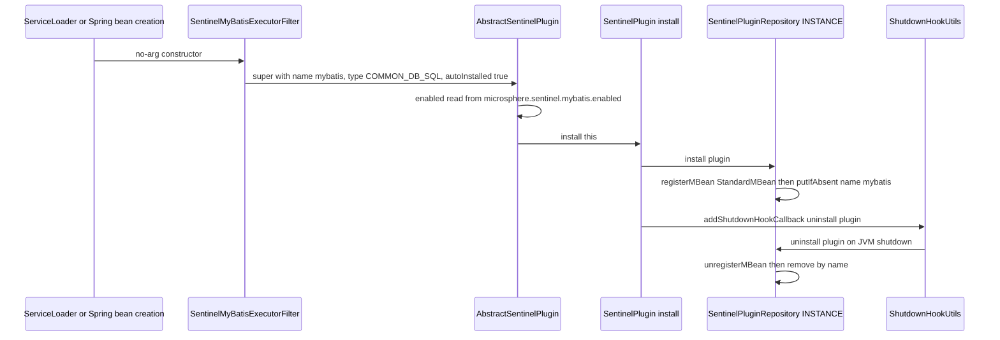
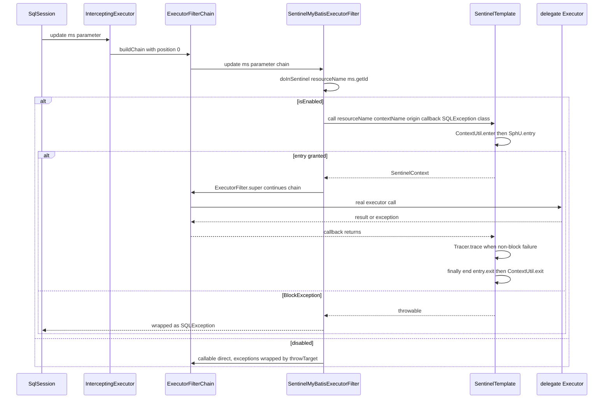
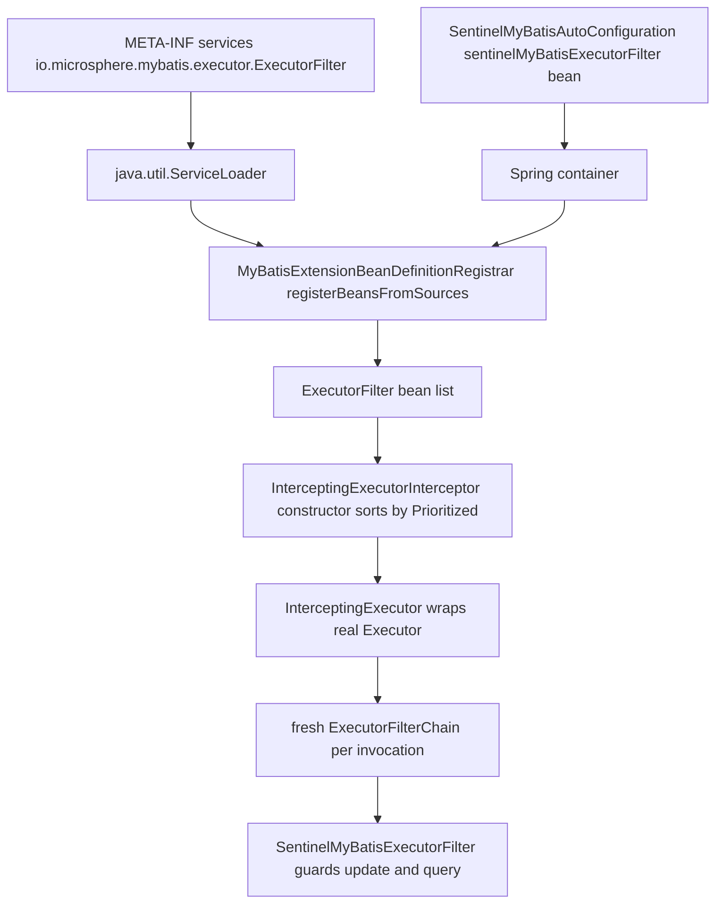
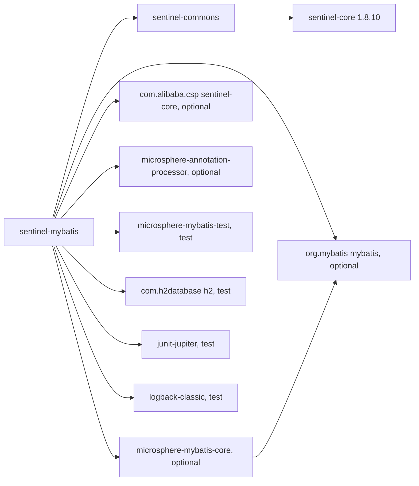

# microsphere-alibaba-sentinel-mybatis — 开发者指南

[English](../microsphere-alibaba-sentinel-mybatis.md)

## 目的与范围

`microsphere-alibaba-sentinel-mybatis`（目录 `microsphere-alibaba-sentinel-plugins/microsphere-alibaba-sentinel-mybatis`）
用 Alibaba Sentinel 守卫 MyBatis 的 `Executor` 流量。它只发布一个插件类 `SentinelMyBatisExecutorFilter`、
一个常量接口，以及 SPI 声明
`src/main/resources/META-INF/services/io.microsphere.mybatis.executor.ExecutorFilter`。与 Druid 插件不同，它直接继承
`AbstractSentinelPlugin`，并使用一次性的 `SentinelOperations.call(...)` 形态，而不是两阶段的 `begin`/`end` 配对。

资源粒度是每个 mapped statement 对应一个 Sentinel 资源：`getSentinelResourceName(ms)` 返回 `ms.getId()`，
例如 `io.microsphere.mybatis.test.mapper.UserMapper.selectById`。资源类型是
`ResourceTypeConstants.COMMON_DB_SQL`，流量类型是 `EntryType.IN`。版本背景：`0.2.x` 系列（已发布
`0.2.0`–`0.2.5`，`revision` = `0.2.6-SNAPSHOT`），Java 17，`sentinel-core` 1.8.10，`microsphere-mybatis`
0.2.16，Spring Boot 3.x / Spring Cloud 2022–2025。面向终端用户的配置由
[用户指南](../../../user-guide/current/zh/microsphere-alibaba-sentinel-mybatis.md)覆盖。

## 架构



## 源码分析

### SentinelMyBatisConstants

```java
String PLUGIN_NAME = "mybatis";
String DEFAULT_CONTEXT_NAME = "microsphere_sentinel_mybatis_context";
String DEFAULT_ORIGIN = "Executor";
String ENABLED_PROPERTY_NAME = PROPERTY_NAME_PREFIX + PLUGIN_NAME + DOT + PropertyConstants.ENABLED_PROPERTY_NAME;
```

`SentinelMyBatisConstantsTest` 固定这四个取值，断言 `ENABLED_PROPERTY_NAME == "microsphere.sentinel.mybatis.enabled"`
并且它等于 `SentinelUtils.getPluginEnabledPropertyName(PLUGIN_NAME)`。这里常量与派生出的
`SentinelUtils.getDefaultContextName(PLUGIN_NAME)` 是一致的，因为插件名不含连字符。
`@ConfigurationProperty(source = SYSTEM_PROPERTIES_SOURCE)` 注解与运行时解析方式相符，后者只读取 JVM 系统属性。

### SentinelMyBatisExecutorFilter

```java
public class SentinelMyBatisExecutorFilter extends AbstractSentinelPlugin implements ExecutorFilter {

    public SentinelMyBatisExecutorFilter() { this(DEFAULT_CONTEXT_NAME, DEFAULT_ORIGIN); }

    public SentinelMyBatisExecutorFilter(String contextName, String origin) {
        super(PLUGIN_NAME, contextName, origin, COMMON_DB_SQL);
        this.sentinelOperations = new SentinelTemplate(getResourceType(), getTrafficType());
    }
```

四参数的 `AbstractSentinelPlugin` 构造器套用默认值 `EntryType.IN` 与 `autoInstalled = true`；自动安装意味着
构造器自身会调用 `SentinelPlugin.install(this)`，它把插件注册进 `SentinelPluginRepository.INSTANCE`，
并添加在 JVM 关闭时卸载它的钩子回调。同一个构造器把 `microsphere.sentinel.mybatis.enabled`（默认 `true`）
快照进基类的 `volatile` 字段。无参构造器是 `java.util.ServiceLoader` 以及 Spring bean 定义所要求的。

只覆盖了三个 `ExecutorFilter` 方法；其余方法都保留默认的透传行为：
`int update(MappedStatement ms, Object parameter, ExecutorFilterChain chain)`、
`<E> List<E> query(MappedStatement ms, Object parameter, RowBounds rowBounds, ResultHandler resultHandler, CacheKey cacheKey, BoundSql boundSql, ExecutorFilterChain chain)`
和 `<E> List<E> query(MappedStatement ms, Object parameter, RowBounds rowBounds, ResultHandler resultHandler, ExecutorFilterChain chain)`。

`ExecutorFilter.super.<method>` 就是继续链条的调用；漏掉 `chain` 会中断链条并跳过下游 filter。`queryCursor`、
`commit`、`rollback`、`createCacheKey`、`deferLoad`、`getTransaction` 和 `close` 有意不加守卫，
因此游标拉取与事务边界不会消耗 Sentinel entry。该类的核心：

```java
protected <T> T doInSentinel(MappedStatement ms, Callable<T> callable) throws SQLException {
    if (isEnabled()) {
        String resourceName = getSentinelResourceName(ms);
        return sentinelOperations.call(resourceName, getContextName(), getOrigin(),
                context -> callable.call(), SQLException.class);
    } else {
        try {
            return callable.call();
        } catch (Exception e) {
            throw throwTarget(e, SQLException.class);
        }
    }
}

protected String getSentinelResourceName(MappedStatement ms) {
    return ms.getId();
}
```

两个分支都保证 `SQLException` 签名：启用分支使用
`SentinelOperations.call(String, String, String, ThrowableFunction, Class<TR>)`，其
`try { return call(...); } catch (Throwable t) { throw throwTarget(t, throwableClass); }` 包装会把任何其他异常 ——
包括 `SphU.entry` 抛出的 `BlockException` 以及 callable 抛出的受检异常 —— 转换为 `SQLException`；
禁用分支则用 `ExceptionUtils.throwTarget` 显式转换。在未限定前缀的 `call` 内部，
`SentinelOperations` 在 `try` 之前执行 `begin(...)`，运行回调，对任何非限流 throwable 调用 `Tracer.trace(e)`，
打印一行 error 日志，重新抛出，并始终在 `finally` 中执行 `end(context)`。

追踪语义与 Druid 插件不同，重构时很容易写错：一次性形态用 `Tracer.trace` 上报失败，而 `end` 看到的
`context.getFailure() == null`，因为没有任何地方调用 `setFailure`。在此处显式加上 `setFailure` 会导致错误被重复计数。
`Tracer.trace` 与 `Tracer.traceEntry` 都写入同一份异常统计，因此每条调用路径只保留其中之一才是不变式。

线程安全性：实例持有来自 `AbstractSentinelPlugin` 的 `final` 身份字段、一个 `final SentinelOperations` 以及
`volatile enabled` 标志，所以一个 filter 被所有 `SqlSession` 实例共享是安全的。守卫过程不使用
`SentinelContext.withinContext()`，也没有任何插件级 ThreadLocal；上下文对象被限制在 `doInSentinel` 的栈帧内，
这也让该插件对嵌套或异步的 executor 调用同样正确。`AbstractSentinelPlugin` 并未实现 `Prioritized`，
该 filter 也未覆盖 `getPriority()`，因此 `ExecutorFilter` 默认的 `NORMAL_PRIORITY = 0`
决定了它在 `InterceptingExecutorInterceptor` 排序数组中的位置。

### 与 microsphere-mybatis-core 的协作

在有东西把插件装入 executor 链之前，它一直是被动的：

- `InterceptingExecutorInterceptor` 接收一个 `ExecutorFilter[]`，用 `Prioritized` 比较器排序，并在
  `plugin(Object target)` 中把真实 `Executor` 包装进 `InterceptingExecutor`。
- `InterceptingExecutor` 为每次调用构建一条*全新*的 `ExecutorFilterChain(delegate, properties, filters)`；该链是一个
  位置游标（`position < size` 时调用 `filters[position++]`，否则调用委托 `Executor`），因此链状态被限制在栈内、
  线程安全，而 `ExecutorFilterChain.applySQL(...)` 会把失败包装为 `SQLException`。
- 在 Spring 中，`@EnableMyBatisExtension` 会触发 `MyBatisExtensionBeanDefinitionRegistrar.registerExecutorFilters(...)`，
  其 `registerBeansFromSources(ExecutorFilter.class, sources)` 从 Spring Factories 或 SPI 源收集实现 ——
  正是这个消费者让本模块的 provider 文件生效。

## 设计模式

| 模式 | 实现类 | 说明 |
| --- | --- | --- |
| 责任链 | `ExecutorFilterChain` 与 `InterceptingExecutor`，`SentinelMyBatisExecutorFilter` 是其中一个环节 | `ExecutorFilter.super` 继续链条 |
| 装饰器 | `InterceptingExecutor` 包装委托 `Executor` | MyBatis 插件机制 |
| 适配器 | `SentinelMyBatisExecutorFilter implements ExecutorFilter` | executor 回调转成 Sentinel entries |
| 模板方法 | 作为固定骨架的 `doInSentinel(ms, callable)`，三处调用点 | 也包括 `AbstractSentinelPlugin` 的构造器默认值 |
| 门面 | 位于 `SentinelOperations` 之后的 `SentinelTemplate` | 隐藏 `SphU.entry`、`Tracer.trace`、`ContextUtil.enter`/`exit` |
| 注册表、单例 | 经由 `SentinelPluginRepository.INSTANCE` 的 `SentinelPlugin.install` | JMX 对象名 `io.microsphere.sentinel:type=SentinelPlugin,name=mybatis` |
| SPI | `META-INF/services/io.microsphere.mybatis.executor.ExecutorFilter` | 只有一行 provider |
| 策略 | 构造时选定的 `resourceType` / `trafficType` | `COMMON_DB_SQL`、`IN` |

## 核心流程

### 插件安装生命周期（含关闭钩子）



### 被守卫语句的 ExecutorFilter 链流程



### SPI 与拦截器的装配



## 依赖关系



| 依赖 | 作用域 | 作用 |
| --- | --- | --- |
| `io.github.microsphere-projects:microsphere-alibaba-sentinel-commons` | compile | `AbstractSentinelPlugin`、`SentinelOperations`、`SentinelTemplate`、`SentinelContext`、`SentinelUtils` |
| `io.github.microsphere-projects:microsphere-mybatis-core` | compile, `optional` | `ExecutorFilter`、`ExecutorFilterChain`、`InterceptingExecutor`、`InterceptingExecutorInterceptor` |
| `com.alibaba.csp:sentinel-core`（1.8.10） | compile, `optional` | `ResourceTypeConstants.COMMON_DB_SQL`、`EntryType.IN`、`Entry`、`Tracer` |
| `org.mybatis:mybatis` | compile, `optional` | `MappedStatement`、`CacheKey`、`BoundSql`、`RowBounds`、`ResultHandler`、`Executor` |
| `io.github.microsphere-projects:microsphere-annotation-processor` | compile, `optional` | `@ConfigurationProperty` 元数据生成 |
| `org.junit.jupiter:junit-jupiter` | test | 测试引擎 |
| `io.github.microsphere-projects:microsphere-mybatis-test` | test | `AbstractMapperTest` 以及 `InterceptingExecutorInterceptor` 测试基座 |
| `com.h2database:h2` | test | 内存数据库 |
| `ch.qos.logback:logback-classic` | test | `io.microsphere.logging` 的日志后端 |

`optional` 让 MyBatis 与 Sentinel 不进入消费方的传递依赖图。版本从
`microsphere-alibaba-sentinel-parent` 解析（`microsphere-mybatis.version` 0.2.16、`sentinel.version` 1.8.10）。

测试：`SentinelMyBatisExecutorFilterTest` 继承 `AbstractMapperTest`，覆盖 `customize(Configuration)` 以构建 filter，
并通过 `configuration.addInterceptor(interceptor)` 注册 `new InterceptingExecutorInterceptor(ofArray(this.filter))`；
分别在启用与禁用状态下运行整套 mapper 测试（`testDisabled` 会翻转 `setEnabled(false)`）；并在 `postTest()` 中以
origin `Executor` 进入 `microsphere_sentinel_mybatis_context`，断言 entrance-node 的 `childList` 非空。

## 扩展点

- **资源命名。** 覆盖 `protected String getSentinelResourceName(MappedStatement ms)`，
  以按 SQL 片段、按 namespace 或按 namespace + database id 来组织规则键，取代 `ms.getId()`。
  名称是流控规则与指标之间的关联键，因此在多次重启之间必须保持稳定。
- **守卫更多 executor 方法。** 为 `queryCursor`、`commit`、`rollback` 或 `close` 增加覆盖，并把它们路由到
  `doInSentinel(ms, () -> ExecutorFilter.super.<method>(...))`；现有辅助方法已经保证了 `SQLException` 签名。
- **按环境设定上下文与 origin。** 使用两参数构造器；在 Spring Boot 中，声明你自己的
  `SentinelMyBatisExecutorFilter` bean 即可取代自动配置的那个（`@ConditionalOnMissingBean`）。
- **切换到两阶段守卫。** 如果某个 filter 需要在上下文上同时看到结果与失败，就在链条继续调用的前后调用
  `sentinelOperations.begin(...)`/`end(...)`，并设置 `context.setResult(...)` /
  `context.setFailure(...)`；此时要把 `Tracer.trace` 移出该路径，以保证错误只计一次。
- **与其他 filter 的顺序。** `ExecutorFilter extends Prioritized`；覆盖 `getPriority()` 可以让 Sentinel filter
  在 `InterceptingExecutorInterceptor` 使用的排序数组中更靠前或更靠后。
- **运行时控制。** `-Dmicrosphere.sentinel.mybatis.enabled=false`（在构造时读取），或 JMX MBean
  `io.microsphere.sentinel:type=SentinelPlugin,name=mybatis` 上的 `setEnabled` 操作；
  `SentinelPluginRepository.INSTANCE` 暴露 `isInstalled`、`get`、`uninstall` 和 `clear`。

## 相关模块

- 索引：[开发者指南 README](./README.md)
- 核心抽象：[microsphere-alibaba-sentinel-commons](./microsphere-alibaba-sentinel-commons.md)
- 同级插件：[microsphere-alibaba-sentinel-alibaba-druid](./microsphere-alibaba-sentinel-alibaba-druid.md)、
  [插件总览](./microsphere-alibaba-sentinel-plugins.md)
- 自动配置：`microsphere-alibaba-sentinel-spring-boot` —— `SentinelMyBatisAutoConfiguration` 要求
  `io.microsphere.mybatis.spring.annotation.EnableMyBatisExtension` 与本模块的 filter 类在 classpath 上，
  运行在 `MybatisAutoConfiguration`、`MybatisPlusAutoConfiguration` 和
  `com.alibaba.cloud.sentinel.custom.SentinelAutoConfiguration` 之后，import 了一个标注
  `@EnableMyBatisExtension` 的 `Config` 类，并以 `@ConditionalOnMissingBean` 声明 filter bean；
  这一切都受 `@ConditionalOnSentinelEnabled`（`microsphere.sentinel.enabled`，`matchIfMissing = true`）门控
- 对应用户指南：[用户指南](../../../user-guide/current/zh/microsphere-alibaba-sentinel-mybatis.md)
- 源码：`microsphere-alibaba-sentinel-plugins/microsphere-alibaba-sentinel-mybatis/src/{main,test}/java`

---

## English

[English 版本](../microsphere-alibaba-sentinel-mybatis.md)
