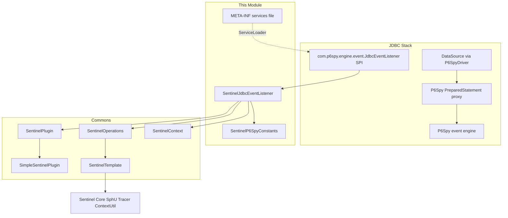
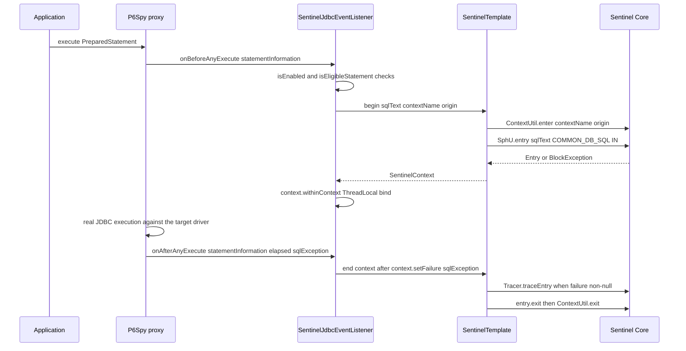
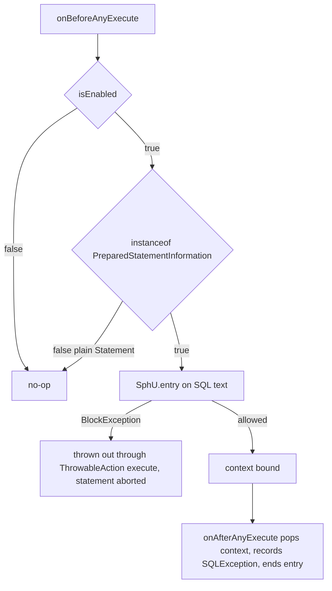
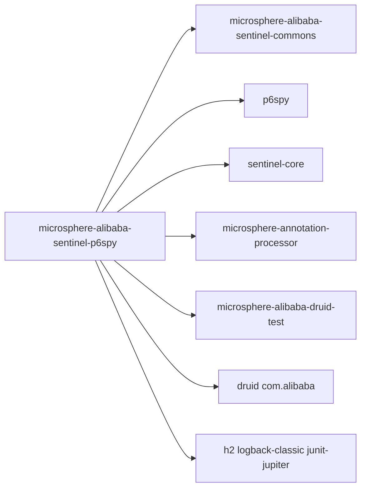

# microsphere-alibaba-sentinel-p6spy — 开发者指南

[English](../microsphere-alibaba-sentinel-p6spy.md)

## 目的与范围

本模块通过 P6Spy 计量 JDBC 语句执行，并交由 Alibaba Sentinel 守卫。
`SentinelJdbcEventListener` 继承 `com.p6spy.engine.event.SimpleJdbcEventListener`（后者实现
`com.p6spy.engine.event.JdbcEventListener`），并作为服务提供者发布在
`META-INF/services/com.p6spy.engine.event.JdbcEventListener` 中，因此只要 jar 位于 classpath 上、
且数据源使用 P6Spy 驱动（`com.p6spy.engine.spy.P6SpyDriver`，URL 前缀 `jdbc:p6spy:`），
P6Spy 自身的事件注册表就会自动拾取它。

本文覆盖的关键行为：

- 语句执行的前置/后置钩子，以及它们开启与关闭的两阶段 Sentinel entry。
- 基于所执行 SQL 文本的资源命名，且默认只限于预处理语句。
- `SQLException` 的记录与追踪语义。
- 通过 `microsphere.sentinel.p6spy.enabled` 实现启用/禁用。

发布线事实：0.2.x、Java 17、`sentinel-core` 1.8.10；P6Spy 与 `sentinel-core` 声明为 optional，
因此由消费方自带兼容版本。

## 架构

## 源码分析

### `io.microsphere.alibaba.sentinel.p6spy.SentinelJdbcEventListener`

声明为 `public class SentinelJdbcEventListener extends SimpleJdbcEventListener implements SentinelPlugin`。
与 Hibernate 插件一样，它**不**继承 `AbstractSentinelPlugin`；插件状态存放在 `SimpleSentinelPlugin` 委托中。

字段与构造器：

- `private static final Logger logger`（microsphere-logging 门面）。
- `private final SentinelPlugin delegate;`
- `private final SentinelOperations sentinelOperations;`
- `public SentinelJdbcEventListener()` —— 调用 `this(DEFAULT_CONTEXT_NAME, DEFAULT_ORIGIN)`。
- `public SentinelJdbcEventListener(String contextName, String origin)` —— 创建
  `new SimpleSentinelPlugin(PLUGIN_NAME, contextName, origin, COMMON_DB_SQL, IN, false)`，随后
  `new SentinelTemplate(getResourceType(), getTrafficType())`，再 `SentinelPlugin.install(this)`
  （注册进仓储加上关闭钩子卸载）。

语句生命周期钩子（继承自 `SimpleJdbcEventListener`，即 P6Spy 的前置/后置配对）：

- `public void onBeforeAnyExecute(StatementInformation statementInformation)` —— 当 `isEnabled()`
  且 `isEligibleStatement(statementInformation)` 时，在
  `io.microsphere.lang.function.ThrowableAction.execute` 内执行：
  `resourceName = getResourceName(statementInformation)`，
  `SentinelContext context = sentinelOperations.begin(resourceName, getContextName(), getOrigin())`，
  然后 `context.withinContext()` 把上下文绑定到当前线程。
- `public void onAfterAnyExecute(StatementInformation statementInformation, long timeElapsedNanos, SQLException e)` ——
  启用且符合条件时：`doInContext(context -> { context.setFailure(e); sentinelOperations.end(context); }, true)`；
  `SentinelContext` 从 `ThreadLocal` 弹出，`SQLException`（可能为 `null`）记录在其上，
  而 `SentinelTemplate.end` 仅当记录的失败非 `null` 时才调用 `Tracer.traceEntry(failure, entry)`，
  随后是 `entry.exit()` 与 `ContextUtil.exit()`。

受保护的扩展缝：

- `protected String getResourceName(StatementInformation statementInformation)` —— 返回
  `statementInformation.getSql()`；所执行的 SQL 字符串就是 Sentinel 资源名，并以 trace 级别记录。
- `protected boolean isEligibleStatement(StatementInformation statementInformation)` —— 返回
  `statementInformation instanceof PreparedStatementInformation`；默认不计量普通 `Statement` 的执行。

`SentinelPlugin` 接口面：`isAutoInstalled`、`isEnabled`、`setEnabled`、`getName`、`getContextName`、
`getOrigin` 转发给 `delegate`；`getResourceType()` 直接返回 `COMMON_DB_SQL`、
`getTrafficType()` 直接返回 `IN`（绕开了委托路径）。

### `io.microsphere.alibaba.sentinel.p6spy.SentinelP6SpyConstants`

由 `SentinelP6SpyConstantsTest` 断言校验：

- `String PLUGIN_NAME = "p6spy"`。
- `String DEFAULT_CONTEXT_NAME = "microsphere_sentinel_p6spy_context"` —— 遵循 commons 的
  `microsphere_sentinel_{}_context` 模板。
- `String DEFAULT_ORIGIN = "Statement"`。
- `String ENABLED_PROPERTY_NAME = "microsphere.sentinel.p6spy.enabled"` —— 标注
  `@ConfigurationProperty(type = boolean.class, defaultValue = "true", source = SYSTEM_PROPERTIES_SOURCE)`。

### SPI 注册与 spy.properties

- `src/main/resources/META-INF/services/com.p6spy.engine.event.JdbcEventListener` 恰好包含
  `io.microsphere.alibaba.sentinel.p6spy.SentinelJdbcEventListener`。
- `src/test/resources/spy.properties` 只有 `driverlist=org.h2.Driver`；listener 本身是通过
  services 文件进来的，而不是通过该 properties 文件。

### 测试

`SentinelJdbcEventListenerTest` 继承 `AbstractAlibabaDruidTest`（microsphere-alibaba-druid-test），
并覆盖 `buildDruidDataSource()` 使用驱动 `com.p6spy.engine.spy.P6SpyDriver`、URL
`jdbc:p6spy:h2:mem:test_mem`、用户 `sa` —— 因此真实 JDBC 流量会穿过 P6Spy 与该 listener。

- `testDefaults()` —— 断言新建的 listener `isEnabled()`，名称为 `p6spy`，上下文名与 origin 与常量一致。
- `testDisabled()` —— `setEnabled(false)`，随后调用 `onBeforeAnyExecute(null)` 和
  `onAfterAnyExecute(null, 0L, null)`；两者都必须是安全的空操作，且 `isEnabled()` 为 `false`。
- `@AfterEach postTest()` —— 以 origin `Statement` 进入 `microsphere_sentinel_p6spy_context`，
  断言 entrance node 存在子节点，以此证明 SQL 资源已被注册。

## 设计模式

- **SPI（服务提供者）**：通过
  `META-INF/services/com.p6spy.engine.event.JdbcEventListener` 注册，由 P6Spy 的入口加载。
- **观察者**：`onBeforeAnyExecute` / `onAfterAnyExecute` 是 P6Spy 针对被代理连接上每次语句执行的广播钩子。
- **委托**：插件元数据与启用状态由 `SimpleSentinelPlugin`（一个
  `AbstractSentinelPlugin` 子类）持有；listener 以适配器视图实现 `SentinelPlugin`。
- **模板方法 / 两阶段执行**：Sentinel entry 的机制完全委托给
  `SentinelOperations`/`SentinelTemplate`（`begin` → `ContextUtil.enter` + `SphU.entry`；
  `end` → 可选 `Tracer.traceEntry` → `entry.exit` → `ContextUtil.exit`）。
- **过滤钩子**：`isEligibleStatement` 决定哪些语句种类会被计量。

## 核心流程

### 语句生命周期保护流程

### 禁用、被过滤与限流路径

当插件被禁用时，`onAfterAnyExecute` 的守卫同样会跳过弹出动作，因此在禁用之前绑定的上下文会一直留在
ThreadLocal 中直到被移除；测试只演练了两个钩子都处于完全禁用状态的情形。

## 依赖关系

| 依赖 | pom 中的作用域 |
|---|---|
| io.github.microsphere-projects:microsphere-annotation-processor | compile, optional |
| io.github.microsphere-projects:microsphere-alibaba-sentinel-commons | compile |
| com.alibaba.csp:sentinel-core | compile, optional |
| p6spy:p6spy | compile, optional |
| org.junit.jupiter:junit-jupiter | test |
| ch.qos.logback:logback-classic | test |
| io.github.microsphere-projects:microsphere-alibaba-druid-test | test |
| com.alibaba:druid | test |
| com.h2database:h2 | test |

## 扩展点

- **自定义资源命名**：继承该类并覆盖 `getResourceName(StatementInformation)` ——
  例如把 SQL 字面量归一化成稳定的资源键。
- **扩大或收窄覆盖范围**：覆盖 `isEligibleStatement(StatementInformation)`，以纳入普通
  `Statement` 调用，或排除某些语句。
- **上下文/origin**：使用 `(contextName, origin)` 构造器，或为自定义插件实例调用 `SentinelPlugin.install`。
- **开关**：运行时 `setEnabled(boolean)`（传播给委托），或构造时读取的
  `microsphere.sentinel.p6spy.enabled=false` JVM 系统属性。
- **注册**：发布你自己的 `META-INF/services/com.p6spy.engine.event.JdbcEventListener`
  条目；P6Spy 把 services 文件契约保留为集成点。

## 相关模块

- 开发者指南索引：[README](./README.md)
- [microsphere-alibaba-sentinel-commons](./microsphere-alibaba-sentinel-commons.md) —— `SentinelPlugin`、
  `SentinelOperations`、`SentinelTemplate`、`SentinelContext`。
- [microsphere-alibaba-sentinel-alibaba-druid](./microsphere-alibaba-sentinel-alibaba-druid.md) ——
  同一 JDBC 层的 Druid filter 替代方案。
- [microsphere-alibaba-sentinel-hibernate-core](./microsphere-alibaba-sentinel-hibernate-core.md) ——
  同级持久层插件。
- 对应用户指南：[../../user-guide/current/zh/microsphere-alibaba-sentinel-p6spy.md](../../../user-guide/current/zh/microsphere-alibaba-sentinel-p6spy.md)

---

## English

[English 版本](../microsphere-alibaba-sentinel-p6spy.md)
