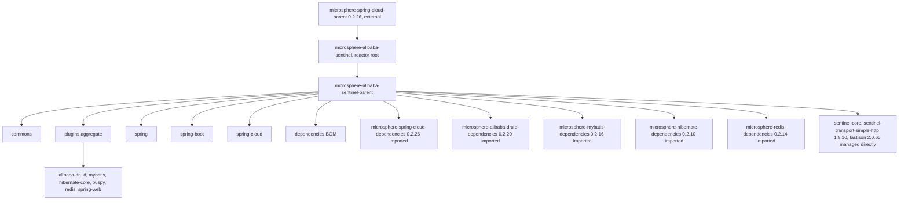
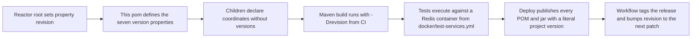
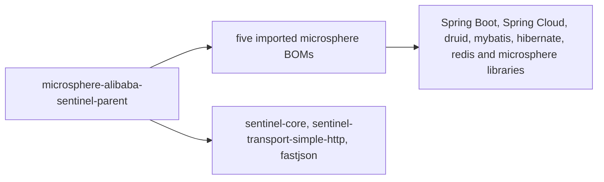

# microsphere-alibaba-sentinel-parent — 开发者指南

[English](../microsphere-alibaba-sentinel-parent.md)

## 目的与范围

`microsphere-alibaba-sentinel-parent` 是一个纯 POM 模块：`<packaging>pom</packaging>`，没有 `src`
目录，没有 `<build>`，没有 `<modules>`，也没有 `<dependencies>` 元素。它只持有属性与一个
`<dependencyManagement>` 块，并且是其余十二个 POM 的 Maven 父级 — commons、插件聚合模块、
六个插件模块、spring、spring-boot、spring-cloud 以及 BOM。它的职责是版本仲裁：子模块只声明坐标，
版本一律来自这里，或来自在这里导入的某个 BOM。

## 架构

两种角色被拆分开来：reactor 根 `microsphere-alibaba-sentinel` 聚合这七个模块，同时是本 POM 的
父级；而本 POM 是每个构件模块所继承的父 POM。六个插件叶子模块跳过插件聚合模块，直接从这里继承。

## 源码分析

### 属性

| 属性 | 取值 | 被谁消费 |
|---|---|---|
| `microsphere-spring-cloud.version` | 0.2.26 | `microsphere-spring-cloud-dependencies` 的 BOM 导入 |
| `microsphere-alibaba-druid.version` | 0.2.20 | `microsphere-alibaba-druid-dependencies` 的 BOM 导入 |
| `microsphere-mybatis.version` | 0.2.16 | `microsphere-mybatis-dependencies` 的 BOM 导入 |
| `microsphere-hibernate.version` | 0.2.10 | `microsphere-hibernate-dependencies` 的 BOM 导入 |
| `microsphere-redis.version` | 0.2.14 | `microsphere-redis-dependencies` 的 BOM 导入 |
| `sentinel.version` | 1.8.10 | `sentinel-core` 与 `sentinel-transport-simple-http` |
| `fastjson.version` | 2.0.65 | `com.alibaba:fastjson` |

`revision` 与 `java.version` **不**在此声明：reactor 根把 `revision` 设为
`0.2.6-SNAPSHOT`、`java.version` 设为 17，而分支 README 记录 0.2.5 为该线最近发布的
版本。每个模块都声明 `<version>${revision}</version>`。

### dependencyManagement 结构分析

五条带 `<type>pom</type>` 与 `<scope>import</scope>` 的导入，按声明顺序为 spring-cloud、
alibaba-druid、mybatis、hibernate、redis。导入顺序是有意义的 — Maven 对某个坐标保留它管理到的
第一个版本，因此排在最前的 `microsphere-spring-cloud-dependencies` 对它也管理的任何坐标拥有最终
决定权，例如 Spring Boot 与 Spring Framework 的构件。

随后是三条直接受管条目：`sentinel-core`、`sentinel-transport-simple-http` 与 `fastjson`。
`sentinel-core` 由 commons 声明，并被几乎所有模块标记为 optional；
`sentinel-transport-simple-http` 只由 commons 声明；而 `fastjson`
在快照中没有任何模块声明 — 它的存在纯粹是为了固定 Sentinel 自带传输所引入的版本。这里没有
`<repositories>`、`<distributionManagement>` 或 `<pluginManagement>`；那些内容，加上工作流所激活的
`test`、`coverage`、`publish`、`ci` 以及 `spring-cloud-2022` … `spring-cloud-2025`
配置环境，都来自外部的 `microsphere-spring-cloud-parent`。

### 子模块继承契约

全部十二个子模块都重复同一段 `<parent>`：`microsphere-alibaba-sentinel-parent`、
`<version>${revision}</version>`，以及一条指回本目录的显式 `<relativePath>`，正是它让 reactor
构建无需先安装父 POM。

## 设计模式

| 模式 | 实现 |
|---|---|
| Bill of Materials | 带五条 `scope import` 条目与三条直接固定的 `<dependencyManagement>` |
| 父 POM / 模板 POM | 子模块中只声明坐标的依赖写法 |
| 属性间接层 | 七个 `*.version` 属性把“用哪个版本”与“用哪个 BOM”两个决策分离开 |
| 聚合与继承分离 | reactor 根负责聚合；本 POM 负责向子模块继承；插件聚合模块不贡献任何版本 |

## 核心流程

### 构建与发布流程

发布工作流在 `deploy` 时传入 `-Drevision=<major.minor.patch>`，并带上 `publish` 与 `ci`
配置环境；构建工作流使用一次性的 `0.0.1-SNAPSHOT`。`${revision}` 在项目版本处被解析，但上面七个属性在部署的
POM 中仍保留为占位符，因此必须把整条父级链都发布出去，使用者才能解析到那些导入的 BOM。

## 依赖

本 POM 不声明依赖；它只管理依赖。

| 受管坐标 | 声明版本 | 类型 |
|---|---|---|
| `io.github.microsphere-projects:microsphere-spring-cloud-dependencies` | `${microsphere-spring-cloud.version}` = 0.2.26 | BOM 导入 |
| `io.github.microsphere-projects:microsphere-alibaba-druid-dependencies` | `${microsphere-alibaba-druid.version}` = 0.2.20 | BOM 导入 |
| `io.github.microsphere-projects:microsphere-mybatis-dependencies` | `${microsphere-mybatis.version}` = 0.2.16 | BOM 导入 |
| `io.github.microsphere-projects:microsphere-hibernate-dependencies` | `${microsphere-hibernate.version}` = 0.2.10 | BOM 导入 |
| `io.github.microsphere-projects:microsphere-redis-dependencies` | `${microsphere-redis.version}` = 0.2.14 | BOM 导入 |
| `com.alibaba.csp:sentinel-core` | `${sentinel.version}` = 1.8.10 | 直接固定 |
| `com.alibaba.csp:sentinel-transport-simple-http` | `${sentinel.version}` = 1.8.10 | 直接固定 |
| `com.alibaba:fastjson` | `${fastjson.version}` = 2.0.65 | 直接固定 |

## 扩展点

| 变更 | 修改位置 |
|---|---|
| 升级 Sentinel 本身 | 此处的 `sentinel.version`；两个 Sentinel 构件共享该属性，因此同步移动 |
| 升级某个 Microsphere 家族 | 此处对应的 `microsphere-*.version` 属性；绝不在子 pom 中添加 `<version>` |
| 新增一个第三方固定项 | 在 `<dependencyManagement>` 内追加一条 `<dependency>`，并配一个新的 `*.version` 属性 |
| 暴露新的项目构件 | 加入 [./microsphere-alibaba-sentinel-dependencies.md](./microsphere-alibaba-sentinel-dependencies.md)，它继承自本 POM |
| 修改 Java 基线 | reactor 根中的 `java.version`，并与 `.github/workflows/maven-build.yml` 中的 CI 矩阵保持一致 |
| 覆盖某个版本 | 在仓库内部，编辑此处的属性，因为子模块从不固定版本。在使用方构建中，属性不会跨越构件边界：请在导入本项目 BOM **之前**声明你自己的带显式版本的 `<dependencyManagement>` 条目，因为第一个受管声明会生效 |

## 相关模块

- 开发者指南索引：[./README.md](./README.md)
- 项目构件 BOM：[./microsphere-alibaba-sentinel-dependencies.md](./microsphere-alibaba-sentinel-dependencies.md)
- 继承本 POM 的模块：[./microsphere-alibaba-sentinel-commons.md](./microsphere-alibaba-sentinel-commons.md)、[./microsphere-alibaba-sentinel-plugins.md](./microsphere-alibaba-sentinel-plugins.md)、[./microsphere-alibaba-sentinel-spring.md](./microsphere-alibaba-sentinel-spring.md)、[./microsphere-alibaba-sentinel-spring-boot.md](./microsphere-alibaba-sentinel-spring-boot.md)、[./microsphere-alibaba-sentinel-spring-cloud.md](./microsphere-alibaba-sentinel-spring-cloud.md)
- 面向用户的文档：[../../user-guide/current/zh/microsphere-alibaba-sentinel-parent.md](../../../user-guide/current/zh/microsphere-alibaba-sentinel-parent.md)

---

## English

[English 版本](../microsphere-alibaba-sentinel-parent.md)
