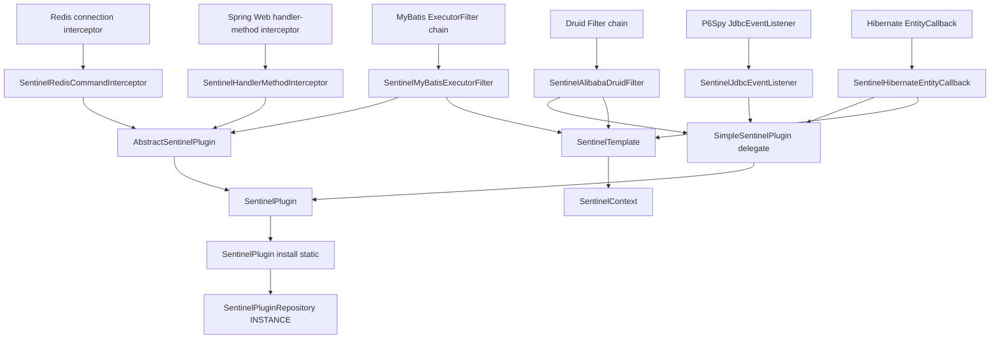
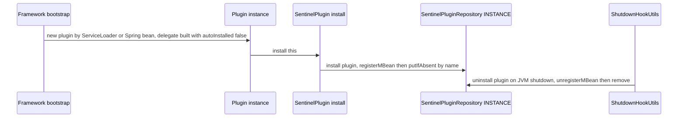
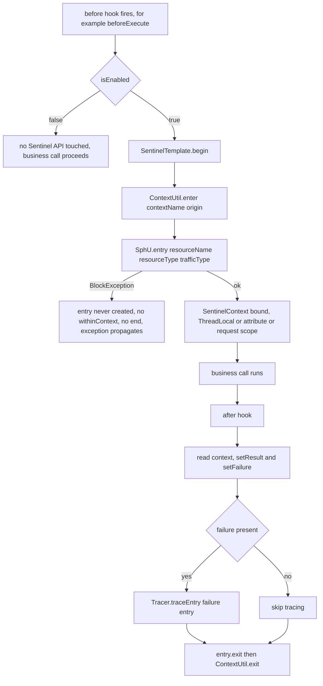
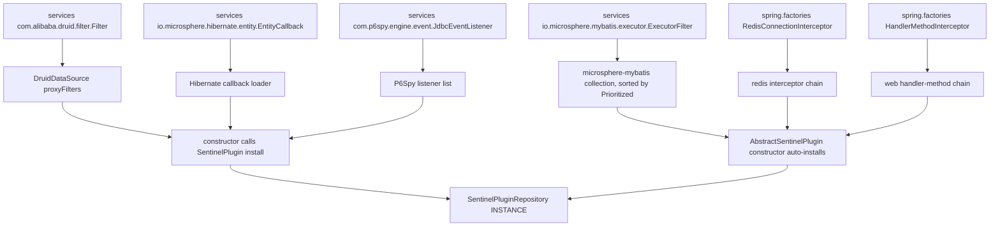
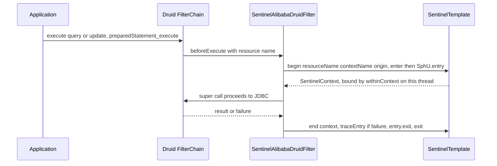
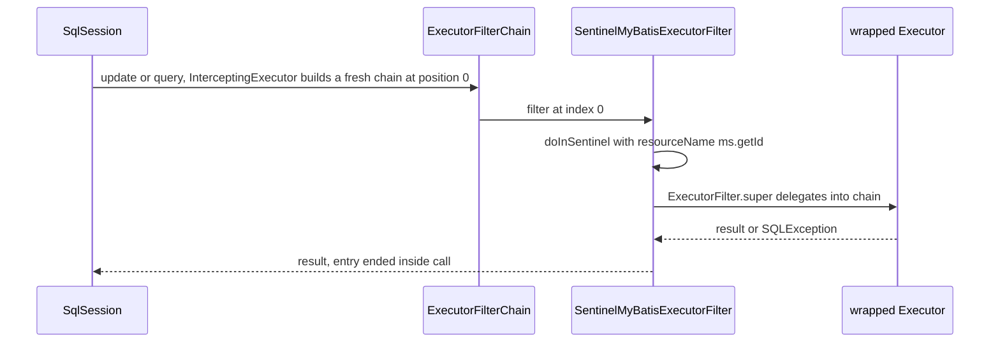
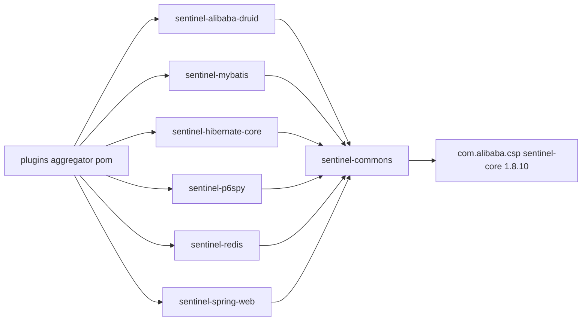

# microsphere-alibaba-sentinel-plugins — 开发者指南

[English](../microsphere-alibaba-sentinel-plugins.md)

## 目的与范围

`microsphere-alibaba-sentinel-plugins` 是一个 `pom` 聚合器（`microsphere-alibaba-sentinel-plugins/pom.xml`），它构建了六个集成模块，
这些模块把框架扩展点转化为受 Sentinel 守卫的资源：

| 子模块 artifactId | 实现的扩展接口 | 插件名 | `resourceType` | Origin（来源） |
| --- | --- | --- | --- | --- |
| `microsphere-alibaba-sentinel-alibaba-druid` | `io.microsphere.alibaba.druid.filter.AbstractStatementFilter` + `SentinelPlugin` | `alibaba-druid` | `COMMON_DB_SQL` | `Filter` |
| `microsphere-alibaba-sentinel-mybatis` | `io.microsphere.mybatis.executor.ExecutorFilter` | `mybatis` | `COMMON_DB_SQL` | `Executor` |
| `microsphere-alibaba-sentinel-hibernate-core` | `io.microsphere.hibernate.entity.EntityCallback` + `SentinelPlugin` | `hibernate` | `COMMON_DB_SQL` | `SessionFactory` |
| `microsphere-alibaba-sentinel-p6spy` | `com.p6spy.engine.event.SimpleJdbcEventListener` + `SentinelPlugin` | `p6spy` | `COMMON_DB_SQL` | `Statement` |
| `microsphere-alibaba-sentinel-redis` | `io.microsphere.redis.spring.interceptor.RedisConnectionInterceptor` | `redis` | `COMMON`（默认） | `RedisConnection` |
| `microsphere-alibaba-sentinel-spring-web` | `io.microsphere.spring.web.method.support.HandlerMethodInterceptor` | `spring-web` | `COMMON_WEB` | `HandlerMethod` |

每个子模块都以非 optional 方式依赖 `microsphere-alibaba-sentinel-commons`，并以 `optional` 方式依赖 `sentinel-core` 1.8.10
以及各自的框架 jar。版本事实：`0.2.x` 系列（已发布 `0.2.0`–`0.2.5`，`revision` = `0.2.6-SNAPSHOT`），Java 17，Spring Boot 3.x
搭配 Spring Cloud 2022–2025；版本对照表在[用户指南](../../../user-guide/current/zh/microsphere-alibaba-sentinel-plugins.md)中。
关于它们编译时所依赖的抽象，请阅读 [microsphere-alibaba-sentinel-commons.md](./microsphere-alibaba-sentinel-commons.md)。

## 架构

每个插件类型都基于 `SentinelTemplate`/`SentinelContext` 构建其守卫调用。这种划分是有意为之：必须继承框架基类的适配器
（`FilterAdapter`、`SimpleJdbcEventListener`、Hibernate 回调宿主类型）无法同时继承 `AbstractSentinelPlugin`，
因此它们以 `autoInstalled = false` 构建的 `SimpleSentinelPlugin` 委托为基础实现 `SentinelPlugin`，并在构造器最后调用
`SentinelPlugin.install(this)`；父类空闲的插件则继承 `AbstractSentinelPlugin`，从而继承"构造即自动安装"。

## 源码分析

### SentinelAlibabaDruidFilter (`.../alibaba/druid/SentinelAlibabaDruidFilter.java`)

继承 `AbstractStatementFilter`（microsphere-alibaba-druid-core，本身是 Druid 的 `FilterAdapter`），并通过委托实现
`SentinelPlugin`：构造器先构建 `new SimpleSentinelPlugin(PLUGIN_NAME, contextName, origin, COMMON_DB_SQL, IN, false)`
以及 `SentinelTemplate(getResourceType(), getTrafficType())`，然后 `install(this)` —— 注册表里登记的是 filter 实例本身，
因此 JMX 暴露的 `setEnabled` 直接作用于活动中的 filter。`beforeExecute(StatementProxy, String resourceName)`
调用 `begin(...)` 然后 `context.withinContext()`；`afterExecute(StatementProxy, String, Object, Throwable)` 执行
`doInContext(context -> { setResult; setFailure; end; }, true)`；八个 `SentinelPlugin` 成员全都是一行的委托。
SQL 资源命名细节见 [Druid 指南](./microsphere-alibaba-sentinel-alibaba-druid.md)。

### SentinelMyBatisExecutorFilter (`.../mybatis/executor/SentinelMyBatisExecutorFilter.java`)

通过 `super(PLUGIN_NAME, contextName, origin, COMMON_DB_SQL)` 继承 `AbstractSentinelPlugin`，因此 `EntryType.IN` 且
`autoInstalled = true` —— 仅构造动作就完成插件注册并挂上卸载钩子。只覆盖了三个 `ExecutorFilter` 方法 ——
`int update(MappedStatement, Object, ExecutorFilterChain)` 和两个 `<E> List<E> query(MappedStatement, ..., ExecutorFilterChain)`
重载 —— 每个都委托给 `doInSentinel(ms, () -> ExecutorFilter.super.<method>(...))`，即一次性形态
`sentinelOperations.call(resourceName, getContextName(), getOrigin(), context -> callable.call(), SQLException.class)`，
于是 `Tracer.trace` 覆盖 MyBatis 异常，且 `end(...)` 在 `finally` 中执行。`getSentinelResourceName(ms)` 返回 `ms.getId()`：
每个 mapped statement 对应一个资源。其余默认方法（`queryCursor`、`commit`、`rollback`、`createCacheKey`、`deferLoad`、
`getTransaction`、`close`）不受守卫地透传；`getPriority()` 未被覆盖，因此 `NORMAL_PRIORITY = 0` 决定了该 filter 在
`InterceptingExecutorInterceptor` 构建的链中的位置；禁用路径会先用 `ExceptionUtils.throwTarget(e, SQLException.class)`
重新包装，然后直接调用 callable。

### SentinelHibernateEntityCallback (`.../hibernate/entity/SentinelHibernateEntityCallback.java`)

以委托模式实现 `EntityCallback, SentinelPlugin`（`COMMON_DB_SQL`、`IN`、`autoInstalled = false`，随后 `install(this)`）。
八个钩子两两配对：`onPreInsert/onPostInsert`、`onPreUpdate/onPostUpdate`、`onPreLoad/onPostLoad`、`onPreDelete/onPostDelete`。
`begin(Object entity, String action)` 返回 `Optional<SentinelContext>`，并把 `sentinelOperations.begin` 包在
`ThrowableSupplier.execute(...)` 中，因此前置钩子里的 `BlockException` 无法中断 Hibernate 的操作链；后置钩子调用 `end()` →
`doInContext(this.sentinelOperations::end, true)`。资源名是
`"Entity:" + action + ":" + entity.getClass().getName()`（`getSentinelResourceName(Object, String)`），所以规则按实体类、
按动作划分；又因为后置钩子收不到 throwable，`failure` 始终保持 `null`。注册方式是
`META-INF/services/io.microsphere.hibernate.entity.EntityCallback`，由 `SentinelHibernateEntityCallbackTest` 及其
`...DisabledTest` 对应测试覆盖，后者使用测试专用的 `persistence.xml`。

### SentinelJdbcEventListener (`.../p6spy/SentinelJdbcEventListener.java`)

继承 `SimpleJdbcEventListener` 并通过委托实现 `SentinelPlugin`。`onBeforeAnyExecute(StatementInformation)` 用
`if (isEnabled() && isEligibleStatement(info))` 做守卫，然后 `execute(() -> { begin(...); context.withinContext(); })`，
通过 `ThrowableAction.execute` 吞掉受检异常。`isEligibleStatement` 只接受 `PreparedStatementInformation`，因此普通
`Statement` 流量不被统计，而 `getResourceName` 直接返回原始 `statementInformation.getSql()`。
`onAfterAnyExecute(..., long timeElapsedNanos, SQLException e)` 在 `end` 之前只设置 failure；耗时被忽略，因为
Sentinel 的 RT 统计来自 `entry.exit` 而非 P6Spy。与其他委托型插件不同，它的 `getResourceType()` 直接返回
`COMMON_DB_SQL`、`getTrafficType()` 直接返回 `IN`，而不是读取委托对象 —— 目前二者一致，但这是一个易变点。注册方式：
`META-INF/services/com.p6spy.engine.event.JdbcEventListener`，测试中由 `src/test/resources/spy.properties` 启用驱动。

### SentinelRedisCommandInterceptor (`.../redis/spring/SentinelRedisCommandInterceptor.java`)

以三参数形态继承 `AbstractSentinelPlugin`（`resourceType = COMMON`、`trafficType = IN`），实现
`RedisConnectionInterceptor`、`InitializingBean` 和 `BeanClassLoaderAware`，且 `getOrder()` 返回
`SentinelConstants.DEFAULT_PRIORITY`（9）。上下文传递**不**使用 `SentinelContext.withinContext()`：
`beforeExecute(RedisMethodContext)` 开启 entry，并通过 `setContext(redisMethodContext, context)` 以
`SENTINEL_CONTEXT_ATTRIBUTE_NAME = "sentinel-context"` 存放；`afterExecute(...)` 用 `getSentinelContext(...)` 读回，
设置 result/failure 后调用 `end` —— 从而避免 ThreadLocal 在异步 Reactor 命令路径上泄漏。资源名在
`afterPropertiesSet()` → `initMethodResourceNamesCache()` 中预先计算，该方法遍历
`ClassUtils.getAllInterfacesForClass(RedisClusterConnection.class, classLoader)` 并存储
`SentinelUtils.buildResourceName(method)`（例如 `StringRedisConnection.get(String)`）；查得 `null` 意味着"不是 Redis 连接方法"，
拦截器直接返回而不进入 Sentinel。发现机制：`META-INF/spring.factories` 中
`io.microsphere.redis.spring.interceptor.RedisConnectionInterceptor` 键下。

### SentinelHandlerMethodInterceptor (`.../spring/web/SentinelHandlerMethodInterceptor.java`)

以 `COMMON_WEB` 继承 `AbstractSentinelPlugin`，实现 `HandlerMethodInterceptor`、`ApplicationListener<WebEndpointMappingsReadyEvent>`
和 `Ordered`（可设置，默认 `DEFAULT_PRIORITY`），并发布为 `BEAN_NAME = "sentinelHandlerMethodInterceptor"`。收到 ready 事件时，
它从每个 endpoint 为 `HandlerMethod` 的 `WebEndpointMapping` 重建 `methodResourceNamesCache`，键使用
`webEndpointMapping.toExpression() + "#" + handlerMethod`。`beforeExecute` 用
`computeIfAbsent(method, m -> PLUGIN_NAME + ":" + handlerMethod)` 解析名称（这是针对快照中缺失的 handler method 的兜底），
开启 entry 并通过 `WebScope.REQUEST.setAttribute(request, SENTINEL_CONTEXT_ATTRIBUTE_NAME, context)` 把
`SentinelContext` 存入请求作用域；`afterExecute` 取回它，设置返回值与错误，然后调用 `end`。缺失上下文时以 trace 级别记录并跳过，
这保证了当请求从未到达 controller 时 `afterExecute` 依然安全。发现机制：`META-INF/spring.factories` 中
`io.microsphere.spring.web.method.support.HandlerMethodInterceptor` 键下，由 `@EnableWebExtension` 机制收集。

### 常量接口

每个模块暴露一个 `SentinelXxxConstants` 接口，包含 `PLUGIN_NAME`、`DEFAULT_CONTEXT_NAME`
（形如 `microsphere_sentinel_<plugin>_context`）、`DEFAULT_ORIGIN`，以及标注了
`@ConfigurationProperty(type = boolean.class, defaultValue = "true", ...)` 的
`ENABLED_PROPERTY_NAME = PROPERTY_NAME_PREFIX + PLUGIN_NAME + DOT + "enabled"`。只有 Redis 与 Spring Web 在
`SYSTEM_PROPERTIES_SOURCE` 之外还列出了 `APPLICATION_SOURCE`；JDBC 侧的常量只声明 `SYSTEM_PROPERTIES_SOURCE`，
与 `SentinelUtils.isPluginEnabled` 读取 JVM 系统属性的事实相符。各 `*ConstantsTest` 固定这些取值，并断言派生出的名称。

## 设计模式

| 模式 | 实现类 | 源码依据 |
| --- | --- | --- |
| 适配器 | `SentinelAlibabaDruidFilter`（Druid `FilterAdapter`）、`SentinelJdbcEventListener`（`SimpleJdbcEventListener`）、`SentinelMyBatisExecutorFilter`（`ExecutorFilter`）、`SentinelHibernateEntityCallback`（`EntityCallback`）、`SentinelRedisCommandInterceptor`、`SentinelHandlerMethodInterceptor` | 框架回调变成 Sentinel entry |
| 委托 | `SentinelAlibabaDruidFilter`、`SentinelJdbcEventListener`、`SentinelHibernateEntityCallback` 持有 `private final SentinelPlugin delegate` | 身份 getter 转发给 `SimpleSentinelPlugin` |
| 模板方法 | `AbstractStatementFilter.beforeExecute`/`afterExecute`、`SentinelMyBatisExecutorFilter.doInSentinel`、`SentinelHibernateEntityCallback.begin`/`end` | 固定骨架、可变主体 |
| 责任链 | `com.alibaba.druid.filter.FilterChain`、`io.microsphere.mybatis.executor.ExecutorFilterChain` | `chain.update(ms, parameter)` 继续链条 |
| 门面 | 六个插件共用的 `SentinelOperations`/`SentinelTemplate` | 隐藏 `SphU`、`Tracer`、`ContextUtil` |
| 注册表、单例 | `SentinelPlugin.install(this)` → `SentinelPluginRepository.INSTANCE` | 每个插件名只注册一次 |
| SPI、ServiceLoader | 上文所有 `META-INF/services` 与 `META-INF/spring.factories` 文件 | 无需显式 `new` |
| 观察者 | 作为 `ApplicationListener<WebEndpointMappingsReadyEvent>` 的 `SentinelHandlerMethodInterceptor`、commons 中的 `SentinelNodeEventPublisher` | 事件驱动的缓存构建 |

## 核心流程

### 插件安装与卸载生命周期

对于 `AbstractSentinelPlugin` 的子类，委托这一步消失了：父类构造器从系统属性读取 `isEnabled()`，并在 `autoInstalled` 为 `true`
时调用 `install(this)`。

### 带限流抛出路径的两阶段守卫

MyBatis 插件把步骤 `A`–`P` 换成了上文描述的一次性 `call(...)` 重载。

### 插件提供者的 SPI 加载

commons 层的 SPI 组合，即 `SentinelPluginRepository` 和 `com.alibaba.csp.sentinel.init.InitFunc`，每个 JVM 只解析一次。

### Druid 过滤器链流程

### MyBatis ExecutorFilter 链流程

## 依赖关系

| 依赖 | 声明位置 | 作用域 |
| --- | --- | --- |
| `microsphere-alibaba-sentinel-commons` | 六个子模块全部 | compile |
| `microsphere-annotation-processor` | 六个子模块全部 | compile, `optional` |
| `com.alibaba.csp:sentinel-core` | 六个子模块全部 | compile, `optional` |
| `microsphere-alibaba-druid-core`、`com.alibaba:druid` | druid 子模块 | compile, `optional` |
| `microsphere-mybatis-core`、`org.mybatis:mybatis` | mybatis 子模块 | compile, `optional` |
| `microsphere-hibernate-core`、`hibernate-core` | hibernate 子模块 | compile, `optional` |
| `p6spy` | p6spy 子模块 | compile, `optional` |
| `microsphere-redis-spring`、`microsphere-spring-context`、`spring-data-redis` | redis 子模块 | compile, `optional` |
| `microsphere-spring-web`、`spring-webmvc` | spring-web 子模块 | compile, `optional` |
| `jakarta.servlet-api` | spring-web 子模块 | `provided` |
| `junit-jupiter`、`mockito-core`、`h2`、`microsphere-*-test`、`logback-classic` | 按需引入的子模块 | test |

版本来自 `microsphere-alibaba-sentinel-parent`：`sentinel.version` 1.8.10、`microsphere-alibaba-druid.version` 0.2.20、
`microsphere-mybatis.version` 0.2.16、`microsphere-hibernate.version` 0.2.10、`microsphere-redis.version` 0.2.14，加上被
import 的 `microsphere-spring-cloud-dependencies` 0.2.26 BOM。

## 扩展点

要新增第七个插件：

1. 在 `microsphere-alibaba-sentinel-plugins/` 下创建子模块，在聚合器 `pom.xml` 中加入其 `<module>` 条目，
   并在 `microsphere-alibaba-sentinel-dependencies/pom.xml` 中加入其构件，继承 `microsphere-alibaba-sentinel-parent`。
2. 把 `commons` 声明为 compile，把框架 jar 与 `sentinel-core` 声明为 `optional` —— 绝不要把框架版本强加给用户 ——
   并添加带 `*ConstantsTest` 的 `Sentinel<Framework>Constants`（`PLUGIN_NAME`、形如
   `microsphere_sentinel_<plugin>_context` 的 `DEFAULT_CONTEXT_NAME`、`DEFAULT_ORIGIN`、`ENABLED_PROPERTY_NAME`）。
3. 选定身份路径：当该类没有其他父类时继承 `AbstractSentinelPlugin`；否则以 `autoInstalled = false` 的
   `SimpleSentinelPlugin` 委托为基础实现 `SentinelPlugin`，并在构造器最后调用 `SentinelPlugin.install(this)`。
4. 为该流量挑选一个 `ResourceTypeConstants`（`COMMON_DB_SQL`、`COMMON_WEB`，其余用 `COMMON`），并构建
   `new SentinelTemplate(getResourceType(), getTrafficType())`。
5. 单一包装点优先使用一次性 `call(resourceName, contextName, origin, callback, DeclaredException.class)`；
   前置/后置成对的场景使用 `begin`/`end` 配合 `withinContext()` 与 `doInContext(consumer, true)`；
   当两个钩子可能运行在不同线程时，使用显式的 attribute/请求作用域槽位（Redis、Spring Web）。
6. 两个钩子都要用 `isEnabled()` 守卫，使 `-Dmicrosphere.sentinel.<plugin>.enabled=false` 退化为透传；注册 provider
   文件或 `spring.factories` 条目；保持资源名稳定，因为它们是 Sentinel 规则的键；并在测试中驱动真实的框架路径，
   就像现有模块使用 H2 以及 `AbstractAlibabaDruidTest` / `AbstractMapperTest` 那样。

## 相关模块

- 索引：[开发者指南 README](./README.md)
- 核心抽象：[microsphere-alibaba-sentinel-commons](./microsphere-alibaba-sentinel-commons.md)
- JDBC 插件：[microsphere-alibaba-sentinel-alibaba-druid](./microsphere-alibaba-sentinel-alibaba-druid.md)、
  [microsphere-alibaba-sentinel-mybatis](./microsphere-alibaba-sentinel-mybatis.md)
- 自动配置：`microsphere-alibaba-sentinel-spring-boot`（`SentinelAlibabaDruidAutoConfiguration`、
  `SentinelMyBatisAutoConfiguration`、`SentinelRedisAutoConfiguration`、`SentinelSpringWebAutoConfiguration`，
  受 `@ConditionalOnSentinelEnabled` / `@ConditionalOnSentinelAvailable` 门控）
- 面向用户的配置：[用户指南](../../../user-guide/current/zh/microsphere-alibaba-sentinel-plugins.md)

---

## English

[English 版本](../microsphere-alibaba-sentinel-plugins.md)
