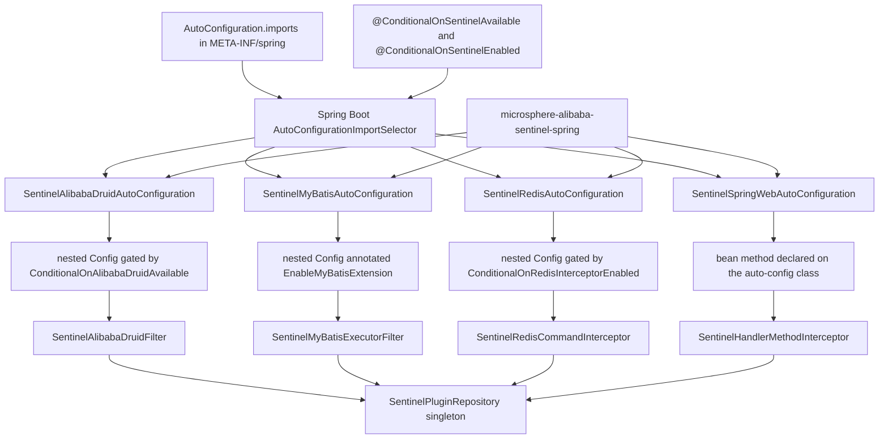
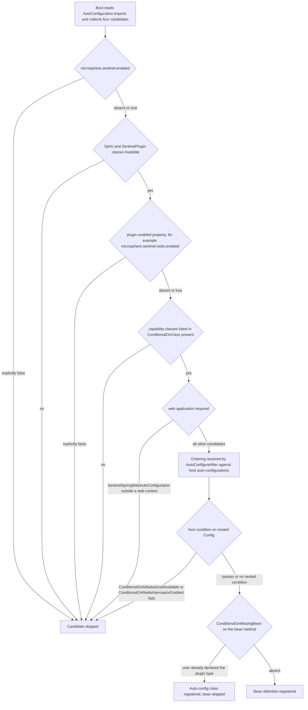
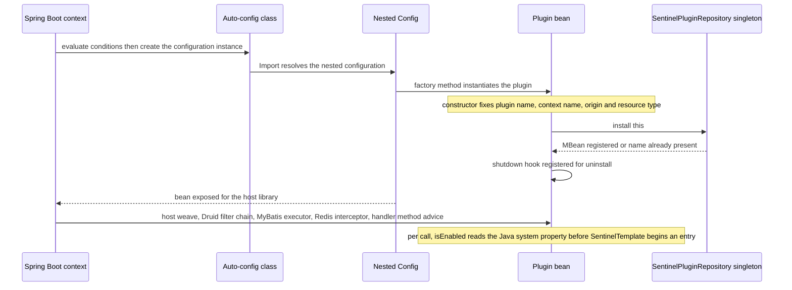
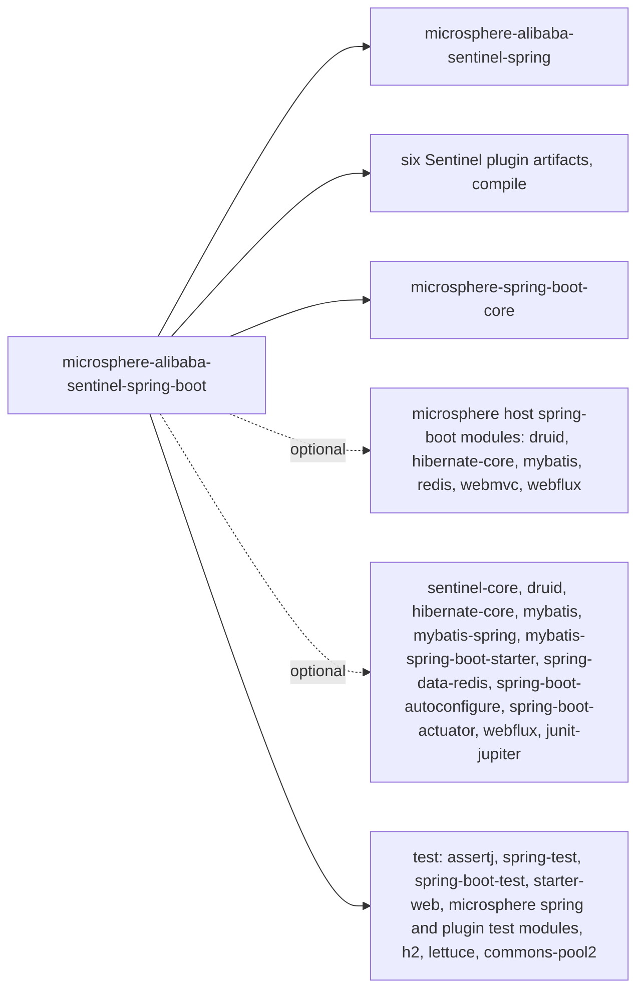

# microsphere-alibaba-sentinel-spring-boot — 开发者指南

[English](../microsphere-alibaba-sentinel-spring-boot.md)

## 目的与范围

`microsphere-alibaba-sentinel-spring-boot` 把 Sentinel 插件转化为 Spring Boot 自动配置。它恰好拥有
六个 Java 类型和一个注册文件：

| 类型 | 职责 |
|---|---|
| `SentinelAlibabaDruidAutoConfiguration` | 发布 `SentinelAlibabaDruidFilter` |
| `SentinelMyBatisAutoConfiguration` | 发布 `SentinelMyBatisExecutorFilter` 并启用 MyBatis 扩展机制 |
| `SentinelRedisAutoConfiguration` | 发布 `SentinelRedisCommandInterceptor` |
| `SentinelSpringWebAutoConfiguration` | 在 Web 应用中发布 `SentinelHandlerMethodInterceptor` |
| `@ConditionalOnSentinelEnabled` | 基于 `@ConditionalOnProperty` 的组合注解 |
| `@ConditionalOnSentinelAvailable` | 基于 `@ConditionalOnSentinelEnabled` + `@ConditionalOnClass` 的组合注解 |
| `META-INF/spring/org.springframework.boot.autoconfigure.AutoConfiguration.imports` | 列出全部四个自动配置类 |

在扩展本模块之前值得了解的范围限制：本模块没有 Hibernate 自动配置，
没有 P6Spy 自动配置，没有 `@ConfigurationProperties` 类，没有 actuator 端点，也没有
`spring-configuration-metadata.json`。属性通过 commons 与各插件模块中定义的常量按名称消费。

## 架构



全部四种 bean 类型在构造时都会把自己注册进 commons 的插件仓库，这正是它们在
[./microsphere-alibaba-sentinel-spring-cloud.md](./microsphere-alibaba-sentinel-spring-cloud.md) 中记录的
Spring Cloud 特性报告里可见的原因。

## 源码分析

### 包结构

```
io.microsphere.alibaba.sentinel.spring.boot.autoconfigure   four auto-config classes
io.microsphere.alibaba.sentinel.spring.boot.condition       two composite condition annotations
META-INF/spring/org.springframework.boot.autoconfigure.AutoConfiguration.imports
```

### 条件注解

`ConditionalOnSentinelEnabled` 是一个 `@Target({TYPE, METHOD})` 注解，被元注解
`@ConditionalOnProperty(name = ENABLED_PROPERTY_NAME, matchIfMissing = true)` 修饰，其中常量来自
`SentinelConstants`，等于 `microsphere.sentinel.enabled`。

`ConditionalOnSentinelAvailable` 叠加了 `@ConditionalOnSentinelEnabled` 与
`@ConditionalOnClass(name = {"com.alibaba.csp.sentinel.SphU", "io.microsphere.alibaba.sentinel.common.SentinelPlugin"})`。

两者都是 **Spring Boot 条件的元注解组合**，而不是
`org.springframework.context.annotation.Condition` 的子类；本模块没有声明任何自定义 `Condition`
实现。它们的 Javadoc 表达了相同的契约，测试也印证了这一点：用 `FilteredClassLoader` 过滤掉
`SphU` 或 `SentinelPlugin`，所有自动配置的 bean 都会消失。

存在两个容易混淆的独立开关：

1. 条件求值时刻 — `@ConditionalOnProperty` 读取 Spring `Environment`，因此它决定
   一个 bean 定义是否被注册。
2. 调用时刻 — `SentinelUtils.isPluginEnabled(pluginName)` 读取 **Java 系统属性**
   `microsphere.sentinel.<plugin>.enabled`，除非取值恰好是字面量字符串 `false`，否则默认为启用。
   这是插件在每次被拦截的调用上所做的检查。

### 自动配置结构分析

每个自动配置类都遵循同一模板：

- 受 `@ConditionalOnSentinelAvailable` 门控；
- 受 `@ConditionalOnProperty(name = <plugin ENABLED_PROPERTY_NAME>, matchIfMissing = true)` 门控；
- 受 `@ConditionalOnClass(name = ...)` 门控，列出宿主库类与插件类，且始终以类名形式声明，
  这样类型缺失时绝不会触发 `NoClassDefFoundError`；
- 用 `@AutoConfigureAfter(name = ...)` 排序 — 四个类都把
  `com.alibaba.cloud.sentinel.custom.SentinelAutoConfiguration` 放在第一位，以保证 Spring Cloud Alibaba
  Sentinel 的 bean 先于我们的存在，其后是各 Microsphere 宿主自动配置；
- 通过 `@Import` 引入一个静态嵌套 `Config` 类，Web 那个除外。

所有 bean 工厂方法都是 `@Bean @ConditionalOnMissingBean` 且不带参数：

| 自动配置 | Bean 方法 | 实例化的类型 | 宿主侧织入的负责方 |
|---|---|---|---|
| `SentinelAlibabaDruidAutoConfiguration` | `sentinelAlibabaDruidFilter()` | `SentinelAlibabaDruidFilter`，一个基于 `AbstractStatementFilter` 构建的 Druid statement filter | `microsphere-alibaba-druid-spring-boot` 的 Druid 自动配置，此处由 `@ConditionalOnAlibabaDruidAvailable` 门控 |
| `SentinelMyBatisAutoConfiguration` | `sentinelMyBatisExecutorFilter()` | `SentinelMyBatisExecutorFilter implements ExecutorFilter` | 来自 `microsphere-mybatis-spring` 的 `@EnableMyBatisExtension` |
| `SentinelRedisAutoConfiguration` | `sentinelRedisCommandInterceptor()` | `SentinelRedisCommandInterceptor implements RedisConnectionInterceptor` | `microsphere-redis-spring-boot` 拦截器链 |
| `SentinelSpringWebAutoConfiguration` | `sentinelHandlerMethodInterceptor()` | `SentinelHandlerMethodInterceptor implements HandlerMethodInterceptor` | Microsphere WebMVC / WebFlux 自动配置 |

没有任何工厂方法显式“安装”了什么。安装发生在插件构造器内部：当
`autoInstalled` 为 true 时，`AbstractSentinelPlugin` 会调用 `SentinelPlugin.install(this)`，
MyBatis、Redis 与 Spring Web 都属于这种情况；`SentinelAlibabaDruidFilter`
则组合了一个 `autoInstalled = false` 的 `SimpleSentinelPlugin` 代理，并自行调用
`install(this)`。`SentinelPlugin.install` 会写入
`SentinelPluginRepository.INSTANCE`，并注册一个用于卸载插件的 JVM 关闭钩子。

### 刻意缺失的部分

- **Hibernate。** `SentinelHibernateEntityCallback` 实现了 Microsphere Hibernate 的
  `EntityCallback` SPI，并由 `microsphere-alibaba-sentinel-hibernate-core` 内自带的服务文件
  `META-INF/services/io.microsphere.hibernate.entity.EntityCallback` 注册。该 SPI 由
  `microsphere-hibernate-core` 这一可选依赖消费，因此不涉及 Spring bean，也就不涉及
  自动配置；本模块仍以 compile 作用域依赖
  `microsphere-alibaba-sentinel-hibernate-core`，这把该服务文件放到了每个 Boot 使用者的
  classpath 上。
- **P6Spy。** `microsphere-alibaba-sentinel-p6spy` 既不是本模块的依赖，也没有被任何条件引用；它通过
  `META-INF/services/com.p6spy.engine.event.JdbcEventListener` 接入，
  即 P6Spy 的 JDBC 代理机制，这不是 Spring 的概念。
- **`spring.factories`。** 本模块只通过 Boot 3 的 `AutoConfiguration.imports`
  文件注册自动配置；在整个 release 分支中搜索，遗留的 `spring.factories` 文件只出现在
  Redis 与 Spring Web 插件 jar 内部，且它们使用的是自定义 SPI 键
  （`io.microsphere.redis.spring.interceptor.RedisConnectionInterceptor`、
  `io.microsphere.spring.web.method.support.HandlerMethodInterceptor`），而不是
  `EnableAutoConfiguration` 键。

### 测试

`AutoConfigurationTest<A>` 是共享夹具。其构造器通过 `ResolvableType` 从泛型参数推导出自动配置类，
然后分别构建以 `AutoConfigurations.of(...)` 配置的 `ApplicationContextRunner` 与
`WebApplicationContextRunner`。每个子类都会运行三个继承而来的测试：
`testAutoConfiguredClasses`、`testOnGlobalDisabledProperty`
（始终包含 `microsphere.sentinel.enabled=false`）以及 `testOnGlobalMissingClass`（始终
包含 `SphU` 与 `SentinelPlugin`）。子类会补充插件专属的反向用例 — 例如
`SentinelRedisAutoConfigurationTest` 过滤 `RedisConnection` 并断言
`microsphere.redis.interceptor.enabled=false`；而 `SentinelSpringWebAutoConfigurationTest`
覆写了 `testAutoConfiguredClasses` 来断言相反的结果：普通上下文中没有 bean，而 Web 上下文中
同时存在自动配置类与拦截器。`SentinelAutoConfigurationTest` 是个例外：它是一个
`@SpringBootTest`，`webEnvironment = RANDOM_PORT`，启动 MyBatis 加 Redis 配置，
执行一次 mapper 调用和一次 `StringRedisTemplate` 往返，然后断言
`microsphere_sentinel_alibaba_druid_context`、`microsphere_sentinel_mybatis_context` 与
`microsphere_sentinel_redis_context` 这几个上下文可以被进入。它需要本地 Redis，
CI 中由 `docker/test-services.yml` 提供。

## 设计模式

| 模式 | 在本模块中的实现 |
|---|---|
| 自动配置 | 通过 `AutoConfiguration.imports` 注册四个类，并用 `@AutoConfigureAfter` 排序 |
| 条件 | 组合注解 `@ConditionalOnSentinelEnabled` 与 `@ConditionalOnSentinelAvailable`，由 Boot 的 `ConditionalOnProperty` 和 `ConditionalOnClass` 构成；宿主库另提供 `@ConditionalOnAlibabaDruidAvailable` 与 `@ConditionalOnRedisInterceptorEnabled`，而 `@ConditionalOnWebApplication` 门控 Web 候选项 |
| 以嵌套配置作为条件作用域 | 静态 `Config` 类把插件 bean 与外层类的排序条件隔离开来 — Druid 与 Redis 用它做门控，MyBatis 在其上标注 `@EnableMyBatisExtension`，Spring Web 则干脆不需要它，bean 方法直接写在自动配置类上 |
| 外观 | bean 工厂方法隐藏了插件构造细节 — 插件名、上下文名、origin、资源类型与流量类型全部固定在插件类内部 |
| 注册表 | 每个创建出的插件实例都注册进 commons 的 `SentinelPluginRepository` 单例，并带有关闭钩子用于卸载 |
| 模板方法 | `AbstractSentinelPlugin` 提供 `isEnabled`、`getName`、`getContextName` 与自动安装；插件的 `beforeExecute` / `afterExecute` 钩子委托给 commons 的 `SentinelTemplate` |

## 核心流程

### 条件评估



### 单个自动配置的启动时序



## 依赖



pom 中声明的直接依赖作用域：

| 分组 | 坐标 | 作用域 |
|---|---|---|
| 项目，必选 | `microsphere-alibaba-sentinel-spring`、`microsphere-alibaba-sentinel-alibaba-druid`、`microsphere-alibaba-sentinel-hibernate-core`、`microsphere-alibaba-sentinel-mybatis`、`microsphere-alibaba-sentinel-redis`、`microsphere-alibaba-sentinel-spring-web` | compile，版本 `${revision}` |
| 项目，必选 | `microsphere-spring-boot-core` | compile，版本来自导入的 BOM |
| 项目，可选 | `microsphere-alibaba-druid-spring-boot`、`microsphere-hibernate-core`、`microsphere-mybatis-spring-boot`、`microsphere-redis-spring-boot`、`microsphere-spring-boot-webmvc`、`microsphere-spring-boot-webflux` | compile，optional |
| 第三方，可选 | `sentinel-core`、`druid`、`hibernate-core`、`mybatis`、`mybatis-spring`、`mybatis-spring-boot-starter`、`spring-data-redis`、`spring-boot-autoconfigure`、`spring-boot-actuator`、`spring-boot-starter-webflux`、`junit-jupiter` | compile，optional |
| 测试 | `assertj-core`、`spring-test`、`spring-boot-test`、`spring-boot-starter-web`、`microsphere-spring-test`、`microsphere-alibaba-druid-spring-test`、`microsphere-hibernate-test`、`microsphere-mybatis-spring-test`、`microsphere-redis-spring-test`、`h2`、`lettuce-core`、`commons-pool2` | test |

`junit-jupiter` 被声明为 compile 作用域下的 `optional` 而非 `test`，这让 JUnit 5 留在
本模块自己的 classpath 上，并使下游项目可以无需指定版本即可编译它们的测试。

## 扩展点

| 属性 | 设为 `false` 时的效果 | 名称出处 |
|---|---|---|
| `microsphere.sentinel.enabled` | 本模块所有自动配置都被跳过 | `SentinelConstants.ENABLED_PROPERTY_NAME` |
| `microsphere.sentinel.alibaba-druid.enabled` | Druid 自动配置被跳过 | `SentinelAlibabaDruidConstants`，其 `PLUGIN_NAME` 为 `alibaba-druid` |
| `microsphere.sentinel.mybatis.enabled` | MyBatis 自动配置被跳过 | `SentinelMyBatisConstants`，其 `PLUGIN_NAME` 为 `mybatis` |
| `microsphere.sentinel.redis.enabled` | Redis 自动配置被跳过 | `SentinelRedisConstants`，其 `PLUGIN_NAME` 为 `redis` |
| `microsphere.sentinel.spring-web.enabled` | Spring Web 自动配置被跳过 | `SentinelSpringWebConstants`，其 `PLUGIN_NAME` 为 `spring-web` |
| `microsphere.sentinel.hibernate.enabled` | 不存在对应条件；只有实体回调中运行时的 `isEnabled` 检查会响应 | `SentinelHibernateConstants` |
| `microsphere.sentinel.p6spy.enabled` | 仅在 P6Spy 监听器内部做运行时检查 | `SentinelP6SpyConstants` |

测试观察到并且同样生效的宿主库开关：`microsphere.alibaba.druid.enabled`、
`microsphere.mybatis.enabled`、`microsphere.redis.enabled`、`microsphere.redis.interceptor.enabled`。

新增一个插件自动配置的步骤：

1. 把插件构件作为 `${revision}` compile 依赖加入，并把其宿主库标记为 `optional`。
2. 按上文描述的共享模板创建 `SentinelXxxAutoConfiguration`，复用
   `@ConditionalOnSentinelAvailable` 与插件的 `ENABLED_PROPERTY_NAME` 常量。
3. 把全限定类名追加到 `AutoConfiguration.imports`；在 Boot 3 下
   `spring.factories` 键会被忽略。
4. 继承 `AutoConfigurationTest<SentinelXxxAutoConfiguration>` 并实现三个
   `configure...` 钩子，以覆盖全局禁用属性与全局类缺失两种场景。
5. 要覆盖某个插件 bean，声明你自己的同类型 bean；`@ConditionalOnMissingBean`
   会让用户定义生效。

## 相关模块

- 开发者指南索引：[./README.md](./README.md)
- Spring classpath 基座：[./microsphere-alibaba-sentinel-spring.md](./microsphere-alibaba-sentinel-spring.md)
- 插件模型与仓库：[./microsphere-alibaba-sentinel-commons.md](./microsphere-alibaba-sentinel-commons.md)
- 在此接入的插件：[./microsphere-alibaba-sentinel-alibaba-druid.md](./microsphere-alibaba-sentinel-alibaba-druid.md)、[./microsphere-alibaba-sentinel-mybatis.md](./microsphere-alibaba-sentinel-mybatis.md)、[./microsphere-alibaba-sentinel-redis.md](./microsphere-alibaba-sentinel-redis.md)、[./microsphere-alibaba-sentinel-spring-web.md](./microsphere-alibaba-sentinel-spring-web.md)、[./microsphere-alibaba-sentinel-hibernate-core.md](./microsphere-alibaba-sentinel-hibernate-core.md)、[./microsphere-alibaba-sentinel-p6spy.md](./microsphere-alibaba-sentinel-p6spy.md)
- Spring Cloud 特性报告：[./microsphere-alibaba-sentinel-spring-cloud.md](./microsphere-alibaba-sentinel-spring-cloud.md)
- 版本管理：[./microsphere-alibaba-sentinel-parent.md](./microsphere-alibaba-sentinel-parent.md)
- 面向用户的文档：[../../user-guide/current/zh/microsphere-alibaba-sentinel-spring-boot.md](../../../user-guide/current/zh/microsphere-alibaba-sentinel-spring-boot.md)

---

## English

[English 版本](../microsphere-alibaba-sentinel-spring-boot.md)
