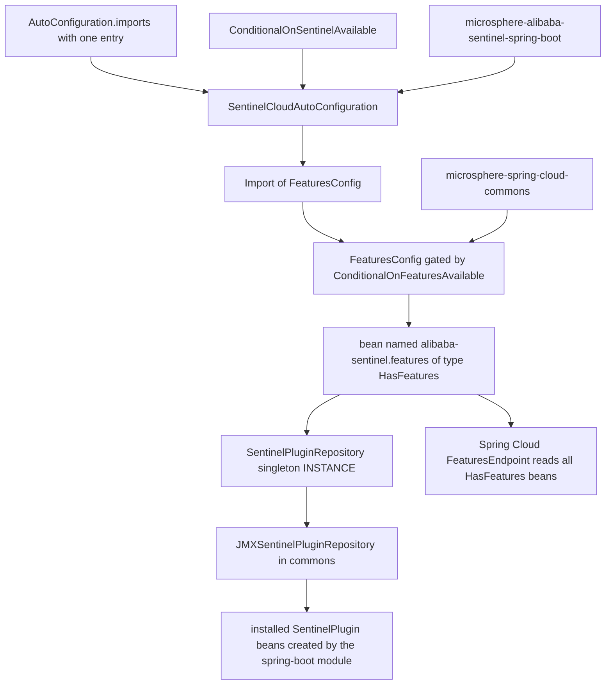
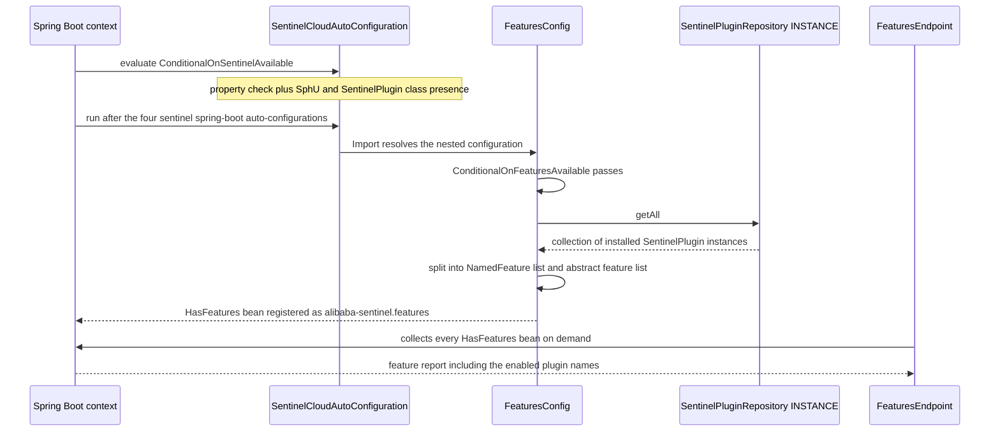
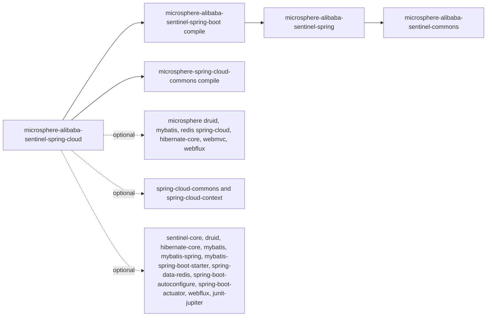

# microsphere-alibaba-sentinel-spring-cloud — 开发者指南

[English](../microsphere-alibaba-sentinel-spring-cloud.md)

## 目的与范围

`microsphere-alibaba-sentinel-spring-cloud` 是该库最薄的一层。在
`release` 分支上它只贡献一个自动配置类、一个注册文件和
一个测试：

| 构件 | 内容 |
|---|---|
| `SentinelCloudAutoConfiguration` | 声明在 `io.microsphere.alibaba.sentinel.spring.cloud` |
| `SentinelCloudAutoConfiguration.FeaturesConfig` | 持有 feature bean 的嵌套配置 |
| `META-INF/spring/org.springframework.boot.autoconfigure.AutoConfiguration.imports` | 单行，指名 `SentinelCloudAutoConfiguration` |
| `SentinelCloudAutoConfigurationTest` | 断言 features 端点的 `@SpringBootTest` |

在 `microsphere-alibaba-sentinel-spring-boot` 之上唯一新增的行为是 **Spring Cloud
特性上报**：发布一个类型为 `org.springframework.cloud.client.actuator.HasFeatures` 的
`alibaba-sentinel.features` bean，使 Spring Cloud 的
`FeaturesEndpoint` 能列出每个已安装且已启用的 Sentinel 插件。

已对照源码核实，明确不在范围内：本模块**没有**声明任何 bootstrap
`ApplicationContext` 贡献，**没有**使用 `RefreshScope` 或 `@RefreshScope`，没有 `ContextRefresher`
钩子，没有 `spring.factories` 文件，也没有配置属性绑定。所有刷新感知或 bootstrap 感知能力都来自宿主库的
同级 Spring Cloud 模块（`microsphere-alibaba-druid-spring-cloud`、`microsphere-mybatis-spring-cloud`、
`microsphere-redis-spring-cloud`），本模块只是把自己的执行顺序排在它们之后。

## 架构

对仓库的读取是一次只读遍历：`INSTANCE.getAll()` 返回的是同一次上下文中较早由四个 Boot
自动配置所创建的插件集合。

## 源码分析

### 类结构

`SentinelCloudAutoConfiguration` 携带三个注解，自身没有字段也没有方法：

- `@ConditionalOnSentinelAvailable` — 复用 spring-boot 模块的条件，即
  `microsphere.sentinel.enabled` 不能为 `false`，并且 `com.alibaba.csp.sentinel.SphU` 与
  `io.microsphere.alibaba.sentinel.common.SentinelPlugin` 都必须可加载。
- `@AutoConfigureAfter(name = {...})`，含九个名称：`com.alibaba.cloud.sentinel.custom.SentinelAutoConfiguration`、
  Druid、MyBatis 与 Redis 的三个 Microsphere Cloud 自动配置、来自
  `microsphere-spring-cloud-commons` 的 `ConfigurationPropertyHasFeaturesAutoConfiguration`，
  以及四个 `microsphere-alibaba-sentinel-spring-boot` 自动配置。使用类名而不是 `Class`
  字面量，是为了在这些可选库缺失时排序依然保持声明式有效。
- `@Import(SentinelCloudAutoConfiguration.FeaturesConfig.class)`。

嵌套的 `FeaturesConfig` 是 `public static` 的，并标注了来自
`io.microsphere.spring.cloud.client.condition` 的 `@ConditionalOnFeaturesAvailable`。它暴露常量
`BEAN_NAME = "alibaba-sentinel.features"`。

### feature bean 生成算法

`features()` 是唯一的 `@Bean` 方法：

1. 读取 `SentinelPluginRepository.INSTANCE`。
2. 调用 `getAll()` 获取每个已安装的 `SentinelPlugin`。
3. 对每个插件询问 `isEnabled()`；已启用的插件变成
   `new NamedFeature(plugin.getName(), plugin.getClass())` 并加入 `namedFeatures`。
4. 已禁用的插件不按名称上报；它们的 `Class` 对象被收集进
   `abstractFeatures`，这是 `HasFeatures` 对“存在但不可激活”特性的约定。
5. 返回 `new HasFeatures(abstractFeatures, namedFeatures)`。

两个列表都由 `ListUtils.newLinkedList()` 创建。这里没有 `@ConditionalOnMissingBean`，因此
重复的 bean 名会发生冲突；下游应用应按名称而不是按类型来覆盖。

由于该 bean 只被物化一次，上报内容是仓库在 feature bean 创建那一刻的快照 — 这正是九个
`@AutoConfigureAfter` 名称的意义所在：它们把本自动配置推到最后，从而保证所有插件 bean 都已实例化。

### 仓库间接层

`SentinelPluginRepository.INSTANCE` 通过
`loadFirstService(SentinelPluginRepository.class, true)` 加载。commons jar 附带
`META-INF/services/io.microsphere.alibaba.sentinel.common.SentinelPluginRepository`，其内容为
`io.microsphere.alibaba.sentinel.jmx.JMXSentinelPluginRepository`，所以本模块读取到的“注册表”
就是 JMX 实现。它是一个装饰器：`install` 会在 `io.microsphere.sentinel` 域下，以
`type=SentinelPlugin,name=<plugin>` 的对象名模式，为 `SentinelPlugin`
接口注册一个 `StandardMBean`，然后转发给内部的
`SimpleSentinelPluginRepository`；`getAll` 查询已注册的 MBean 名称，一个都没有时返回空
列表，否则返回被装饰对象的集合。`clear` 遍历查询到的每个名称并逐个卸载。该类实现 `Prioritized`，
`DEFAULT_PRIORITY` 为 9；由于服务文件只声明了这一个实现，它就被解析为单例，只有当某个使用者贡献第二个服务条目时，
优先级才会真正起作用。对本模块的最终影响是：插件列表同样可以用标准 JMX 工具查看。

### 测试

`SentinelCloudAutoConfigurationTest` 以 `webEnvironment = NONE`、
`@EnableAutoConfiguration` 启动，并带上属性 `spring.application.name=test-app` 与
`management.endpoints.web.exposure.include=features`。它自动装配 `Map<String, HasFeatures>` 和
`FeaturesEndpoint`，断言 bean 名常量等于 `alibaba-sentinel.features`，断言
map 中存在该键，并断言 `featuresEndpoint.features()` 不为 null。与 spring-boot 模块不同，这里没有
条件反向测试：跳过行为继承自 `@ConditionalOnSentinelAvailable`，并由 spring-boot 的测试覆盖。

## 设计模式

| 模式 | 在本模块中的实现 |
|---|---|
| 自动配置 | 通过 `AutoConfiguration.imports` 注册一个类；顺序由九个 `@AutoConfigureAfter` 名称保证 |
| 条件 | 类上使用 `@ConditionalOnSentinelAvailable`，嵌套配置上使用 `@ConditionalOnFeaturesAvailable` — 两者都是组合式元注解条件，没有自定义 `Condition` 子类 |
| 外观 | `features()` 把整个插件子系统呈现为一条 Spring Cloud actuator 特性记录；调用方从不接触插件类型 |
| 注册表 | 读取 commons 的 `SentinelPluginRepository` 单例，其底层为 `JMXSentinelPluginRepository`，由 spring-boot 层的插件构造器填充 |
| 创建时快照 | 上报在工厂方法内部计算完成，因此 `@AutoConfigureAfter` 的排序是该模式正确性的一部分 |

## 核心流程

## 依赖

| 分组 | 坐标 | 作用域 |
|---|---|---|
| 项目，必选 | `microsphere-alibaba-sentinel-spring-boot` | compile，版本 `${revision}` |
| 项目，必选 | `microsphere-spring-cloud-commons` | compile，版本来自 `microsphere-spring-cloud-dependencies` 0.2.26 |
| 项目，可选 | `microsphere-alibaba-druid-spring-cloud`、`microsphere-hibernate-core`、`microsphere-mybatis-spring-cloud`、`microsphere-redis-spring-cloud`、`microsphere-spring-boot-webmvc`、`microsphere-spring-boot-webflux` | compile，optional |
| 第三方，可选 | `sentinel-core`、`druid`、`hibernate-core`、`mybatis`、`mybatis-spring`、`mybatis-spring-boot-starter`、`spring-data-redis`、`spring-cloud-commons`、`spring-cloud-context`、`spring-boot-autoconfigure`、`spring-boot-actuator`、`spring-boot-starter-webflux`、`junit-jupiter` | compile，optional |
| 测试 | `assertj-core`、`spring-test`、`spring-boot-test`、`spring-boot-starter-web`、`microsphere-spring-test`、`microsphere-alibaba-druid-spring-test`、`microsphere-hibernate-test`、`microsphere-mybatis-spring-test`、`microsphere-redis-spring-test`、`h2`、`lettuce-core`、`commons-pool2` | test |

`HasFeatures`、`NamedFeature` 与 `FeaturesEndpoint` 都位于
`spring-cloud-commons` 的 `org.springframework.cloud.client.actuator` 包中。该条目被声明为
`optional`，这只阻止 Maven 把它传递给使用者 — 该库仍在本模块自身的编译与测试 classpath 上，
这就是测试可以自动装配 `FeaturesEndpoint`，而消费本构件的应用必须自带 `spring-cloud-commons` 的原因。

需要注意，六个 Sentinel 插件构件并**不**在此直接声明 — 它们从 spring-boot 依赖传递到达
classpath，因此本模块无需重复那份列表也能看到 `SentinelPlugin`
实现。

## 扩展点

| 需求 | 做法 |
|---|---|
| 把新插件上报为特性 | 只要插件实现 `SentinelPlugin` 并由某个自动配置构造出来，这里就无需任何改动；它会自动出现在 `getAll()` 中 |
| 保证新的自动配置被统计到 | 把其全限定名追加到 `SentinelCloudAutoConfiguration` 的 `@AutoConfigureAfter` 列表 |
| 禁用 feature bean | 设置 `microsphere.sentinel.enabled=false`，或移除 `spring-cloud-commons`，或使 `@ConditionalOnFeaturesAvailable` 落入否定分支 |
| 替换 feature bean | 声明一个名为 `alibaba-sentinel.features` 的自己的 bean；这里没有 `@ConditionalOnMissingBean` 保护，因此按常规的 bean 覆盖规则，后定义的生效 |
| 改变“已禁用”的含义 | commons 中的 `SentinelPlugin.isEnabled()`，当前由 `SentinelUtils.isPluginEnabled` 与 Java 系统属性 `microsphere.sentinel.<plugin>.enabled` 解析 |
| 发布该构件 | 它已在 [./microsphere-alibaba-sentinel-dependencies.md](./microsphere-alibaba-sentinel-dependencies.md) 中受管；版本来自 [./microsphere-alibaba-sentinel-parent.md](./microsphere-alibaba-sentinel-parent.md) |

## 相关模块

- 开发者指南索引：[./README.md](./README.md)
- 下一层：[./microsphere-alibaba-sentinel-spring-boot.md](./microsphere-alibaba-sentinel-spring-boot.md)
- 它所读取的插件注册表：[./microsphere-alibaba-sentinel-commons.md](./microsphere-alibaba-sentinel-commons.md)
- Spring classpath 基座：[./microsphere-alibaba-sentinel-spring.md](./microsphere-alibaba-sentinel-spring.md)
- 聚合插件：[./microsphere-alibaba-sentinel-plugins.md](./microsphere-alibaba-sentinel-plugins.md)
- 版本管理：[./microsphere-alibaba-sentinel-parent.md](./microsphere-alibaba-sentinel-parent.md)、[./microsphere-alibaba-sentinel-dependencies.md](./microsphere-alibaba-sentinel-dependencies.md)
- 面向用户的文档：[../../user-guide/current/zh/microsphere-alibaba-sentinel-spring-cloud.md](../../../user-guide/current/zh/microsphere-alibaba-sentinel-spring-cloud.md)

---

## English

[English 版本](../microsphere-alibaba-sentinel-spring-cloud.md)
