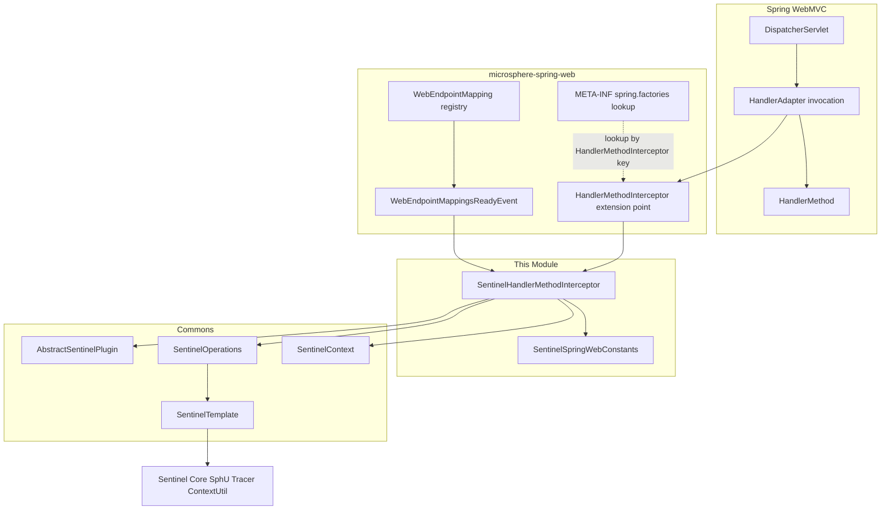
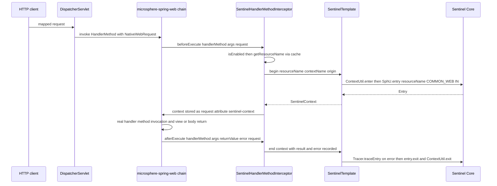
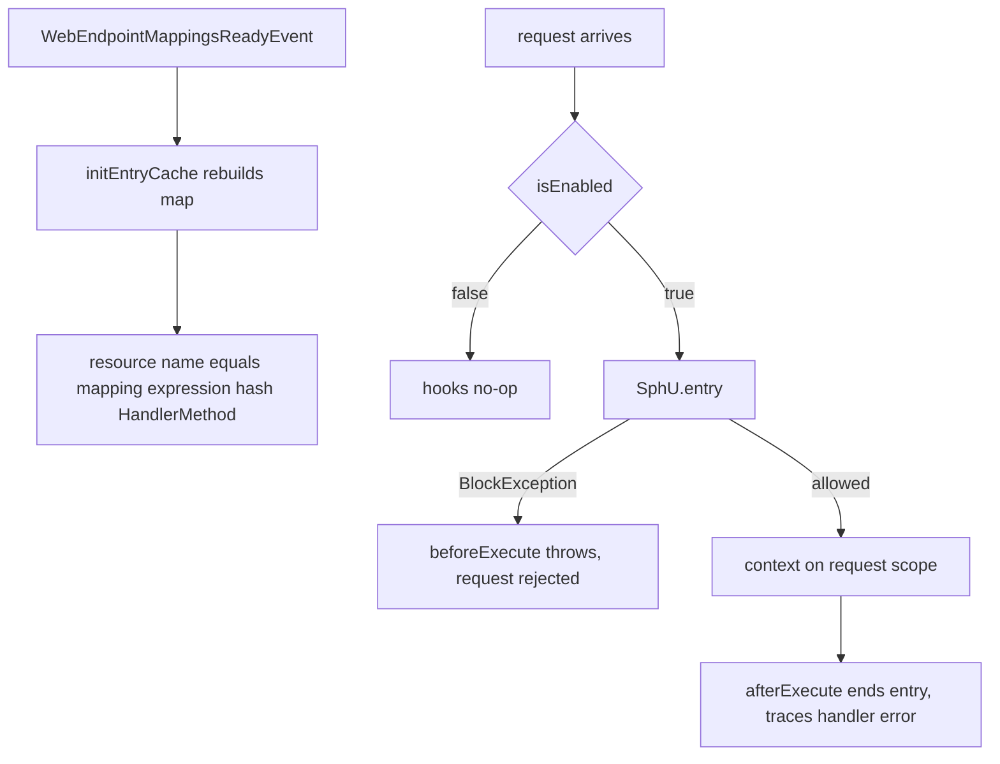
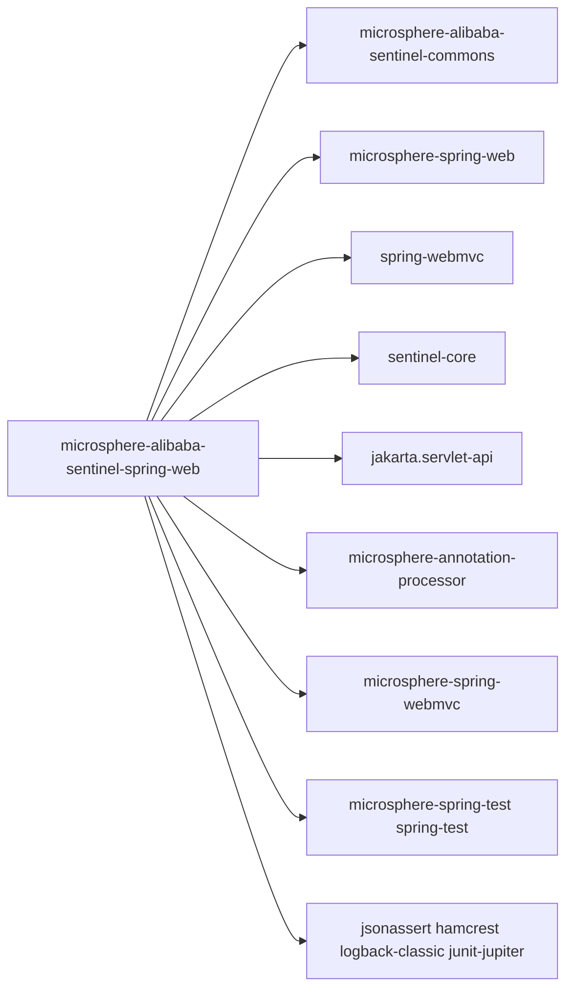

# microsphere-alibaba-sentinel-spring-web — 开发者指南

[English](../microsphere-alibaba-sentinel-spring-web.md)

## 目的与范围

本模块将 Alibaba Sentinel 的流量控制应用到 Spring WebMVC 的处理器方法（handler method）上。
`SentinelHandlerMethodInterceptor` 实现了同级项目 `microsphere-spring-web` 中的
`io.microsphere.spring.web.method.support.HandlerMethodInterceptor` 扩展点，在每次 `HandlerMethod`
分发的前后包裹一个 Sentinel entry。资源名以请求映射表达式加处理器方法作为键，并在端点映射就绪时预先计算好。

本文涵盖：

- 作用于 `HandlerMethod` 分发的 `beforeExecute`/`afterExecute` 拦截配对。
- 通过 `NativeWebRequest` 属性传递请求作用域的 `SentinelContext`。
- 构建资源名缓存的 `WebEndpointMappingsReadyEvent` 监听器。
- `META-INF/spring.factories` 注册了什么，以及本分支向 jakarta.servlet 的对齐。

发布线事实：0.2.x、Java 17、Spring Boot 3.x 世代（`sentinel-core` 1.8.10）；
pom 将 Servlet API 固定为 `jakarta.servlet:jakarta.servlet-api` 且作用域为 `provided`，
与 Spring Framework 6 的 `jakarta` 命名空间保持一致。

## 架构



## 源码分析

### `io.microsphere.alibaba.sentinel.spring.web.SentinelHandlerMethodInterceptor`

声明为
`public class SentinelHandlerMethodInterceptor extends AbstractSentinelPlugin implements HandlerMethodInterceptor, ApplicationListener<WebEndpointMappingsReadyEvent>, Ordered`.

字段与常量：

- `public static final String BEAN_NAME = "sentinelHandlerMethodInterceptor"` — 由测试断言验证。
- `private final SentinelOperations sentinelOperations;`
- `private int order;` 与 `private Map<Method, String> methodResourceNamesCache;`

构造器：

- `public SentinelHandlerMethodInterceptor()` — `this(DEFAULT_CONTEXT_NAME, DEFAULT_ORIGIN)`。
- `public SentinelHandlerMethodInterceptor(String contextName, String origin)` —
  `super(PLUGIN_NAME, contextName, origin, COMMON_WEB)`；四参数的 `AbstractSentinelPlugin`
  形式会设置 `resourceType = ResourceTypeConstants.COMMON_WEB`、`trafficType = EntryType.IN`、
  `autoInstalled = true`（自我安装进 `SentinelPluginRepository.INSTANCE`，并在关闭钩子中卸载）。随后执行
  `new SentinelTemplate(getResourceType(), getTrafficType())` 以及
  `this.setOrder(DEFAULT_PRIORITY)`（9）。

拦截钩子：

- `public void beforeExecute(HandlerMethod handlerMethod, Object[] args, NativeWebRequest request) throws Exception` —
  当 `isEnabled()` 为真时：`resourceName = getResourceName(handlerMethod)`；
  `sentinelOperations.begin(resourceName, getContextName(), getOrigin())` 依次执行
  `ContextUtil.enter` 与 `SphU.entry(resourceName, COMMON_WEB, IN)`；`BlockException` 会从该钩子中
  向外传播并中止处理器调用。随后该上下文通过 `setSentinelContext(context, request)` 存入请求。
- `public void afterExecute(HandlerMethod handlerMethod, Object[] args, Object returnValue, Throwable error, NativeWebRequest request)` —
  当 `isEnabled()` 为真时：`getSentinelContext(request)`；若不存在，则输出 trace 级日志并返回。否则执行
  `context.setResult(returnValue).setFailure(error)` 与 `sentinelOperations.end(context)`，后者在
  已记录错误时调用 `Tracer.traceEntry(error, entry)`，然后调用 `entry.exit()` 与
  `ContextUtil.exit()`。

请求作用域载体（属性名 `sentinel-context` 来自 commons 的 `SentinelConstants`）：

- `public static void setSentinelContext(@Nonnull SentinelContext context, @Nonnull NativeWebRequest request)` —
  即 `REQUEST.setAttribute(request, SENTINEL_CONTEXT_ATTRIBUTE_NAME, context)`，使用的是
  `io.microsphere.spring.web.util.WebScope.REQUEST`。
- `@Nonnull public static SentinelContext getSentinelContext(NativeWebRequest request)` —
  即 `REQUEST.getAttribute(request, SENTINEL_CONTEXT_ATTRIBUTE_NAME)`。

事件驱动的缓存构建：

- `public void onApplicationEvent(WebEndpointMappingsReadyEvent event)` — 调用 `initEntryCache(event)`。
- `protected void initEntryCache(WebEndpointMappingsReadyEvent event)` — 重建一个全新的
  `newFixedHashMap`，容量按 `event.getMappings()` 设定；对每个 `getEndpoint()` 为 `HandlerMethod`
  的 `WebEndpointMapping`，把 `buildResourceName(handlerMethod, webEndpointMapping)`
  以 `handlerMethod.getMethod()` 作为键缓存起来。
- `protected String buildResourceName(HandlerMethod handlerMethod, WebEndpointMapping webEndpointMapping)` —
  返回 `webEndpointMapping.toExpression() + "#" + handlerMethod`。
- `public String getResourceName(HandlerMethod handlerMethod)` —
  `methodResourceNamesCache.computeIfAbsent(method, m -> PLUGIN_NAME + ":" + handlerMethod)`；未命中的
  方法仍会获得一个以 `spring-web:` 为前缀的非空兜底名称。
- `public int getOrder()` / `public void setOrder(int order)` — 可变的 `Ordered` 支持。

### `io.microsphere.alibaba.sentinel.spring.web.SentinelSpringWebConstants`

由 `SentinelSpringWebConstantsTest` 断言：

- `String PLUGIN_NAME = "spring-web"`。
- `String DEFAULT_CONTEXT_NAME = "microsphere_sentinel_spring_web_context"`。
- `String DEFAULT_ORIGIN = "HandlerMethod"`。
- `String ENABLED_PROPERTY_NAME = "microsphere.sentinel.spring-web.enabled"` — 带有
  `SYSTEM_PROPERTIES_SOURCE` 与 `APPLICATION_SOURCE` 的 `@ConfigurationProperty`；
  `SentinelUtils.isPluginEnabled` 读取 JVM 系统属性，默认为 `true`，并在
  `AbstractSentinelPlugin` 构造器中只求值一次。

### `META-INF/spring.factories`

该文件只包含一条映射 — 即 microsphere-spring-web 的拦截器查找键，**不是**
Spring Boot 自动配置键：

```
io.microsphere.spring.web.method.support.HandlerMethodInterceptor=\
io.microsphere.alibaba.sentinel.spring.web.SentinelHandlerMethodInterceptor
```

### 测试

`SentinelHandlerMethodInterceptorTest` 继承 `AbstractWebMvcTest`，并在
`@WebAppConfiguration @SpringJUnitConfig(classes = {SentinelHandlerMethodInterceptor.class, test})
@EnableWebMvc @EnableWebMvcExtension(registerHandlerInterceptors = true)` 下运行 — 由
microsphere-spring-webmvc 扩展把拦截器链注册进 MVC 调用流程。

- `testConstants()` — 断言 `BEAN_NAME` 等于 `sentinelHandlerMethodInterceptor`。
- `test()` — 调用继承而来的 mock-MVC 用例 `testHelloWorld()` 与 `testGreeting()`，随后
  `postTest()` 进入 `microsphere_sentinel_spring_web_context`/`HandlerMethod`，并断言入口节点
  存在子节点（基于映射的资源已被注册）。
- `testDisabled()` — `setEnabled(false)`，在无保护的情况下重放相同请求，然后重新启用。
- `testAfterExecuteWithoutSentinelContext()` — 调用 `afterExecute(null, null, null, null,
  MockServletWebRequest)`；不抛异常，且 `getSentinelContext(request)` 保持为 `null`。

## 设计模式

- **责任链 / 装饰器钩子**：`HandlerMethodInterceptor`（来自 microsphere-spring-web）
  在 Spring WebMVC 分发内部装饰 `HandlerMethod` 的调用，并按 `Ordered`（9）排序。
- **观察者**：`ApplicationListener<WebEndpointMappingsReadyEvent>` 在端点映射就绪时重建资源名缓存。
- **模板方法**：entry 机制集中封装在 `SentinelOperations`/`SentinelTemplate` 中；
  继承 `AbstractSentinelPlugin` 提供启用状态与插件元数据。
- **缓存 / 记忆化**：`methodResourceNamesCache` 以 `java.lang.reflect.Method` 为键，并通过
  `computeIfAbsent` 提供兜底。
- **属性黑板**：`SentinelContext` 通过 `NativeWebRequest` 的请求作用域
  （`WebScope.REQUEST`）从前置钩子传递给后置钩子，避免 `ThreadLocal` 耦合。

## 核心流程

### 处理器方法保护流程



### 映射就绪缓存构建与限流拒绝路径



## 依赖



| 依赖 | pom 中的作用域 |
|---|---|
| io.github.microsphere-projects:microsphere-annotation-processor | compile, optional |
| io.github.microsphere-projects:microsphere-alibaba-sentinel-commons | compile |
| io.github.microsphere-projects:microsphere-spring-web | compile, optional |
| com.alibaba.csp:sentinel-core | compile, optional |
| org.springframework:spring-webmvc | compile, optional |
| jakarta.servlet:jakarta.servlet-api | provided |
| org.junit.jupiter:junit-jupiter | test |
| ch.qos.logback:logback-classic | test |
| io.github.microsphere-projects:microsphere-spring-webmvc | test |
| io.github.microsphere-projects:microsphere-spring-test | test |
| org.springframework:spring-test | test |
| org.skyscreamer:jsonassert | test |
| org.hamcrest:hamcrest | test |

## 扩展点

- **自定义资源命名**：继承并覆写 `buildResourceName(HandlerMethod, WebEndpointMapping)`
  （例如去掉 `HandlerMethod` 后缀），或者通过 `initEntryCache` 整体替换该映射表。
- **排序**：`setOrder(int)` 调整拦截器在处理器拦截器链中的位置；默认值为
  `DEFAULT_PRIORITY` 9。
- **上下文/来源**：`(contextName, origin)` 构造器；在 Spring Boot 中，
  `SentinelSpringWebAutoConfiguration` 以 `@Bean @ConditionalOnMissingBean` 声明
  `sentinelHandlerMethodInterceptor()`，并受 `@ConditionalOnWebApplication(type = ANY)`、
  `@ConditionalOnSentinelAvailable` 和 `@ConditionalOnProperty(ENABLED_PROPERTY_NAME, matchIfMissing = true)` 约束 —
  注册你自己的 bean 即可接管。
- **开关**：运行时 `setEnabled(false)`，或设置 `microsphere.sentinel.spring-web.enabled=false`
  （在构造时刻读取的 JVM 系统属性）。
- **注册**：其他 `HandlerMethodInterceptor` 实现可以发布在同一个
  `META-INF/spring.factories` 键之下。

## 相关模块

- 开发者指南索引：[README](./README.md)
- [microsphere-alibaba-sentinel-commons](./microsphere-alibaba-sentinel-commons.md) — `AbstractSentinelPlugin`、
  `SentinelOperations`、`SentinelTemplate`、`SentinelContext`、`SentinelConstants`。
- [microsphere-alibaba-sentinel-spring-boot](./microsphere-alibaba-sentinel-spring-boot.md) —
  `SentinelSpringWebAutoConfiguration`。
- [microsphere-alibaba-sentinel-spring-cloud](./microsphere-alibaba-sentinel-spring-cloud.md) — 基于 Spring Cloud Alibaba Sentinel
  构建的 Cloud 层协同。
- 用户指南对应文档：[../../user-guide/current/zh/microsphere-alibaba-sentinel-spring-web.md](../../../user-guide/current/zh/microsphere-alibaba-sentinel-spring-web.md)

---

## English

[English 版本](../microsphere-alibaba-sentinel-spring-web.md)
