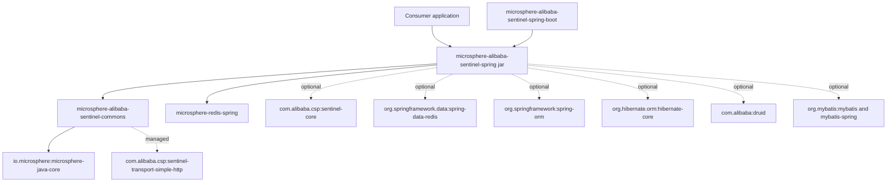
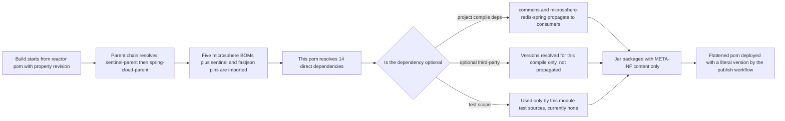
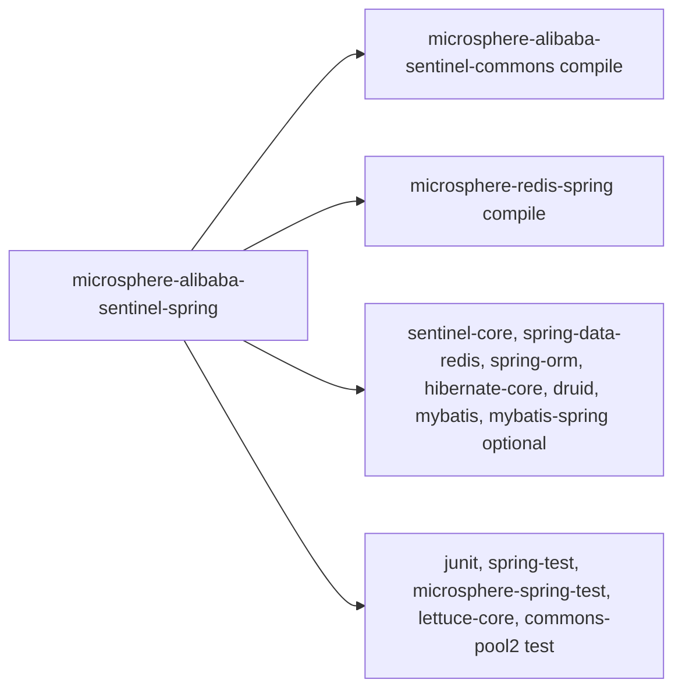

# microsphere-alibaba-sentinel-spring — 开发者指南

[English](../microsphere-alibaba-sentinel-spring.md)

## 目的与范围

`microsphere-alibaba-sentinel-spring` 是 Microsphere Alibaba Sentinel 库的 Spring 层聚合模块。
在 `release` 分支上它被声明为 `<packaging>jar</packaging>`，但模块目录中只有 `pom.xml`：既没有
`src/main/java`，也没有 `src/test/java` 和资源目录。因此 0.2.x 线发布的构件只包含一个几乎为空的
jar — `META-INF/MANIFEST.MF`、内嵌的 Maven pom 以及一条 `git.properties` 条目，仅此而已。

该模块作为一个**依赖契约**而存在，而非代码：

- 它为普通 Spring Framework 应用提供单一 Maven 坐标，一次性引入 Sentinel 核心 API 以及
  Sentinel 插件所要增强的 Spring 侧库（`spring-data-redis`、`spring-orm`、`hibernate-core`、
  `druid`、`mybatis`、`mybatis-spring`）。
- 它声明每个 Spring 使用者都必须的两个传递依赖：
  `microsphere-alibaba-sentinel-commons`（插件模型）与 `microsphere-redis-spring`
  （Redis 命令拦截器扩展点）。
- 它是 `microsphere-alibaba-sentinel-spring-boot` 的直接父级依赖，后者在其之上叠加了自动配置层。

本指南面向需要理解“为什么要发布一个空 jar”、以及需要修改该模块依赖面的开发者。

## 架构

只有两条实线项目边会传递到使用者侧。所有第三方边在 pom 中都标记了
`<optional>true</optional>`，因此 Maven 在这一点终止传递性：使用者必须自己引入想要被增强的库。
虚线的 commons 边声明在 commons 的 pom 中而非此处，列出它们是为了解释 `commons` 会带入什么。

## 源码分析

### pom 结构分析

| 章节 | 内容 | 说明 |
|---|---|---|
| `parent` | `microsphere-alibaba-sentinel-parent`，`relativePath ../microsphere-alibaba-sentinel-parent/pom.xml` | 通过导入的 BOM 提供所有第三方版本 |
| `version` | `${revision}` | 根 pom 将 `revision` 设为 `0.2.6-SNAPSHOT`；CI 会覆盖它 |
| `packaging` | `jar` | 即使没有源码也会产出真实构件 |
| `name` / `description` | `Microsphere :: Alibaba Sentinel :: Spring` | reactor 命名约定 |
| `dependencies` | 2 个项目依赖 + 7 个可选第三方依赖 + 5 个测试依赖 | 第三方条目不带 `<version>` |
| `build` | 不存在 | 没有插件定制，也没有需要编译的源码目录 |

所声明的依赖分为三块，由 pom 注释 `Microsphere Sentinel Core`、`Third-Party Dependencies`
和 `Testing` 分隔：

1. 必选项目依赖：`microsphere-alibaba-sentinel-commons`（显式写 `${revision}`）与
   `microsphere-redis-spring`（省略版本）。
2. 可选能力依赖：`sentinel-core`、`spring-data-redis`、`spring-orm`、
   `hibernate-core`、`druid`、`mybatis`、`mybatis-spring`。
3. test 作用域依赖：`junit` 4、`spring-test`、`microsphere-spring-test`、
   `lettuce-core`、`commons-pool2` — 目前因为没有测试源码而未被使用，但保留它们是为了
   日后该模块可以重新承载 Spring XML 集成测试。

### 为什么存在一个空 jar

- **单一坐标。** 非 Boot 的 Spring 应用通过一个 `<dependency>` 就能得到一致的 classpath，
  而不必重新声明 Redis、ORM 与连接池库。
- **版本仲裁集中在一处。** 这里没有任何第三方依赖携带版本；父 pom 导入了
  `microsphere-spring-cloud-dependencies`、`microsphere-redis-dependencies`、
  `microsphere-hibernate-dependencies`、`microsphere-mybatis-dependencies` 和
  `microsphere-alibaba-druid-dependencies`，因此本模块不可能与它们产生漂移。
- **为 Boot 模块提供稳定的依赖目标。** `microsphere-alibaba-sentinel-spring-boot`
  以 `${revision}` 依赖本构件，因此 Spring 层能力只需声明一次。
- **用 optional 充当特性开关。** 把第三方条目标记为 optional 意味着本模块永远不会把
  Druid、MyBatis 或 Hibernate 强加到 classpath 上；某个类是否存在，正是 Boot 条件稍后要探测的内容。

### 模块不包含的内容

没有 `spring.factories`，没有 `AutoConfiguration.imports`，没有 SPI 服务文件。自动配置位于
`microsphere-alibaba-sentinel-spring-boot`；插件实现位于
`microsphere-alibaba-sentinel-plugins/*`。

## 设计模式

由于该模块没有代码，下面列出的是结构性（pom 层）模式；而行为型模式 —
注册表（`SentinelPluginRepository`）、外观（`SentinelTemplate`）、策略与模板方法 —
属于 commons，记录在
[./microsphere-alibaba-sentinel-commons.md](./microsphere-alibaba-sentinel-commons.md)。

| 模式 | 适用位置 | 证据 |
|---|---|---|
| Bill-of-Materials 式聚合 | 一个坐标发布一致的 Spring classpath | `<packaging>jar</packaging>` 而源码缺失 |
| 可选依赖 / 能力门控 | 被增强的库对使用者是自选的 | 7 条 `<optional>true</optional>` 条目 |
| 无版本声明 | 所有第三方版本都从导入的 BOM 解析 | 除两条项目条目外没有 `<version>` |
| 对内部实现的分层外观 | 使用者依赖 Spring，而不是直接依赖 commons | `microsphere-alibaba-sentinel-spring-boot` 引入本构件 |

## 核心流程

本模块内部没有运行时流程。真正重要的流程是 Maven 依赖解析，以及产出该构件的发布流水线。

打包仍会执行标准的 `maven-jar-plugin` 目标，这就是发布出一个为空但合法 jar 的原因；
若使用 `<packaging>pom</packaging>`，该模块就无法作为 classpath 条目被消费。

## 依赖

| 坐标 | 声明的作用域 | 是否 optional | 版本解析 |
|---|---|---|---|
| `io.github.microsphere-projects:microsphere-alibaba-sentinel-commons` | compile | 否 | 在本 pom 中内联写 `${revision}` |
| `io.github.microsphere-projects:microsphere-redis-spring` | compile | 否 | `microsphere-redis-dependencies` 0.2.14，由父 pom 导入 |
| `com.alibaba.csp:sentinel-core` | compile | 是 | 父 pom 属性 `sentinel.version` = 1.8.10 |
| `org.springframework.data:spring-data-redis` | compile | 是 | 经由 `microsphere-spring-cloud-dependencies` 0.2.26 的 Spring Boot 依赖链 |
| `org.springframework:spring-orm` | compile | 是 | 同一条依赖链 |
| `org.hibernate.orm:hibernate-core` | compile | 是 | `microsphere-hibernate-dependencies` 0.2.10 |
| `com.alibaba:druid` | compile | 是 | `microsphere-alibaba-druid-dependencies` 0.2.20 |
| `org.mybatis:mybatis` | compile | 是 | `microsphere-mybatis-dependencies` 0.2.16 |
| `org.mybatis:mybatis-spring` | compile | 是 | `microsphere-mybatis-dependencies` 0.2.16 |
| `junit:junit` | test | 否 | 由父 pom 链统一管理 |
| `org.springframework:spring-test` | test | 否 | 由父 pom 链统一管理 |
| `io.github.microsphere-projects:microsphere-spring-test` | test | 否 | 由 `microsphere-spring-cloud-dependencies` 统一管理 |
| `io.lettuce:lettuce-core` | test | 否 | 由 `microsphere-redis-dependencies` 统一管理 |
| `org.apache.commons:commons-pool2` | test | 否 | 由父 pom 链统一管理 |

整个仓库的父 pom 声明 `java.version` 为 17，因此构件以 `--release 17` 构建；
CI 矩阵还会在 Java 21 与 25 上额外编译和测试。

## 扩展点

| 任务 | 做法 |
|---|---|
| 新增一个被增强的能力 | 在此追加一条 `<optional>true</optional>` 依赖，在 `microsphere-alibaba-sentinel-plugins` 下添加对应插件，然后在 Boot 模块中加入 `SentinelXxxAutoConfiguration` |
| 修改受管版本 | 在 [./microsphere-alibaba-sentinel-parent.md](./microsphere-alibaba-sentinel-parent.md) 中编辑版本属性；绝不要在本 pom 里添加 `<version>` |
| 让本模块向下游传递某个库 | 去掉 `<optional>true</optional>` — 这是一个破坏性决策，因为每个使用者都会继承该库 |
| 发布新的项目构件 | 把该坐标加入 [./microsphere-alibaba-sentinel-dependencies.md](./microsphere-alibaba-sentinel-dependencies.md) |
| 下游覆盖已解析的版本 | 用你自己的版本显式声明该依赖；直接声明优先于传递声明，而你自己的 `dependencyManagement` 条目优先于导入的 BOM |
| 把代码搬回本模块 | 创建 `src/main/java/io/microsphere/alibaba/sentinel/spring/...`；构建无需改动 pom，因为没有任何插件配置 |

## 相关模块

- 开发者指南索引：[./README.md](./README.md)
- 本模块向 Spring 应用暴露的能力：[./microsphere-alibaba-sentinel-commons.md](./microsphere-alibaba-sentinel-commons.md)
- 构建在其上的自动配置：[./microsphere-alibaba-sentinel-spring-boot.md](./microsphere-alibaba-sentinel-spring-boot.md)
- Spring Cloud 层：[./microsphere-alibaba-sentinel-spring-cloud.md](./microsphere-alibaba-sentinel-spring-cloud.md)
- 被增强的插件：[./microsphere-alibaba-sentinel-plugins.md](./microsphere-alibaba-sentinel-plugins.md)
- 版本管理：[./microsphere-alibaba-sentinel-parent.md](./microsphere-alibaba-sentinel-parent.md)、[./microsphere-alibaba-sentinel-dependencies.md](./microsphere-alibaba-sentinel-dependencies.md)
- 面向用户的文档：[../../user-guide/current/zh/microsphere-alibaba-sentinel-spring.md](../../../user-guide/current/zh/microsphere-alibaba-sentinel-spring.md)

---

## English

[English 版本](../microsphere-alibaba-sentinel-spring.md)
