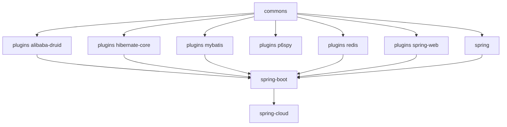

# 用户指南 — 1.x（release-1.x 分支，0.1.x）

[English](../README.md) · [用户指南总目录](../../zh/README.md)

这些文档介绍基于 `release-1.x` 分支构建的制品，即 Microsphere Alibaba Sentinel 的 `0.1.x`
版本线，面向遗留的 Java 8 / Spring Boot 2.x 应用持续维护。

## 版本信息

| 项目                       | 值                                                           |
|----------------------------|--------------------------------------------------------------|
| 源码分支              | `release-1.x`                                                |
| 已发布版本          | `0.1.0` – `0.1.5`（分支修订号：`0.1.6-SNAPSHOT`）        |
| Java 运行时               | 8                                                            |
| Spring Boot / Cloud        | 2.x / Hoxton – 2021.0.x                                      |
| Alibaba Sentinel           | `sentinel-core` 1.8.10                                       |
| Microsphere BOM 基线  | spring-cloud 0.1.26 · druid 0.1.20 · mybatis 0.1.15 · hibernate 0.1.9 · redis 0.1.13 |

## 模块文档

| 模块                                               | 适用于                                                          |
|----------------------------------------------------|-------------------------------------------------------------------|
| [parent](microsphere-alibaba-sentinel-parent.md)   | 版本属性、导入的第三方 BOM                     |
| [dependencies](microsphere-alibaba-sentinel-dependencies.md) | 消费方项目的 BOM 导入                          |
| [commons](microsphere-alibaba-sentinel-commons.md) | 核心 API：`SentinelPlugin`、`SentinelOperations`、`SentinelContext`、`SentinelTemplate`、插件注册表 |
| [plugins](microsphere-alibaba-sentinel-plugins.md) | 六个插件的概览                                       |
| [alibaba-druid](microsphere-alibaba-sentinel-alibaba-druid.md) | 针对 JDBC 语句的 Druid `Filter` 保护       |
| [hibernate-core](microsphere-alibaba-sentinel-hibernate-core.md) | Hibernate 实体操作保护               |
| [mybatis](microsphere-alibaba-sentinel-mybatis.md) | MyBatis `Executor` 保护                                     |
| [p6spy](microsphere-alibaba-sentinel-p6spy.md)    | 通过 P6Spy 实现的 JDBC 语句保护                           |
| [redis](microsphere-alibaba-sentinel-redis.md)    | Spring Data Redis 命令保护                              |
| [spring-web](microsphere-alibaba-sentinel-spring-web.md) | Spring Web MVC 处理器方法保护                    |
| [spring](microsphere-alibaba-sentinel-spring.md)  | 面向原生 Spring 应用的依赖聚合              |
| [spring-boot](microsphere-alibaba-sentinel-spring-boot.md) | 通过 `META-INF/spring.factories` 实现的自动配置、条件注解与属性 |
| [spring-cloud](microsphere-alibaba-sentinel-spring-cloud.md) | Spring Cloud 集成                        |

## 与 current 版本线的差异

两条版本线的 Java 源码几乎完全一致，差异都来自环境层面：

- 自动配置通过 Spring Boot 2.x 的 `META-INF/spring.factories` 注册。
- Servlet API 基线为 `javax.servlet`，Hibernate 解析到 `org.hibernate.orm` 之前的坐标。
- Microsphere 配套 BOM 与 fastjson 锁定的版本比 `0.2.x` 版本线低一个次版本。

## 模块依赖关系

## 配套文档集

同一分支的源码级分析位于
[开发者指南 · 1.x 分支](../../../developer-guide/1.x/zh/README.md)。使用当前版本线的用户应改读
[0.2.x 用户指南](../../current/zh/README.md)。

---

## English

[English 版本](../README.md)
