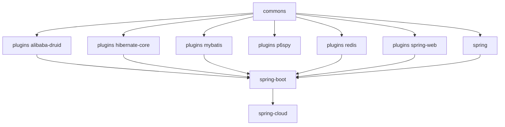

# User Guide — current (release branch, 0.2.x)

[中文版](zh/README.md) · [User Guide home](../README.md)

These documents describe the artifacts built from the `release` branch — the `0.2.x` line of Microsphere Alibaba
Sentinel.

## Version information

| Item                       | Value                                                        |
|----------------------------|--------------------------------------------------------------|
| Source branch              | `release`                                                    |
| Released versions          | `0.2.0` – `0.2.5` (branch revision: `0.2.6-SNAPSHOT`)        |
| Java runtime               | 17                                                           |
| Spring Boot / Cloud        | 3.x / 2022.0.x – 2025.0.x                                    |
| Alibaba Sentinel           | `sentinel-core` 1.8.10                                       |
| Microsphere BOM baselines  | spring-cloud 0.2.26 · druid 0.2.20 · mybatis 0.2.16 · hibernate 0.2.10 · redis 0.2.14 |

## Module documents

| Module                                             | Read it for                                                       |
|----------------------------------------------------|-------------------------------------------------------------------|
| [parent](microsphere-alibaba-sentinel-parent.md)   | Version properties, imported third-party BOMs                     |
| [dependencies](microsphere-alibaba-sentinel-dependencies.md) | BOM import for consumer projects                          |
| [commons](microsphere-alibaba-sentinel-commons.md) | Core API: `SentinelPlugin`, `SentinelOperations`, `SentinelContext`, `SentinelTemplate`, plugin registry |
| [plugins](microsphere-alibaba-sentinel-plugins.md) | Overview of the six plugins                                       |
| [alibaba-druid](microsphere-alibaba-sentinel-alibaba-druid.md) | Druid `Filter` protection for JDBC statements       |
| [hibernate-core](microsphere-alibaba-sentinel-hibernate-core.md) | Hibernate entity-operation protection               |
| [mybatis](microsphere-alibaba-sentinel-mybatis.md) | MyBatis `Executor` protection                                     |
| [p6spy](microsphere-alibaba-sentinel-p6spy.md)    | JDBC statement protection through P6Spy                           |
| [redis](microsphere-alibaba-sentinel-redis.md)    | Spring Data Redis command protection                              |
| [spring-web](microsphere-alibaba-sentinel-spring-web.md) | Spring Web MVC handler-method protection                    |
| [spring](microsphere-alibaba-sentinel-spring.md)  | Dependency aggregation for plain Spring applications              |
| [spring-boot](microsphere-alibaba-sentinel-spring-boot.md) | Auto-configuration, `@ConditionalOnSentinel*` annotations, `microsphere.sentinel.*` properties |
| [spring-cloud](microsphere-alibaba-sentinel-spring-cloud.md) | Spring Cloud actuator feature reporting               |

## Module dependencies

## Companion set

The matching source-level analysis lives in the
[Developer Guide for the current branch](../../developer-guide/current/README.md). The legacy line is documented in
the [1.x User Guide](../1.x/README.md).

---

## 中文

[当前版本用户指南（中文版）](zh/README.md)
