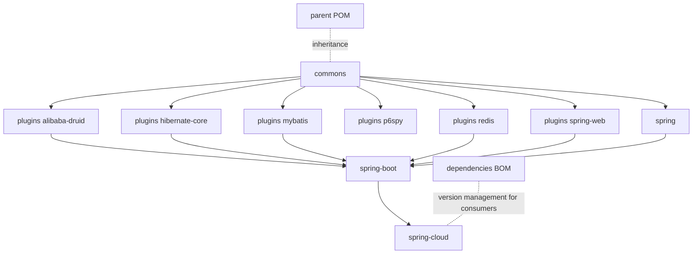

# Microsphere Alibaba Sentinel — 文档

[English](../README.md)

本目录收录 [Microsphere Alibaba Sentinel](https://github.com/microsphere-projects/microsphere-alibaba-sentinel)
的完整文档集。该项目是 [Alibaba Sentinel](https://github.com/alibaba/Sentinel) 与常见 Java
基础设施组件（Spring Web、Druid、Hibernate、MyBatis、P6Spy、Spring Data Redis）之间的集成层。

文档仅面向两个持续维护的发布分支编写：

| 文档目录 | 源码分支 | 版本线 | 目标平台                              |
|----------------|---------------|---------------|----------------------------------------------|
| `current/`     | `release`     | `0.2.x`       | Java 17、Spring Boot 3.x、Spring Cloud 2022.0.x – 2025.0.x |
| `1.x/`         | `release-1.x` | `0.1.x`       | Java 8、Spring Boot 2.x、Spring Cloud Hoxton – 2021.0.x    |

## 文档集

| 文档集                                             | 适用读者     | 内容                                                                         |
|----------------------------------------------------|----------------|------------------------------------------------------------------------------|
| [用户指南](../user-guide/zh/README.md)                 | 应用开发者 | 逐模块的 API 参考、安装方式、配置属性、改编自项目自身测试用例的代码示例、版本与兼容性信息 |
| [开发者指南](../developer-guide/zh/README.md)       | 贡献者 / 扩展作者 | 逐模块的架构设计、源码分析、设计模式，以及复杂流程的 Mermaid 流程图/时序图 |

每个文档集都按发布分支（`current` 与 `1.x`）各设一个目录，分支目录内每个 Maven 模块对应一篇
Markdown 文档。中文译文位于并行的 `zh/` 目录中，文件名保持一致；每个页面都链接到自己的对应版本。

## 模块一览

每篇文档在两个指南、两个分支、两种语言下都存在。

| Maven 模块（`io.github.microsphere-projects`）      | 角色                                                          |
|------------------------------------------------------|---------------------------------------------------------------|
| `microsphere-alibaba-sentinel-parent`                | 父 POM：版本属性与第三方 BOM 导入                            |
| `microsphere-alibaba-sentinel-dependencies`          | 管理本项目全部已发布制品的 BOM                                |
| `microsphere-alibaba-sentinel-commons`               | 核心 API：`SentinelPlugin`、`SentinelOperations`、`SentinelContext`、`SentinelTemplate`、插件注册表、SPI、JMX、事件 |
| `microsphere-alibaba-sentinel-plugins`               | 六个 Sentinel 插件的聚合 POM                                  |
| `microsphere-alibaba-sentinel-alibaba-druid`         | Druid 过滤器插件（JDBC 语句保护）                            |
| `microsphere-alibaba-sentinel-hibernate-core`        | Hibernate 实体回调插件                                        |
| `microsphere-alibaba-sentinel-mybatis`               | MyBatis Executor 过滤器插件                                   |
| `microsphere-alibaba-sentinel-p6spy`                 | P6Spy JDBC 事件监听器插件                                     |
| `microsphere-alibaba-sentinel-redis`                 | Spring Data Redis 命令拦截器插件                              |
| `microsphere-alibaba-sentinel-spring-web`            | Spring Web MVC 处理器方法拦截器插件                          |
| `microsphere-alibaba-sentinel-spring`                | 面向原生 Spring 用法的依赖聚合模块                            |
| `microsphere-alibaba-sentinel-spring-boot`           | 插件与条件注解的 Spring Boot 自动配置                         |
| `microsphere-alibaba-sentinel-spring-cloud`          | 基于 Boot 模块的 Spring Cloud 特性上报                        |

## 模块依赖关系

## 源码对比

按 Maven 模块逐一比较各 tag 之间 `src/main` 与 `src/test` 内容的对比文档位于
[`diff/source/`](../diff/source/)。文档已排除 Java 8 与 Java 17 的语法/API 差异、Java EE 与 Jakarta EE API 差异，
表格中仅保留真正的实现差异及其原因说明。

| 版本对 | `src/main` 对比 | `src/test` 对比 |
|---|---|---|
| `0.1.5` vs `0.2.5`（最新两个 tag，Java 8 线 vs Java 17 线） | [main-diff-0.1.5-vs-0.2.5.zh.md](../diff/source/main-diff-0.1.5-vs-0.2.5.zh.md) · [English](../diff/source/main-diff-0.1.5-vs-0.2.5.md) | [test-diff-0.1.5-vs-0.2.5.zh.md](../diff/source/test-diff-0.1.5-vs-0.2.5.zh.md) · [English](../diff/source/test-diff-0.1.5-vs-0.2.5.md) |

## 按角色快速开始

- 初次接触本库 → [用户指南 · current 分支](../user-guide/current/zh/README.md)，建议从
  [commons](../user-guide/current/zh/microsphere-alibaba-sentinel-commons.md) 开始。
- 维护遗留的 Java 8 / Spring Boot 2.x 应用 → [用户指南 · 1.x 分支](../user-guide/1.x/zh/README.md)。
- 阅读或扩展源码 → [开发者指南 · current 分支](../developer-guide/current/zh/README.md)。
- 理解 0.1.x 版本线的内部实现 → [开发者指南 · 1.x 分支](../developer-guide/1.x/zh/README.md)。

---

## English

[English 版本](../README.md) · [返回仓库根目录 README](../../README.md)
